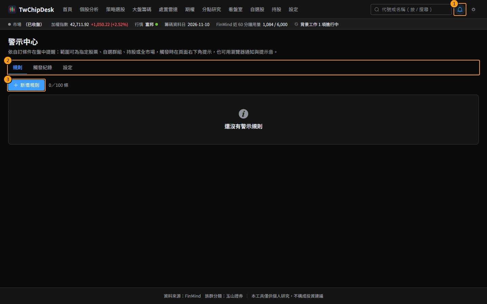
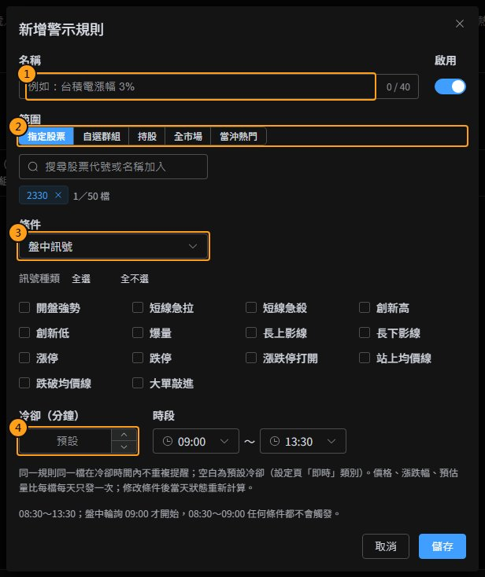
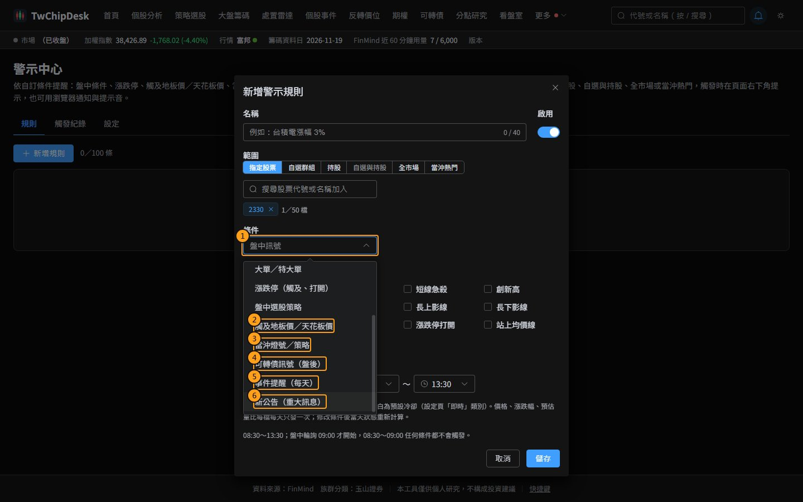
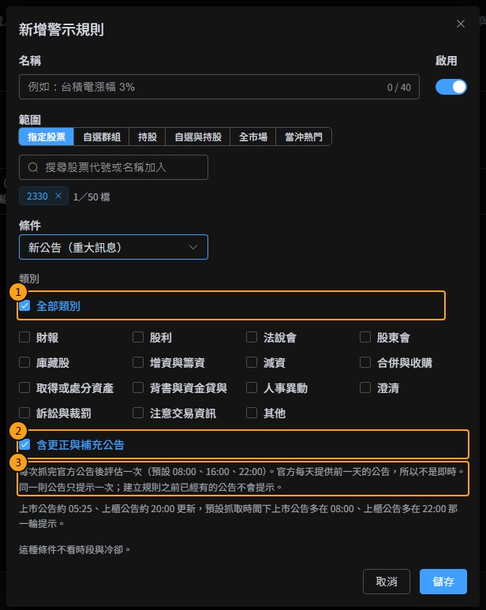
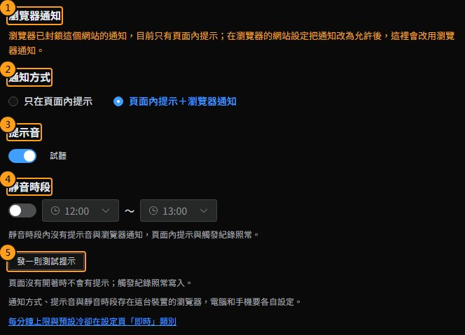

<!-- routes: /alerts, /alerts?tab=rules, /alerts?tab=log, /alerts?tab=settings -->
# 警示中心

> 位置：頂部右上角的鈴鐺（網址 `/alerts`）；手機同樣在頂部的鈴鐺。分頁：「規則」（`?tab=rules`，預設）、「觸發紀錄」（`?tab=log`）、「設定」（`?tab=settings`）。個股頁頁首與自選股群組列的「新增警示」會開啟新增表單並帶入股票或群組
> 資料更新：盤中每一輪股票快照之後評估一次（與「即時訊號」同一節奏，「漲跌停（觸及、打開）」也是）；「盤中選股策略」條件每 1 分鐘執行一次；「觸及地板價／天花板價」「當沖燈號／策略」在事件發生時評估；「可轉債訊號」在每個交易日晚上可轉債主力動態算完後評估一次；「事件提醒」每天 08:00 評估一次；「新公告（重大訊息）」每次抓完官方公告後評估一次（預設 08:00、16:00、22:00）。觸發時立即推送到開著的頁面

## 這個功能可以做什麼
自己設定要留意的條件，例如「台積電漲幅達 3%」「自選群組出現短線急拉」「持股出現特大單」「自選股觸及漲停或漲停打開」「持股觸及地板價」「自選股 3 個交易日內除息」「自選與持股有新的法說會公告」，條件成立時在頁面右下角跳出提示，也可以加上提示音與瀏覽器通知。範圍可以是指定股票、自選群組、持股、自選與持股、全市場或當沖熱門；每一次觸發都寫入觸發紀錄，可以事後依日期、規則、股票查詢。

提示的文字只描述發生了什麼（例如「2330 台積電 漲幅達 3.05%（09:12:05，現價 1,085）」），不含任何判斷。

## 畫面說明

| 編號 | 名稱 | 說明 |
|---|---|---|
| 1 | 鈴鐺 | 在每一頁的右上角，紅色數字為未讀的觸發則數（超過 99 顯示「99+」）。點一下開啟警示中心。 |
| 2 | 頁面分頁 | 「規則」「觸發紀錄」「設定」。 |
| 3 | 「新增規則」 | 開啟新增表單；旁邊顯示目前的規則數與上限（100 條）。有規則時另有搜尋框（「搜尋名稱、條件或股票代號」），依名稱、範圍與條件的文字或指定股票的代號篩選清單，不分大小寫；沒有符合時顯示說明。 |
| 4 | 規則清單 | 每條規則的「啟用」開關、「名稱」「範圍」「條件」「時段」（下方是冷卻）、「今天」觸發次數（點次數開啟這條規則今天的觸發紀錄）、「最近觸發」時間，以及「編輯」「重設今天」「刪除」。 |

按「刪除」會先開確認框，裡面有「一併刪除這條規則的紀錄（N 筆）」可以勾選（N 是這條規則目前所有日期的紀錄筆數；沒有紀錄時不能勾選）。不勾選時規則刪除、紀錄保留；勾選時規則與它的紀錄一起刪除，無法復原。

## 新增與編輯規則

| 編號 | 名稱 | 說明 |
|---|---|---|
| 1 | 名稱與啟用 | 名稱 1～40 字；關閉「啟用」的規則不評估。 |
| 2 | 範圍 | 「指定股票」（搜尋加入，最多 50 檔）、「自選群組」（可複選，最多 20 個，取聯集）、「持股」（持股頁目前持有的股票）、「自選與持股」（持股加上全部自選群組，之後新增的群組也自動包含；只用於「新公告（重大訊息）」，其他條件時這個選項是灰色的）、「全市場」、「當沖熱門」（與當沖監控燈號表的熱門範圍相同，盤中隨時變動）。自選群組與持股的內容變動約 1 分鐘內生效。 |
| 3 | 條件 | 十二種擇一，見下表。範圍為「全市場」時只能選「盤中訊號」「盤中選股策略」「漲跌停（觸及、打開）」「觸及地板價／天花板價」「可轉債訊號（盤後）」；範圍為「當沖熱門」時只能選「當沖燈號／策略」；範圍為「自選與持股」時只能選「新公告（重大訊息）」。 |
| 4 | 冷卻與時段 | 「冷卻（分鐘）」0～240，空白為預設冷卻（設定頁「即時」類別，預設 10 分鐘）；「時段」08:30～13:30，預設 09:00～13:30；盤中輪詢 09:00 才開始，所以 08:30～09:00 任何條件都不會觸發。「可轉債訊號」「事件提醒」「新公告（重大訊息）」不看時段與冷卻，表單不顯示這兩欄；「漲跌停（觸及、打開）」「觸及地板價／天花板價」不看冷卻。 |

### 條件

| 編號 | 名稱 | 說明 |
|---|---|---|
| 1 | 「條件」 | 點開選單，十二種擇一（「漲跌停（觸及、打開）」在「大單／特大單」下方）；選單可捲動，下方五種是「觸及地板價／天花板價」「當沖燈號／策略」「可轉債訊號（盤後）」「事件提醒（每天）」「新公告（重大訊息）」。範圍不支援的條件顯示為灰色、不能選。 |
| 2 | 「觸及地板價／天花板價」 | 見下表。 |
| 3 | 「當沖燈號／策略」 | 見下表。 |
| 4 | 「可轉債訊號（盤後）」 | 見下表。 |
| 5 | 「事件提醒（每天）」 | 見下表。 |
| 6 | 「新公告（重大訊息）」 | 見下表與下方「新公告的參數」。 |

| 條件 | 參數 | 什麼時候提示 | 重複提示 |
|---|---|---|---|
| 「盤中訊號」 | 「訊號種類」1～14 種 | 與「即時訊號」頁同一套偵測：開盤強勢、短線急拉、短線急殺、創新高、創新低、爆量、長上影線、長下影線、漲停、跌停、漲跌停打開、站上均價線、跌破均價線、大單敲進。 | 冷卻（同一規則同一檔，不分訊號種類）。 |
| 「價格穿越」 | 方向、「價格（元）」 | 「向上達到（≥）」：現價 ≥ 指定價；「向下達到（≤）」：現價 ≤ 指定價。 | 每檔每天一次。 |
| 「漲跌幅穿越」 | 方向、「漲跌幅（%）」 | 漲跌幅＝（現價 − 參考價）÷ 參考價 × 100，與報價相同。跌 2% 填 -2；範圍 -20～20。 | 每檔每天一次。 |
| 「預估量比（估）」 | 「預估量 ÷ 5 日均量（倍）」0.5～50 | 預估量（估，與預估量頁相同）÷ 前 5 日均量達到倍數。09:10 以前不判斷（開盤時預估量偏差大）；沒有 5 日均量的股票不判斷。 | 每檔每天一次。 |
| 「大單／特大單」 | 「大單種類」、「單筆金額至少（萬元）」（可空白） | 這一輪的最後一筆成交符合該股的大單或特大單門檻（與分價量的大單小單相同）；有填金額時另需單筆金額達到。每一輪快照只看得到最後一筆成交，兩輪之間的其他成交看不到；每檔當天第一次觀察只當基準，不判斷；13:25 以後（收盤集合競價，13:30 一次撮合）不判斷；處置股分盤撮合期間不判斷；同一筆成交只算一次。 | 冷卻。 |
| 「漲跌停（觸及、打開）」 | 「細項」可複選：觸及漲停、漲停打開、觸及跌停、跌停打開（預設勾觸及漲停、觸及跌停；都不勾＝四種全部；範圍為全市場時至少選一種） | 每一輪股票快照之後比較：當天最高價第一次 ≥ 漲停價為「觸及漲停」；已觸及漲停後現價 < 漲停價為「漲停打開」；最低價第一次 ≤ 跌停價為「觸及跌停」；已觸及跌停後現價 > 跌停價為「跌停打開」。漲跌停價與即時報價畫面相同（當日漲跌停價資料，沒有時以昨收計算）；無漲跌幅限制（興櫃、槓桿與反向 ETF 等）或除權息等事件日沒有漲跌停價時不判斷。09:00 以前不判斷。範圍可為指定股票、自選群組、持股、全市場。 | 每檔每個細項每天一次（打開後再鎖住、再打開也不再提示）。只提示規則建立之後、時段之內才發生的：盤中才新建規則、修改條件、「重設今天」或時段較晚開始（例如 10:00）時，之前已觸及或已打開的股票不補發。 |
| 「盤中選股策略」 | 「選股策略」（我的策略或內建策略） | 交易日今天有即時報價後，以盤中模式每 1 分鐘執行一次，這次符合、上一次不符合的股票算新符合（當天第一次執行時全部符合的都算）。這種規則最多 5 條。 | 冷卻；離開後再次符合會再提示。 |
| 「觸及地板價／天花板價」 | 「觸及哪一邊」（地板價、天花板價）、「昨日盤後分類」（近於地板、小於地板、近於天花板、大於天花板；可不選，範圍為全市場時至少選一種） | 盤中第一次觸及今日地板價（天花板價，估）時，與[反轉價位｜盤中監控](../reversal/live.md)的「首次觸及時間」同一時刻。選了分類時，只有昨日盤後清單是那幾類的股票才提示。 | 每檔每邊每天一次。 |
| 「當沖燈號／策略」 | 「燈號（亮起）」（12 個燈號，可複選）、「策略（符合）」（1～16，可複選）、「每檔每燈每天最多（則）」1～5（預設 1） | 當沖監控盤中產生燈號亮起或策略符合時，與[當沖監控｜流水牆](../daytrade/stream.md)同一個事件。範圍可為指定股票、自選群組、持股、當沖熱門。 | 每檔每個燈號（策略）每天最多設定的則數，兩則之間另受冷卻。 |
| 「可轉債訊號（盤後）」 | 「訊號」三選一：「套利價差低於門檻」（另填「扣成本價差 ≤（%，估）」，預設 -1，範圍 -20～5）、「券償暴增」、「融券暴增」 | 每個交易日晚上可轉債主力動態算完後（排程 22:40 起）評估一次。券償暴增、融券暴增與[可轉債｜訊號](../cb/signals.md)相同；扣成本價差與[可轉債｜套利](../cb/arbitrage.md)的歷史機會統計相同（負值為折價；當天不可轉換、沒有成交的可轉債不算；同一標的取最低的一檔）。範圍可為指定股票、自選群組、持股、全部有可轉債的股票（全市場）。 | 同一資料日每檔一次。 |
| 「事件提醒（每天）」 | 「事件種類」（除權息、月營收公布）、「未來幾個交易日內」1～20（預設 3） | 每天 08:00（非交易日也一樣）以[個股事件｜行事曆](../events/calendar.md)評估一次，事件日在今天起 N 個交易日內就提示；除權息含除息、除權、權息同日、ETF 除息。事件日是推估的（例如月營收公布日）會標「估」。範圍可為指定股票、自選群組、持股。 | 同一事件每檔一次（月營收以公布月份算同一事件，推估日改成實際日不再提示）。 |
| 「新公告（重大訊息）」 | 「類別」（15 類可複選，預設「全部類別」）、「含更正與補充公告」（預設勾選） | 每次抓完官方公告後（預設 08:00、16:00、22:00，非交易日也一樣）評估一次，只看那一輪新寫入的[重大訊息](../events/material.md)；類別與[個股事件｜重大訊息](../events/material.md)相同。官方每天提供前一天的公告，所以不是即時：上市公告約 05:25、上櫃公告約 20:00 更新，預設抓取時間下上市公告多在 08:00、上櫃公告多在 22:00 那一輪提示。範圍可為指定股票、自選群組、持股、自選與持股。 | 同一則公告只提示一次（跨規則也只一次）。 |

- **每檔每天一次**：價格穿越、漲跌幅穿越、預估量比每檔每天只提示一次；「重設今天」之後同一天可以再提示一次。修改規則的條件或參數時視同重設；只改名稱、啟用、範圍、冷卻或時段時狀態保留。「漲跌停（觸及、打開）」重設或修改條件之後，只有之後才發生的觸及、打開會提示（例如之前已打開、再鎖住後又打開），重設之前已經觸及的不會再以現在的時間提示一次。
- **08:30～09:00**：盤中輪詢 09:00 才開始，這段時間任何條件都不會觸發。
- **盤中才開機或重新啟動**：開機後第一次看到的股票，價格穿越、漲跌幅穿越、預估量比、漲跌停（觸及、打開）如果當下已經成立，只當基準，記為今天已提示、不再提示；「重設今天」之後同一天可以再提示一次（漲跌停只限重設之後才發生的）。
- 選擇的策略已刪除或無法執行時，儲存會顯示錯誤。
- **可轉債訊號與事件提醒的「一次」跨日計算**：之前幾天已提示過的同一資料日訊號、同一事件不再提示；這是從觸發紀錄判斷的，刪除那些紀錄（或超過保存天數）後同一事件可能再提示一次。「重設今天」之後也會再提示一次。
- **事件提醒在 08:00 以後才開機**時，開機後約 1 分鐘內補評估一次。
- **新公告不補發**：只提示每一輪新寫入的公告；建立規則之前已經在庫裡的公告、規則停用期間寫入的公告都不會提示。同一則公告提示過後，「重設今天」、刪除紀錄、重新建立規則都不會讓它再提示。開機時剛好錯過的那一輪公告（公告已寫入、還沒評估就關機）也不補提示，仍可在重大訊息頁、首頁今日清單與盤前摘要看到。
- 新規則提示的例子：「2330 台積電 觸及漲停 1,100（09:10:00，現價 1,100，漲跌幅 +10%）」「2330 台積電 漲停打開（漲停價 1,100，09:20:00，現價 1,095，漲跌幅 +9.5%）」「2330 台積電 觸及地板價 501（估）（09:31:05，價格 500，漲跌幅 -3.2%）」「2330 當沖燈號「外盤連攻」亮起（09:20:00，現價 100，漲跌幅 +2.5%）」「2330 台積電 券償暴增：現券償還 300 張（2026-11-12，前 20 日平均 40 張）」「2317 月營收公布日 2026-11-17（估）（3 個交易日後）」「2330 台積電 新公告［法說會］公告本公司將召開法人說明會（發言 11-13 17:05）」。新公告的提示只有類別與主旨（公司公告原文），不含說明內文。

### 新公告的參數

| 編號 | 名稱 | 說明 |
|---|---|---|
| 1 | 「類別」 | 勾「全部類別」或勾選其中幾類；勾滿 15 類等於全部類別，之後新增的類別也自動包含。 |
| 2 | 「含更正與補充公告」 | 取消勾選時，主旨含「更正」或「補充」的公告不提示。 |
| 3 | 說明 | 評估時機與「官方每天提供前一天的公告」的限制。官方開放資料事件來源尚未開啟時多一行「官方開放資料事件來源尚未開啟（設定頁「補充來源」區塊的「官方開放資料事件來源」），這條規則不會觸發。」與「前往設定」（直接跳到該區塊）；規則照樣可以建立。 |

## 觸發紀錄

| 編號 | 名稱 | 說明 |
|---|---|---|
| 1 | 篩選 | 「日期」（預設今天）、「規則」、「股票」（輸入代號後按 Enter）。篩選寫在網址（例如 `/alerts?tab=log&date=2026-11-11&rule=7&stock=2330`），可以加書籤。 |
| 2 | 「全部標為已讀」 | 把所有日期的未讀紀錄標為已讀，鈴鐺的數字歸零。沒有未讀時按鈕停用。 |
| 3 | 紀錄表 | 「時間」「規則」「股票」「內容」「價格」「漲跌幅」，由新到舊，每頁 50 則。未讀的列加底色並標「未讀」。點一下某一列（包括點列上的股票連結）只把那一則標為已讀；單純開啟這一頁或用網址帶入篩選不會改變已讀狀態。「新公告」的股票連結開啟[個股分析｜公告](../stock/material.md)並直接打開那一則的說明。 |
| 4 | 「刪除紀錄」 | 開啟刪除對話框，見下方「刪除紀錄」。 |
| 5 | 保存天數 | 「紀錄保存 N 天（日曆日）…」，N 是設定頁「即時」類別的「觸發紀錄保存天數」。 |

- 「只記錄」：全部規則合計每分鐘最多即時提示 10 則（設定頁「即時」類別可改；盤後的可轉債訊號、08:00 的事件提醒與新公告也算在內）。同一分鐘內超過時，依序為範圍「指定股票」、範圍「持股」、每檔每天一次的條件、範圍「自選群組」與「自選與持股」、全市場「盤中選股策略」、全市場「盤中訊號」的規則先提示（同一順位依規則建立的先後）；其餘仍寫入紀錄並標「只記錄」，下一分鐘會有一則合併提示，例如「09:12 另有 5 則提示（已記入紀錄）」；收盤那一分鐘被合併的則數，約在那一分鐘結束後 2 分鐘內送出最後一則合併提示。
- 「新公告」另有每一輪的上限：一輪最多個別提示 5 則，同一檔最多 1 則（依規則順位、類別順序、發言時間新到舊排列）；其餘照樣每則寫入紀錄並標「只記錄」，下一分鐘併入「另有 N 則提示」。
- 紀錄保存天數預設 30 天（日曆日），可在[設定](../settings.md)頁「即時」類別的 `Alerts:LogKeepDays` 改為 1～365 天；每個交易日 15:55 刪除超過天數的紀錄（非交易日不刪，下一個交易日一併刪除）。
- 刪除規則時預設保留它的紀錄；要一起刪除，在刪除規則的確認框勾選「一併刪除這條規則的紀錄」。

### 刪除紀錄
按紀錄區右上的「刪除紀錄」開啟對話框，「範圍」四選一：

| 範圍 | 刪除哪些紀錄 |
|---|---|
| 「全部紀錄」 | 所有日期、所有規則的紀錄。 |
| 「已讀的紀錄」（預設） | 所有日期中已讀的紀錄；未讀的保留。 |
| 「某條規則的紀錄」 | 選擇的規則所有日期的紀錄。已刪除的規則不在下拉選單中，它留下的紀錄可用「某日以前」或「全部紀錄」刪除。 |
| 「某日以前的紀錄」 | 日期早於選擇那天的紀錄，不含那天。 |

- 選好範圍後對話框先計算筆數並顯示「將刪除 N 筆，無法復原」；沒有符合的紀錄時顯示「沒有符合的紀錄」，「確定刪除」停用。按「確定刪除」後才實際刪除，清單、規則的「今天」次數與鈴鐺的未讀數隨即重新計算。
- 刪除不受上方篩選（日期、規則、股票）影響，只看對話框選的範圍。
- 刪除今天的紀錄不影響今天已發過的冷卻與「每檔每天一次」狀態；但之後系統若在盤中重新啟動，這些狀態是從當天的紀錄恢復的，被刪掉的部分同一天可能再提示一次。

## 設定

| 編號 | 名稱 | 說明 |
|---|---|---|
| 1 | 瀏覽器通知 | 顯示這個瀏覽器目前的狀態，見下方「瀏覽器通知的狀態」。 |
| 2 | 通知方式 | 「只在頁面內提示」或「頁面內提示＋瀏覽器通知」。 |
| 3 | 提示音 | 開關與「試聽」。 |
| 4 | 靜音時段 | 開啟後，時段內沒有提示音與瀏覽器通知，頁面內提示與觸發紀錄照常。 |
| 5 | 「發一則測試提示」 | 由後端推送一則「測試提示」到目前開著的頁面（不寫入紀錄），用來確認提示、提示音與瀏覽器通知。每 10 秒最多一次。 |

**通知方式、提示音與靜音時段存在這台裝置的瀏覽器，電腦和手機要各自設定**（同一台裝置換用另一個瀏覽器也要重新設定）。每分鐘上限、預設冷卻與觸發紀錄保存天數是全系統的設定，在[設定](../settings.md)頁的「即時」類別。

### 瀏覽器通知的狀態
| 畫面文字 | 意思 |
|---|---|
| 「這個網站尚未取得瀏覽器通知的同意。」 | 還沒詢問過。打開頁面時不會跳出詢問；按「允許瀏覽器通知」才會由瀏覽器詢問一次。 |
| 「瀏覽器已允許這個網站顯示通知。」 | 通知方式為「頁面內提示＋瀏覽器通知」時，切到別的分頁或視窗也看得到通知；點通知會回到警示中心的觸發紀錄。 |
| 「瀏覽器已封鎖這個網站的通知，…」 | 只有頁面內提示。要改回，到瀏覽器的網站設定（網址列左邊的圖示）把通知改為允許，回到這個分頁後狀態會更新。 |
| 「這個瀏覽器只有頁面內提示。」 | 這個瀏覽器雖有通知功能，但這個網頁無法顯示（例如手機瀏覽器分頁、或不是 https 開啟）。 |
| 「這個瀏覽器不支援通知，只有頁面內提示。」 | 瀏覽器沒有網頁通知功能。 |

**手機**：Android 與 iPhone 都要先把網站加到主畫面，再從主畫面的圖示開啟（見[手機版](../mobile.md)）；iPhone 需要 iOS 16.4 以上。手機上的通知經由瀏覽器的通知元件顯示，只負責通知、不快取網頁，部署新版後照常更新。手機上能否跳出通知依裝置與系統設定而定。

## 頁面內提示
- 出現在畫面右下角（手機在底部分頁列上方），最多同時 5 則，30 秒後自動關閉；每則可單獨關閉，或按「全部關閉」。
- 上方的鈴鐺圖示切換提示音（與設定分頁的「提示音」相同）；「觸發紀錄」開啟觸發紀錄分頁。
- 點有股票的提示開啟該股的「即時」分頁；「新公告」的提示開啟該股的「公告」分頁並直接打開那一則的說明。

## 注意事項與限制
- 頁面沒有開著時不會有任何提示（沒有手機推播或電子郵件）；觸發照常寫入紀錄，之後開啟時鈴鐺會顯示未讀數。
- 交易日 08:30～13:46（收盤後晚到的提示與合併提示也收得到）且至少有一條啟用的規則時，網頁會維持即時連線以接收提示；在警示中心頁時也會維持。規則讀取失敗時照樣維持，並每 30 秒重試。
- 觸控裝置的網頁切到背景約 1 分鐘後會暫停即時連線，回到前景時才恢復；暫停或斷線期間的觸發只會出現在觸發紀錄，重新連上後鈴鐺的未讀數會重新計算。
- 同時開著多個分頁時，每個分頁都會顯示頁面內提示，但提示音與瀏覽器通知只由其中一個分頁發出；連續多則提示時，提示音 2 秒內最多響一次。
- 規則參照的股票、選股策略或自選群組已不存在（或參數不再符合範圍）時，清單上標「已失效」，這條規則不再觸發。
- 系統盤中重新啟動時，會從當天的紀錄恢復冷卻與「每檔每天一次」的狀態，不會重複提示。
- 評估只使用盤中已在接收的報價與已入庫的資料，不增加任何外部資料請求。
- 「可轉債訊號」晚上 22:40 以後、「事件提醒」08:00、「新公告」在抓取時間（預設 08:00、16:00、22:00）才評估；這些時間多半不在上面的即時連線時段內，頁面沒有連線時只寫入紀錄，鈴鐺顯示未讀數，之後開啟觸發紀錄就看得到。
- 「新公告」需要設定頁「補充來源」區塊的「官方開放資料事件來源」開啟；公告從開啟那天起累積，沒有更早的資料。

## 相關功能
- [策略選股｜即時訊號](../screener/signals.md)
- [反轉價位｜盤中監控](../reversal/live.md)
- [當沖監控｜流水牆](../daytrade/stream.md)
- [可轉債｜訊號](../cb/signals.md)
- [個股事件｜行事曆](../events/calendar.md)
- [個股事件｜重大訊息](../events/material.md)
- [個股分析｜公告](../stock/material.md)
- [自選股](../watchlist.md)
- [持股](../portfolio.md)
- [個股分析](../stock/README.md)
- [設定](../settings.md)
