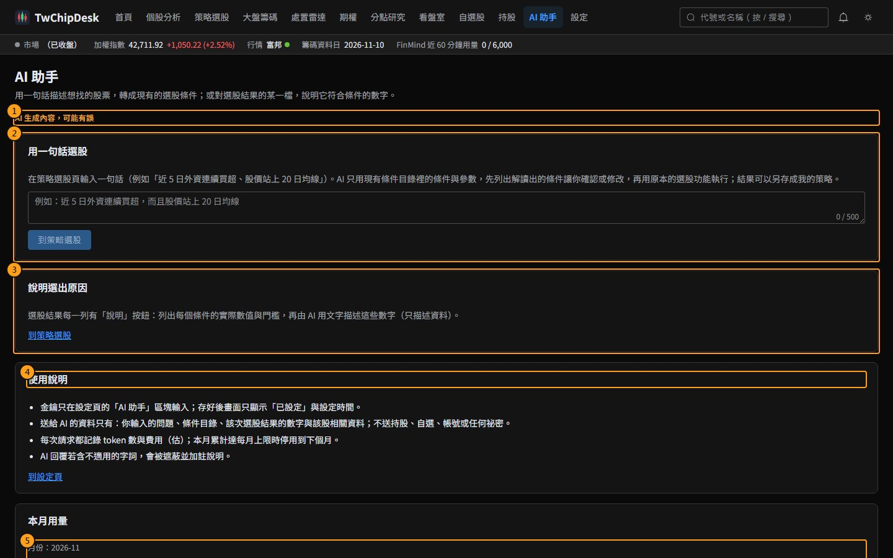

<!-- routes: /assistant -->
# AI 助手

> 位置：頂部選單「AI 助手」（網址 `/assistant`）；手機在底部「更多」裡。實際使用的位置在「策略選股」頁：編輯器上方的「用一句話選股」，以及選股結果每一列的「說明」。模型、金鑰與費用上限在[設定頁](../settings.md#ai-助手)的「AI 助手」區塊
> 資料更新：每次按「解讀條件」或「說明」時即時向 AI 服務（Anthropic）送出一次請求；本月用量在每次請求結束後更新

## 這個功能可以做什麼
用 Claude 模型處理兩件事：

1. **用一句話選股**：輸入一句話（例如「近 5 日投信連續買超、股價站上 20 日均線」），AI 只能用現有[條件總表](../screener/conditions.md)裡的條件與參數範圍，把句子轉成選股條件。畫面先列出「解讀出的條件」與沒有採用的部分，由你確認或修改後，再用原本的選股功能執行；結果可以「另存為我的策略」。
2. **說明選出原因**：對選股結果的某一檔，列出每個條件的實際值與門檻（由選股引擎直接計算，不經 AI），再由 AI 用文字描述這些數字。

畫面上所有 AI 產生的文字都固定標示「AI 生成內容，可能有誤」。AI 只描述資料，不做判讀，也不提供任何操作意見；數字以表格與選股結果為準。

## 畫面說明

| 編號 | 名稱 | 說明 |
|---|---|---|
| 1 | 「AI 生成內容，可能有誤」 | 固定標示。 |
| 2 | 「用一句話選股」 | 輸入問題（最多 500 字）後按「到策略選股」，問題會帶到策略選股頁的輸入框（只填入，不會自動送出；在選股頁按「解讀條件」才會產生費用）。 |
| 3 | 「說明選出原因」 | 說明「說明」按鈕在哪裡、會顯示什麼。 |
| 4 | 「使用說明」 | 金鑰、送出的資料、費用上限與遮蔽的簡短說明，以及「到設定頁」連結。 |
| 5 | 「本月用量」 | 本月的請求數、費用（估）、每月上限與剩餘（估）。 |

金鑰未設定或本月費用（估）已達上限時，頁面上方顯示原因與「到設定頁」連結，輸入框停用。

## 用一句話選股（策略選股頁）

| 編號 | 名稱 | 說明 |
|---|---|---|
| 1 | 輸入框與「解讀條件」 | 輸入一句話後按「解讀條件」（或按 Enter）。解讀中顯示「AI 解讀中…」，可以按「停止」。 |
| 2 | 「AI 補充」 | AI 解讀時的文字（逐段出現）。 |
| 3 | 「解讀出的條件」 | 通過檢查的條件：條件名稱、參數與門檻，寫法和條件編輯器相同，最多 10 條。數值門檻旁有輸入框，確認前可以直接修改（清空時回到原值；「介於」的下限大於上限時不能確認）。標「AI 預設門檻，請確認」的條件是你沒有寫數字、AI 填了常見門檻或參數的條件：改過數值門檻後，沒有參數的條件拿掉標記，有參數（例如天數）的條件改標「參數為 AI 預設，請確認」，參數可以在條件編輯器修改。 |
| 4 | 「沒有採用的部分」 | AI 提出但不在條件目錄、參數不在允許範圍等被剔除的條件與原因，以及 AI 自己說無法對應的句子片段。 |
| 5 | 「確認並執行」／「放進編輯器修改」／「取消」 | 「確認並執行」：條件放進下方的條件編輯器並立即執行選股；「放進編輯器修改」：只放進編輯器，修改後自己按「執行選股」；「取消」：不改編輯器。 |

操作步驟：
1. 在「用一句話選股」輸入想找的條件，按「解讀條件」。
2. 看「解讀出的條件」與「沒有採用的部分」，確認 AI 的解讀是否符合原意。
3. 按「確認並執行」或「放進編輯器修改」。條件放進編輯器後就是一般的未儲存策略，名稱預設為「AI 選股：」加上問題的前 30 字。
4. 需要保留時按「另存為我的策略」。

說明：
- AI 不能自己編造條件：每一條都要通過和條件編輯器相同的檢查（條件在目錄內、參數值在允許的選項內、運算與型別相符）。盤中條件不會被採用。
- 使用者沒寫數字時，AI 會填常見門檻並標「AI 預設門檻，請確認」；請確認或修改門檻後再執行。
- 「沒有採用的部分」每一筆最多 100 字、最多列 10 筆，文字一樣經過不適用字詞的遮蔽。
- 範圍固定為「只看一般股」，放進編輯器後可以在「範圍／排序」修改。
- 沒有任何可用的條件時顯示「沒有解讀出可用的條件」，不能確認。

## 說明選出原因（選股結果的「說明」）

選股結果（盤後模式）每一列最後有「說明」按鈕；盤中模式沒有這個按鈕。

| 編號 | 名稱 | 說明 |
|---|---|---|
| 1 | 「條件的實際值與門檻」 | 由選股引擎直接計算（不經 AI）：資料日、收盤、漲跌幅，這一天整個策略是否成立，以及每個條件的「條件與門檻」「實際值」「成立」。有時間修飾、排名、歷史比較或族群統計的條件另列「原值」；欄位互比另列「比較值」。 |
| 2 | 「AI 說明」 | AI 依上面的數字寫的文字說明，逐段出現；可以按「停止」，出錯或停止後可以按「重試」。 |
| 3 | 標示與用量 | 「AI 生成內容，可能有誤」、遮蔽或拒答等註記，以及本次 token 數與費用（估）。 |

這檔股票不在策略的範圍內（例如範圍排除了 ETF），或那一天沒有這檔股票的選股資料時，表格上方會註明，各條件都不判斷。

## 送出的資料
- 「用一句話選股」：系統提示、選股條件目錄（條件代碼、名稱、分類、型別、單位、參數允許值、列舉值與說明）、你輸入的問題。
- 「說明」：系統提示、策略名稱、資料日、這檔股票的代號、名稱、產業、市場、收盤、漲跌幅、成交量，以及每個條件的設定與這檔股票的實際值（就是對話框上半部的表格）。
- 不送出：持股、自選股、帳號、任何金鑰或設定，以及其他股票的資料。
- 這兩項功能送到你選的 AI 來源（Anthropic、Google 或 OpenAI 相容端點；本機端點則只在這台電腦處理）。

## 費用與上限
- 每次請求都記錄輸入、輸出、快取讀取與快取寫入的 token 數，依設定頁的價格表算出費用（估）；實際費用以 Anthropic 帳單為準。
- 按「停止」、逾時（120 秒）或連線中斷時，AI 服務沒有回報最後的用量，系統以送出的內容與經過時間推估 token 數並照樣記入；「本月用量」下方會註明「其中 N 次因中途停止或中斷，用量為推估」。
- 自訂模型在價格表沒有價格列時，費用以價格表各欄中最高的價格估（保守估計）；「本月用量」下方會註明「N 次以最高價格估」。
- 送出前會先確認「本月已記錄的費用＋進行中的請求＋這次最多可能的費用」不超過每月上限，所以接近上限時也可能先被擋下；每月上限低於單次最多可能的費用時（例如 Opus 5.5 單次約 US$0.3～0.5（估）），每一次送出都會被擋下。
- 本月費用（估）累計達到或接近「每月上限」（預設 US$10）時，AI 功能停用到下個月（以台北時間切月）；在設定頁提高上限後立即恢復。上限設為 0 表示停用。
- 「測試連線」也會記入用量（費用很小）。
- 單次請求最多 16,000 個輸出 token、逾時 120 秒（固定）。

## AI 來源
AI 助手可以使用以下來源之一（設定頁「AI 助手」區塊選擇；一句話選股、說明選出原因與 [AI 每日摘要](briefing.md) 共用目前的來源，每日摘要也可以另外指定）：

| 來源 | 金鑰 | 一句話選股 | 網頁搜尋（每日摘要） | 費用 |
|---|---|---|---|---|
| Claude（Anthropic，預設） | Anthropic API 金鑰 | 可以 | 可以 | 依價格表；網頁搜尋每 1,000 次 US$10（估） |
| Google Gemini | Google AI Studio 的 Gemini API 金鑰 | 可以 | 可以（Google 搜尋） | 依你在設定頁填的價格；沒填價格的模型費用未知 |
| OpenAI 相容（OpenAI、OpenRouter、本機 Ollama／LM Studio） | 該服務的金鑰；本機端點可以不設 | 可以（模型不支援工具時，改成要求 AI 只回文字格式的條件） | 不搜尋 | 依你在設定頁填的價格；本機端點固定 0 |
| Antigravity CLI（實驗） | — | 尚未提供 | 尚未提供 | — |

- 每個來源的金鑰各自保存，只能輸入、不會再顯示，畫面只顯示「已設定」與金鑰末 4 碼；金鑰加密存在這台電腦的資料庫。
- 每個來源都可以「測試連線」：用該來源的金鑰與模型送一個極小的請求（計入用量）。
- Gemini 與 OpenAI 相容的模型清單會向該服務查詢；查不到時可以直接輸入模型代號。
- OpenAI 相容端點的網址預設 `https://api.openai.com/v1`；OpenRouter 例 `https://openrouter.ai/api/v1`，本機 Ollama 例 `http://host.docker.internal:11434/v1`。網址是本機（localhost、127.0.0.1、host.docker.internal）時不需要金鑰、費用記 0。
- 「每月上限」是所有來源合計，只計算有價格的費用；沒有設定價格的模型，那幾次的費用不計入上限，「本月用量」下方會註明「N 次未設定價格，未計入費用」。
- Gemini、OpenAI 相容不使用「思考程度（effort）」設定（用該模型的預設）。
- 模型不支援工具（OpenAI 相容端點關閉工具）而 AI 回的格式無法解讀時，顯示「這個模型無法產生選股條件，請換一個來源或模型」。

## 模型選擇
在設定頁「AI 助手」區塊的「模型」選擇：

| 選項 | 說明 |
|---|---|
| Opus 5.5（預設，最準） | 最準，費用最高。 |
| Sonnet 5.5（平衡） | 準確度與費用居中。 |
| Haiku 5.5（最省） | 費用最低。 |
| 自訂模型代號 | 輸入模型代號（小寫英文、數字、點與連字號，1～100 字）。價格表沒有這個代號時，旁邊提示「自訂模型沒有價格列，費用以價格表中最高的價格估」。 |

每個選項旁顯示費用區間「每問約 US$a～b、每月約 US$c～d」與「估」：以每月 440 次請求、每次約 3,000 輸入 token、27,000 快取 token、3,000 輸出 token 估算（設定頁會列出實際的估算假設）。下限假設每次都命中提示快取（快取 token 以快取讀取價計），上限假設每次都要重新寫入快取（以快取寫入價計）。「思考程度（effort）」可選低、中（預設）、高，程度越高回覆越仔細，token 與費用也越多。

## 金鑰
- Anthropic API 金鑰**只在設定頁的「AI 助手」區塊輸入**：輸入後按「儲存金鑰」，輸入框立即清空；之後畫面只顯示「已設定」與設定時間，不會再顯示金鑰內容。
- 金鑰加密存在這台電腦的資料庫，不會出現在網址、紀錄、錯誤訊息或設定匯出檔中，也不會存在瀏覽器裡。
- 「測試連線」用目前的金鑰與模型送一個極小的請求，顯示成功（模型、回應時間、費用（估））或錯誤原因。
- 「清除金鑰」確認後刪除金鑰，AI 功能停用。

## 錯誤訊息的意思
| 訊息 | 意思 |
|---|---|
| 「尚未設定 AI 金鑰」 | 還沒有在設定頁輸入目前來源的金鑰。 |
| 「AI 來源尚未設定完成」 | 目前來源沒有模型代號、網址不正確，或選了尚未提供的來源。 |
| 「本月 AI 費用已達或接近上限」 | 本月費用（估）已達每月上限、加上這次最多可能的費用會超過上限，或上限設為 0。 |
| 「AI 服務帳戶的額度或付款有問題」 | Anthropic 帳戶的額度用完或付款有問題，要到 Anthropic 的帳戶頁處理。 |
| 「AI 金鑰無效或已撤銷」 | 金鑰打錯、已在 Anthropic 撤銷或過期；重新輸入後按「測試連線」。 |
| 「這把金鑰無法使用這個模型」 | 這把金鑰的帳戶不能使用所選的模型。 |
| 「找不到這個模型代號」 | 自訂模型代號打錯或已停用。 |
| 「AI 服務拒絕這次請求」 | AI 服務不接受這次請求的內容（例如自訂模型不支援這裡用的功能）。 |
| 「AI 服務忙碌，請稍後再試」 | 請求太頻繁，系統已自動重試仍失敗。 |
| 「AI 服務暫時無法使用」 | AI 服務或網路暫時有問題，系統已自動重試仍失敗。 |
| 「AI 回應逾時（120 秒）」 | 超過 120 秒沒有完成。 |
| 「AI 回覆在完成前中斷」 | 連線在回覆完成前中斷，或收到的資料不完整；這次的結果不採用，用量為推估。 |
| 「AI 回覆含不適用字詞，已遮蔽」 | AI 的回覆含有本系統不使用的字詞，這些字已換成「＊」。 |
| 「AI 沒有回覆這個問題，可以換個說法再試一次。」 | AI 拒絕回答這個問題。 |
| 「AI 回覆達長度上限，內容可能不完整。」 | 回覆超過單次上限被截斷。 |

## 注意事項與限制
- AI 的解讀與說明可能有誤；條件請在「解讀出的條件」與條件編輯器中確認，數字以表格與選股結果為準。
- 「說明」只支援盤後結果。
- 每一次「解讀條件」、「說明」、「重試」與「測試連線」都會產生費用（估）。

## 相關功能
- [策略選股｜選股](../screener/screener.md)
- [條件總表](../screener/conditions.md)
- [設定](../settings.md)
- [AI 每日摘要](briefing.md)
