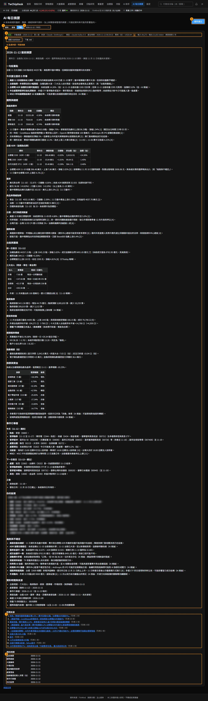

<!-- routes: /assistant/briefing -->
# AI 每日摘要

> 位置：頂部選單「AI 每日摘要」（網址 `/assistant/briefing`）；手機在底部「更多」裡。首頁上方的「AI 每日摘要」卡片也連到這裡。開關、時間、範圍與使用的 AI 來源在[設定頁](../settings.md#每日摘要)的「每日摘要」區塊
> 資料更新：交易日依設定的時間自動產生「盤前」（預設 08:15）與「盤後」（預設 16:30）摘要；任何時間都可以按「重新產生」手動產生一份

## 這個功能可以做什麼
AI 依系統裡已有的資料（盤前摘要、國際總經、大盤籌碼、市場狀態、資金輪動、處置雷達、事件行事曆等），加上新聞搜尋，整理成一份 markdown 摘要：一句話重點、今天要注意的事、國際與總經、台股與籌碼、族群與資金、事件行事曆、你的股票、風險與不確定、資料時間與來源。

摘要只描述資料與新聞可能影響的面向，不提供任何操作意見。所有內容固定標示「AI 生成內容，可能有誤」；估計值標「估」，AI 自己的推論標「（AI 推論）」，新聞事實附來源編號（例如 [1]），對應頁面下方的「新聞來源」。

## 畫面說明

| 編號 | 名稱 | 說明 |
|---|---|---|
| 1 | 「盤前」／「盤後」／「手動」 | 切換這一天的摘要種類；這一天有手動產生的摘要時才出現「手動」。沒有指定時，這一天已有盤後摘要就先顯示盤後，否則顯示盤前。 |
| 2 | 日期 | 選擇要看的日期（列出保存中的摘要日期，今天標「（今天）」）。 |
| 3 | 版本 | 同一天同種類有多個版本（例如手動重新產生過）時出現，預設最新版本；舊版本都會保留。 |
| 4 | 狀態與摘要資訊 | 狀態（「排隊中」「AI 產生中…」「完成」「產生失敗」「已略過」）、種類與日期、版本、來源、模型、產生時間、「費用（估）」（模型沒有設定價格時顯示「未設定價格」）、token 數與網頁搜尋次數。 |
| 5 | 「複製 markdown」／「下載 .md」 | 複製原始 markdown 到剪貼簿，或下載成 .md 檔。 |
| 6 | 摘要內容 | 依 markdown 排版的摘要（標題、清單、表格、引言）。表格太寬時在表格內左右捲動。內文裡的連結會在新分頁開啟。 |
| 7 | 「新聞來源」 | 依編號列出摘要引用的網頁與引用次數，點標題在新分頁開啟。這個來源不做網頁搜尋時顯示「這一份沒有引用網頁來源。」。 |
| 8 | 「資料時間」 | 每一段站內資料的資料日；還沒有資料的段落顯示「尚未更新」。 |
| 9 | 「重新產生」 | 手動產生一份新的摘要（見下方操作步驟）；產生中時停用。 |

產生中時頁面每 4 秒自動更新一次狀態，完成後直接顯示內容。「產生失敗」與「已略過」會顯示原因（例如本月費用已達上限、AI 來源尚未設定完成）。

手機寬度下，內容與表格都在畫面寬度內，表格太寬時只有表格本身可以左右捲動。

## 操作步驟
**看今天的摘要**
1. 點頂部選單「AI 每日摘要」，或首頁的「AI 每日摘要」卡片上的「查看全文」。
2. 用「盤前」「盤後」切換種類；要看以前的摘要，在日期選單選擇日期。

**手動產生一份**
1. 按右上角「重新產生」。
2. 確認框列出會使用的來源與模型、大綱（13:30 前用盤前大綱、之後用盤後大綱）、「費用（估）」的一般與最多金額、網頁搜尋上限、送給 AI 的持股與自選股檔數，以及本月已用與每月上限。
3. 按「產生」開始；頁面切到「手動」並顯示「AI 產生中…」，通常 1～5 分鐘完成。
4. 本月費用（估）已達上限或 AI 來源尚未設定完成時，確認框只顯示原因，不會送出。同一時間只能有一份在產生，已有一份在產生時顯示「已有一份摘要正在產生」。

## 首頁卡片與未讀標示
- 首頁上方的「AI 每日摘要」卡片顯示最新一份已完成摘要的「一句話重點」、種類與完成時間，以及「查看全文」連結。還沒有任何摘要時不顯示這張卡片。
- 有比這個瀏覽器看過的更新的摘要時，頂部選單「AI 每日摘要」旁出現紅點、首頁卡片標「新」（手機在底部「更多」上出現紅點）；開啟摘要頁後消失。看過的紀錄只存在這個瀏覽器。

## 內容大綱
- 盤前版：一句話重點 → 今天要注意的 3～7 件事 → 國際與總經 → 台股與籌碼 → 族群與資金 → 事件行事曆 → 你的股票 → 風險與不確定 → 資料時間與來源。
- 盤後版：在「今天要注意的事」之後多一節「今日大盤回顧」（漲跌家數、成交金額、漲跌停與爆量個股、法人與籌碼重點）。
- 「事件行事曆」底下有兩小節：「你的股票的除權息與營收公布」（持股與自選股接下來 3 個交易日的除權息、月營收公布，推估的日期標「（估）」）與「全市場事件數」（同期間全市場各種事件的件數摘要）。盤前版從今天（交易日）算起 3 個交易日，盤後版從下一個交易日算起。
- 手動產生：13:30 之前用盤前大綱，之後用盤後大綱，都用當時最新的資料。

## 產生時間
| 種類 | 預設 | 可設定範圍 | 說明 |
|---|---|---|---|
| 盤前 | 08:15 | 07:00～08:50 | 只在交易日；設定時間後 3 小時內產生一次。 |
| 盤後 | 16:30 | 14:00～21:50 | 只在交易日；設定時間後 3 小時內產生一次。 |
| 手動 | — | 任何時間 | 每按一次產生新的一版，舊版保留。同一時間只能有一份在產生。 |

- 盤前、盤後可以分別開關。系統每分鐘檢查一次，到了設定時間才產生；同一天同一種只自動產生一次。
- 自動產生時 AI 服務暫時無法使用（忙碌、逾時、連線中斷）會在 5 分鐘後自動重試一次。
- 一份摘要通常 1～5 分鐘完成（有網頁搜尋時較久，上限 15 分鐘）。服務重新啟動時正在產生的那一份會標為失敗。

## 資料範圍
- 全市場：上面列出的各段站內資料，每段附資料日；某段還沒有資料時，摘要會寫「尚未更新」。指數權證投資人淨買（估）：加權指數與對照的類股指數，最新一天的淨買金額與約當口數，以及近 5 個交易日合計（不含分點與個別權證）。
- 事件：取自[個股事件](../events/README.md)的未來事件。持股與自選股（跟著下一行的開關與群組）在接下來 3 個交易日內的除權息類事件（含現金、股票股利）與月營收公布（推估的公布日標「（估）」，最多 40 筆），以及同期間全市場（上市、上櫃）各種事件的件數；個股事件的樣本還沒建置時這段為「尚未更新」。
- 持股（可關閉）與自選股（可關閉、可只選部分群組，預設全部群組）：先挑出當天有事件或異動的（漲跌幅、量比、處置與注意、三大法人買賣超、除權息等事件），最多 30 檔；不足 30 檔時再依序補持股、自選股。

## 送出的資料
- 送到目前的 AI 來源（或摘要另外指定的來源）：上面各段站內資料的摘要，以及挑出的持股與自選股的**代號與名稱**和這些股票當天的公開資料（收盤、漲跌幅、量比、成交量、三大法人買賣超、處置與注意、事件）。
- **不送**：持股張數、成本、損益、帳號、任何金鑰或設定。
- 網頁搜尋由 AI 服務代為執行；Claude 只查設定的新聞網站（預設中央社、經濟日報、工商時報、鉅亨網、科技新報、Bloomberg、CNBC、Nikkei，可修改；清空表示不限）。apnews.com、ft.com、reuters.com、wsj.com 這四個網站不能被 Claude 的網頁搜尋查詢：清單裡有它們時，摘要會自動拿掉這幾個再查其他網站，也可以直接從「新聞來源網域」刪掉。Gemini 以 Google 搜尋，新聞網站清單只作為優先參考。OpenAI 相容來源不搜尋，摘要開頭會註明「本摘要未查詢新聞，只使用站內資料」。

## 費用
- 每份摘要記入 AI 用量（種類「每日摘要」），計入每月上限；畫面上的費用都是估計值。
- 產生前先確認「本月已記錄的費用＋進行中的請求＋這份最多可能的費用」不超過每月上限；最多可能的費用＝送出的資料＋32,000 個輸出 token（含 AI 的思考）＋搜尋次數上限 ×（搜尋費用＋每次約 6,000 個搜尋內容 token）。超過時自動版不產生、記為「略過」，手動產生會直接顯示「本月 AI 費用已達上限」。
- 手動產生前會先顯示這份的估計費用（一般情況與最多可能）供確認。
- 以 Claude Opus 5.5、搜尋 10 次估：一份約 US$0.6～1.2（估）；Haiku 5.5 約 US$0.08～0.13（估），盤前加盤後每月約 22 個交易日。改用較省的模型、減少搜尋次數或關掉其中一種可以降低費用。
- 沒有設定價格的模型（Gemini、OpenAI 相容），費用顯示「未設定價格」，不計入上限。

## 設定
| 設定 | 預設 | 說明 |
|---|---|---|
| 盤前摘要 | 開、08:15 | 07:00～08:50。 |
| 盤後摘要 | 開、16:30 | 14:00～21:50。 |
| 包含持股 | 開 | 只送代號與名稱。 |
| 包含自選股 | 開、全部群組 | 可只選部分群組。 |
| 搜尋次數上限 | 10 | 1～20；每次搜尋另計費用。 |
| 新聞網站 | 8 個 | 最多 30 個網域（例 `cna.com.tw`）。 |
| 保存天數 | 180 | 7～3650；超過的摘要自動刪除。 |
| 摘要使用的來源 | 跟著目前來源 | 也可以指定 Claude、Gemini 或 OpenAI 相容。 |

## 狀態與錯誤
| 狀態 | 意思 |
|---|---|
| 「排隊中」「AI 產生中…」 | 已排入或正在產生。 |
| 「完成」 | 可以閱讀。 |
| 「產生失敗」 | AI 服務錯誤、逾時、服務重新啟動，或 AI 拒絕產生；原因後面會附上 AI 服務回的英文說明。自動版會重試一次。 |
| 「已略過」 | 沒有呼叫 AI：本月費用已達上限，或 AI 來源沒有設定完成（例如沒有金鑰）。 |

- AI 服務拒絕網頁搜尋時（例如帳戶沒有開啟網頁搜尋，或某個新聞網站不允許查詢），系統會先拿掉 AI 服務列出不能查詢的網站、保留其他網站再試，仍被拒就不限網站再試，再被拒就改成不查新聞、只用站內資料產生，摘要開頭註明「這份沒有查新聞：AI 服務拒絕網頁搜尋（原因）」（帳戶沒有開啟網頁搜尋時，原因會寫「Claude 主控台的組織設定未開啟網頁搜尋」，到 Anthropic 主控台的組織設定開啟即可）；這幾次嘗試都會記入用量（被拒的請求通常不收費）。

## 注意事項與限制
- AI 產生的內容可能有誤；新聞以來源連結的原文為準，數字以站內各頁為準。
- 摘要經過禁用字遮蔽，含不適用字詞時會換成「＊」並註明。
- 引用標記 [1]、[2]… 對應摘要下方的來源清單；Gemini 的來源網址可能是 Google 的轉址網址。

## 相關功能
- [AI 助手](README.md)
- [設定｜AI 助手與每日摘要](../settings.md#ai-助手)
- [大盤籌碼｜盤前摘要](../market/preopen.md)
