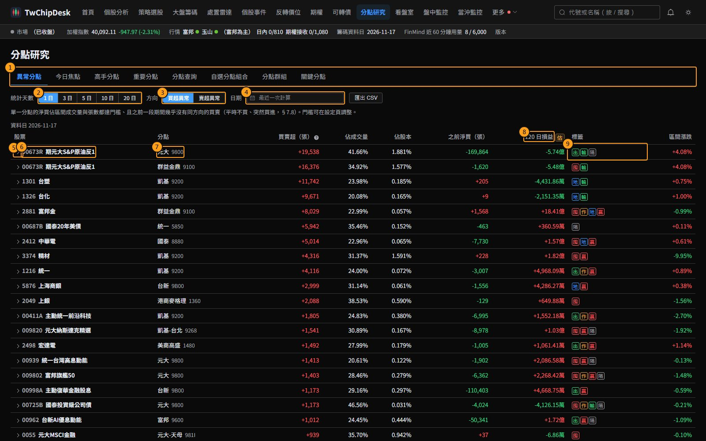
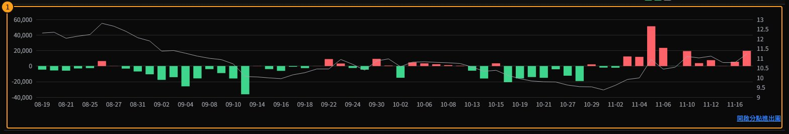

<!-- routes: /brokers/abnormal -->
# 分點研究｜異常分點

> 位置：頂部選單「分點研究」→「異常分點」分頁（網址 `/brokers/abnormal`，例如 `/brokers/abnormal?days=1&side=buy`）
> 資料更新：每個交易日分點資料（18:10 起）與個股三大法人資料（20:05 後）都到齊後計算最新資料日的 1、3、5、10、20 日結果

## 這個功能可以做什麼
找出「平時不太買賣、統計期間內卻突然大量買超（或賣超）某檔股票」的分點。可以用來快速發現某檔股票出現集中在單一分點的大量買超或賣超，再點進去看這個分點過去在這檔股票的進出與損益。

## 畫面說明

| 編號 | 名稱 | 說明 |
|---|---|---|
| 1 | 分頁 | 分點研究的八個分頁，目前在「異常分點」。 |
| 2 | 「統計天數」 | 1、3、5、10、20 日，計算異常的區間長度（交易日）。 |
| 3 | 「方向」 | 「買超異常」或「賣超異常」。 |
| 4 | 「日期」 | 要看哪一天的結果；空白時為「最近一次計算」。未來的日期不能選。 |
| 5 | 展開按鈕 | 每列最左邊的箭頭，展開這個分點在這檔股票的小型分點進出圖（見下圖）。 |
| 6 | 「股票」 | 點擊開啟該股 K線籌碼圖，並把這個分點加入特定分點副圖。 |
| 7 | 「分點」 | 分點名稱與代號，點擊開啟[分點頁](broker-page.md)。 |
| 8 | 「120 日損益」 | 這個分點在這檔股票近 120 日的損益（估），可看它過去在這檔股票是賺還是賠。欄名的天數依設定而定。 |
| 9 | 「標籤」 | 這個分點在這檔股票的關鍵分點標籤（囤、出、作、地、贏、輸、隔），滑鼠停在標籤上會顯示名次與數值。 |

表格欄名可以點擊排序（遞減、遞增、回到預設順序三種狀態）。「買賣超（張）」依張數的絕對值排序：買超與賣超異常都是張數大的在前。

### 小型分點進出圖

展開後顯示最近 60 個交易日這個分點在這檔股票的每日買賣超（柱狀，紅買綠賣）與收盤價（折線）。要看完整的分點進出圖可點圖上的連結。

工具列最右邊的「匯出 CSV」把表格目前的列（依目前的排序）存成 CSV 檔，檔名為「異常分點_方向_N日_資料日.csv」；股票與分點各拆成代號、名稱兩欄。數值不加千分位、不加 % 符號（百分比欄的欄名註明「（%）」），沒有資料的格子空白，估計值的欄名加「（估）」；沒有資料列時按鈕無法按。

## 操作步驟
1. 選「統計天數」與「方向」，例如 1 日、買超異常。
2. 要看過去某一天的結果時在「日期」選日期；清除日期回到最近一次計算。
3. 點欄名排序，例如依「佔成交量」由大到小。
4. 點列左邊的箭頭展開小型進出圖，或點股票、分點進一步查看。

## 欄位與名詞
- **買賣超（張）**：這個分點在統計天數內的淨買賣張數。
- **佔成交量**：淨買賣張數 ÷ 這檔股票區間成交量（以絕對值顯示）。
- **佔股本**：淨買賣股數 ÷ 這檔股票的股本（以絕對值顯示）。
- **之前淨買（張）**：統計區間之前 60 個交易日，這個分點在這檔股票的淨買張數。數字很小代表「平時不買」。
- **N 日損益**：這個分點在這檔股票的區間損益（估），計算方式見[分點研究總覽](README.md)。
- **區間漲跌**：股價在統計區間內的漲跌幅。

### 判定條件（預設值）
同時符合下列四項就列為買超異常（賣超異常把方向反過來）：

| 條件 | 預設值 |
|---|---|
| 分點淨買 ÷ 區間成交量 | ≥ 20% |
| 分點淨買 | ≥ 200 張 |
| 該股近 20 日均量 | ≥ 300 張 |
| 區間之前 60 個交易日的淨買 ÷ 區間內淨買 | ≤ 20%（平時不買、突然大買） |

這些門檻可在設定頁「籌碼參數」調整。

## 資料來源與更新時間
- 分點資料：FinMind 分點買賣日報，每個交易日 18:10 起匯入。
- 異常分點：每個交易日在分點資料與三大法人資料都到齊後，與其他主力衍生資料一起計算最新資料日的結果。
- 損益與標籤：每晚與主力衍生資料一起計算。

## 注意事項與限制
- 大型權值股的成交量大，單一分點很難佔到 20%，所以常見的異常分點多半是成交量較小的股票、ETF 或債券 ETF。
- 統計需要區間加上之前 60 個交易日的分點資料；資料不足時該股不會出現在清單。
- 分點的買超不代表最終持有人，見[分點研究總覽](README.md)。
- 畫面出現「還沒有異常分點的計算結果」時，代表當天尚未計算完成。

## 常見問題
- **為什麼某天的清單是空的？** 那天沒有任何「股票＋分點」同時符合四個條件，畫面會顯示「這天沒有買超異常的分點。」。
- **個股的籌碼日報也有異常分點？** 有。籌碼日報的提示區用同樣的規則，以報表的結束日即時計算。

## 相關功能
- [分點頁](broker-page.md)
- [個股分析](../stock/README.md)：K線籌碼圖的特定分點副圖、籌碼日報
- [策略選股](../screener/README.md)：條件「有買超異常分點」「有賣超異常分點」
