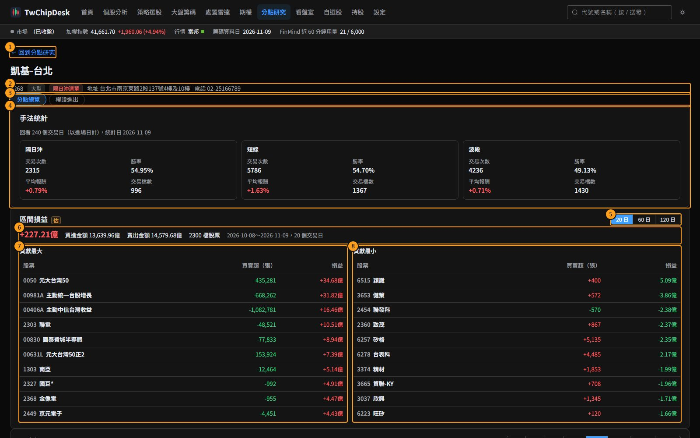
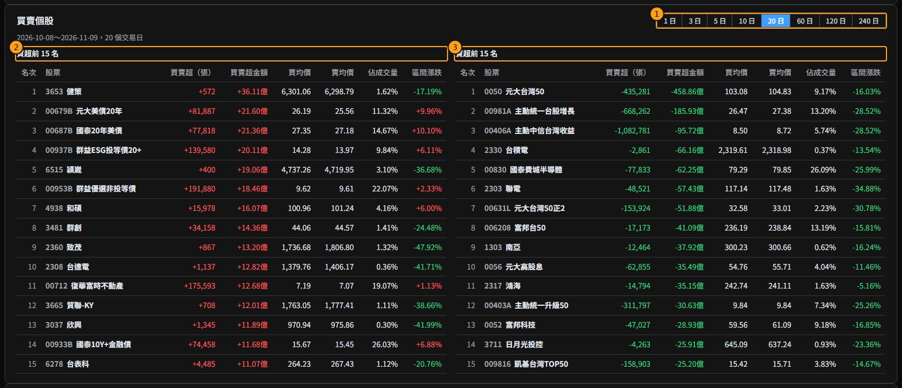
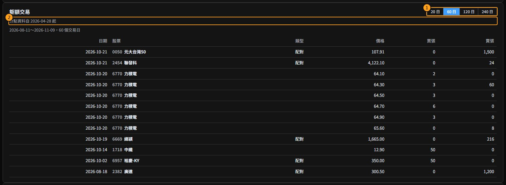
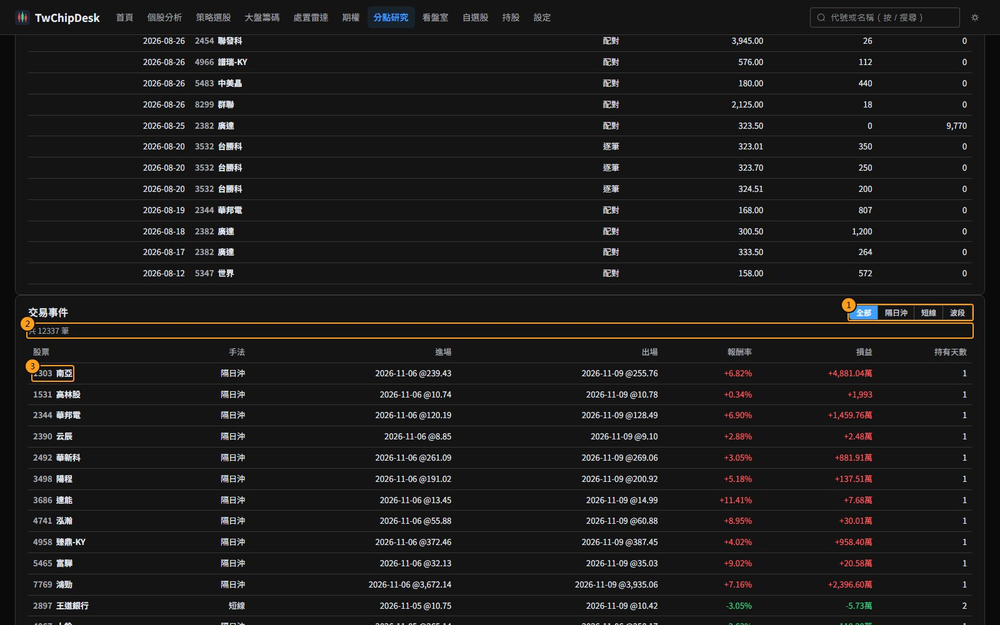
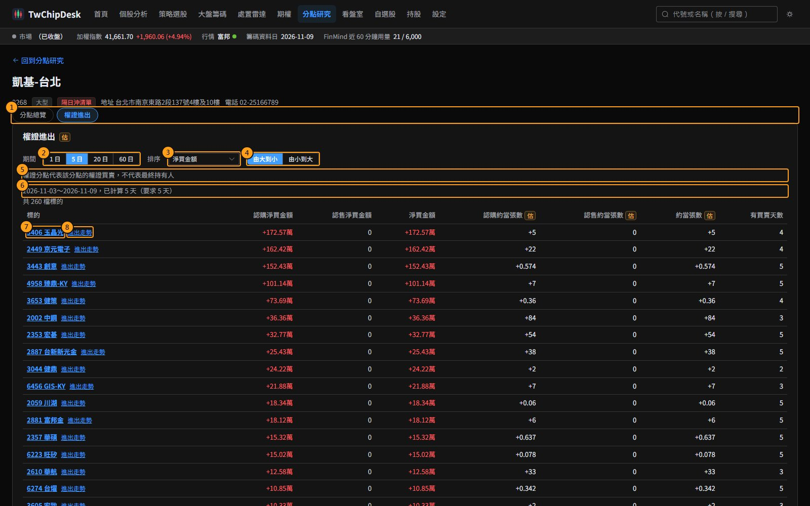
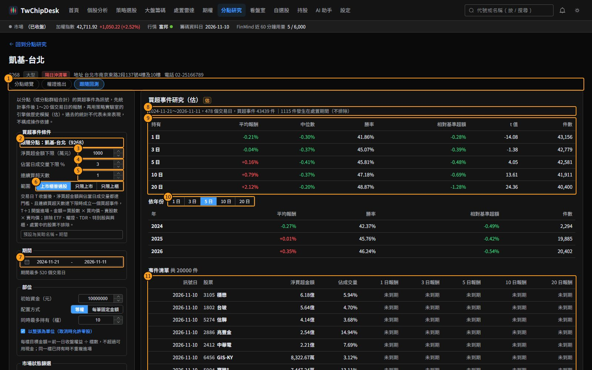
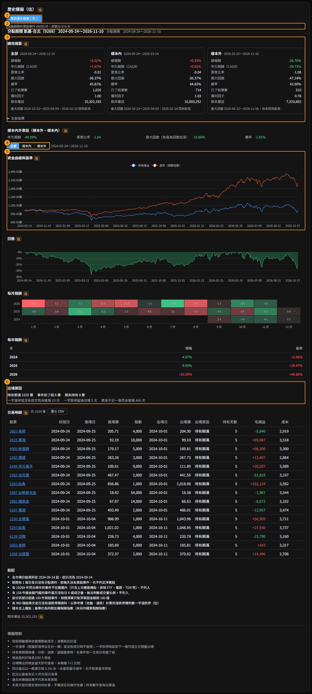

<!-- routes: /brokers/:brokerId, /brokers/follow -->
# 分點研究｜分點頁

> 位置：在分點研究各分頁、個股的主力面板或分點選單點分點名稱進入（網址 `/brokers/<分點代號>`，例如 `/brokers/9268`；「權證進出」分頁為 `/brokers/9268?tab=warrants`，「跟隨回測」分頁為 `/brokers/9268?tab=follow`；分點群組的跟隨回測為 `/brokers/follow?groupId=<群組編號>`）
> 資料更新：買賣個股依已匯入的分點資料即時計算（每個交易日 18:10 起匯入）；手法統計與交易事件每個交易日 23:50 計算；鉅額交易每個交易日 21:40 匯入；權證進出在權證分點（20:30 起匯入）與權證標的彙總完成後更新；跟隨回測依已匯入的分點資料與日 K 即時計算，事件後的報酬每晚由訊號績效統計中心計算

## 這個功能可以做什麼
集中看一個分點的所有資訊：分類、三種手法的歷史統計、近 20／60／120 日的損益（估）與貢獻最大、最小的股票、買賣個股、鉅額交易、每一筆交易事件，以及它在各標的的權證進出。「跟隨回測」分頁以這個分點的買超事件為訊號，統計事件後的報酬，並可做歷史模擬（估）。

分點代號區分大小寫，網址中的代號要和分點主檔完全相同；找不到時顯示「找不到分點「代號」」。

## 畫面說明

### 分點總覽（上半部）

| 編號 | 名稱 | 說明 |
|---|---|---|
| 1 | 「回到分點研究」 | 回到分點研究的「異常分點」分頁。 |
| 2 | 基本資料 | 分點代號、分類徽章（「外資」「官股」、規模「大型／中型／小型」、在隔日沖清單內時顯示「隔日沖清單」）、地址與電話。 |
| 3 | 分頁 | 「分點總覽」「權證進出」與「跟隨回測」。 |
| 4 | 「手法統計」 | 隔日沖、短線、波段三張卡片，各顯示「交易次數」「勝率」「平均報酬」「交易檔數」；上方註明回看天數與統計日。 |
| 5 | 區間天數 | 「區間損益」的 20、60、120 日。 |
| 6 | 損益摘要 | 區間損益（估）合計、買入與賣掉的金額、交易的股票數與起訖日。 |
| 7 | 「貢獻最大」 | 損益最高的 10 檔股票（買賣超張數與損益）。 |
| 8 | 「貢獻最小」 | 損益最低的 10 檔股票。 |

### 買賣個股

| 編號 | 名稱 | 說明 |
|---|---|---|
| 1 | 統計天數 | 1、3、5、10、20、60、120、240 日。 |
| 2 | 「買超前 15 名」 | 依買賣超金額由大到小。 |
| 3 | 「賣超前 15 名」 | 依買賣超金額由小到大。 |

欄位與[分點查詢](lookup.md)相同。

### 鉅額交易

此截圖以分點 9200（凱基）為例。

| 編號 | 名稱 | 說明 |
|---|---|---|
| 1 | 天數 | 20、60、120、240 日，預設 60 日。 |
| 2 | 資料起日說明 | 「分點資料自 日期 起」；查詢區間晚於最新載入日時另註明「分點資料更新到 日期」。 |

表格欄位為「日期」「股票」「類型」（鉅額交易的種類）、「價格」「買張」「賣張」。一般的分點資料不含鉅額交易，這裡另外列出。這段期間沒有鉅額交易時顯示「這段期間沒有鉅額交易。」。

### 交易事件

| 編號 | 名稱 | 說明 |
|---|---|---|
| 1 | 手法篩選 | 「全部」「隔日沖」「短線」「波段」。 |
| 2 | 筆數 | 符合的交易事件總數；超過一頁時表格下方有頁碼。 |
| 3 | 「股票」 | 點擊開啟 K線籌碼圖並加入這個分點的副圖。 |

表格欄位：「手法」「進場」（日期與價格）、「出場」（日期與價格；尚未出場的顯示「持有中」與統計日收盤）、「報酬率」「損益」「持有天數」。

### 權證進出

| 編號 | 名稱 | 說明 |
|---|---|---|
| 1 | 分頁 | 切到「權證進出」。 |
| 2 | 「期間」 | 1、5、20、60 日，預設 5 日。 |
| 3 | 「排序」 | 「淨買金額」「約當張數」「認購淨買金額」「認售淨買金額」。 |
| 4 | 「方向」 | 「由大到小」「由小到大」。 |
| 5 | 持有人說明 | 「權證分點代表該分點的權證買賣，不代表最終持有人」。 |
| 6 | 區間 | 實際起訖日與「已計算 N 天（要求 N 天）」；只有部分日子已計算時另外註明。 |
| 7 | 「標的」 | 權證的標的股票，點擊開啟該股「權證」分頁；指數標的（例如「臺股指數」）開啟指數權證明細頁（這裡沒有期權頁的連結，期權頁從指數權證明細頁或「進出走勢」頁開）。 |
| 8 | 「進出走勢」 | 開啟[分點權證進出](broker-warrants.md)頁，看這個分點在這檔標的的逐日權證進出。 |

表格欄位：「認購淨買金額」「認售淨買金額」「淨買金額」「認購約當張數」「認售約當張數」「約當張數」「有買賣天數」。指數標的的三個約當欄改顯示約當期貨口數（估），數字後標商品（例如「+23.60大台口」）；富櫃200 沒有指數資料，顯示「—」。排序選「約當張數」時指數標的排在最後。這個分點在設定的權證造市分點清單內時，標題旁會顯示「發行商造市分點」。

### 跟隨回測
「跟隨回測」分頁回答「過去這個分點大量買超某檔股票之後，那檔股票接下來幾天的表現如何」。左欄是條件，右欄先列「買超事件研究（估）」，再列「歷史模擬（估）」。所有條件（含左欄的實驗室設定）都存在網址，可以加入書籤或分享網址重開同樣的條件。

| 編號 | 名稱 | 說明 |
|---|---|---|
| 1 | 分頁 | 切到「跟隨回測」。 |
| 2 | 跟隨對象 | 「跟隨分點：名稱（代號）」；從分點群組進入時為「跟隨分點群組：群組名稱（N 個分點合計）」。 |
| 3 | 「淨買超金額下限（萬元）」 | 預設 1,000 萬元。 |
| 4 | 「佔當日成交量下限 %」 | 淨買超股數佔當天成交股數的比例下限，預設 3%。 |
| 5 | 「連續買超天數」 | 含訊號日在內，連續幾個交易日淨買超金額都大於 0，預設 1 天（不要求連續）。 |
| 6 | 「範圍」 | 「上市櫃普通股」「只限上市」「只限上櫃」。 |
| 7 | 期間 | 起日與迄日，最多 520 個交易日；預設為今天往前 720 天。 |
| 8 | 事件說明 | 實際起訖日、交易日數與買超事件件數；有金額以當日均價估算的事件、或發生在處置期間的事件時另外註明件數。 |
| 9 | 各持有天數的統計 | 持有 1、3、5、10、20 日的「平均報酬」「中位數」「勝率」「相對基準超額」「t 值」「件數」；件數少於 30 時標「樣本少」。 |
| 10 | 「依年份」 | 選一個持有天數，看每年的平均報酬、勝率、相對基準超額與件數；件數少於 30 的年份標「樣本少」。 |
| 11 | 「事件清單」 | 每一個買超事件：「訊號日」「股票」「淨買超金額」（以當日均價估算的標「估」）、「佔成交量」、連續天數（連續買超天數大於 1 時才列；最多算到 20 天，顯示「20 以上」代表 20 天或更長）、各持有天數的報酬；處置期間的事件標「處置中」，還沒到期的顯示「未到期」，剔除的顯示原因。依訊號日新到舊、同一天依淨買超金額由大到小，每頁 50 件。 |

左欄下半部是與[策略實驗室](../screener/README.md)相同的設定：期間、部位、市場狀態篩選、出場、成本與樣本外驗證（沒有參數掃描）。出場多一個「分點賣超出場」：持有中這個分點（群組合計）在該股的淨賣超金額達同一個門檻時，隔一個交易日開盤出場。

| 編號 | 名稱 | 說明 |
|---|---|---|
| 1 | 「開始歷史模擬（估）」 | 用目前的條件模擬；執行中顯示階段（「產生買超事件」「讀取日 K」「模擬中」）與進度，可「取消」。 |
| 2 | 模擬說明 | 模擬期間的買超事件件數與訊號日天數；有金額以當日均價估算的事件時另外註明。 |
| 3 | 「績效摘要」 | 與策略實驗室相同的指標（全部、樣本內、樣本外）。 |
| 4 | 期間切換 | 「全部」「樣本內」「樣本外」，切換下方圖表與明細。 |
| 5 | 「資金曲線與基準」 | 模擬權益與同期報酬指數；下方接著是回撤、每月報酬、每年報酬。 |
| 6 | 「出場原因」 | 各出場原因的筆數；勾了「分點賣超出場」時，這類出場顯示為「分點賣超出場」。下方接著是「交易明細」（可排序、「匯出 CSV」）與「註記」。 |

模擬完成後網址會加上結果編號（`savedId`），結果也保存在策略實驗室的「已保存的實驗」（類型「分點跟隨」），可以在那裡置頂、改名、刪除；在實驗室按「開啟」會回到這裡並帶回當時的條件。

## 操作步驟
1. 從任何清單點分點名稱進入。
2. 在「區間損益」切換 20、60、120 日，看哪些股票貢獻最多、最少。
3. 在「買賣個股」切換天數，看近期買賣了哪些股票。
4. 在「交易事件」用手法篩選，逐筆查看進出場與報酬率。
5. 切到「權證進出」看它的權證淨買集中在哪些標的，再點「進出走勢」看細節。
6. 切到「跟隨回測」，設定買超事件的門檻與期間，先看「買超事件研究（估）」；需要時按「開始歷史模擬（估）」看依同一組事件模擬的資金曲線與交易明細。

分點群組也可以做跟隨回測：在[分點群組](groups.md)按群組列的「跟隨回測」，以群組內所有分點的合計判斷買超事件，條件與畫面和上面相同（網址 `/brokers/follow?groupId=<群組編號>`；也可以在網址用 `brokerIds=代號,代號` 指定最多 30 個分點的合計）。[高手分點](masters.md)每列的「跟隨回測」直接開啟該分點的這個分頁。

點本頁任何股票都會開啟該股 K線籌碼圖，並自動把這個分點加入特定分點副圖。

## 欄位與名詞
- **手法統計**、**交易事件**的算法見[高手分點](masters.md)。手法統計以進場日計，回看 240 個交易日。
- **區間損益（估）**：區間內每檔股票的「賣的金額 − 買的金額 ＋ 淨買股數 × 區間最後一天收盤」加總，假設區間開始時持股為 0。
- **淨買金額**（權證進出）：淨買單位 × 當天權證收盤，逐日加總。
- **約當張數（估）**：權證淨買單位 × 當天行使比例 × Delta ÷ 1,000；認售為負數。只計當天有收盤價與 Delta 的權證，排除指數與外國標的。官方資料外掛關閉時沒有 Delta，約當張數無法計算。
- **買超事件**（跟隨回測）：交易日 T 收盤後，分點（或群組合計）在某檔股票的淨買超金額 ≥ 門檻、淨買超股數佔當天成交股數 ≥ 下限、且連續買超天數 ≥ 下限時成立。金額＝買股數 × 買均價 − 賣股數 × 賣均價（群組先加總）；分點均價缺值時以當日均價（成交金額 ÷ 成交股數）估算，標「估」。只算上市櫃普通股，排除 ETF、權證、TDR、特別股與興櫃；處置中的股票不排除。
- **N 日報酬**（跟隨回測）：T＋1 開盤到 T＋N 收盤的報酬（加回現金股利）。持有期間遇除權、減資等事件、T＋1 一字漲停或沒有成交的事件不計；還沒到期的不列入統計。
- **相對基準超額**：報酬減同期含息加權報酬指數的報酬，再取平均。
- **t 值**：平均報酬 ÷（標準差 ÷ √件數），用來看平均值離 0 有多遠；件數少時參考價值低。
- **件數**：有報酬的樣本數，不含尚未到期與剔除的事件。

## 資料來源與更新時間
- 分點資料：FinMind 分點買賣日報，每個交易日 18:10 起匯入。
- 手法統計、交易事件、規模分類：每個交易日 23:50 計算。
- 鉅額交易分點資料：每個交易日 21:40 匯入，資料從 2026-04-28 起。
- 權證分點：每個交易日 20:30 起匯入，完成後計算權證標的彙總；尚未計算時顯示「權證標的彙總尚未計算」。
- 跟隨回測：買超事件依已匯入的分點資料即時計算（同一組條件 10 分鐘內換頁不重算）；事件後的報酬來自訊號績效統計中心每晚算好的前向報酬，還沒有算時統計暫時沒有樣本，畫面上方會說明，事件清單仍可查看。期間起日早於全市場分點資料的起日時，從分點資料的起日開始並在註記說明；起日早於前向報酬的最早日時，事件研究改從有前向報酬的第一天開始，註記也會說明。事件超過 20,000 件時，統計含全部事件，事件清單只保留最近的 20,000 件並在註記說明。

## 注意事項與限制
- 損益、報酬率、約當張數都是推算值（估）。
- 分點與權證分點都不代表最終持有人，見[分點研究總覽](README.md)。
- 發行商造市分點的權證淨買多半是造市的避險部位，照常列出、不排除。
- 權證功能在設定頁「籌碼參數」關閉時，「權證進出」分頁顯示功能關閉的說明。
- 跟隨回測的統計與模擬都是歷史模擬（估），過去的結果不代表之後的表現，也不構成操作依據。分點不代表最終持有人，同一個分點的買超可能來自許多不同的投資人。
- 歷史模擬與策略實驗室、組合回測共用執行名額，同一時間只能跑一個；已有工作在執行時顯示「已有實驗在執行中，可在頁面上查看進度或取消」，可到策略實驗室查看。
- 某天訊號超過 100 件時，模擬的候選只取淨買超金額前 100 檔，註記會說明。

## 相關功能
- [分點權證進出](broker-warrants.md)
- [分點群組](groups.md)：群組合計的跟隨回測
- [選股策略｜策略實驗室](../screener/README.md)：同一套模擬設定與「已保存的實驗」
- [分點查詢](lookup.md)、[高手分點](masters.md)、[重要分點](important.md)
- [個股分析](../stock/README.md)：K線籌碼圖的特定分點副圖、權證分頁
