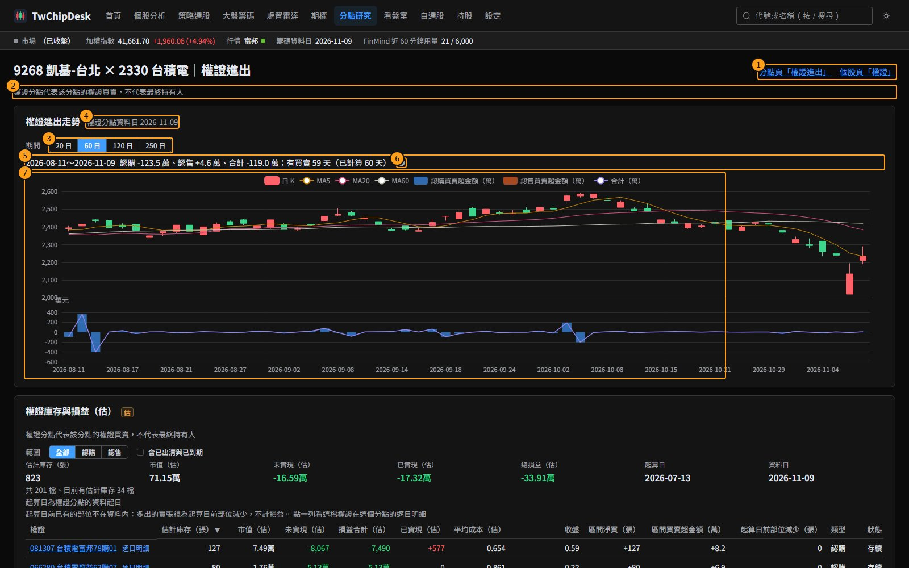
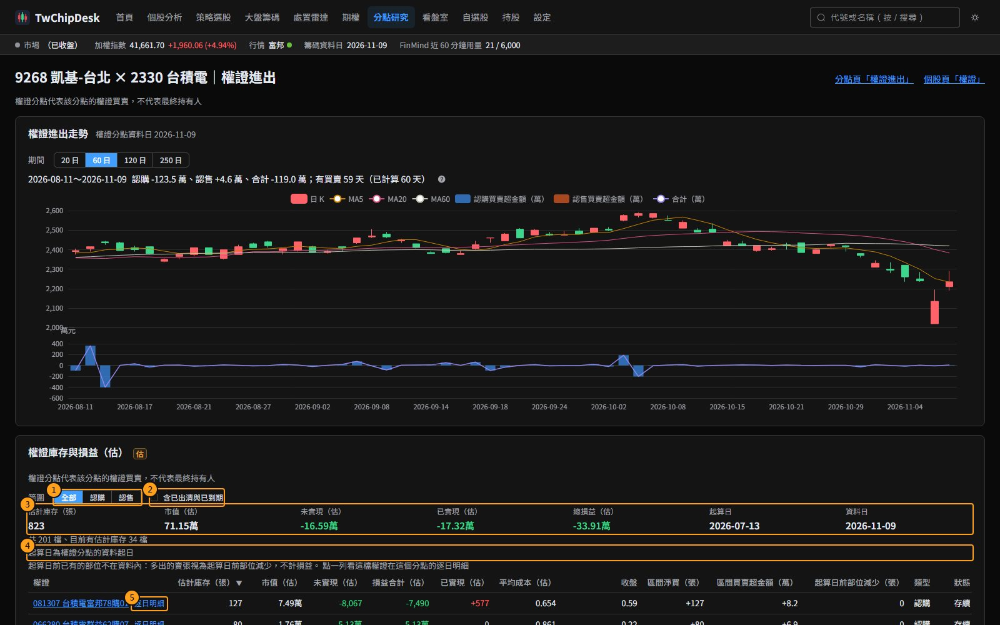
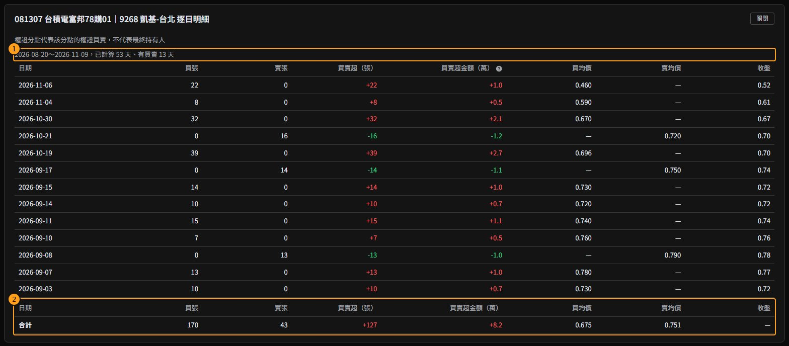

<!-- routes: /brokers/:brokerId/warrants/:stockId -->
# 分點研究｜分點權證進出

> 位置：分點頁「權證進出」分頁每列的「進出走勢」、權證詳細頁分點排行的「這個分點在標的的權證進出」，或個股「權證」分頁的分點連結（網址 `/brokers/<分點代號>/warrants/<股票代號>`，例如 `/brokers/9268/warrants/2330?days=60`）
> 資料更新：權證分點每個交易日 20:30 起匯入，核對完成後才列入；標的日 K 每個交易日盤後更新

## 這個功能可以做什麼
看一個分點在一檔標的股票上的權證買賣：每天認購、認售的買賣超金額與標的日 K 對照，推算這個分點目前在各檔權證的估計庫存與損益，並可查看單一權證的逐日明細。

例如「凱基-台北 × 台積電」：可以看凱基-台北在台積電相關權證每天是買超還是賣超、金額多大，與台積電股價走勢放在一起比較。

## 畫面說明

### 權證進出走勢

| 編號 | 名稱 | 說明 |
|---|---|---|
| 1 | 相關連結 | 「分點頁「權證進出」」回到這個分點的權證進出分頁；「個股頁「權證」」開啟標的的權證分頁。指數標的的這個連結改為「指數權證明細」，開啟指數權證明細頁；旁邊另有第二個連結「期權頁約當期貨」，開啟期權頁的對應期貨商品。 |
| 2 | 持有人說明 | 「權證分點代表該分點的權證買賣，不代表最終持有人」。 |
| 3 | 「期間」 | 20、60、120、250 日，預設 60 日；存在網址（`?days=`）。 |
| 4 | 資料日 | 「權證分點資料日 日期」。 |
| 5 | 期間摘要 | 起訖日，以及「認購 … 萬、認售 … 萬、合計 … 萬；有買賣 N 天（已計算 N 天）」。 |
| 6 | 口徑說明 | 滑鼠停在問號上，說明「買賣超金額（成交）」的計算方式。 |
| 7 | 走勢圖 | 上方為標的日 K 與 5、20、60 日均線；下方為這個分點每天的「認購買賣超金額（萬）」「認售買賣超金額（萬）」與「合計（萬）」。滑鼠停在圖上顯示當天的開高低收、認購與認售的買金額、賣金額、買賣超與權證檔數。 |

這個分點在設定的權證造市分點清單內時，標題下方顯示「發行商造市分點」。

### 權證庫存與損益（估）

| 編號 | 名稱 | 說明 |
|---|---|---|
| 1 | 「範圍」 | 「全部」「認購」「認售」。 |
| 2 | 「含已出清與已到期」 | 預設只列目前有估計庫存且未到期的權證；勾選後列出全部。 |
| 3 | 摘要 | 「估計庫存（張）」「市值（估）」「未實現（估）」「已實現（估）」「總損益（估）」「起算日」「資料日」。 |
| 4 | 起算日說明 | 推算從哪一天開始，以及更早的資料是否還在回補或有缺漏。 |
| 5 | 「逐日明細」 | 點權證列或這個按鈕，在頁面下方開啟這檔權證在這個分點的逐日明細。 |

表格欄位：「權證」「類型」「估計庫存（張）」「平均成本（估）」「收盤」「市值（估）」「未實現（估）」「已實現（估）」「損益合計（估）」「區間淨買（張）」「區間買賣超金額（萬）」「起算日前部位減少（張）」「狀態」（「存續」或「已到期（以最後交易日收盤估）」）。數值欄可點欄名排序，預設依估計庫存由大到小。

### 分點逐日明細

| 編號 | 名稱 | 說明 |
|---|---|---|
| 1 | 區間 | 起訖日、已計算天數與有買賣的天數。 |
| 2 | 「合計」 | 表格下方的合計列。 |

表格欄位：「日期」「買張」「賣張」「買賣超（張）」「買賣超金額（萬）」「買均價」「賣均價」「收盤」，新的日期在前。按「關閉」收起明細。選擇的權證會寫入網址，可以分享。

## 操作步驟
1. 在分點頁切到「權證進出」，在想看的標的那一列按「進出走勢」。
2. 選「期間」，對照日 K 與下方的認購、認售買賣超金額。
3. 往下看「權證庫存與損益（估）」，用「範圍」切換認購或認售，需要時勾「含已出清與已到期」。
4. 點某一檔權證的「逐日明細」看它每天的買賣。

## 欄位與名詞
- **指數標的**：代號為 IX0001（臺股指數）、IX0027（電子類指數）、IX0039（金融保險類指數）、IX0118（富櫃200）時，走勢圖不畫 K 線，只畫這個分點的認購、認售買賣超金額，並註明「指數標的只畫這個分點的認購、認售買賣超金額，不畫 K 線。」；庫存與損益（估）照常計算。
- **買賣超金額（成交）**：Σ（買金額 − 賣金額），以這個分點在這檔標的的權證實際成交金額計算。分點頁「權證進出」與個股「權證」分頁的淨買金額是「淨買單位 × 當天權證收盤」，口徑不同，兩者可能不相等。
- **估計庫存**：從起算日起逐日累計這個分點在每檔權證的買賣。同一天買賣相抵的部分先算當日沖銷；買超增加庫存，成本取移動平均；賣超先減少估計庫存並計算已實現，多出的賣張視為起算日前部位減少，不計損益。
- **市值（估）**＝估計庫存 × 收盤；**未實現（估）**＝市值 − 庫存成本；已到期的權證以最後交易日收盤結算，計入已實現。
- **起算日**：權證分點的資料起日，最多往前推算 250 個交易日。

## 資料來源與更新時間
- 權證分點：FinMind 權證分點明細，每個交易日 20:30 起匯入，抓完逐檔核對，核對完成的日子才列入。
- 尚未計算、尚未回補、不在權證查詢期間的日子在圖上留空並註明。

## 注意事項與限制
- 權證分點代表該分點的權證買賣，不代表最終持有人。
- 庫存與損益都是推算值：起算日以前的部位不計；沒有委買委賣報價，以收盤價估值。
- 發行商造市分點發行時取得的權證不經過分點買賣，估計庫存與損益不代表造市部位，畫面會另外警告。
- 部分權證沒有收盤價時，總損益不含這些權證的未實現或到期結算，畫面會註明。
- 權證功能在設定頁「籌碼參數」關閉時不畫圖，顯示功能關閉的說明。
- 分點或股票代號格式不正確、或找不到時，畫面顯示對應的說明。

## 相關功能
- [分點頁](broker-page.md)：「權證進出」分頁
- [個股分析｜權證](../stock/README.md)
- [大盤籌碼｜權證排行](../market/README.md)
