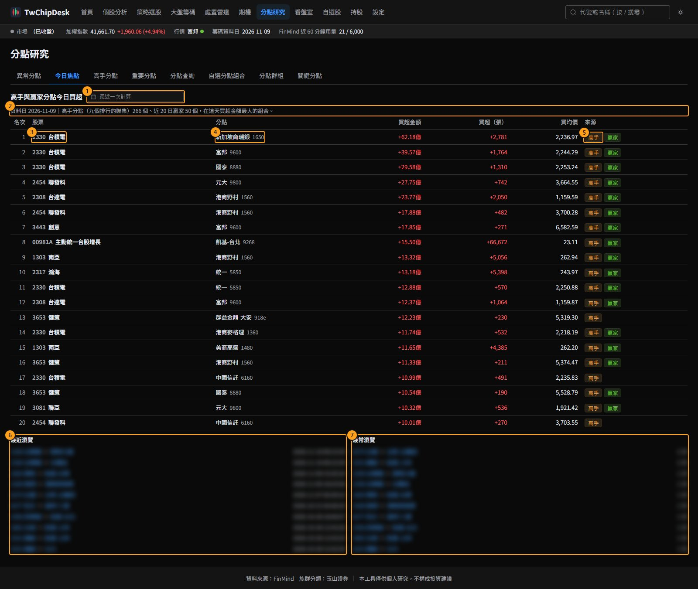

<!-- routes: /brokers/focus -->
# 分點研究｜今日焦點

> 位置：頂部選單「分點研究」→「今日焦點」分頁（網址 `/brokers/focus`）
> 資料更新：買超金額依最新分點資料日（每個交易日 18:10 起匯入）；高手分點與贏家分點的名單每個交易日 23:50 更新；瀏覽紀錄即時

## 這個功能可以做什麼
把「高手分點」與「近 20 日贏家分點」這些過去表現較好的分點，在某一天買超金額最大的「股票＋分點」組合列出來；下半部列出你最近、最常查看的「股票＋分點」組合，方便回頭再看。

## 畫面說明

| 編號 | 名稱 | 說明 |
|---|---|---|
| 1 | 日期 | 要看哪一天；空白時為「最近一次計算」（最新分點資料日）。 |
| 2 | 說明列 | 資料日，以及這次納入的高手分點與近 20 日贏家分點各有幾個。 |
| 3 | 「股票」 | 點擊開啟該股 K線籌碼圖，並把這個分點加入特定分點副圖。 |
| 4 | 「分點」 | 點擊開啟[分點頁](broker-page.md)。 |
| 5 | 「來源」 | 這個分點屬於「高手」（高手分點排行）或「贏家」（近 20 日贏家），兩者都是時同時顯示。 |
| 6 | 「最近瀏覽」 | 最近查看過的「股票＋分點」組合與時間，點擊開啟該股的分點進出圖並帶入這個分點。 |
| 7 | 「最常瀏覽」 | 查看次數最多的組合與次數。 |

截圖中的瀏覽紀錄已模糊處理。

## 操作步驟
1. 進入分頁即顯示最新分點資料日的結果。
2. 要看過去某一天時在日期欄選日期；清除日期回到最新。
3. 點股票或分點進一步查看；點下半部的組合直接回到該股的分點進出圖。

## 欄位與名詞
- **高手分點**：[高手分點](masters.md)九個排行（三種手法 × 三種排行）各自前 50 名的聯集。
- **近 20 日贏家**：[重要分點](important.md)「贏家」20 日的前 50 名（全市場損益最高）。
- **買超金額**、**買超（張）**：這個分點在這一天買這檔股票的淨買金額與張數。
- **買均價**：這個分點當天的買入均價。
- 表格依買超金額排序，預設列出前 20 名（名額可在設定頁「籌碼參數」調整）。

## 資料來源與更新時間
- 買超金額來自當天的分點資料。
- 高手與贏家名單來自每晚 23:50 的分點研究計算；所以 18:10 後、23:50 前看到的是「當天的買超」配上「前一晚的名單」。
- 瀏覽紀錄：在[個股分析｜分點](../stock/README.md)的分點進出圖選擇分點時記錄，存在伺服器上。

## 注意事項與限制
- 這裡只列買超，不列賣超。
- 高手、贏家是依過去紀錄推算的統計結果（估），不代表之後的表現。
- 分點的買超不代表最終持有人，見[分點研究總覽](README.md)。
- 還沒有任何瀏覽紀錄時，下半部顯示「還沒有瀏覽紀錄：在分點進出圖選擇分點後會記錄。」。

## 相關功能
- [高手分點](masters.md)、[重要分點](important.md)
- [分點頁](broker-page.md)
