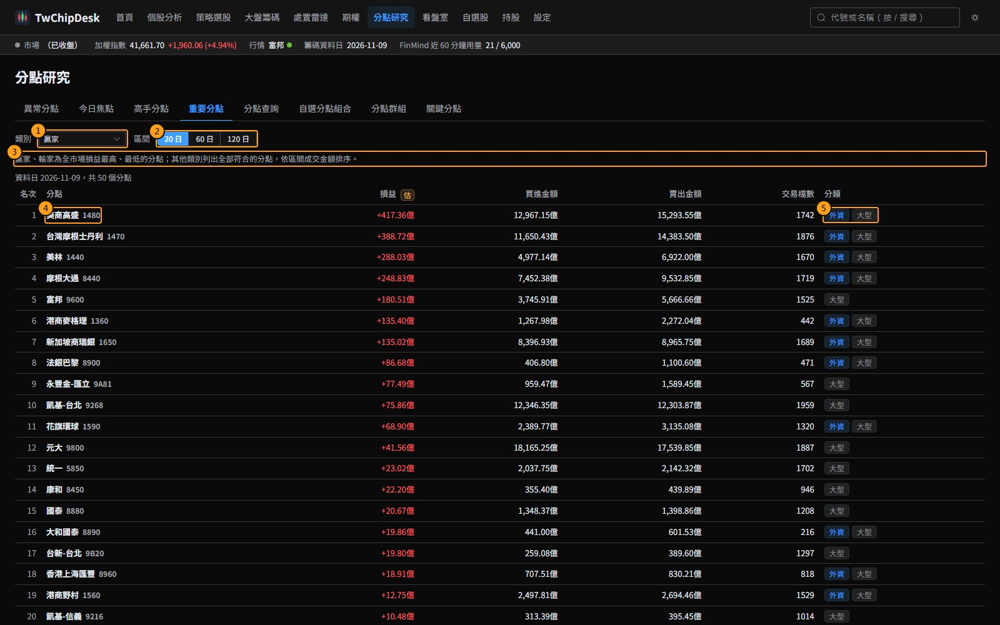

<!-- routes: /brokers/important -->
# 分點研究｜重要分點

> 位置：頂部選單「分點研究」→「重要分點」分頁（網址 `/brokers/important`，例如 `/brokers/important?category=winner&window=20`）
> 資料更新：每個交易日 23:50 計算全市場分點損益與分點規模

## 這個功能可以做什麼
從全市場的角度看分點：哪些分點在近 20、60、120 日整體賺最多（贏家）或賠最多（輸家），以及外資分點、官股分點、大型、中型、小型分點各有哪些、成交規模多大。

## 畫面說明

| 編號 | 名稱 | 說明 |
|---|---|---|
| 1 | 「類別」 | 「贏家」「輸家」「外資分點」「官股分點」「大型分點」「中型分點」「小型分點」。 |
| 2 | 「區間」 | 20、60、120 日（交易日）。 |
| 3 | 說明 | 類別的排序規則，以及資料日與分點數。 |
| 4 | 「分點」 | 點擊開啟[分點頁](broker-page.md)。 |
| 5 | 「分類」 | 外資、官股徽章與規模（大型、中型、小型）。 |

類別不是贏家、輸家且分點很多時，表格下方有頁碼可以換頁（每頁 50 個）。

## 操作步驟
1. 選「類別」與「區間」；選擇存在網址，換類別或區間時回到第 1 頁。
2. 點分點名稱進入分點頁看它的損益貢獻與買賣個股。

## 欄位與名詞
- **損益**：這個分點在區間內所有股票的損益（估）合計。每檔股票的損益＝賣的金額 − 買的金額 ＋ 淨買股數 × 區間最後一天收盤，假設區間開始時持股為 0，忽略手續費與交易稅。
- **買、賣金額**（表格第 4、5 欄）：區間內這個分點全部股票的買入、賣掉金額。
- **交易檔數**：區間內有買賣的股票數。
- **贏家**、**輸家**：全市場損益最高、最低的前 50 名（名額可在設定頁「籌碼參數」調整）。
- **外資分點**、**官股分點**：分點名稱包含設定的外資或官股關鍵字。
- **大型、中型、小型分點**：依近 60 個交易日全市場成交金額（買＋賣）排名，前 10% 為大型、其後 30% 為中型、其餘為小型。
- 贏家、輸家以外的類別列出全部符合的分點，依區間成交金額由大到小排序。

## 資料來源與更新時間
每個交易日 23:50 由已匯入的分點資料與日 K 計算。

## 注意事項與限制
- 損益是推算值（估），區間開始前已持有的部位、零股與鉅額交易的細節都可能讓數字與實際不同。
- 外資、官股分類依分點名稱的關鍵字判斷，名稱不含關鍵字的分點不會被歸類。
- 分點不代表最終持有人，見[分點研究總覽](README.md)。

## 相關功能
- [今日焦點](focus.md)：近 20 日贏家當天的買超
- [分點頁](broker-page.md)
