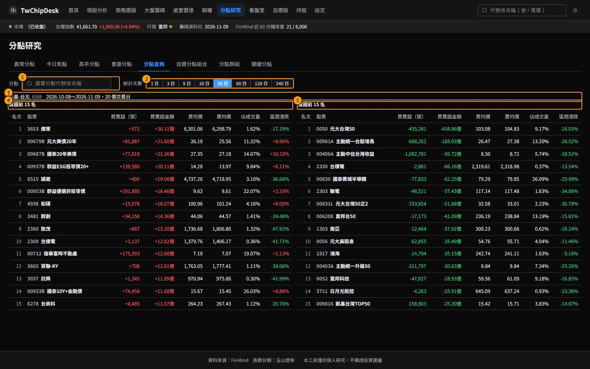

<!-- routes: /brokers/lookup -->
# 分點研究｜分點查詢

> 位置：頂部選單「分點研究」→「分點查詢」分頁（網址 `/brokers/lookup`，例如 `/brokers/lookup?broker=9268&days=20`）
> 資料更新：查詢時依已匯入的分點資料即時計算（分點資料每個交易日 18:10 起匯入）

## 這個功能可以做什麼
輸入一個分點，看它在最近一段期間買超最多與賣超最多的各 15 檔股票，以及每檔的買賣均價、佔成交量比例與股價漲跌。

## 畫面說明

| 編號 | 名稱 | 說明 |
|---|---|---|
| 1 | 「分點」搜尋框 | 輸入分點代號或名稱，從下拉清單選擇。 |
| 2 | 「統計天數」 | 1、3、5、10、20、60、120、240 日（交易日），預設 20 日。 |
| 3 | 分點與區間 | 查詢的分點（點擊開啟[分點頁](broker-page.md)）與實際起訖日、交易日數。 |
| 4 | 「買超前 15 名」 | 依買賣超金額由大到小。 |
| 5 | 「賣超前 15 名」 | 依買賣超金額由小到大。 |

## 操作步驟
1. 在「分點」搜尋框輸入代號或名稱（例如「9268」或「凱基-台北」），選擇清單中的分點。分點代號區分大小寫，請對照名稱選擇。
2. 選「統計天數」。
3. 點股票開啟 K線籌碼圖並把這個分點加入特定分點副圖。

分點與天數存在網址，可直接用網址開啟某個分點的查詢結果。

## 欄位與名詞
- **買賣超（張）**、**買賣超金額**：區間內淨買賣的張數與金額（股數 × 當日均價加總）。
- **買均價**、**賣均價**：區間內的買入、賣掉加權均價。
- **佔成交量**：淨買賣股數 ÷ 該股區間成交量。
- **區間漲跌**：該股在區間內的漲跌幅。

## 注意事項與限制
- 分點資料不足所選天數時，區間會從最早有資料的日子起算，並顯示「分點資料不足所選天數，區間已從最早有資料的日子起算」。
- 這段期間沒有買賣時顯示「這段期間沒有買賣。」。
- 分點不代表最終持有人，見[分點研究總覽](README.md)。

## 相關功能
- [分點頁](broker-page.md)：同樣的買賣個股表，加上手法統計、損益與交易事件
- [分點群組](groups.md)：把多個分點合在一起看
