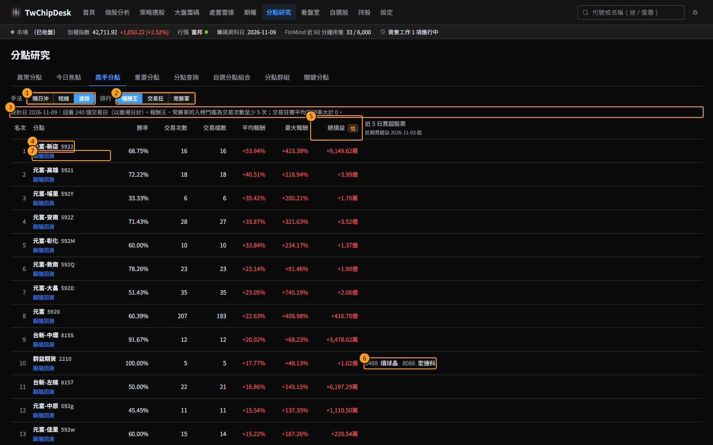

<!-- routes: /brokers/masters -->
# 分點研究｜高手分點

> 位置：頂部選單「分點研究」→「高手分點」分頁（網址 `/brokers/masters`，例如 `/brokers/masters?style=swing&rank=return`）
> 資料更新：每個交易日 23:50 依分點資料重新計算交易事件與手法統計

## 這個功能可以做什麼
系統依每個分點在每檔股票的每日買賣，推算出一筆筆「交易事件」（進場到出場），再依持有天數分成隔日沖、短線、波段三種手法，排出報酬王、交易狂、常勝軍三種排行。可以用來了解哪些分點在某種手法上的歷史紀錄較突出，以及它們最近在買哪些股票。

## 畫面說明

| 編號 | 名稱 | 說明 |
|---|---|---|
| 1 | 「手法」 | 「隔日沖」「短線」「波段」。 |
| 2 | 「排行」 | 「報酬王」「交易狂」「常勝軍」。 |
| 3 | 說明列 | 統計日、回看天數與入榜門檻。 |
| 4 | 「分點」 | 點擊開啟[分點頁](broker-page.md)。 |
| 5 | 「總損益」 | 這個分點在這種手法的交易事件損益合計（估）。 |
| 6 | 「近 5 日買超股票」 | 這個分點近 5 個交易日買超金額最大的 5 檔股票；欄名旁註明起算日。點股票開啟 K線籌碼圖並加入這個分點的副圖。 |
| 7 | 「跟隨回測」 | 分點名稱下方的連結，開啟這個分點分點頁的「跟隨回測」分頁（見[分點頁｜跟隨回測](broker-page.md#跟隨回測)）。 |

## 操作步驟
1. 選「手法」與「排行」，表格立即更新；選擇會存在網址。
2. 點分點名稱看它的手法統計與交易事件，或點近 5 日買超的股票直接看 K 線。
3. 點分點名稱下方的「跟隨回測」，看這個分點過去買超事件之後的報酬統計與歷史模擬（估）。

## 欄位與名詞
- **勝率**：報酬率大於 0 的交易事件比例。
- **交易次數**、**交易檔數**：回看期間內（以進場日計）這種手法的事件數與涉及的股票數。
- **平均報酬**、**最大報酬**：各事件報酬率的簡單平均與最大值。
- **總損益**：各事件損益合計（估）。

### 三種排行

| 排行 | 排序依據 | 入榜門檻 |
|---|---|---|
| 報酬王 | 平均報酬率 | 交易次數達最低門檻 |
| 交易狂 | 交易次數 | 平均報酬率大於 0 |
| 常勝軍 | 勝率 | 交易次數達最低門檻 |

最低交易次數預設為隔日沖 20 次、短線 20 次、波段 5 次；每個排行列出前 50 名。

### 交易事件怎麼算（預設值）
1. **進場**：某分點在某股某天淨買 ≥ 50 張，且佔當天成交量 ≥ 2%。
2. **加買與出場**：之後淨買為正視為加買（進場量增加），淨買為負視為出場；累計出場量達進場量的 80% 時事件結束。
3. **手法**：進場到出場相隔 1 個交易日為隔日沖，2～10 日為短線，11～120 日為波段。
4. **未結事件**：持有不到 20 個交易日的暫不列入；20～120 日的列為波段（以統計日收盤估值，分點頁標「持有中」）；超過 120 日以第 120 個交易日的收盤結算。
5. **報酬率**＝（出場均價 − 進場均價）÷ 進場均價；均價用分點每天的買賣均價推算。
6. 統計回看 240 個交易日，以進場日是否落在期間內為準。

以上參數都可在設定頁「籌碼參數」調整。

## 資料來源與更新時間
每個交易日 23:50 由已匯入的分點資料與日 K 計算，不另外向外部取資料。

## 注意事項與限制
- 交易事件、報酬率與損益都是用每日買賣均價推算的估計值，不是真實的成交紀錄；同一分點裡有許多投資人，事件不代表某一個人的操作。
- 當沖（同一天買賣相抵、淨買為 0）不會開啟事件。
- 名單是過去的統計結果，不代表之後的表現。
- 還沒有計算結果時顯示「還沒有分點研究的計算結果」。

## 相關功能
- [分點頁](broker-page.md)：單一分點三種手法的統計與每一筆交易事件；「跟隨回測」分頁
- [今日焦點](focus.md)：高手分點當天的買超
- [設定](../settings.md)：隔日沖清單在「分點清單」
