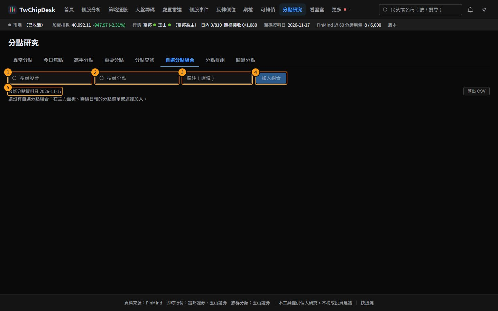

<!-- routes: /brokers/watch -->
# 分點研究｜自選分點組合

> 位置：頂部選單「分點研究」→「自選分點組合」分頁（網址 `/brokers/watch`）
> 資料更新：查詢時依最新分點資料日計算（分點資料每個交易日 18:10 起匯入）

## 這個功能可以做什麼
把想持續追蹤的「股票＋分點」組合存成清單，例如「2330 台積電＋凱基-台北」。每天打開就能看到每個組合最新一日與近 5 日的買賣超、區間損益（估），最新一日有買賣的組合會以徽章提示。

## 畫面說明

| 編號 | 名稱 | 說明 |
|---|---|---|
| 1 | 「搜尋股票」 | 輸入代號或名稱選擇股票，選好後右側顯示所選股票。 |
| 2 | 「搜尋分點」 | 輸入分點代號或名稱選擇分點。 |
| 3 | 「備註（選填）」 | 最多 200 字。 |
| 4 | 「加入組合」 | 股票與分點都選好後才能按。 |
| 5 | 最新分點資料日與清單 | 上方是「最新分點資料日」，下方是已加入的組合；還沒有組合時顯示說明文字。 |

截圖時清單是空的。有組合時，表格欄位如下：

| 欄位 | 說明 |
|---|---|
| 「股票」 | 點擊開啟 K線籌碼圖並加入這個分點的副圖。 |
| 「分點」 | 點擊開啟[分點頁](broker-page.md)。 |
| 「最新一日（張）」 | 最新分點資料日的買賣超張數；當天有買賣時前面顯示「最新一日有買賣」徽章。 |
| 「近 5 日（張）」 | 近 5 個交易日的買賣超合計。 |
| 「60 日損益」 | 這個分點在這檔股票近 60 日的損益（估）。 |
| 「備註」、「加入日期」 | 加入時填的備註與日期。 |
| 「動作」 | 「開啟分點進出圖」開啟該股的分點進出圖並帶入這個分點；「移除」把組合移出清單（不需確認）。 |

清單上方的「匯出 CSV」把目前的組合存成 CSV 檔（檔名「自選分點組合_最新分點資料日.csv」）；股票與分點各拆成代號、名稱兩欄，「最新一日有買賣」另列一欄，「動作」欄不匯出。數值不加千分位、不加 % 符號（百分比欄的欄名註明「（%）」），沒有資料的格子空白，估計值的欄名加「（估）」；沒有資料列時按鈕無法按。

## 操作步驟
1. 在「搜尋股票」選股票，在「搜尋分點」選分點（分點代號區分大小寫，請對照名稱）。
2. 需要時填備註，按「加入組合」，畫面顯示「已加入自選分點組合」。
3. 不再追蹤時按該列的「移除」。

也可以在個股的主力面板、籌碼日報的分點選單中把「股票＋分點」加入這份清單。

## 欄位與名詞
- **損益（估）**：區間內賣的金額 − 買的金額 ＋ 淨買股數 × 最後一天收盤，假設區間開始時持股為 0。

## 資料來源與更新時間
- 清單存在伺服器上，換瀏覽器或手機版都看得到。
- 設定頁的匯出與匯入（備份）包含自選分點組合。

## 注意事項與限制
- 「移除」按下就生效，沒有確認視窗。
- 分點不代表最終持有人，見[分點研究總覽](README.md)。

## 相關功能
- [關鍵分點](key.md)：另一種依股票追蹤分點的方式，有更多統計欄位與整批匯入
- [個股分析](../stock/README.md)：主力面板與籌碼日報的分點選單
