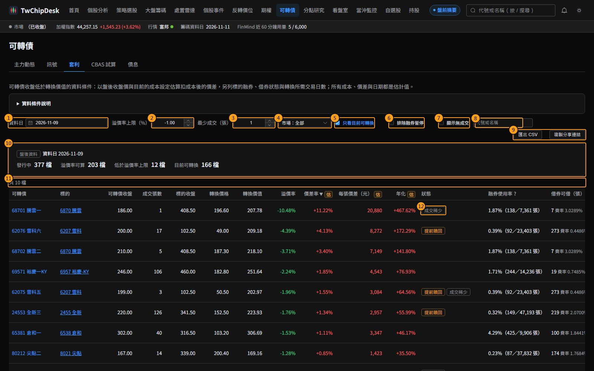
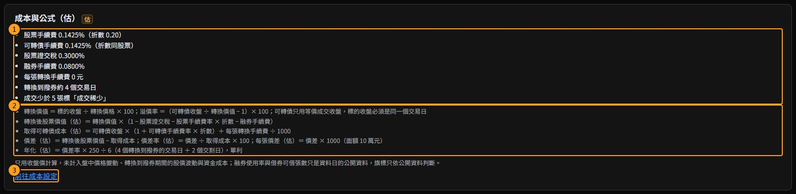
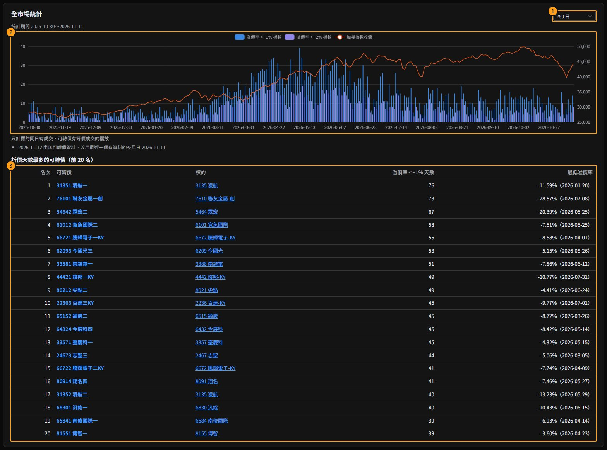
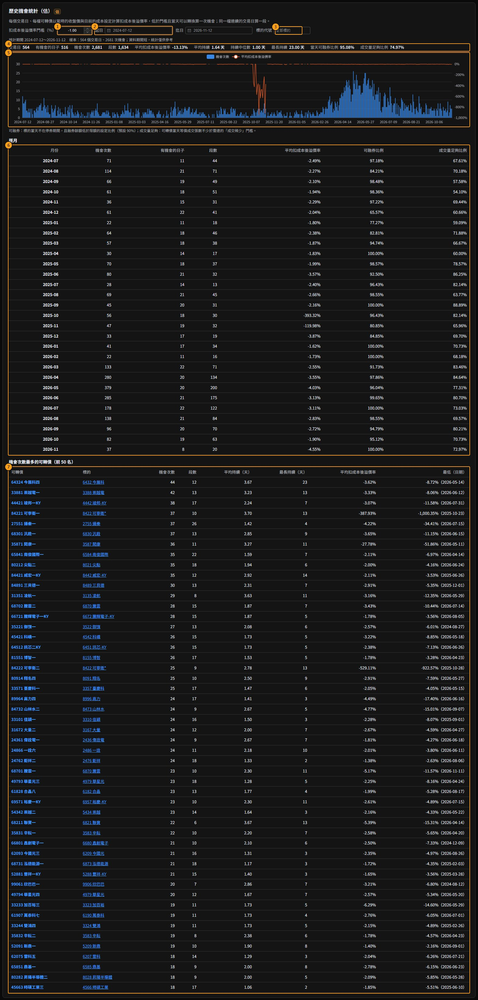
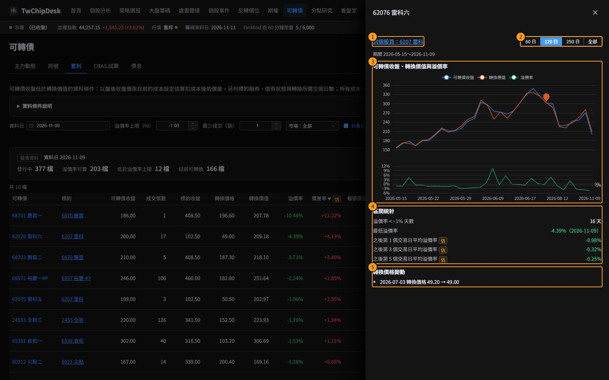

<!-- routes: /cb/arbitrage, /derivatives/cb-arbitrage -->
# 可轉債｜套利

> 位置：頂部選單「可轉債」→「套利」分頁（網址 `/cb/arbitrage`）；期權頁分頁列的「可轉債套利」、舊網址 `/derivatives/cb-arbitrage`（舊書籤，條件照帶）與個股頁「基本面」的「可轉債」區塊每一檔旁的「套利明細」也會開到這裡
> 資料更新：盤後資料，每個交易日約 21:35 可轉債日成交入庫後才有當天的資料（21:30 每日總覽、21:35 日成交）；成本設定改變後立即重算

## 這個功能可以做什麼
以盤後收盤價列出溢價率低於上限的可轉換公司債（可轉債收盤價低於轉換價值），並依設定頁的成本估算「取得可轉債、申請轉換、同時以融券持有標的空方部位」這個組合在扣掉費用後的價差。頁面分四部分：

- 清單：條件篩選後的可轉債，含溢價率、價差率（估）、每張價差（估）、年化（估）與狀態旗標。
- 「成本與公式（估）」：目前使用的費率與全部公式。
- 「全市場統計」：每天溢價率低於 −1%、−2% 的檔數對照加權指數，以及折價天數最多的前 20 檔。
- 單檔明細：點一列開啟，看這檔的收盤、轉換價值與溢價率走勢和歷史統計。

所有成本、價差與年化都是估計值；本頁只提供計算，不提供操作依據。

2026-11 起本頁從「期權」移到「可轉債」頁，並加上：資料條件說明、標的融券使用率、借券可借張數與費率、依停止轉換期間調整的轉換天數與預計可取得股票日，以及 2024-07-12 以來的歷史機會統計。

## 資料條件說明
清單上方的「資料條件說明」（點一下展開）以資料條件描述這類價差，不是操作步驟：
- 可轉債價格低於轉換價值（溢價率小於 0），扣除手續費、證交稅等成本後價差仍為正。
- 轉換期間內需要以融券或借券取得對應的股票部位，所以表格列出標的的「融券使用率」與「借券可借（張）」。
- 「轉換天數」：資料日的下一個交易日申請，約需設定的交易日數才取得股票；遇停止轉換、暫停轉換或閉鎖期時順延。

**名詞**：
- **轉換價值**：一張可轉債（面額 100 元計）全部轉成股票，以標的收盤價計算的價值 ＝ 標的收盤 ÷ 轉換價格 × 100。
- **溢價率**：（可轉債收盤 ÷ 轉換價值 − 1）× 100。溢價率為負代表可轉債收盤低於轉換價值（折價）。

## 清單

| 編號 | 名稱 | 說明 |
|---|---|---|
| 1 | 「資料日」 | 空白為「最新資料日」；可選過去的日子。選的日子還沒有可轉債資料時，自動改用最近一個有資料的交易日，摘要旁註明「（指定 YYYY-MM-DD）」 |
| 2 | 「溢價率上限（%）」 | 只列溢價率小於或等於這個值的可轉債（預設 −1，每次加減 0.5） |
| 3 | 「最少成交（張）」 | 可轉債當天等價成交張數下限（預設 1）；當天沒有等價成交的列不套用 |
| 4 | 「市場」 | 「全部」「上市」「上櫃」，依標的股票的市場 |
| 5 | 「只看目前可轉換」 | 預設勾選：排除閉鎖期、轉換期滿、停止轉換、暫停轉換中的可轉債 |
| 6 | 「排除融券暫停」 | 勾選後排除標的在融券暫停期間的可轉債（不勾選時只標示「融券暫停」） |
| 7 | 「顯示無成交」 | 勾選後也列出可轉債或標的當天沒有成交的可轉債；這些列沒有溢價率，不套用溢價率上限，排在最後 |
| 8 | 「代號或名稱」 | 搜尋可轉債或標的的代號、名稱（只篩目前已取回的列）；改過條件後出現「恢復預設條件」 |
| 9 | 「匯出 CSV」「複製分享連結」 | 下載目前清單（檔名「可轉債套利_日期.csv」，估計欄標「（估）」）；複製含全部條件的網址 |
| 10 | 摘要 | 「盤後資料」「資料日 YYYY-MM-DD」，以及資料日全市場的「發行中」「溢價率可算」「低於溢價率上限」「目前可轉換」檔數（不受市場與其他篩選影響）；資料說明列在下方 |
| 11 | 檔數 | 「共 N 檔」或「顯示 N 檔（共 M 檔）」（搜尋後）；超過 200 檔時註明「符合條件 M 檔，只列前 200 檔」 |
| 12 | 「狀態」 | 狀態旗標，滑過看說明（見下方「狀態旗標」） |

### 表格欄位
| 欄位 | 說明 |
|---|---|
| 「可轉債」 | 代號與名稱；點一下開啟單檔明細 |
| 「標的」 | 標的股票；點一下開啟個股頁 K 線籌碼圖 |
| 「可轉債收盤」 | 可轉債當天等價交易的收盤（每 100 元面額） |
| 「成交張數」 | 可轉債當天等價成交張數 |
| 「標的收盤」 | 標的股票同一個交易日的收盤 |
| 「轉換價格」 | 資料日（或之前最近一筆）每日總覽的轉換價格（元） |
| 「轉換價值」「溢價率」 | 見上方名詞 |
| 「價差率」（估） | （轉換後股票價值 − 取得可轉債成本）÷ 取得成本 × 100，公式見下方 |
| 「每張價差（元）」（估） | 每 100 元面額的價差 × 1000（一張面額 10 萬元） |
| 「年化」（估） | 價差率 × 250 ÷ 持有天數（轉換到撥券的交易日數 ＋ 2 個交割日，預設 4 ＋ 2 ＝ 6），單利 |
| 「下一次賣回」 | 資料日以後最近一次賣回日與賣回價格，例如「2027-12-05（100.00）」 |
| 「融券使用率」 | 標的資料日的融券餘額 ÷ 融券限額 × 100，括號內為「餘額／限額 張」；限額為 0 或沒有資料時顯示「—」。實際可融券張數以券商當天的額度為準 |
| 「借券可借（張）」 | 次一營業日的借券可借張數（股數 ÷ 1,000 捨去），旁邊為最近 20 個交易日借券成交依張數加權的平均「費率」；期間內沒有借券成交時顯示「期間內沒有借券成交」 |
| 「轉換天數」（估） | 資料日的下一個交易日申請轉換、加上設定的轉換天數（預設 4 個交易日），顯示資料日到「預計 YYYY-MM-DD 取得股票」的交易日數；申請日落在停止轉換、暫停轉換期間或閉鎖期時順延到期間結束後的第一個交易日，並標「順延」。轉換期間已結束時顯示「轉換期間已結束」 |
| 「提前贖回」 | 已公告的提前贖回期間起日與價格，例如「2026-11-19 起（100.00）」 |

預設依價差率由大到小排序；點欄名可改排序（溢價率、融券使用率、轉換天數第一次點為由小到大）。匯出的 CSV 另外附融券餘額、融券限額、融券使用率、借券可借、借券費率、預計可申請轉換日、預計可取得股票日（估）與轉換天數（估）。條件、排序與開啟的明細都會寫進網址，重新整理或分享後還原。溢價率上限、可轉換、排除融券暫停、最少成交張數、市場、無成交與排序也記在這台電腦的瀏覽器：下次直接開 `/cb/arbitrage` 時沿用上次的選擇；網址有帶這些條件時以網址為準。資料日、搜尋與明細不記。

### 狀態旗標
紅色為目前不能轉換或標的融券暫停，橘色為要留意的事件，灰色為一般說明。

| 旗標 | 意思 |
|---|---|
| 「閉鎖期」 | 資料日早於轉換期間起日，還不能轉換 |
| 「轉換期滿」 | 資料日晚於轉換期間迄日 |
| 「停止轉換」「暫停轉換」 | 資料日在停止轉換或暫停轉換期間內 |
| 「即將停止轉換」 | 未來 10 個交易日內開始停止轉換或暫停轉換 |
| 「融券暫停」「即將融券暫停」 | 標的在官方公告的融券暫停期間內，或未來 10 個交易日內開始（迄日未定的視為 60 個日曆日） |
| 「融券接近限額」 | 標的融券餘額已達融券限額的設定比例（預設 90%）以上 |
| 「處置」「注意」 | 標的處置中、被列為注意股（沒有注意股資料的日子不標示） |
| 「提前贖回」 | 已公告提前贖回期間 |
| 「賣回日將屆」 | 60 個日曆日內有賣回日 |
| 「成交稀少」 | 可轉債當天等價成交張數低於設定的門檻（預設 5 張） |
| 「可轉債無成交」「標的無成交」 | 當天沒有成交，無法計算溢價率（勾「顯示無成交」才會出現） |

## 成本與公式（估）

| 編號 | 名稱 | 說明 |
|---|---|---|
| 1 | 目前費率 | 股票手續費與折數、可轉債手續費（折數同股票）、股票證交稅、融券手續費、每張轉換手續費、轉換到撥券的交易日數、「成交稀少」的門檻 |
| 2 | 公式 | 計算方式（以每 100 元面額計） |
| 3 | 「前往成本設定」 | 開啟設定頁的「可轉債套利（成本，估）」區 |

公式（全部為估計，不計最低手續費）：
- 轉換後股票價值 ＝ 轉換價值 ×（1 − 股票證交稅 − 股票手續費率 × 折數 − 融券手續費）
- 取得可轉債成本 ＝ 可轉債收盤 ×（1 ＋ 可轉債手續費率 × 折數）＋ 每張轉換手續費 ÷ 1000
- 價差 ＝ 轉換後股票價值 − 取得成本；價差率 ＝ 價差 ÷ 取得成本 × 100；每張價差 ＝ 價差 × 1000
- 年化 ＝ 價差率 × 250 ÷（轉換到撥券的交易日數 ＋ 2 個交割日），單利

為什麼是估計：只用收盤價計算，沒有計入盤中價格變動、轉換到撥券這段期間的股價波動與資金成本；融券使用率與借券可借張數只是資料日的公開資料；費率是設定頁的值，不一定等於實際成交的費用。

## 全市場統計

| 編號 | 名稱 | 說明 |
|---|---|---|
| 1 | 期間 | 「60 日」「120 日」「250 日」（預設）「520 日」交易日；上方列出實際「統計期間」 |
| 2 | 折價檔數走勢 | 每天「溢價率 < −1% 檔數」「溢價率 < −2% 檔數」（長條）對照「加權指數收盤」（折線）；只計標的同日有成交、可轉債有等價成交的檔數 |
| 3 | 「折價天數最多的可轉債（前 20 名）」 | 期間內溢價率 < −1% 天數最多的可轉債，列出「溢價率 < −1% 天數」與「最低溢價率」（括號為日期）；點可轉債開啟單檔明細，點標的開啟個股頁 |

全市場統計的結束日固定為最新資料日，不跟清單的「資料日」連動；今天的資料還沒入庫時，下方會註明改用最近一個有資料的交易日。

## 歷史機會統計（估）

每個交易日、每檔可轉債以當時的可轉債收盤、轉換價值與**目前的成本設定**計算「扣成本後溢價率」（＝ −價差率；小於 0 表示扣成本後可轉債價格仍低於轉換價值）。低於門檻、而且當天可以轉換（不在閉鎖期、停止轉換、暫停轉換，轉換期間未結束）算一次機會；同一檔可轉債連續的交易日算一段。資料自 2024-07-12 起，樣本期間短，畫面列出統計期間與樣本數。

| 編號 | 名稱 | 說明 |
|---|---|---|
| 1 | 「扣成本後溢價率門檻（%）」 | 預設 −1；小於這個值算一次機會 |
| 2 | 「起日」「迄日」 | 統計期間，空白為 2024-07-12 到最新資料日 |
| 3 | 「標的代號」 | 只看一檔標的股票（空白為「全部標的」）；改過條件後出現「恢復預設」 |
| 4 | 摘要 | 「交易日」「有機會的日子」「機會次數」（交易日 × 可轉債的筆數）「段數」「平均扣成本後溢價率」「平均持續」「持續中位數」「最長持續」「當天可融券比例」「成交量足夠比例」 |
| 5 | 每天的機會次數 | 長條為每天的機會次數，折線（右軸）為當天機會的平均扣成本後溢價率 |
| 6 | 「逐月」 | 每月的機會次數、有機會的日子、段數、平均扣成本後溢價率、可融券比例、成交量足夠比例 |
| 7 | 「機會次數最多的可轉債（前 50 名）」 | 每檔的機會次數、段數、平均與最長持續天數、平均與最低扣成本後溢價率（括號為日期）；點可轉債開啟單檔明細，點標的開啟個股頁 |

- **可融券**：標的當天不在官方停券期間，且融券餘額低於限額的設定比例（預設 90%）。
- **成交量足夠**：可轉債當天等價成交張數不少於「成交稀少」門檻（預設 5 張）。
- 門檻、期間與標的寫進網址（`oth`、`ofrom`、`oto`、`ostock`），與清單的條件互不影響。
- 成本設定改變後，歷史統計也會用新的成本重算。
- 歷史資料要等「可轉債主力」的回補工作跑完才有；之前顯示「這段期間還沒有可轉債主力的每日計算結果：歷史資料要等回補工作跑完才會有，每個交易日約 22:40 計算當天」。

## 單檔明細（點一列）

| 編號 | 名稱 | 說明 |
|---|---|---|
| 1 | 「到個股頁」 | 開啟標的的個股頁 K 線籌碼圖 |
| 2 | 「期間」 | 「60 日」「120 日」（預設）「250 日」「全部」，結束日為清單的資料日；上方列出實際期間 |
| 3 | 「可轉債收盤、轉換價值與溢價率」 | 上圖為可轉債收盤與轉換價值，下圖為溢價率（虛線為 0% 與 −1%）；轉換價格變動的日子在圖上以標記標出（變動當天可轉債沒有成交時，標在之後第一個有成交的日子）。只畫可轉債有等價成交的日子 |
| 4 | 「區間統計」 | 「溢價率 < −1% 天數」、「最低溢價率」（括號為日期），以及「之後第 1／3／5 個交易日平均溢價率」（估）：對每個溢價率 < −1% 的日子，取其後第 N 個交易日的溢價率再平均，只用歷史資料計算 |
| 5 | 「轉換價格變動」 | 期間內轉換價格的變動日與變動前後的值；沒有時顯示「期間內沒有轉換價格變動」 |

## 操作步驟
1. 先到設定頁「可轉債套利（成本，估）」與「期現套利（成本與稅率，估）」區確認手續費折數等成本符合自己的情況。
2. 在清單調整「溢價率上限（%）」「最少成交（張）」，依「價差率」或「溢價率」排序，留意「狀態」欄的旗標。
3. 點一列開啟單檔明細，看溢價率的歷史走勢與「區間統計」。
4. 想知道折價出現的頻率，看下方「全市場統計」並切換期間；想知道扣成本後的價差持續幾天、當天能不能融券，看「歷史機會統計（估）」。

## 資料來源與更新時間
- 可轉債每日總覽（轉換價格、流通餘額、停止轉換、暫停轉換、提前贖回）：交易日 21:30；可轉債日成交：21:35；賣回時程：每週六 10:30。來源 FinMind。
- 只用交易別「等價」的成交；標的收盤用同一個交易日的日 K，不回看其他日子。
- 資料日為「每日總覽」與「等價成交」都已入庫的最近一天；伺服器以資料日為單位快取 10 分鐘。
- 融券暫停、處置、注意股來自既有的官方公告資料（與期現套利、處置雷達相同）。
- 融券餘額與限額：每個交易日 21:05 資券資料入庫後；借券可借張數與借券成交：FinMind 借券資料。
- 歷史機會統計讀「可轉債主力」每日計算的結果（每個交易日約 22:40 算完），2024-07-12 起。

## 注意事項與限制
- 只列可轉換公司債，且標的已確認；交換債與標的不明的不列入。
- 價差、年化只用收盤價計算；實際轉換要經過申請到撥券的期間，期間內股價變動與融券、借券是否取得都會影響結果。
- 轉換天數與預計可取得股票日是依停止轉換、暫停轉換期間與設定的轉換天數推算的估計值，實際以發行公司與券商的作業為準。
- 每張價差以面額 10 萬元計，沒有計入最低手續費。
- 旗標只依公開資料判斷，閉鎖期、停止轉換等以發行公司公告為準。
- 資料日的標的日 K 還沒入庫時，畫面顯示「資料日有發行中的可轉債，但溢價率一檔都算不出來，多半是標的日 K 尚未入庫；溢價率與價差暫時無法顯示」。
- 當天資料還沒入庫（約 21:35 之前）時自動改用前一個有資料的交易日；完全沒有可用資料時顯示「可轉債資料尚未入庫（每個交易日約 21:35 之後才有當天資料）」。
- 想在扣成本價差夠低時收到提示：到[警示中心](../alerts/README.md)新增「可轉債訊號（盤後）」規則並選「套利價差低於門檻」（預設 -1%，與歷史機會統計的扣成本價差相同）；每個交易日晚上可轉債主力動態算完後評估一次。

## 常見問題
- **舊的書籤 `/derivatives/cb-arbitrage` 還能用嗎？** 可以，會自動轉到 `/cb/arbitrage`，網址上的條件照帶。
- **為什麼晚上 9 點多打開，資料日還是前一天？** 可轉債日成交約 21:35 入庫，入庫前會用最近一個有資料的交易日。
- **為什麼有些可轉債溢價率很低卻沒有出現？** 預設只看目前可轉換、成交至少 1 張。閉鎖期、停止轉換中的要取消「只看目前可轉換」；成交張數低於「最少成交（張）」的要調低門檻；當天沒有成交的沒有溢價率，勾「顯示無成交」才會列在最後。
- **個股頁的可轉債溢價率和這裡不同？** 個股頁的收盤是最近有成交的日子，這裡固定用資料日當天的等價收盤與同日的標的收盤。

## 相關功能
- [首頁｜我的今日清單](../home.md#我的今日清單)：標的是自選股或持股、扣成本價差（估）低於設定門檻的可轉債會列在「可轉債」區段。
- [可轉債](README.md)：主力動態、訊號、CBAS 試算、債息。
- [個股分析｜基本面](../stock/fundamental.md)：「可轉債」區塊的「套利明細」連到本頁。
- [期權｜期現套利](../derivatives/arbitrage.md)：股票成本設定與本頁共用。
- [設定](../settings.md)：「可轉債套利（成本，估）」區。
