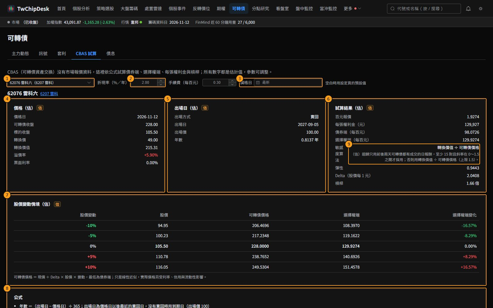

<!-- routes: /cb/cbas -->
# 可轉債｜CBAS 試算

> 位置：頂部選單「可轉債」→「CBAS 試算」分頁（網址 `/cb/cbas`，可帶 `?cb=代號`）
> 資料更新：隨時試算；價格用價格日以前最近一筆可轉債等價收盤（每個交易日 21:35 入庫）

## 這個功能可以做什麼
CBAS（可轉債資產交換）沒有市場報價資料，這一頁依公開的公式，用一檔可轉債的收盤價、賣回或到期資訊與可調整的參數，試算百元報價、每張權利金、債券端、選擇權端、槓桿，以及股價 ±10% 時選擇權端的變化。所有數字都是估計值，與券商實際報價可能不同。

## 畫面說明

| 編號 | 名稱 | 說明 |
|---|---|---|
| 1 | 「可轉債」 | 輸入代號或名稱選擇（清單為主力動態最新資料日的可轉債）；還沒選時顯示「請先選擇一檔可轉債」 |
| 2 | 「折現率（%／年）」「手續費（每百元）」 | 空白時用設定頁「可轉債主力」區的預設值（2.0%、0.3），欄位的提示文字顯示目前使用的值；範圍 0～20、0～10 |
| 3 | 「價格日」 | 空白為最新；用不晚於這天的最近一筆等價收盤。改過參數後出現「恢復預設參數」 |
| 4 | 「價格（估）」 | 價格日、可轉債收盤、標的收盤、轉換價、轉換價值、溢價率、票面利率 |
| 5 | 「出場日（估）」 | 出場方式（「賣回」或「到期」）、出場日、出場價與年數 |
| 6 | 「試算結果（估）」 | 「百元報價」「每張權利金（元）」「債券端（每百元）」「選擇權端（每百元）」、敏感度算法、「彈性」「Delta（股價每 1 元）」「槓桿」 |
| 7 | 「股價變動情境（估）」 | 股價 −10%、−5%、0、+5%、+10% 時的股價、可轉債價格、選擇權端與選擇權端變化（0% 那一列為目前） |
| 8 | 「公式」 | 全部公式與限制 |
| 9 | 敏感度算法 | 實際採用的方法：「近 20 日迴歸」（後面列「樣本 N 對」）或「轉換價值 ÷ 可轉債價格」；下方灰字說明兩種方法的切換條件（估），見下方公式的「彈性」。 |

## 公式（每 100 元面額）
- 年數 ＝（出場日 − 價格日）÷ 365；出場日為價格日以後最近的賣回日（出場價＝賣回價），沒有賣回時用到期日（出場價 100）。
- 百元報價 ＝ 折現率 × 年數 −（出場價 − 100）＋ 手續費。例：2 × 3 −（105 − 100）＋ 0.3 ＝ 1.3。
- 每張權利金 ＝（百元報價 ＋（可轉債價格 − 100））× 1,000（面額 10 萬元）。例：百元報價 1.3、可轉債 109 → 10,300 元。
- 債券端 ＝ 100 − 百元報價；選擇權端 ＝ 可轉債價格 − 債券端。
- 彈性（估）：最近 20 個交易日中，前後兩天可轉債都有成交、且可轉債與標的都有收盤的日報酬至少 15 對，而且迴歸斜率在 0～1.5 之間（不含 0）時用迴歸斜率（「近 20 日迴歸」）；可轉債成交稀少、斜率 ≤ 0 或超過 1.5 時改用轉換價值 ÷ 可轉債價格（超過 1.5 時以 1.5 計），「敏感度算法」顯示實際採用的方法；Delta ＝ 彈性 × 可轉債價格 ÷ 股價。
- 槓桿 ＝ 彈性 × 可轉債價格 ÷ 選擇權端；選擇權端 ≤ 0 時不計算。
- 情境：可轉債價格 ＝ 現價 ＋ Delta × 股價 × 變動，最低為債券端（所以選擇權端最低為 0）。

## 操作步驟
1. 在「可轉債」選一檔，畫面依預設參數試算。
2. 依需要改「折現率（%／年）」「手續費（每百元）」或「價格日」，結果立即更新；參數寫進網址，可分享。
3. 看「股價變動情境（估）」中選擇權端隨股價的變化。

## 注意事項與限制
- 沒有 CBAS 報價與信用評等資料；試算未計入券商的實際報價、利息與稅負。
- 情境表是線性近似，實際價格另受利率、信用與流動性影響。
- 價格日以前沒有等價成交時顯示「這檔可轉債在價格日以前沒有等價成交，無法試算」；沒有賣回日也沒有到期日時顯示「這檔可轉債沒有賣回日也沒有到期日，無法計算年數與百元報價」。

## 相關功能
- [可轉債｜債息](yield.md)：到賣回日、到期日的殖利率。
- [設定](../settings.md)：「可轉債主力」區的 CBAS 預設參數。
