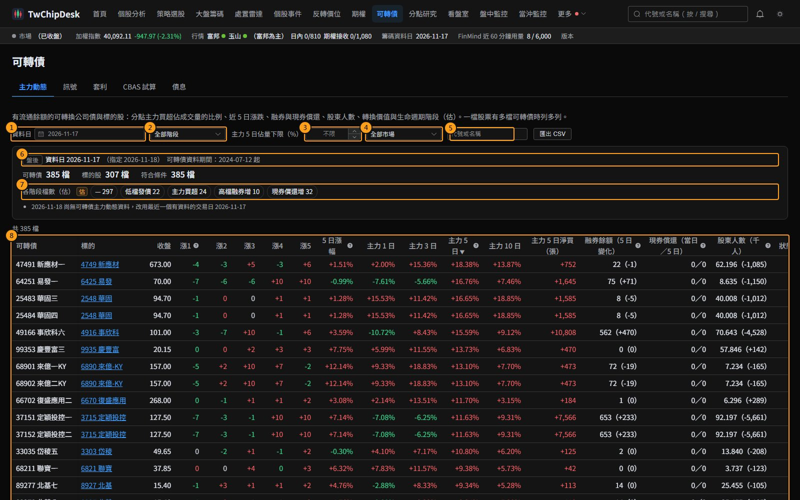
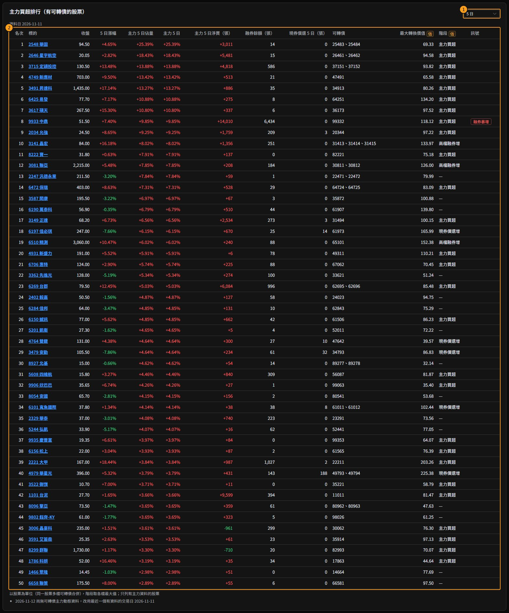

<!-- routes: /cb -->
# 可轉債｜主力動態

> 位置：頂部選單「可轉債」→「主力動態」分頁（網址 `/cb`）；個股頁「基本面」可轉債區塊的「在可轉債頁查看」也會開到這裡並帶入代號搜尋
> 資料更新：盤後資料。「可轉債主力」每個交易日約 22:40 起計算：當天的總覽完整、資券與等價成交都入庫、而且籌碼（分點）資料也到了才算；最近 30 個交易日內後來才補齊資料的日子會重算（分點 18:10、資券 21:05、可轉債總覽與成交 21:35 之後），算完才有當天的資料

## 這個功能可以做什麼
列出有流通餘額的可轉換公司債，每檔可轉債一列（一檔股票有多檔可轉債時列多列，股票欄位相同）：標的近 5 日每天的漲跌、分點主力買超佔成交量的比例、融券與現券償還、股東人數，以及可轉債的轉換價值、溢價率、已轉換比例、發行與到期資訊、財務比率與生命週期階段（估）。下方為有可轉債的股票依主力買超佔量的排行。

## 畫面說明

| 編號 | 名稱 | 說明 |
|---|---|---|
| 1 | 「資料日」 | 空白為「最新資料日」；選的日子還沒有計算結果時，改用最近一個有資料的交易日並註明「（指定 YYYY-MM-DD）」 |
| 2 | 「階段」 | 「全部階段」或只看一個階段（0「未分類」、1～4） |
| 3 | 「主力 5 日佔量下限（%）」 | 主力買超佔量 5 日平均的下限（含），空白為「不限」 |
| 4 | 市場 | 「全部市場」「上市」「上櫃」，依標的股票 |
| 5 | 「代號或名稱」 | 搜尋可轉債或標的的代號、名稱；改過條件後出現「恢復預設條件」 |
| 6 | 摘要 | 「盤後」「資料日」、資料期間，以及「可轉債」「標的股」「符合條件」檔數 |
| 7 | 「各階段檔數（估）」 | 資料日各階段的檔數（篩選前）；點一個階段只看該階段，再點一次取消 |
| 8 | 表格 | 欄位見下表；第一欄固定，表格可左右捲動 |
| 9 | 「階段規則（估）」 | 點一下展開，列出目前設定的階段與訊號條件 |
| 10 | 「主力買超排行（有可轉債的股票）」 | 見下方「主力買超排行」 |

### 表格欄位
| 欄位 | 說明 |
|---|---|
| 「可轉債」「標的」 | 可轉債代號名稱；標的點一下開啟個股頁「基本面」 |
| 「收盤」 | 標的收盤（元） |
| 「漲1」～「漲5」 | 近 5 個交易日每天的官方漲跌幅 ＝ 收盤 ÷ 當天參考價 − 1（與選股、個股頁相同；除權息、減資恢復買賣日不會算成漲跌），四捨五入到整數 %（滑鼠移上去看精確值）；「漲1」為資料日 |
| 「5 日漲幅」 | 這 5 天每日漲跌幅連乘；任一天缺資料時顯示「—」 |
| 「主力 1 日」～「主力 10 日」 | 主力買超佔量的 N 日平均（%）；N 日內都沒有分點資料時顯示「—」 |
| 「主力 5 日淨買（張）」 | 主力 5 日合計的買賣超張數 |
| 「融券餘額（5 日變化）」 | 融券餘額（張）與較 5 個交易日前的增減 |
| 「現券償還（當日／5 日）」 | 當日與 5 日合計的現券償還張數 |
| 「股東人數（千人）」 | 集保股權分散表最新一週的股東人數，括號為 4 週變化（人） |
| 「狀態」 | 標的資料日「處置」「注意」「停券」；當天沒有任何官方注意股資料時顯示「—」，滑過說明「當天沒有注意股資料」（無法判斷，不代表沒有被注意） |
| 「轉換價」「轉換價值」（估）「可轉債收盤」「溢價率」（估） | 轉換價值 ＝ 100 × 標的收盤 ÷ 轉換價；可轉債當天沒有等價成交時收盤與溢價率為「—」 |
| 「已轉換」 | 1 − 流通餘額 ÷ 發行額 |
| 「發行日（距今）」（估） | 推算的發行日與到資料日的交易日數 |
| 「發行時股價位置」 | 發行日收盤在前一年最高、最低之間的位置（0% 為最低） |
| 「賣回日」「到期日」（估） | 資料日以後最近一次賣回日（括號為賣回價）與推算的到期日 |
| 「票面利率」 | 可轉債的票面年利率 |
| 「可轉債法人（當日／5 日）」 | 可轉債本身的三大法人合計買賣超張數 |
| 「速動比」「負債比」 | 最新一季財報（括號為季別）：速動比 ＝（流動資產 − 存貨 − 預付款項）÷ 流動負債 × 100；負債比 ＝ 負債總額 ÷ 資產總額 × 100 |
| 「階段」（估） | 見[可轉債](README.md)的階段規則 |
| 「訊號」 | 這檔可轉債當天的「券償暴增」「融券暴增」；訊號按每檔可轉債判斷，同一股票的兩檔可轉債可能不同（例如融券暴增要求轉換價值 ≥ 110） |

預設依「主力 5 日」由大到小排序；點欄名可改排序，條件與排序寫進網址，重新整理或分享後還原。階段、主力佔量下限、市場、排序與排行天數也記在這台電腦的瀏覽器：下次直接開 `/cb` 時沿用上次的選擇；網址有帶這些條件時以網址為準。資料日與搜尋不記。

## 主力買超排行

| 編號 | 名稱 | 說明 |
|---|---|---|
| 1 | 「依 N 日平均」 | 「1 日」「3 日」「5 日」（預設）「10 日」 |
| 2 | 排行表 | 以股票為單位（同一股票多檔可轉債合併）依所選 N 日的主力買超佔量由大到小，列出前 50 名：收盤、5 日漲幅、主力佔量、主力 5 日淨買、融券餘額、現券償還 5 日、可轉債代號、最大轉換價值（估）、階段（各檔最大，估）與訊號 |

資料日跟著上方的「資料日」。

## 操作步驟
1. 打開「可轉債」頁，預設看到最新資料日、依主力 5 日佔量排序的全部可轉債。
2. 點「各階段檔數（估）」的一個階段，或用「階段」選單只看該階段。
3. 調整「主力 5 日佔量下限（%）」與市場，依需要點欄名排序。
4. 點標的開啟個股頁「基本面」，在「可轉債」區塊看這檔可轉債的生命週期時間軸。

## 資料來源與更新時間
- 分點買賣超（主力定義與 K 線籌碼圖相同）：交易日 18:10；資券（融券餘額、限額、現券償還）：21:05；可轉債每日總覽、日成交、三大法人：21:30～21:45；集保股權分散表：每週；財報：資產負債表（流動資產、存貨、預付款項、流動負債、負債總額、資產總額）。來源 FinMind。
- 「可轉債主力」每個交易日約 22:40 起計算：當天的總覽完整、資券與等價成交都入庫、而且籌碼（分點）資料也到了才算；最近 30 個交易日內後來才補齊資料的日子會重算。資料沒到齊的日子先不算，之後補齊時再算。

## 注意事項與限制
- 只列可轉換公司債（不含交換債），標的已確認，且資料日有流通餘額。
- 分點資料只有股票本身，沒有可轉債的分點；主力分析只看標的股。
- 階段、轉換價值、溢價率、發行日、到期日都是估計值；階段只描述資料狀態。
- 可轉債資料自 2024-07-12 起；早於這天的發行資訊可能不完整。
- 沒有信用評等資料，以速動比、負債比代替。

## 常見問題
- **為什麼晚上 10 點前打開，資料日還是前一天？** 可轉債主力約 22:40 起、資料到齊後才算當天，之前會用最近一個有資料的交易日。
- **同一檔股票為什麼出現好幾列？** 每檔可轉債一列，股票欄位（收盤、主力佔量、融券等）相同。

## 相關功能
- [可轉債｜訊號](signals.md)、[可轉債｜套利](arbitrage.md)、[可轉債｜CBAS 試算](cbas.md)、[可轉債｜債息](yield.md)
- [個股分析｜基本面](../stock/fundamental.md)：「可轉債」區塊的生命週期時間軸。
