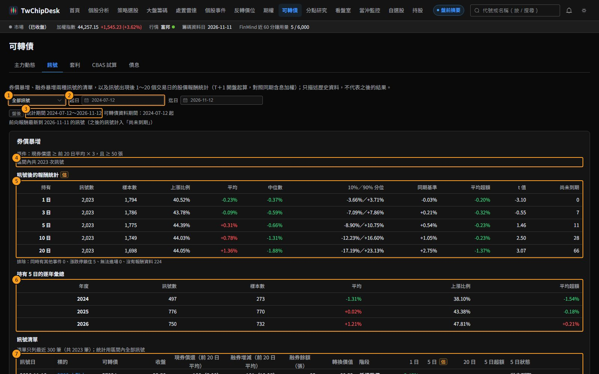

<!-- routes: /cb/signals -->
# 可轉債｜訊號

> 位置：頂部選單「可轉債」→「訊號」分頁（網址 `/cb/signals`）
> 資料更新：每個交易日約 22:40「可轉債主力」計算完成後；訊號後的報酬（前向報酬）在之後的交易日陸續補上

## 這個功能可以做什麼
列出有可轉債的股票出現兩種融券相關訊號的日子，並統計訊號出現後 1、3、5、10、20 個交易日的股價報酬，看歷史上這類資料狀態之後的表現分布。統計只描述歷史資料，不代表之後的結果。

| 訊號 | 條件（預設，設定頁「可轉債主力」區可調） |
|---|---|
| 券償暴增 | 當日現券償還 ≥ 前 20 個交易日平均 × 3，且 ≥ 50 張 |
| 融券暴增 | 當日融券餘額增加 ≥ 前 20 個交易日每日變化絕對值平均 × 3，且當日增加至少 50 張，且轉換價值 ≥ 110（按每檔可轉債判斷，「可轉債」欄只列符合的那幾檔） |

## 畫面說明

| 編號 | 名稱 | 說明 |
|---|---|---|
| 1 | 「訊號」 | 「全部訊號」（預設，兩種都列）或只看一種 |
| 2 | 「起日」「迄日」 | 統計期間，空白為 2024-07-12 到最新資料日；改過後出現「恢復預設期間」 |
| 3 | 期間 | 「統計期間 起～迄」、資料期間，以及「前向報酬最新到 YYYY-MM-DD 的訊號」：之後的訊號還沒滿持有天數，計入「尚未到期」 |
| 4 | 條件與訊號數 | 每種訊號的條件與「區間內共 N 次訊號」 |
| 5 | 「訊號後的報酬統計」（估） | 持有 1、3、5、10、20 日各一列：「訊號數」「樣本數」「上漲比例」「平均」「中位數」「10%／90% 分位」「同期基準」「平均超額」「t 值」「尚未到期」；樣本少於 30 筆標「樣本不足」 |
| 6 | 「持有 5 日的逐年彙總」 | 每年的訊號數、樣本數、平均、上漲比例、平均超額 |
| 7 | 「訊號清單」 | 最近的訊號（新到舊，每種最多 300 筆；超過時註明「清單只列最近 N 筆（共 M 筆）」）；欄位見下表，點欄名可排序 |

### 訊號清單欄位
| 欄位 | 說明 |
|---|---|
| 「訊號日」「標的」「可轉債」 | 訊號日、標的股票（點一下開啟個股頁「基本面」）與當天在範圍內的可轉債 |
| 「收盤」 | 標的收盤 |
| 「現券償還（前 20 日平均）」 | 當日現券償還張數，括號為前 20 個交易日平均 |
| 「融券增減（前 20 日平均）」 | 當日融券餘額變化張數，括號為前 20 個交易日每日變化絕對值的平均 |
| 「融券餘額（張）」「轉換價值」 | 轉換價值為各檔可轉債的最大值（估） |
| 「階段」 | 各檔可轉債的最大階段（估） |
| 「1 日」「5 日」「20 日」「5 日超額」 | 持有 N 日的報酬（%）與 5 日報酬減同期基準 |
| 「5 日狀態」 | 「已計算」「尚未到期」「其他事件」「漲跌停鎖住」「無法進場」「沒有資料」 |

報酬的算法與「策略選股｜訊號績效」相同：訊號日的次一交易日開盤進場、持有 N 個交易日，基準為同期的含息加權指數。2024-09-18 以前沒有前向報酬資料，計入「沒有報酬資料」。

## 操作步驟
1. 打開「訊號」分頁，先看兩種訊號的條件與訊號數。
2. 在「訊號後的報酬統計」比較不同持有天數的平均、中位數與上漲比例，留意「樣本不足」標示。
3. 用「起日」「迄日」縮小期間，或在「持有 5 日的逐年彙總」看各年的差異。
4. 在「訊號清單」點欄名排序，點標的看個股頁。

## 資料來源與更新時間
- 融券餘額與現券償還：交易日 21:05（FinMind 融資融券）；可轉債轉換價值：每日總覽與日成交 21:30～21:35。
- 訊號在「可轉債主力」每日計算（約 22:40）時判斷；前向報酬來自訊號績效統計的每日資料。

## 注意事項與限制
- 可轉債資料自 2024-07-12 起，樣本期間短；統計只描述歷史資料。
- 清單最多列 300 筆，但統計一律用區間內全部訊號。
- 訊號按每檔可轉債判斷，清單與統計則依日期與股票合併：同一股票同一天只算一次訊號，「可轉債」欄列出當天有這個訊號的可轉債。
- 想在訊號出現時收到提示：到[警示中心](../alerts/README.md)新增「可轉債訊號（盤後）」規則，選「券償暴增」「融券暴增」或「套利價差低於門檻」；每個交易日晚上算完後評估一次，同一資料日每檔一次。

## 相關功能
- [可轉債｜主力動態](mainforce.md)：表格的「訊號」欄。
- [策略選股｜訊號績效](../screener/signal-stats.md)：相同的報酬統計方法。
