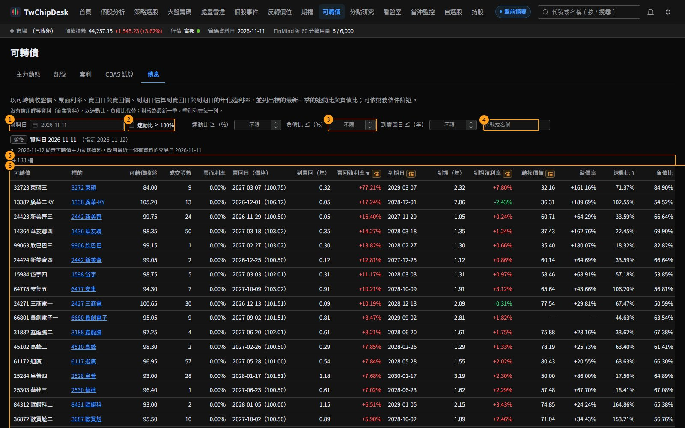

<!-- routes: /cb/yield -->
# 可轉債｜債息

> 位置：頂部選單「可轉債」→「債息」分頁（網址 `/cb/yield`）
> 資料更新：盤後資料，用主力動態的資料日（每個交易日約 22:40）；財報為可用日不晚於資料日的最新一季

## 這個功能可以做什麼
以可轉債收盤價、票面利率、賣回日與賣回價、到期日，估算持有到最近賣回日與到期日的年化殖利率，並列出標的最新一季的速動比與負債比，方便依財務條件篩選與排序。

沒有信用評等資料（商業資料），以速動比、負債比代替；每列標出所用財報的季別。

## 畫面說明

| 編號 | 名稱 | 說明 |
|---|---|---|
| 1 | 「資料日」 | 空白為「最新資料日」 |
| 2 | 「速動比 ≥ 100%」 | 快速勾選速動比下限 100% |
| 3 | 「速動比 ≥（%）」「負債比 ≤（%）」「到賣回日 ≤（年）」 | 空白為「不限」；設了條件時沒有該數值的列不列出 |
| 4 | 「代號或名稱」 | 搜尋；改過條件後出現「恢復預設條件」 |
| 5 | 檔數 | 「共 N 檔」或「顯示 N 檔（符合 M 檔）」 |
| 6 | 表格 | 欄位見下表；只列有等價收盤的可轉債 |

### 表格欄位
| 欄位 | 說明 |
|---|---|
| 「可轉債」「標的」 | 標的點一下開啟個股頁「基本面」 |
| 「可轉債收盤」「成交張數」「票面利率」 | 等價收盤（每 100 元面額）、成交張數、票面年利率 |
| 「賣回日（價格）」「到賣回（年）」 | 資料日以後最近一次賣回日與價格、距今年數 |
| 「賣回殖利率」（估） | 持有到賣回日的年化殖利率 |
| 「到期日」（估）「到期（年）」「到期殖利率」（估） | 到期日用轉換期間迄日推算，到期出場價以 100 計 |
| 「轉換價值」（估）「溢價率」 | 與主力動態相同 |
| 「速動比」「負債比」「財報季別」 | 速動比 ＝（流動資產 − 存貨 − 預付款項）÷ 流動負債 × 100；負債比 ＝ 負債總額 ÷ 資產總額 × 100 |
| 「階段」（估） | 生命週期階段 |

預設依賣回殖利率由大到小；點欄名可改排序（負債比、到賣回年數第一次點為由小到大），條件與排序寫進網址。

**殖利率的算法（估）**：以可轉債收盤為現值、票面利率每年付息一次（付息日由出場日往前每滿一年，不含已過的）、出場日收到出場價，解年複利的內部報酬率（年數 ＝ 日曆日 ÷ 365）。出場日不晚於資料日或沒有收盤時為「—」。

## 操作步驟
1. 打開「債息」分頁，預設依賣回殖利率排序。
2. 勾「速動比 ≥ 100%」或輸入負債比上限、到賣回日年數上限篩選。
3. 點欄名改排序，留意每列的「財報季別」。

## 注意事項與限制
- 殖利率只用收盤價與公開的賣回、到期資訊計算，沒有計入手續費與稅負；到期日為推算值。
- 速動比、負債比為最新一季財報，不同公司的季別可能不同。
- 沒有信用評等與擔保資料。

## 相關功能
- [可轉債｜CBAS 試算](cbas.md)
- [個股分析｜基本面](../stock/fundamental.md)：財報與財務比率。
