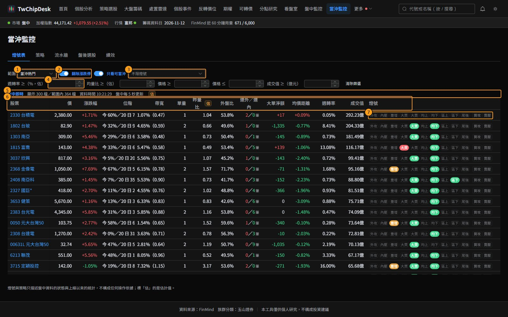
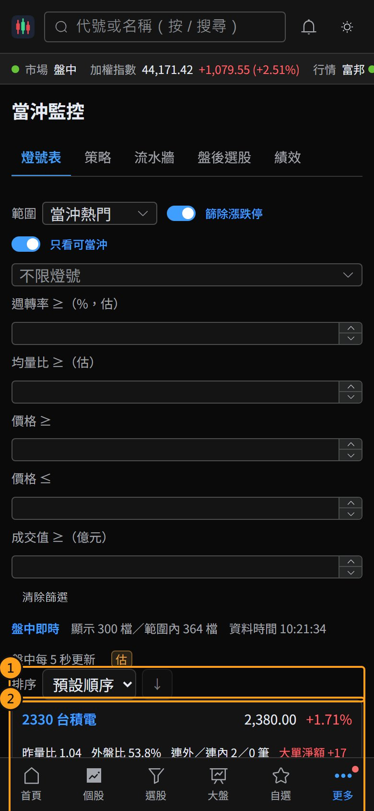

<!-- routes: /daytrade -->
# 當沖監控｜燈號表

> 位置：頂部選單「當沖監控」→「燈號表」分頁（網址 `/daytrade`）
> 資料更新：盤中每隔一次快照輪詢間隔（目前 5 秒，依設定值）重新查詢；燈號有變化時立即更新；非交易時段顯示最後一個交易日收盤時的狀態

## 這個功能可以做什麼
每檔股票一列，同時看價、漲跌、位階、帶寬、單量、昨量比、外盤比、連外／連內、大單淨額、均價距離、週轉率、成交值，以及 10 個燈號與 2 個複合燈目前亮或熄。可以只看當沖熱門、自選、持股或指定的股票，再用漲跌停、可否當沖、週轉率、均量比、價格、成交值與燈號篩選。點股票開啟這檔的當沖面板。

## 畫面說明

| 編號 | 名稱 | 說明 |
|---|---|---|
| 1 | 「範圍」 | 「當沖熱門」（成交值前 300 名或量比 ≥ 2，預設）、「全市場」、「自選」（可選群組，空白為全部自選）、「持股」、「看盤室」（看盤室目前來源合併後的股票，前 300 檔；不套用看盤室的濾網；右邊顯示看盤室的檔數，看盤室還沒有來源時提示先設定）、「指定股票」（輸入代號，逗號或空白分隔，最多 300 檔）。 |
| 2 | 「篩除漲跌停」「只看可當沖」 | 預設都開啟：不列漲停或跌停鎖住的股票、不列暫停先賣後買的股票。 |
| 3 | 「燈號」 | 可多選；只列選取的燈號中至少一個亮著的股票。空白為不限。 |
| 4 | 數值篩選 | 「週轉率 ≥（%，估）」「均量比 ≥（估）」「價格 ≥」「價格 ≤」「成交值 ≥（億元）」；空白為不限。「清除篩選」回到預設（保留範圍）。 |
| 5 | 資料說明 | 「盤中即時」或「YYYY-MM-DD 收盤時的狀態」、「顯示 N 檔／範圍內 M 檔」、資料時間與更新間隔；「估」說明哪些欄位是估計值。 |
| 6 | 表格 | 每檔一列，欄名可點擊排序（見下方欄位說明）。 |
| 7 | 燈號 | 10 個燈號，後面隔開的是 2 個複合燈。亮的燈依方向上色（買方力道紅、賣方力道綠、中性橘），熄的燈是灰色外框；每個燈都有兩個字的短名稱。滑鼠移上去看名稱、亮起時間與亮、熄滅規則。 |
| 8 | 「精度」 | 「逐筆」或「估（5 秒快照）」；秒數依設定值。 |

篩選與排序會記在這台電腦的瀏覽器中，下次開啟沿用。

## 欄位與名詞
| 欄位 | 說明 |
|---|---|
| 「股票」 | 代號與名稱；漲停、跌停鎖住時標「漲停」「跌停」，暫停先賣後買時標「暫停先賣後買」。點一下開啟當沖面板。 |
| 「價」「漲跌幅」 | 目前價與相對參考價的漲跌幅。當天曾碰到漲跌停而已打開時，價的左邊加「曾漲停」「曾跌停」或「曾漲跌停」小標記（鎖住時看「股票」欄的「漲停」「跌停」）。 |
| 「位階」 | 「今 N%／20 日 M%」：目前價在今天高低區間、20 日高低區間的位置。 |
| 「帶寬」 | 今天（最高 − 最低）÷ 參考價；括號內為與 20 日平均日內振幅的比。 |
| 「單量」 | 最近一段（快照）或一筆（逐筆）的成交張數（快照時為估計）。 |
| 「昨量比」 | 同時段昨量比（估）。 |
| 「外盤比」 | 當天外盤量 ÷（外盤 + 內盤）。 |
| 「連外／連內」 | 連外次／連內次，後面的單位是「筆」或「段」。 |
| 「大單淨額」 | 近 5 分鐘大單外盤張數 − 大單內盤張數（從目前時間往回算 5 分鐘，不以整分鐘切）。 |
| 「均價距離」 | 價與當日均價的距離（%）。 |
| 「週轉率」 | 估計值。 |
| 「成交值」 | 今天的成交金額。 |
| 「亮燈數」「最近亮燈」 | 目前亮著的燈數、最近一次亮燈的時間。 |

「位階」「帶寬」「單量」「昨量比」「外盤比」「連外／連內」「大單淨額」「均價距離」「週轉率」等欄名旁的小問號圖示是這一欄的說明（滑鼠移上去顯示，手機點一下顯示；點圖示不會排序）。

排序：點欄名依那一欄排序，再點一次反向，第三次回到原本順序。依「成交值」「漲跌幅」「昨量比」「外盤比」「大單淨額」「亮燈數」「最近亮燈」排序時，伺服器也用同一個欄位決定取哪 300 檔。盤中數值更新時列的順序先不變動，出現「順序已變動・重新排序」時按一下重新排列。

## 手機版

| 編號 | 名稱 | 說明 |
|---|---|---|
| 1 | 排序 | 手機上用上方的排序選單。 |
| 2 | 卡片 | 每檔一張卡片：股票、價、漲跌幅、昨量比、外盤比、連外／連內、大單淨額、精度與 12 個燈。點股票那一行開啟當沖面板。 |

## 當沖面板
點股票會從右側（手機為全螢幕）開啟這檔的當沖面板（標題為代號與名稱），內容與個股頁「即時」分頁下方的「當沖面板」相同，見[個股分析｜即時](../stock/intraday.md#當沖面板)（包括「損益兩平（估）」：以目前成交價買一張、當天沖銷，價格要朝有利方向走幾檔才不虧）；「開啟個股即時頁」連到個股頁。電腦上可拖曳面板左緣調整寬度，瀏覽器會記住（見[側邊抽屜的寬度](../getting-started.md#側邊抽屜的寬度)）。

## 操作步驟
1. 盤中開啟本頁，預設看「當沖熱門」。
2. 依需要改「範圍」，再用篩選縮小範圍。
3. 點欄名排序，或用「燈號」只看某些燈亮著的股票。
4. 點股票開啟當沖面板，看燈號時間軸與走勢。

## 注意事項與限制
- 服務重新啟動後到下一個交易日開盤前，表格會是空的，並顯示「目前沒有引擎狀態（服務重新啟動後，下一個交易日開盤才有資料）」。
- 燈號表只在快照輪詢時更新，不是逐筆即時；燈號的亮滅事件則會立即推送到「流水牆」。

## 相關功能
- [流水牆](stream.md)
- [策略](strategies.md)
- [個股分析｜即時](../stock/intraday.md)
