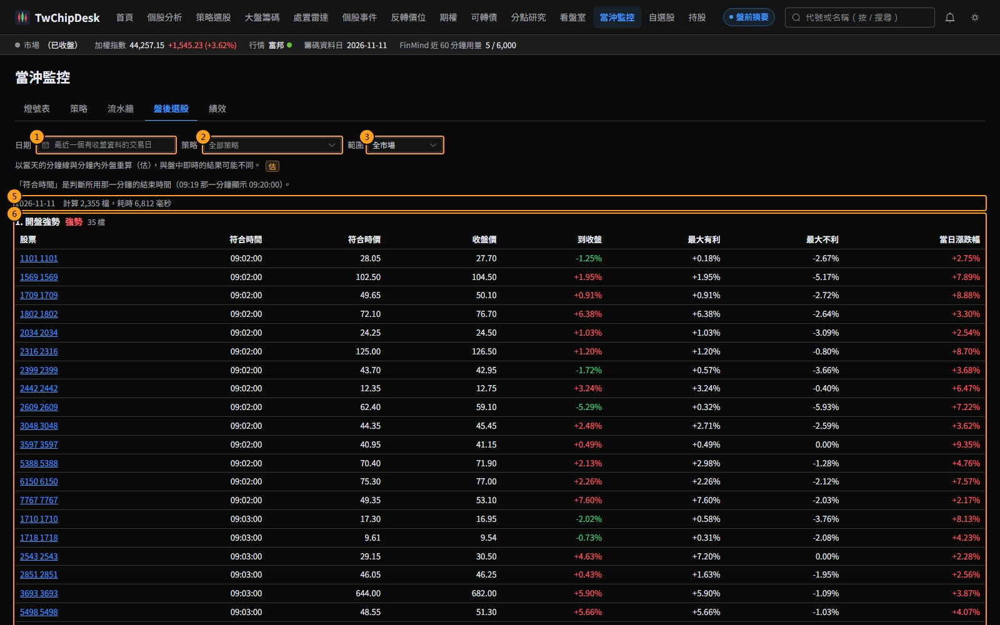

<!-- routes: /daytrade/review -->
# 當沖監控｜盤後選股

> 位置：頂部選單「當沖監控」→「盤後選股」分頁（網址 `/daytrade/review`）
> 資料更新：交易日 13:30 收盤後可查當天；分鐘線只保留 10～30 天

## 這個功能可以做什麼
選一個交易日，用當天的分鐘線與分鐘內外盤，以和盤中相同的規則把 16 種策略再算一次，列出每個策略當天符合的股票、符合時間與時價，以及之後到收盤的漲跌、盤中最大有利與最大不利變動。適合收盤後回顧當天哪些股票曾出現某種型態。

## 畫面說明

| 編號 | 名稱 | 說明 |
|---|---|---|
| 1 | 「日期」 | 空白為最近一個有收盤資料的交易日（今天 13:30 以後就是今天）。不能選未來的日期。 |
| 2 | 「策略」 | 空白為「全部策略」，或只算一個策略。 |
| 3 | 「範圍」 | 預設「全市場」；過去日期的「當沖熱門」以當天成交值前 300 名或量比 ≥ 2 判斷。「看盤室」用看盤室目前的股票（前 300 檔，不是當天的看盤室名單）。 |
| 4 | 「套用組合」 | 有自訂組合時出現在「範圍」右邊（截圖時沒有自訂組合，所以圖中沒有這一項），可用組合的參數重算（只列所選策略的組合）。空白為使用設定值。 |
| 5 | 計算摘要 | 日期、計算的股票數與耗時。 |
| 6 | 每個策略的符合清單 | 只列有符合的策略：「股票」（代號與名稱；點一下開啟當天的個股即時頁）「符合時間」「符合時價」「收盤價」「到收盤」「最大有利」「最大不利」「當日漲跌幅」。 |

## 欄位與名詞
- **符合時間**：判斷所用那一分鐘的結束時間，例如 09:19 那一分鐘的資料符合時顯示 09:20:00。
- **到收盤**：符合時價到當天收盤價的漲跌幅。
- **最大有利、最大不利**：符合之後到收盤之間，價格往有利、不利方向最大的變動。強勢類以上漲為有利，弱勢類以下跌為有利；數字一律是價格變動百分比。

## 操作步驟
1. 收盤後開啟本頁（日期空白即為今天）。
2. 選策略或範圍；有自訂組合時可以選「套用組合」比較不同參數。
3. 點股票看當天的分時走勢與當沖面板。

## 注意事項與限制
- 盤後選股是以分鐘線重算的估計（估），與盤中即時（快照或逐筆）的結果可能不同。
- 分鐘線不存在的日期顯示「這一天沒有分鐘線資料（分鐘線只保留 10～30 天）」；選今天但還沒 13:30 時顯示「今天收盤後（13:30 以後）才能看今天的盤後選股」。
- 同一時間只能算一個盤後選股；已有一個在算時顯示「已有一個盤後選股在計算，請稍後再試」，按「重試」再查一次。過去日期的結果會保留 30 分鐘，再查同樣條件時直接顯示。

## 相關功能
- [策略](strategies.md)
- [績效](stats.md)
