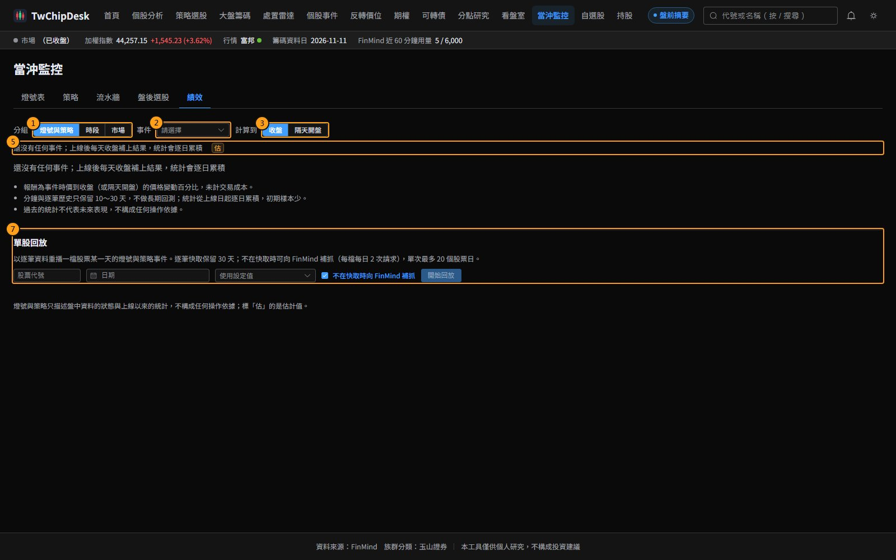
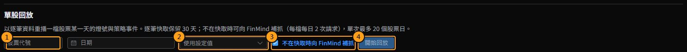

<!-- routes: /daytrade/stats -->
# 當沖監控｜績效

> 位置：頂部選單「當沖監控」→「績效」分頁（網址 `/daytrade/stats`）
> 資料更新：交易日 14:00 補上當天每個事件到收盤的結果；下一個交易日 14:00 補上到隔天開盤的結果

## 這個功能可以做什麼
從上線日起，記錄每一次亮燈、熄燈、攻擊結束與策略符合當時的時間與價格，收盤後計算之後到收盤（或到隔天開盤）的價格變化，並依燈號與策略、時段或市場分組統計。統計期間預設為最近 60 個交易日（上線未滿 60 個交易日時從上線日起），畫面寫出實際期間。下方的「單股回放」可以用逐筆資料把一檔股票某一天重新跑一次，看當天會出現哪些燈號與策略事件。

## 畫面說明

| 編號 | 名稱 | 說明 |
|---|---|---|
| 1 | 「分組」 | 「燈號與策略」（每個燈號、複合燈與策略一列）、「時段」（開盤 09:00～09:30、早盤 09:30～11:00、午盤 11:00～12:30、尾盤 12:30～13:30）、「市場」（上市、上櫃）。 |
| 2 | 「事件」 | 「全部事件」或只看「亮燈」「熄燈」「攻擊結束」「策略符合」。 |
| 3 | 「計算到」 | 「收盤」或「隔天開盤」。 |
| 4 | 「燈號／策略」 | 依時段或市場分組時出現，只看一個燈號或策略。 |
| 5 | 起算日、期間與樣本數 | 「統計自上線日 YYYY-MM-DD 起」、實際統計的期間（「期間 起日～迄日」，預設最近 60 個交易日）與合計事件數、樣本數；「估」說明樣本不足的門檻與上漲機率的算法。 |
| 6 | 統計表 | 「名稱」「方向」「事件數」「樣本數」「上漲機率」「平均」「中位數」「平均最大有利」「平均最大不利」「待補」，可點欄名排序。樣本少於 30 筆的列標「樣本不足」。 |
| 7 | 「單股回放」 | 見下方。 |

## 欄位與名詞
- **上漲機率**：報酬大於 0 的比例；報酬依價格變動計算，不依方向翻號。
- **平均、中位數**：事件時價到收盤（或隔天開盤）的價格變動百分比。
- **待補**：還沒有結果的事件數（例如今天的事件要等 14:00）。

## 單股回放

| 編號 | 名稱 | 說明 |
|---|---|---|
| 1 | 「股票代號」「日期」 | 一檔股票與一個過去的交易日。 |
| 2 | 「套用組合」 | 用自訂組合的參數取代對應策略的設定值；空白為「使用設定值」。 |
| 3 | 「不在快取時向 FinMind 補抓」 | 逐筆快取保留 30 天；不在快取時向 FinMind 補抓（每檔每日 2 次請求）。取消勾選時，不在快取的日期顯示「沒有資料」。 |
| 4 | 「開始回放」 | 送出後每檔以代號與名稱標示，列出資料來源（「逐筆快取」「FinMind 補抓」「沒有資料」「失敗」）、逐筆筆數與事件數，以及每則事件的時間、種類、價與「到收盤」「最大有利」「最大不利」。 |

回放同時只能一個請求，前一個還沒完成時顯示「回放同時只能一個請求，請等前一個完成」。非交易日、未來日期、今天 13:35 以前的今天都沒有資料。

## 操作步驟
1. 選分組與計算到收盤或隔天開盤，看各燈號與策略的統計。
2. 注意每列的樣本數；標「樣本不足」的列參考價值低。
3. 想看某一天某檔股票的事件時，在「單股回放」輸入代號與日期，按「開始回放」。

## 注意事項與限制
- 報酬未計交易成本。
- 分鐘與逐筆歷史只保留 10～30 天，不做長期回測；統計從上線日起逐日累積，初期樣本少。
- 過去的統計不代表未來表現，不構成任何操作依據。

## 相關功能
- [策略選股｜訊號績效](../screener/signal-stats.md)
- [盤後選股](review.md)
