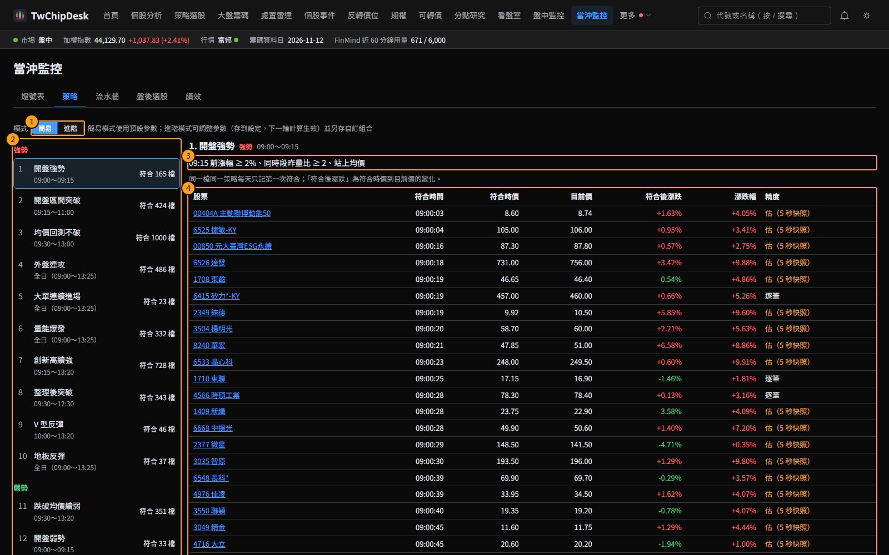
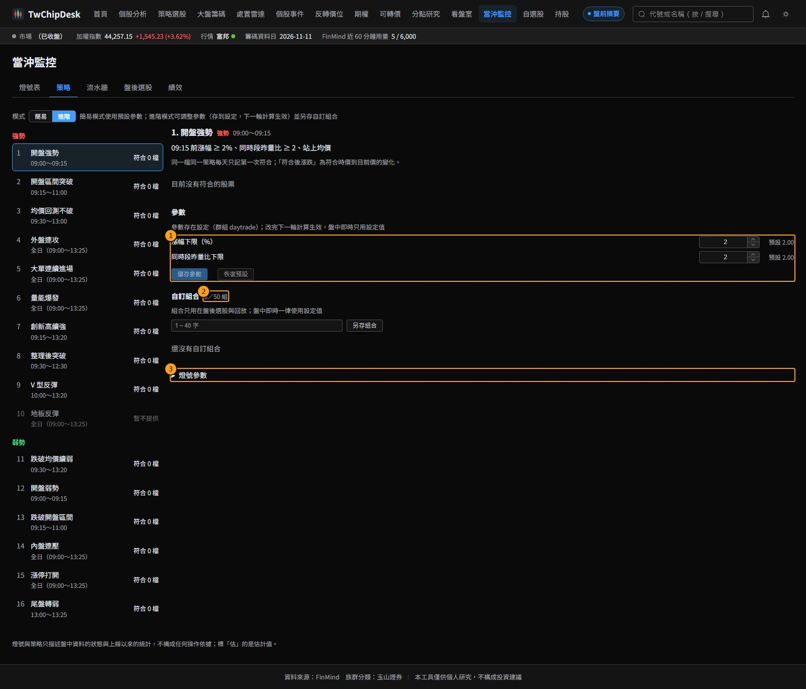

<!-- routes: /daytrade/strategies -->
# 當沖監控｜策略

> 位置：頂部選單「當沖監控」→「策略」分頁（網址 `/daytrade/strategies`）
> 資料更新：盤中有策略符合時立即更新符合清單；參數改完後下一輪計算生效

## 這個功能可以做什麼
16 種預設策略都是燈號與指標的組合（強勢類 1～10、弱勢類 11～16）。選一個策略就能看今天盤中符合的股票、符合時間、符合時的價格與之後的變化。「簡易」模式用預設參數；「進階」模式可以調整參數，並把參數另存為自己的組合，用在盤後選股與回放。

## 畫面說明

| 編號 | 名稱 | 說明 |
|---|---|---|
| 1 | 「模式」 | 「簡易」只看結果；「進階」多出參數編輯與自訂組合。 |
| 2 | 策略清單 | 分「強勢」「弱勢」兩組，每個策略顯示時段與「符合 N 檔」。目前無法使用的策略標「暫不提供」。 |
| 3 | 策略說明 | 策略名稱、類別、時段與條件。 |
| 4 | 符合清單 | 「股票」（代號與名稱）「符合時間」「符合時價」「目前價」「符合後漲跌」「漲跌幅」「精度」。點股票開啟個股即時頁。 |

進階模式：

| 編號 | 名稱 | 說明 |
|---|---|---|
| 1 | 「參數」 | 每個參數一個數字欄，右邊是預設值。「儲存參數」只送出有改過的參數；「恢復預設」把這個策略的參數改回預設值。 |
| 2 | 「自訂組合」 | 「N／50 組」為目前組合數與上限。輸入名稱（1～40 字）後按「另存組合」，把目前編輯中的參數存成一組；每一組可以「改名」「刪除」（刪除要再按「確定」）。 |
| 3 | 「燈號參數」 | 展開後可調整每個燈號的門檻與「共通參數」（例如同燈冷卻分鐘數）。 |

## 16 種策略（預設參數）
| # | 名稱 | 類別 | 時段 | 條件 |
|---|---|---|---|---|
| 1 | 開盤強勢 | 強勢 | 09:00～09:15 | 漲幅 ≥ 2%、同時段昨量比 ≥ 2、站上均價燈亮 |
| 2 | 開盤區間突破 | 強勢 | 09:15～11:00 | 突破開盤區間燈＋量能放大燈 |
| 3 | 均價回測不破 | 強勢 | 09:30～13:00 | 曾站上均價、回到均價 ±0.3% 內後再站上，期間沒跌破均價 1% |
| 4 | 外盤連攻 | 強勢 | 全日（09:00～13:25） | 外盤連攻燈＋外盤比 ≥ 60% |
| 5 | 大單連續進場 | 強勢 | 全日（09:00～13:25） | 大單買方力道燈連續亮 15 分鐘以上 |
| 6 | 量能爆發 | 強勢 | 全日（09:00～13:25） | 同時段昨量比 ≥ 3＋站上均價燈 |
| 7 | 創新高續強 | 強勢 | 09:15～13:20 | 5 分鐘內創日內新高＋外盤比 ≥ 60% |
| 8 | 整理後突破 | 強勢 | 09:30～12:30 | 前 30 分鐘振幅 < 1.5% 後突破那段的高點＋量能放大燈 |
| 9 | V 型反彈 | 強勢 | 10:00～13:20 | 日內最低曾低於參考價 3% 以上，之後價 ≥ 均價 |
| 10 | 地板反彈 | 強勢 | 全日（09:00～13:25） | 今日觸及地板價後站回地板價之上＋外盤連攻燈（地板價取自[地板天花板](../reversal/README.md)的今日地板價；那一檔沒有地板價或反轉價位還沒算到前一個交易日時不判斷） |
| 11 | 跌破均價續弱 | 弱勢 | 09:30～13:20 | 跌破均價燈＋內盤比 ≥ 60% |
| 12 | 開盤弱勢 | 弱勢 | 09:00～09:15 | 跌幅 ≥ 2%、同時段昨量比 ≥ 2、價 < 均價 |
| 13 | 跌破開盤區間 | 弱勢 | 09:15～11:00 | 跌破開盤區間燈＋量能放大燈 |
| 14 | 內盤連壓 | 弱勢 | 全日（09:00～13:25） | 內盤連壓燈＋大單賣方力道燈 |
| 15 | 漲停打開 | 弱勢 | 全日（09:00～13:25） | 曾鎖漲停後打開超過 1 分鐘 |
| 16 | 尾盤轉弱 | 弱勢 | 13:00～13:25 | 13:00 後近 20 分鐘跌 ≥ 1% 且內盤比 ≥ 60% |

「全日」為 09:00～13:25（13:30 收盤撮合不判斷）。同一檔同一個策略每天只記第一次符合。外盤比、內盤比＝當天外盤量（或內盤量）÷（外盤＋內盤）。

## 操作步驟
1. 點左側清單的策略，看右邊的符合清單。
2. 想調整門檻時切到「進階」，改參數後按「儲存參數」；下一輪計算開始用新的參數。
3. 想保留一組參數比較時，輸入名稱按「另存組合」，再到[盤後選股](review.md)或[績效](stats.md)的單股回放選這個組合。

## 注意事項與限制
- 盤中即時一律使用設定值；自訂組合只用在盤後選股與回放。
- 參數存在設定頁的「當沖監控」群組，改了會影響所有畫面。
- 符合清單的精度：「逐筆」或「估（5 秒快照）」（秒數依設定值）。

## 相關功能
- [盤後選股](review.md)
- [績效](stats.md)
- [設定](../settings.md)
