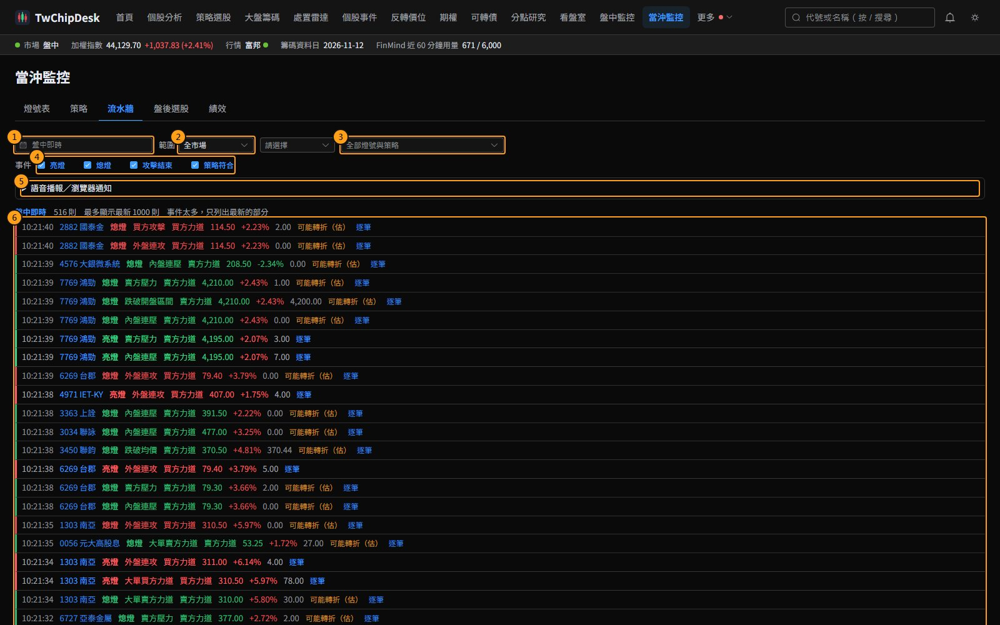
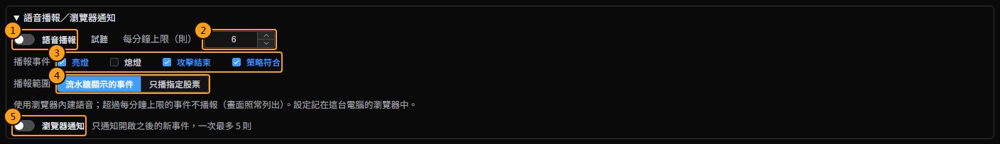

<!-- routes: /daytrade/stream -->
# 當沖監控｜流水牆

> 位置：頂部選單「當沖監控」→「流水牆」分頁（網址 `/daytrade/stream`）
> 資料更新：盤中燈號亮滅、攻擊結束與策略符合即時推送；連線中斷重新連上後自動補上中斷期間的事件

## 這個功能可以做什麼
把所有亮燈、熄燈、攻擊結束與策略符合依時間排成一列，最新的在最上面。買方力道的事件左側是紅色，賣方力道是綠色。可以只看某個範圍、某些事件種類、方向或燈號／策略，並開啟語音播報或瀏覽器通知，不用一直盯著畫面。

## 畫面說明

| 編號 | 名稱 | 說明 |
|---|---|---|
| 1 | 日期 | 空白為今天（盤中即時）；選過去的日期看當天的事件。 |
| 2 | 「範圍」 | 「當沖熱門」「全市場」（預設）「自選」「持股」「看盤室」（看盤室目前的股票，前 300 檔）「指定股票」。 |
| 3 | 方向、燈號／策略 | 「全部方向」或只看「買方力道」「賣方力道」「中性」；燈號與策略可多選，空白為全部。 |
| 4 | 「事件」 | 「亮燈」「熄燈」「攻擊結束」「策略符合」，可複選。 |
| 5 | 「語音播報／瀏覽器通知」 | 展開後設定語音與通知（見下方）。 |
| 6 | 事件列表 | 時間、股票（代號與名稱，例如「2330 台積電」；點一下開啟當沖面板）、事件種類、燈號或策略、方向、價、漲跌幅、觸發值、精度。熄燈與攻擊結束標「可能轉折（估）」；攻擊結束另外寫出亮了幾分鐘。 |

畫面最多保留最新 1,000 則；第一次開啟載入最新 500 則，事件太多時會註明「事件太多，只列出最新的部分」。

## 語音播報與通知

| 編號 | 名稱 | 說明 |
|---|---|---|
| 1 | 「語音播報」 | 開關。使用瀏覽器內建的語音，播報「股票名稱，燈號，亮燈」或「股票名稱，符合策略名稱」。瀏覽器不支援時開關停用並顯示說明。「試聽」播一句測試。 |
| 2 | 「每分鐘上限（則）」 | 1～60，預設 6。超過的事件不播報（畫面照常列出），並顯示「這一分鐘已略過 N 則」。 |
| 3 | 「播報事件」 | 要播的事件種類；預設播亮燈、攻擊結束、策略符合。 |
| 4 | 「播報範圍」 | 「流水牆顯示的事件」（跟著上方篩選）或「只播指定股票」（輸入代號）。 |
| 5 | 「瀏覽器通知」 | 開啟時瀏覽器會詢問是否允許通知；只通知開啟之後的新事件，一次最多 5 則。點通知回到流水牆。 |

語音只播開啟之後的新事件，第一次載入的事件不播。設定記在這台電腦的瀏覽器中。

## 操作步驟
1. 盤中開啟本頁，選範圍與要看的事件種類。
2. 展開「語音播報／瀏覽器通知」，打開「語音播報」並設定每分鐘上限與播報範圍；按「試聽」確認聲音。
3. 點事件的股票，從右側開啟當沖面板。

## 注意事項與限制
- 手機與平板的瀏覽器在背景或螢幕關閉時可能不播報語音，也可能暫停即時連線；回到畫面後會自動補上事件。
- 瀏覽器在使用者第一次點擊頁面之前可能不允許播放語音，必要時先按一下「試聽」。
- 熄燈、攻擊結束是「可能轉折」的估計，不代表價格一定改變方向。
- 不開著這一頁也想收到提示：到[警示中心](../alerts/README.md)新增「當沖燈號／策略」規則，選要哪些燈號亮起、哪些策略符合，範圍可為指定股票、自選、持股或當沖熱門；每檔每燈每天最多幾則可自訂（預設 1）。

## 相關功能
- [燈號表](board.md)
- [警示中心](../alerts/README.md)：瀏覽器通知的設定與允許方式，以及「當沖燈號／策略」規則
