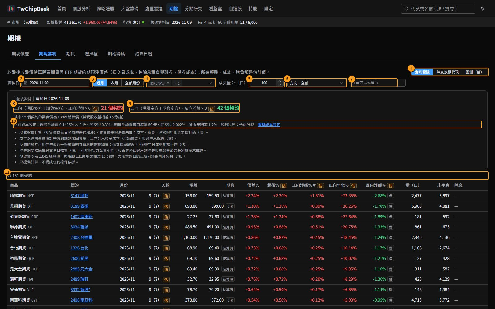
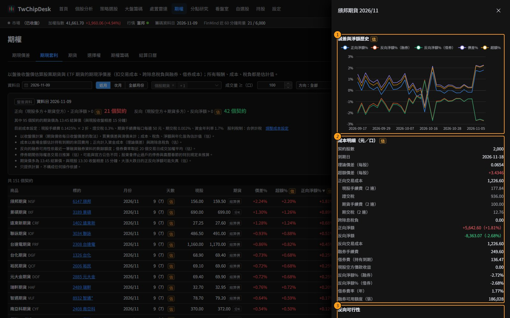
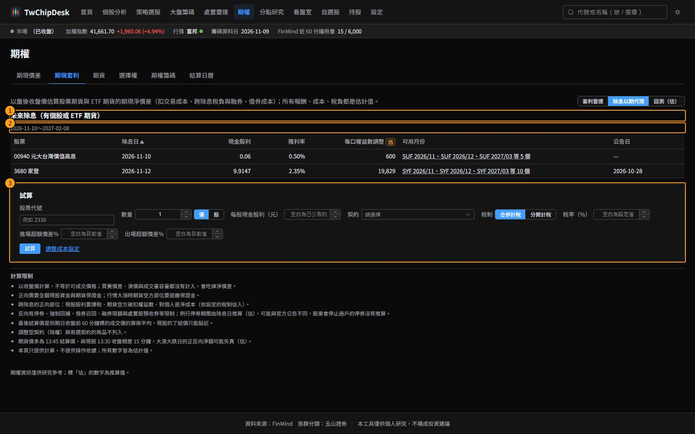
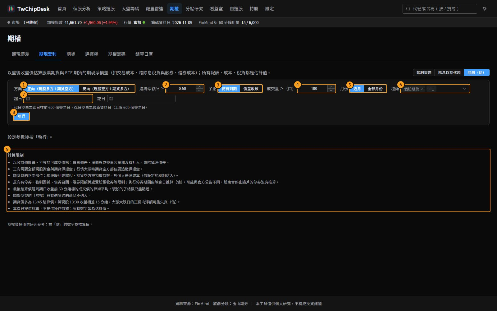

<!-- routes: /derivatives/arbitrage -->
# 期權｜期現套利

> 位置：頂部選單「期權」→「期現套利」分頁（網址 `/derivatives/arbitrage`；子頁 `?view=dividend`、`?view=backtest`）
> 資料更新：盤後資料，每個交易日 19:00 每日收盤價差算好後即可查詢；成本與稅率設定改變後立即重算

## 這個功能可以做什麼
以盤後收盤價估算股票期貨與 ETF 期貨的「期現淨價差」：期貨與現股的價差，扣掉理論持有成本、交易成本（手續費、證交稅、期交稅）、跨除息的稅負，以及反向時的融券或借券成本。三個子頁：

- 「套利雷達」：全部個股與 ETF 期貨契約的正向、反向淨額（估）排行。
- 「除息以期代現」：比較「持有現股參加除息」與「改持期貨」的稅後差額（估）。
- 「回測（估）」：用過去的每日收盤價差模擬，觀察門檻的歷史表現。

所有報酬、成本、稅負都是估計值；本頁只提供計算，不提供操作依據。

**方向的意思**：
- 「正向（現股多方＋期貨空方）」：期貨相對現股偏貴時，持有現股、同時持有期貨空方部位到期。
- 「反向（現股空方＋期貨多方）」：期貨相對現股偏便宜時，以融券或借券取得現股空方、同時持有期貨多方部位。

## 套利雷達

| 編號 | 名稱 | 說明 |
|---|---|---|
| 1 | 子頁 | 「套利雷達」「除息以期代現」「回測（估）」 |
| 2 | 「資料日」 | 空白為最近一日；可回看過去日子 |
| 3 | 「月份」 | 「近月」「次月」「全部月份」 |
| 4 | 「種類」 | 「個股期貨」「ETF 期貨」「小型契約」（預設個股與 ETF） |
| 5 | 「成交量 ≥（口）」 | 預設 100 口；離開欄位或按 Enter 後才套用 |
| 6 | 「方向」 | 「全部」「正向淨額 > 0」「反向淨額 > 0」 |
| 7 | 「代號或名稱」 | 搜尋商品或標的；「清除篩選」恢復預設 |
| 8 | 「正向淨額 > 0」 | 正向淨額為正的契約數（不受畫面上方向、搜尋篩選影響） |
| 9 | 「反向淨額 > 0」 | 反向淨額為正的契約數；下方另註明有幾個契約的期貨價是 13:45 結算價 |
| 10 | 「目前成本設定」 | 現股手續費 × 折數、證交稅、期貨手續費（每口每邊）、期交稅、資金年利率與股利稅制；「調整成本設定」連到設定頁 |
| 11 | 契約數 | 「共 N 個契約」或「顯示 N 個契約（篩選前 N 個）」 |

### 表格欄位
| 欄位 | 說明 |
|---|---|
| 「商品」「標的」「月份」 | 期貨商品、標的股票（點標的開啟個股頁）、契約月份 |
| 「天數」 | 距到期日曆日（括號為交易日） |
| 「現股」「期貨」 | 現股收盤、期貨價（旁邊標示期貨價的取法，例如結算價） |
| 「價差%」「超額%」 | 價差 ÷ 現股；超額為扣掉理論價差（估）後的部分 |
| 「正向淨額%」 | 正向淨額 = (期貨 − 現股 − 理論價差) × 契約股數 − 交易成本 − 跨除息稅負，再 ÷ 進場金額（估） |
| 「正向年化%」 | 正向淨額% × 365 ÷ 距到期日曆日（估） |
| 「反向淨額%」 | 反向淨額 = (現股 − 期貨) × 契約股數 ＋ 現股空方所得資金收益 − 交易成本 − 融券或借券費用；取可用方法中較高者，旁邊標「融」（融券）或「借」（借券）（估） |
| 「量（口）」「未平倉」 | 期貨成交量與未平倉 |
| 「除息」 | 下一次除息日與現金股利；除息日落在契約期間內時標「期間內」（正向持有到期要計入跨除息稅負） |
| 「停券（估）」 | 由除息日推算的停券期間 |
| 「標記」 | 「處置」「漲停」「跌停」「官方停券」 |

預設依正向淨額% 由大到小排序，任一欄可點擊排序。

### 契約明細（點一列）

| 編號 | 名稱 | 說明 |
|---|---|---|
| 1 | 「價差與淨額歷史」 | 這個契約整個存續期間的價差%、超額%、正向淨額%、反向淨額%（融券、借券）走勢；已到期的另列最後結算價 |
| 2 | 「成本明細（元／口）」 | 正向：現股手續費（2 邊）、證交稅、期貨手續費（2 邊）、期交稅（2 邊）、跨除息稅負、正向淨額。反向：融券手續費、借券費（持有到期）、借券費率（年）、現股空方價款收益、反向淨額（融券／借券）、融券可用額度。另列理論價差、超額價差（每股）、契約股數、到期日 |
| 3 | 「反向可行性」 | 反向做不到或受限的原因，例如「融券額度不足或沒有資料」「官方公告停券期間」「到期前有推算的停券期間（估），融券不能持有到期」「處置股：融券須預收券」「近期沒有借券成交，沒有借券費率」；沒有限制時顯示「沒有限制紀錄」。另列推算的停券期間與最後回補日 |

## 除息以期代現

| 編號 | 名稱 | 說明 |
|---|---|---|
| 1 | 「未來除息（有個股或 ETF 期貨）」 | 「股票」「除息日」「現金股利」「殖利率」「每口權益數調整」（估）「可用月份」（到期日不早於除息日的契約，太多時顯示「等 N 個」，滑過列出全部）「公告日」；點一列把資料帶入試算表單 |
| 2 | 期間 | 清單涵蓋的除息日期間（預設最新資料日的下一天起 90 天） |
| 3 | 「試算」表單 | 「股票代號」、「數量」（「張」或「股」，1～10,000,000 股）、「每股現金股利（元）」（空白為已公告的股利，可自訂尚未公告的股利）、「契約」（預設自動選到期日不早於除息日的最近月份）、「稅制」與「稅率（%）」（空白為設定值）、「進場超額價差%」「出場超額價差%」（空白為目前值）；按「試算」 |

**試算結果**（估）分兩欄比較：
- 「持有現股參加除息」：現金股利、股利所得稅、二代健保補充保費、稅後股利。
- 「以期代現」：口數、期貨股數、餘股（仍持有現股）、權益數調整、換倉成本（現股了結手續費、證交稅、現股回補手續費、期貨手續費與期交稅各 2 邊、價差成本）、期貨部分結果、餘股稅後股利、合計。
- 「差額（以期代現 − 持有現股）」、「損益兩平稅率」（合併計稅時顯示實質稅率與約當邊際稅率；不存在時顯示「不存在」）、「超額價差每變化 0.1% 的影響」。

原理：個股期貨遇現金除息時，期交所在除息日調整未平倉部位的權益數（多方加、空方減「每股現金股利 × 期貨股數」），持有期貨不會領到股利，所以沒有股利所得稅與補充保費；但要付換倉的交易成本與價差成本。權益數調整以期交所公告為準。

## 回測（估）

| 編號 | 名稱 | 說明 |
|---|---|---|
| 1 | 「方向」 | 「正向（現股多方＋期貨空方）」或「反向（現股空方＋期貨多方）」；選反向時多出「反向方式」（「自動」「融券」「借券」） |
| 2 | 「進場淨額% ≥」 | 收盤淨額% 達到這個門檻就進場（預設 0.50） |
| 3 | 「了結」 | 「持有到期」或「價差收斂」；選價差收斂時另填「收斂門檻（超額%）」 |
| 4 | 「成交量 ≥（口）」 | 成交量下限（預設 100） |
| 5 | 「月份」 | 「近月」或「全部月份」 |
| 6 | 「種類」 | 個股期貨、ETF 期貨、小型契約（預設個股與 ETF） |
| 7 | 「起日」「訖日」 | 起日空白為迄日往前 600 個交易日、迄日空白為最新資料日（上限 600 個交易日） |
| 8 | 「執行」 | 依參數執行回測 |
| 9 | 「計算限制」 | 每個子頁底部固定列出的計算限制（見下方「注意事項與限制」） |

**回測結果**：
- 「摘要」：資料期間、「筆數」「勝率」「平均淨報酬%」「中位數淨報酬%」「P5 淨報酬%」「P95 淨報酬%」「平均持有日數」「資金加權年化」「總損益（元）」「最大回撤（元）」「每日新訊號平均」「最多同時持有」。
- 「累計損益」圖（含同時持有筆數）、「每月損益」圖。
- 「了結原因」：「持有到期」「到期（結算價估）」（沒有最後結算價時以到期前最後一筆現股收盤估計）、「價差收斂」「停券前了結」。
- 「交易明細」：商品、月份、方式、進場日、了結日、了結原因、持有日數、進場淨額%、損益、淨報酬%、年化%；最多 2,000 筆，到期日晚於迄日的標「未了結」，不計入統計。

回測以每日收盤價與最後結算價模擬，未計買賣價差與滑價；勝率與最大回撤是在收盤價可成交、沒有追繳、沒有提前召回、沒有時間差的假設下的結果，只用來校準門檻。

## 成本與稅率設定
位置：「[設定](../settings.md)」頁的「期現套利（成本與稅率，估）」區；套利雷達的「調整成本設定」連結也會開到這裡。改了以後，雷達、契約歷史、除息清單會立即重新計算。

| 設定項目（畫面說明） | 預設 | 用在哪裡 |
|---|---|---|
| 現股手續費率（%，每邊） | 0.1425% | 現股手續費 = max(最低手續費, 金額 × 費率 × 折數) |
| 現股手續費折數 | 0.2（2 折） | 同上 |
| 現股每筆最低手續費（元） | 20 元 | 同上 |
| 股票證交稅（%） | 0.3% | 現股了結那一邊，以進場金額估 |
| ETF 證交稅（%） | 0.1% | ETF 期貨的標的 |
| 期貨手續費（元／口／邊，標準契約） | 50 元 | 期貨兩邊各一次 |
| 小型個股期貨與小型 ETF 期貨手續費 | 20 元 | 小型契約 |
| 期交稅（%，每邊） | 0.002% | 以契約金額計 |
| 融券手續費（%） | 0.08% | 反向以融券時，以成交金額計一次 |
| 融券資金成數（%） | 90% | 回測的資金計算 |
| 借券費率取近幾個交易日 | 20 日 | 借券成交依張數加權平均；期間內沒有成交視為借券不可用 |
| 反向所得價款的年收益（%） | 0% | 預設不計；設成資金年利率即等於理論持有成本 |
| 期貨資金占契約金額的比例（%） | 13.5% | 回測的資金計算 |
| 股利所得稅制 | 合併計稅 | 「合併計稅」或「分開計稅」 |
| 合併計稅的邊際稅率（%） | 12% | 跨除息稅負、以期代現試算 |
| 合併計稅的股利可抵減比率（%） | 8.5% | 同上 |
| 股利可抵減稅額上限（元／戶／年） | 80,000 元 | 只用於以期代現試算 |
| 分開計稅的稅率（%） | 28% | 同上 |
| 二代健保補充保費費率（%） | 2.11% | 單筆股利達門檻才扣 |
| 補充保費門檻（元） | 20,000 元 | 同上 |

資金年利率沿用「期權」區的年利率（預設 1.7%）。上表「融券資金成數」「期貨資金占契約金額的比例」只用於回測的資金計算（設定頁的名稱與上表略有不同，以融券、期貨原始成數的說明文字為準）。持股頁的部位試算也沿用這裡的股票手續費與證交稅。

## 操作步驟
1. 先到設定頁確認手續費折數與股利稅制符合自己的情況（預設 2 折、合併計稅 12%）。
2. 在「套利雷達」選資料日與月份，依「正向淨額%」或「反向淨額%」排序，點一列看成本明細與歷史。
3. 遇到除息前，到「除息以期代現」選一檔，輸入數量後按「試算」比較兩種方式。
4. 想知道門檻在過去的表現，到「回測（估）」設定參數後按「執行」。

## 資料來源與更新時間
期貨價取每日收盤價差（每個交易日 19:00 計算，資料從 2024-09-19 起）；股利、融資融券、借券、處置、漲跌停來自 FinMind。

## 注意事項與限制
畫面底部「計算限制」：
- 以收盤價計算，不等於可成交價格；買賣價差、滑價與成交量容量都沒有計入，會吃掉淨價差。
- 正向需要全額現股資金與期貨部位的資金；行情大漲時期貨空方部位要補足資金。
- 跨除息的正向部位：現股股利要課稅、期貨空方被扣權益數，對個人是淨成本（依設定的稅制估入）。
- 反向有停券、強制回補、借券召回、融券限額與處置股預收券等限制；例行停券期間由除息日推算（估，除息日前 4 個交易日停券，最後回補日為停券第一天），可能與官方公告不同，股東會停止過戶的停券沒有推算。
- 最後結算價是到期日收盤前 60 分鐘標的成交價的算術平均，現股的了結價只能貼近。
- 調整型契約（除權）與有週契約的商品不列入。
- 期貨價多為 13:45 結算價，與現股 13:30 收盤相差 15 分鐘，大漲大跌日的正反向淨額可能失真（估）。
- 期權模組關閉時，雷達、除息清單與回測不提供資料。

## 相關功能
- [期現價差](basis.md)：價差與理論價差的定義。
- [期貨](futures.md)：單一期貨的價差資訊與轉倉。
- [設定](../settings.md)：「期現套利（成本與稅率，估）」區。
