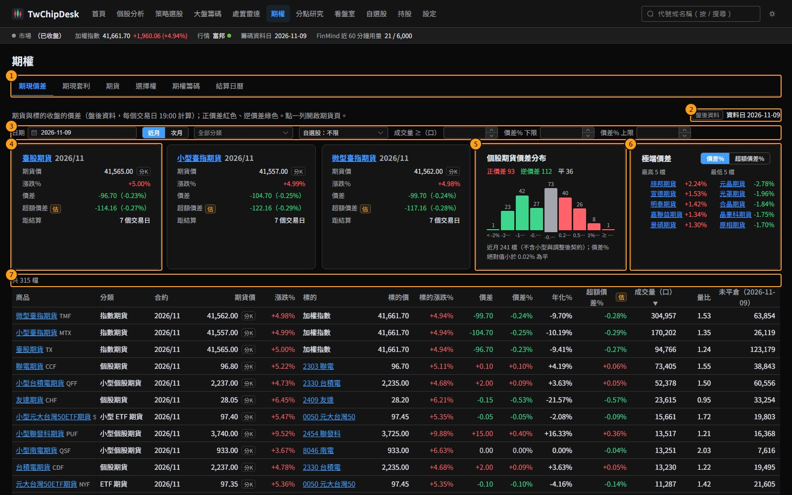
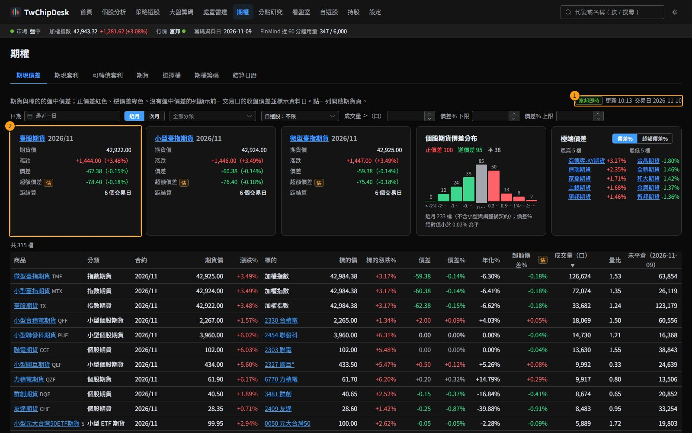

<!-- routes: /derivatives -->
# 期權｜期現價差

> 位置：頂部選單「期權」→「期現價差」分頁（網址 `/derivatives`；回看某一天加 `?date=2026-11-09`）
> 資料更新：盤後版每個交易日 19:00 計算每日收盤價差；交易時段（含夜盤）看最新資料時為即時價差，約每秒更新

## 這個功能可以做什麼
一個看板列出全部期貨（指數、個股、ETF 期貨等）與標的的價差：哪些是正價差、哪些是逆價差、價差有多大、扣掉理論持有成本後還剩多少（超額價差，估）。上方另有臺股期貨、小型臺指、微型臺指近月的卡片、個股期貨價差的分布與最極端的 5 檔。

## 畫面說明（盤後）

| 編號 | 名稱 | 說明 |
|---|---|---|
| 1 | 分頁 | 「期現價差」「期現套利」「期貨」「選擇權」「期權籌碼」「結算日曆」 |
| 2 | 「盤後資料」與資料日 | 盤後版標「盤後資料」與「資料日 2026-11-09」；盤中改為即時來源（見下方） |
| 3 | 篩選列 | 「日期」（空白為最近一日，可回看）、「合約」（「近月」「次月」）、「分類」（多選，空白為全部分類）、「自選股」（「不限」或選一個自選股清單）、「成交量 ≥（口）」、「價差% 下限」「價差% 上限」、「清除篩選」。條件放在網址，從期貨頁返回時保留 |
| 4 | 指數期貨近月卡片 | 臺股期貨、小型臺指、微型臺指：「期貨價」（旁邊標示取法）、「漲跌%」、「價差」（點與 %）、「超額價差」（估）、「距結算」（交易日）。點商品名稱開啟期貨頁 |
| 5 | 「個股期貨價差分布」 | 近月個股期貨（不含小型與調整後契約）的「正價差 N・逆價差 N・平 N」與價差% 直方圖；價差% 絕對值小於 0.02% 為平 |
| 6 | 「極端價差」 | 價差% 「最高 5 檔」「最低 5 檔」；右上可切換依據為「價差%」或「超額價差%」 |
| 7 | 檔數 | 「共 N 檔」或「顯示 N 檔（篩選前 N 檔）」；資料太多時註明「只取成交量前 N 檔」 |

卡片與分布、極端價差不受篩選影響。

### 看板表格欄位
| 欄位 | 說明 |
|---|---|
| 「商品」「分類」「合約」 | 期貨名稱與代號、分類（指數期貨、個股期貨、小型個股期貨、ETF 期貨…）、合約月份；調整後契約標「調整」 |
| 「期貨價」 | 旁邊的小標籤是期貨價的取法：「分K」（13:29 那一分鐘期貨分 K 的收盤，與現貨收盤同步）、「快照」（13:29 那一分鐘盤中快照的最後一筆）、「結算價」（期貨日資料的結算價，與現貨 13:30 收盤不同步）；滑鼠移上有說明 |
| 「漲跌%」 | 期貨的漲跌幅 |
| 「標的」「標的價」「標的漲跌%」 | 點標的開啟個股頁 |
| 「價差」「價差%」 | 期貨 − 標的；正價差紅色、逆價差綠色 |
| 「年化%」 | 價差% 換算成年化 |
| 「超額價差%」（估） | 扣掉理論價差後的部分（見[期權總覽](README.md#名詞)） |
| 「成交量（口）」「量比」 | 期貨成交量；量比 = 所有月份合計成交量 ÷ 前 20 個交易日的平均 |
| 「未平倉（日期）」「未平倉增減」 | 欄名標示未平倉的資料日 |
| 「距結算（交易日）」 | 到期日為推算時標「估」 |

預設依成交量由大到小，任一欄可點擊排序。點任一列開啟該商品的[期貨頁](futures.md)（看次月時帶入次月合約）。

## 盤中

> 這張圖要在交易時段才有意義（目前的圖可能是夜盤或收盤後拍的）。

| 編號 | 名稱 | 說明 |
|---|---|---|
| 1 | 即時來源 | 「富邦即時」或「玉山即時」（期貨報價即時推送，價差每秒重算）；券商即時未連線時為「FinMind 約 30 秒」（盤中快照，約 30 秒輪詢一次，只涵蓋部分商品）。旁邊是時段（「日盤」「夜盤」）、更新時間與交易日 |
| 2 | 指數期貨卡片 | 盤中顯示期貨價、漲跌、價差、超額價差與距結算；夜盤時另顯示「夜盤隱含加權漲跌」（估） |
| 3 | 狀態標籤 | 見下表 |

**狀態標籤**（滑鼠移上有說明）：

| 標籤 | 意思 |
|---|---|
| 「現貨未開盤」 | 08:45～09:00 現貨還沒開盤，現貨價改用參考價（昨收） |
| 「現貨已收盤」 | 13:30 之後，現貨價為收盤價 |
| 「夜盤」 | 夜盤時段，現貨價為當日收盤價 |
| 「時間差」 | 期貨與現貨最新成交的時間差超過 15 秒（設定可調），價差可能失真 |
| 「延遲」 | 期貨或現貨超過 60 秒（FinMind 備援時 90 秒）沒有更新 |
| 「今日未成交」 | 期貨合約這個時段還沒有成交，不計算價差 |
| 「試撮」 | 期貨價為試撮價，不是成交價 |
| 「約 30 秒更新」 | 來源為 FinMind 盤中快照 |
| 「延遲」（涵蓋） | 券商即時的合約額度已滿，這個合約沒有盤中價差，顯示前一交易日的收盤價差 |
| 「需券商即時」 | 目前以 FinMind 備援，這個合約不在輪詢範圍，顯示前一交易日的收盤價差 |

沒有盤中價差的列顯示前一交易日的收盤價差，並在價格旁標「資料日 …」。

**夜盤隱含加權漲跌**（估）=（夜盤期貨價 ÷ 當日一般時段 13:29 那分鐘的期貨收盤 − 1）× 100；隱含點位 = 現貨收盤 × 夜盤期貨價 ÷ 13:29 期貨收盤。

## 操作步驟
1. 打開「期權」，預設就是「期現價差」。
2. 用「分類」只看個股期貨，或用「自選股」只看自選清單裡股票的期貨；用「價差%」上下限找價差特別大的商品。
3. 點表頭排序，例如依「價差%」或「超額價差%」。
4. 點一列進入期貨頁看歷史價差與 K 線。

## 欄位與名詞
- **理論價差**（估）：標的 × 年利率 × 距結算日曆日數 ÷ 365 − 結算前除息的股利（指數為預估除息點數）；年利率預設 1.7%（設定頁「期權」區）。
- **個股期貨與股利**：只除息時期貨契約不調整，股利以權益數補給多方，所以理論價差預設不扣股利。
- **預估除息點數**（估）：指數 × Σ（結算前已知除息日的現金股利 × 發行股數）÷ Σ（收盤 × 發行股數）；成分股以上市（櫃）普通股近似，未定除息日的股利不計入。

## 資料來源與更新時間
- 盤後：期貨日資料（15:20 起）、現貨收盤；每個交易日 19:00 計算每日收盤價差與預估除息點數。還沒有資料時顯示「還沒有每日收盤價差資料：每個交易日 19:00 依期貨日資料計算」。
- 盤中：富邦或玉山即時行情；備援為 FinMind 盤中快照。

## 注意事項與限制
- 期貨價取「結算價」的列，與現貨 13:30 收盤相差約 15 分鐘，大漲大跌日的價差可能失真。
- 調整後契約的乘數不是標準的 2,000 股，不列入正逆價差家數與分布。
- 理論價差、超額價差、預估除息點數、夜盤隱含漲跌都是估計值。

## 相關功能
- [期現套利](arbitrage.md)：扣交易成本後的淨價差（估）。
- [期貨](futures.md)：單一期貨的 K 線、價差與轉倉。
- 個股分析的「期權」分頁：該股期貨各月份的價差，見[個股分析](../stock/README.md)。
