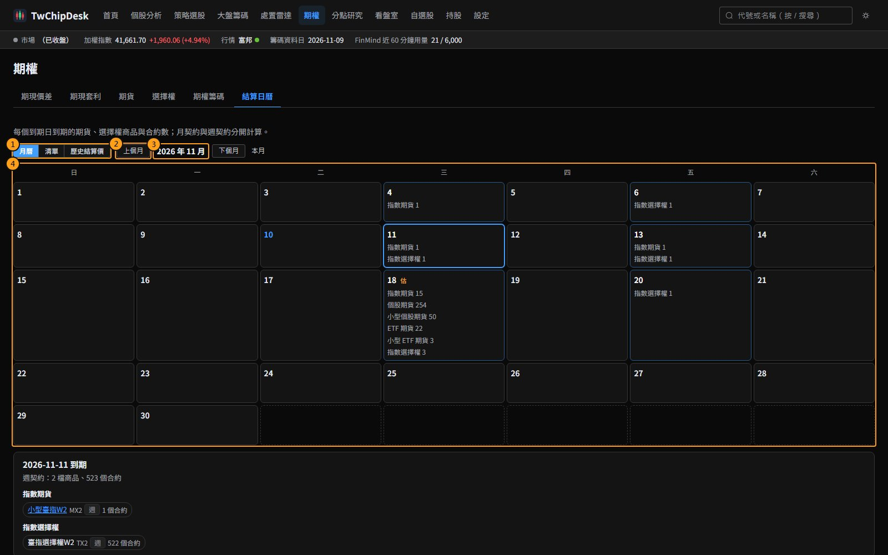
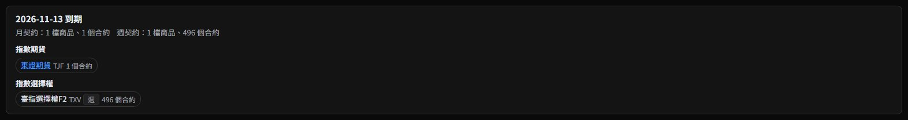
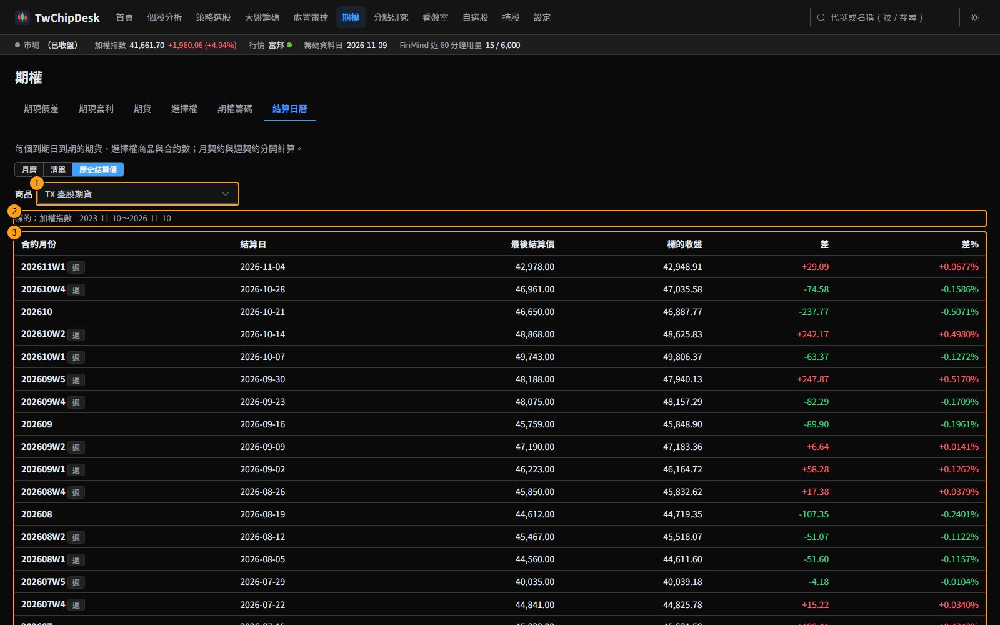

<!-- routes: /derivatives/calendar -->
# 期權｜結算日曆

> 位置：頂部選單「期權」→「結算日曆」分頁（網址 `/derivatives/calendar`；可加 `?view=month&month=2026-11`、`?view=list`、`?view=history&product=TXF`）
> 資料更新：期權商品主檔與期貨合約每個交易日 07:50、17:00；最後結算價 17:30

## 這個功能可以做什麼
列出每個到期日到期的期貨、選擇權商品與合約數（月契約與週契約分開計算），並可查詢每個商品歷史的最後結算價與當日標的收盤價的差。

## 畫面說明

| 編號 | 名稱 | 說明 |
|---|---|---|
| 1 | 檢視方式 | 「月曆」「清單」「歷史結算價」；手機寬度預設為清單 |
| 2 | 「上個月」「下個月」 | 切換月份；「本月」回到這個月 |
| 3 | 月份 | 目前顯示的年月 |
| 4 | 月曆 | 每個到期日的格子列出各分類到期的商品數（月契約、週契約分開）；推算的到期日標「估」，原定到期日休市而順延的標「休市順延」 |

### 一個到期日的商品

點月曆上有到期合約的日期，下方列出「YYYY-MM-DD 到期」的商品：依分類分組、月契約與週契約分開（週契約標「週」），每個商品列出到期的合約數。點期貨商品開啟它的[期貨頁](futures.md)。選擇權商品只列出合約數，各履約價的報價在「[選擇權](options.md)」分頁。

「清單」檢視把同一個月份的到期日逐日列出，內容相同。

### 歷史結算價

| 編號 | 名稱 | 說明 |
|---|---|---|
| 1 | 「商品」 | 選擇商品（代號或名稱） |
| 2 | 標的與期間 | 「標的：…」與資料期間；結算價紀錄沿用同一標的的其他商品時會註明 |
| 3 | 歷史結算價表 | 「合約月份」「結算日」「最後結算價」「標的收盤」「差」「差%」，可排序；週契約標「週」 |

## 操作步驟
1. 打開「結算日曆」，看本月的到期日。
2. 點某一天，在下方看當天到期的商品；點期貨商品進入期貨頁。
3. 想看某個商品過去每次結算時結算價與現貨收盤的差，切到「歷史結算價」並選商品。

## 欄位與名詞
- **到期日（估）**：來源沒有到期日時依契約規則推算（月契約為該月第三個星期三，遇休市順延）；來源的到期日落在休市日時改列次一交易日。
- **休市順延**：原定到期日休市（含颱風等臨時休市），最後交易日順延至次一交易日；來源公布到期日後以來源為準。
- **最後結算價**：指數類為最後交易日收盤前一段時間指數的算術平均；股票類為收盤前 60 分鐘標的成交價的算術平均（依期交所規則）。

## 注意事項與限制
- 已到期的選擇權合約會從合約主檔清除，過去的日子只看得到期貨。
- 結算日當天的預估結算價尚未提供。

## 相關功能
- [期貨](futures.md)、[選擇權](options.md)。
