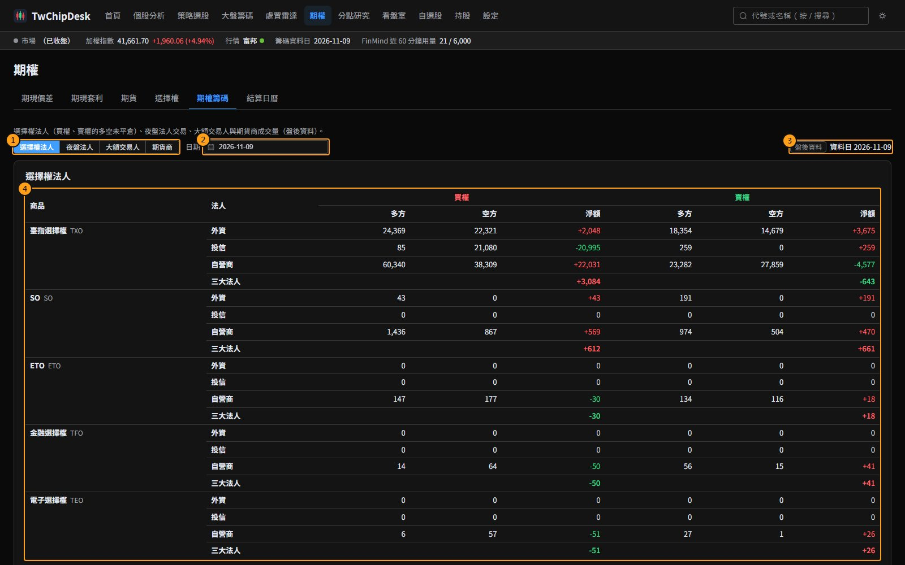
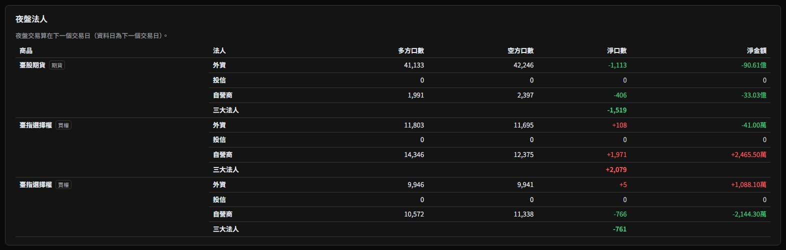
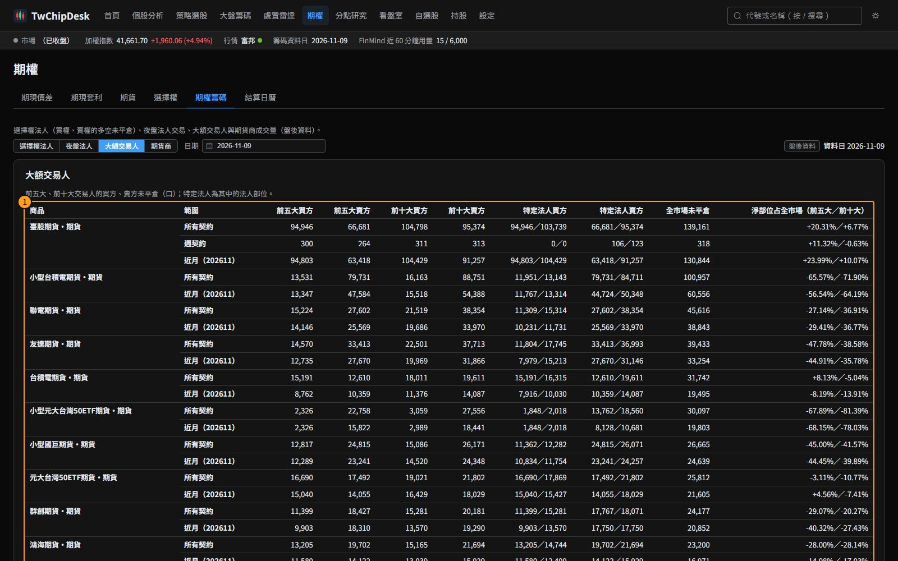
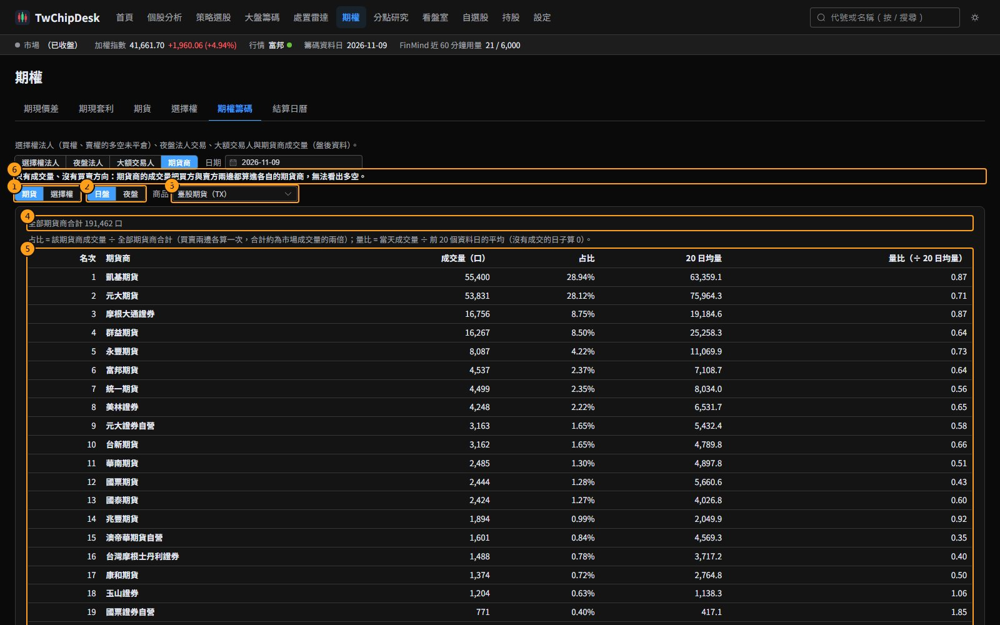

<!-- routes: /derivatives/chips -->
# 期權｜期權籌碼

> 位置：頂部選單「期權」→「期權籌碼」分頁（網址 `/derivatives/chips`；可加 `?kind=after-hours`、`?kind=large-traders`、`?kind=dealers` 與 `&date=2026-11-09`）
> 資料更新：選擇權法人、夜盤法人每個交易日 15:20 起（不足時每 10 分鐘重試到 18:30，18:10 再補抓）；大額交易人 15:30 起；期貨商成交量 20:45

## 這個功能可以做什麼
看期貨與選擇權市場的籌碼：三大法人在各選擇權商品的買權、賣權多空未平倉，夜盤的法人交易，前五大、前十大交易人的部位，以及各期貨商的成交量排行。期貨的三大法人未平倉在各商品的[期貨頁](futures.md)，這裡不重複。

## 畫面說明

| 編號 | 名稱 | 說明 |
|---|---|---|
| 1 | 種類 | 「選擇權法人」「夜盤法人」「大額交易人」「期貨商」 |
| 2 | 「日期」 | 空白為該資料最新一日 |
| 3 | 資料日 | 目前顯示的資料日 |
| 4 | 選擇權法人表 | 各選擇權商品（依未平倉合計由大到小）的外資、投信、自營商與三大法人合計，在「買權」「賣權」的「多方」「空方」「淨額」未平倉（口） |

### 夜盤法人

臺股期貨、臺指選擇權夜盤的三大法人交易：「多方口數」「空方口數」「淨口數」與「淨金額」（選擇權分買權、賣權）。夜盤只有交易、沒有未平倉；夜盤交易算在下一個交易日（資料日為下一個交易日）。

### 大額交易人

前五大、前十大交易人的「買方」「賣方」未平倉（口），「特定法人」為其中的法人部位；另列「全市場未平倉」與「淨部位占全市場（前五大／前十大）」。「範圍」可選「所有契約」「週契約」「近月」。期貨在前、選擇權在後。

### 期貨商

| 編號 | 名稱 | 說明 |
|---|---|---|
| 1 | 期貨或選擇權 | 「期貨」「選擇權」 |
| 2 | 交易時段 | 「日盤」「夜盤」「合計」 |
| 3 | 「商品」 | 選擇商品 |
| 4 | 合計 | 「全部期貨商合計 N 口」；不足 20 個資料日時註明，不計算量比 |
| 5 | 排行表 | 「名次」「期貨商」「成交量（口）」「占比」「20 日均量」「量比（÷ 20 日均量）」 |
| 6 | 說明 | 只有成交量、沒有買賣方向（見下方） |

- **占比** = 該期貨商成交量 ÷ 全部期貨商合計；買賣兩邊各算一次，所以合計約為市場成交量的兩倍。
- **量比** = 當天成交量 ÷ 前 20 個資料日的平均（沒有成交的日子算 0）。
- 期貨商的成交量把買方與賣方兩邊都算進各自的期貨商，無法看出多空。

## 操作步驟
1. 打開「期權籌碼」，預設為最新一日的「選擇權法人」。
2. 切換上方的種類；需要看過去的日子時選「日期」。種類與日期會記在網址。
3. 在「期貨商」選期貨或選擇權、時段與商品，看期貨商的成交量排行。

## 資料來源與更新時間
期交所的三大法人、夜盤法人、大額交易人與期貨商成交量資料，經 FinMind 取得（期貨商成交量保留最近 250 個交易日）。

## 注意事項與限制
- 這天沒有資料時顯示「這天沒有資料」；夜盤法人只有臺股期貨與臺指選擇權。
- 期貨商成交量沒有方向，不能當作多空部位解讀。

## 相關功能
- [期貨](futures.md)：期貨的三大法人與大額交易人。
- [選擇權](options.md)：單一選擇權商品的法人。
