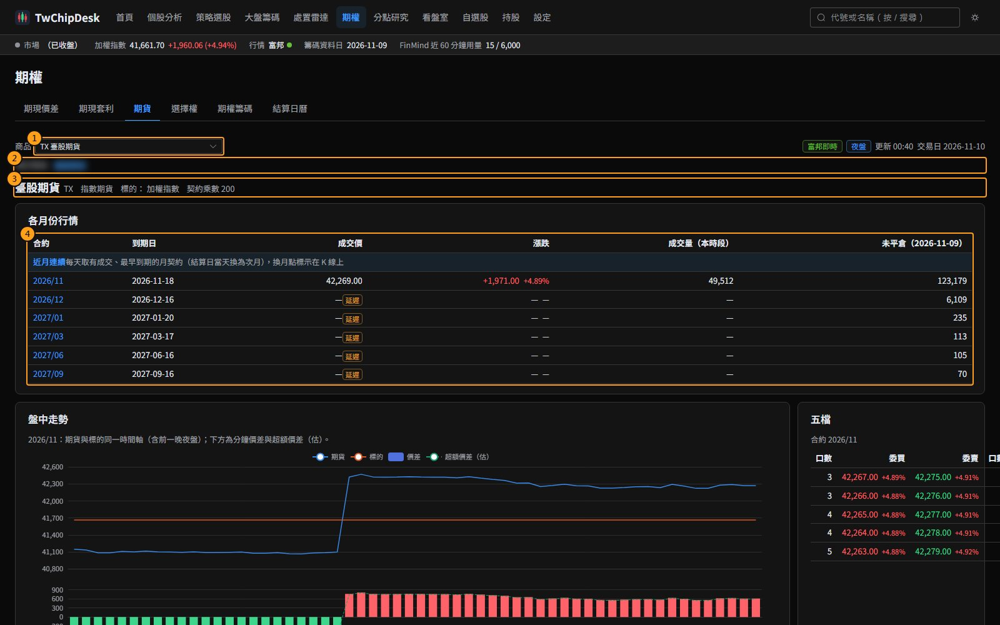
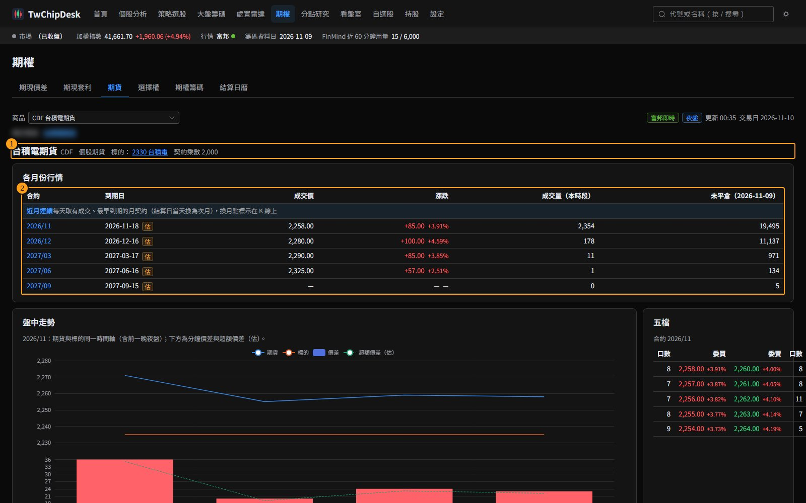
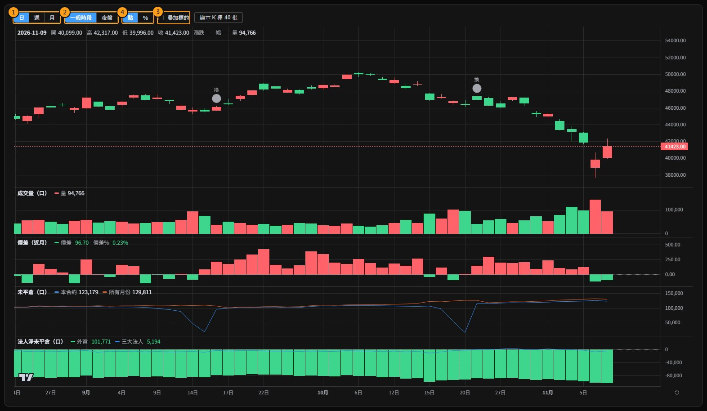
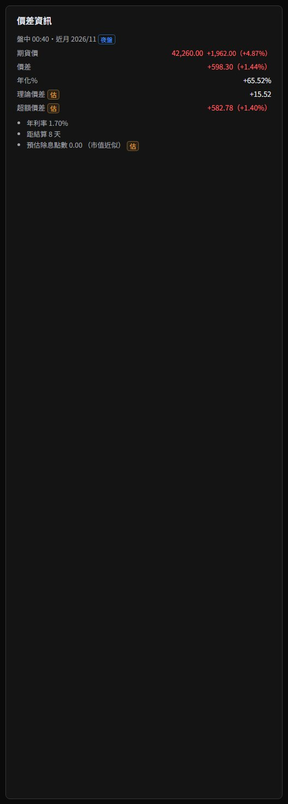
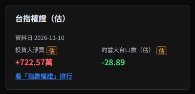
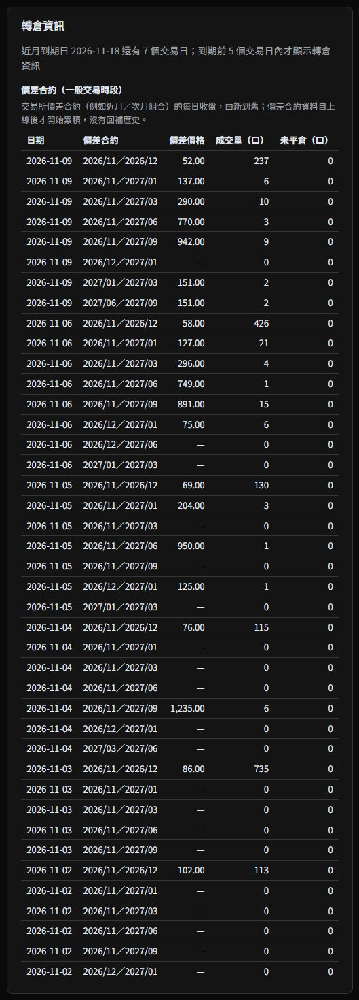
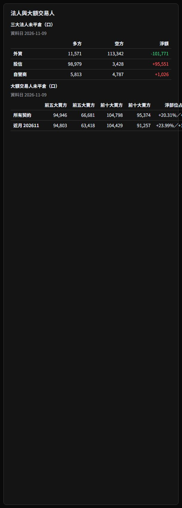
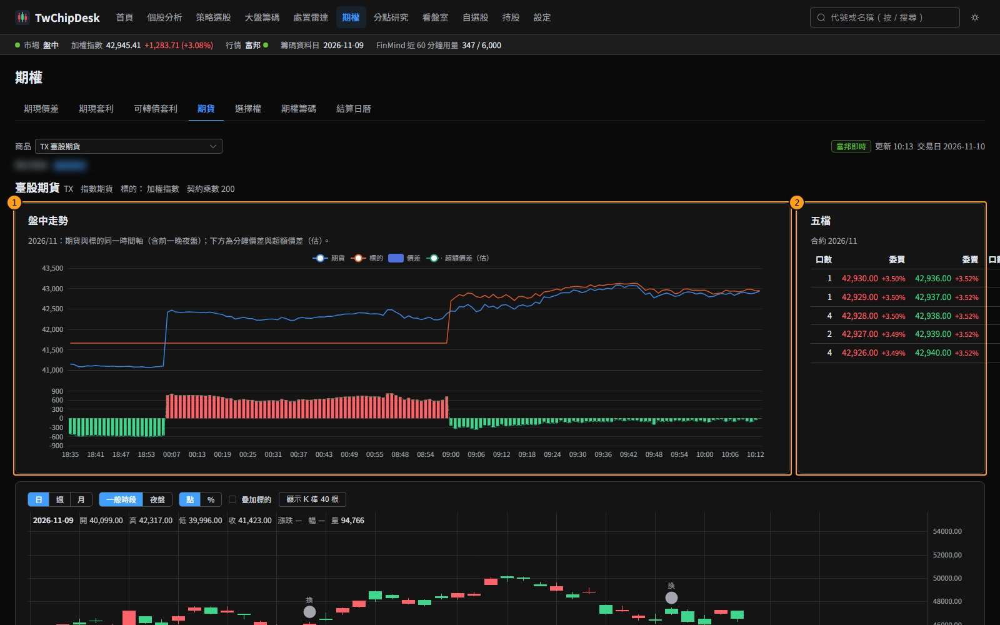

<!-- routes: /derivatives/futures/:productId? -->
# 期權｜期貨

> 位置：頂部選單「期權」→「期貨」分頁（網址 `/derivatives/futures/TX`；也可從期現價差看板點一列進入）
> 資料更新：期貨日資料與三大法人每個交易日 15:20 起；大額交易人 15:30 起；每日收盤價差 19:00；交易時段（含夜盤）有即時資料時顯示盤中走勢與五檔

## 這個功能可以做什麼
看單一期貨商品（指數期貨、個股期貨、ETF 期貨等）：各月份合約的行情、期貨 K 線與成交量、價差、未平倉、法人副圖、價差資訊（理論價差與超額價差，估）、接近結算時的轉倉資訊，以及三大法人與大額交易人部位。

## 畫面說明

| 編號 | 名稱 | 說明 |
|---|---|---|
| 1 | 「商品」 | 搜尋期貨（代號、名稱或標的股票代號，例如輸入 2330 找台積電期貨） |
| 2 | 「最近看過」 | 最近看過的商品（記在瀏覽器） |
| 3 | 商品標題 | 商品名稱、代號、分類、「標的」（點開啟個股頁）與「契約乘數」（未確認的預設值會註明） |
| 4 | 「各月份行情」 | 「近月連續」與每個月份（含週契約）的「到期日」「收盤」（盤中為成交價）、「結算價」「漲跌」「成交量」「未平倉」；點一個月份把主圖切換為該合約。推算的到期日標「估」 |

「近月連續」：每天取有成交、最早到期的月契約（結算日當天換為次月），換月點在 K 線上標「換」。

個股期貨的例子（台積電期貨）：

### K 線與副圖

| 編號 | 名稱 | 說明 |
|---|---|---|
| 1 | 週期 | 「日」「週」「月」 |
| 2 | 時段 | 「一般時段」「夜盤」；夜盤的 K 線與成交量另外顯示（資料日為下一個交易日），不和一般時段混在同一根 K 線 |
| 3 | 「疊加標的」 | 在主圖疊加標的收盤線；產業指數等沒有現貨對照時無法疊加 |
| 4 | 價差單位 | 價差副圖以「點」或「%」顯示 |

副圖由上而下：「成交量（口）」、「價差（近月）」（每日收盤價差，固定為近月）、「未平倉（口）」（所有月份與本合約）、「法人淨未平倉（口）」（外資、三大法人；來源沒有時註明「來源未提供」）。週、月 K 的價差、未平倉、法人取該期最後一天。

### 價差資訊

最近一日近月的「價差」「年化%」「理論價差」（估）「超額價差」（估），以及計算參數：「年利率」「距結算 N 天」、指數類的「預估除息點數」與「涵蓋率」（成分股數、計入除息的檔數；權重來源標「市值近似」或「官方權重」），個股期貨註明「理論價不扣股利（只除息時契約不調整，股利以權益數補給買方）」。

### 台指權證（估）

只在台指期（TX）商品頁出現：最新一天臺股指數權證的「投資人淨買」（估）與「約當大台口數（估）」（約當口數＝權證淨買的元／點 ÷ 大台每點 200 元）。點「看「指數權證」排行」開啟[大盤籌碼｜權證排行](../market/warrants.md)的「指數權證」。權證投資人淨買還沒計算時顯示「台指權證投資人淨買尚未計算」；權證功能關閉時不顯示這張小卡。

### 轉倉資訊

轉倉的逐日表在結算前 5 個交易日內（設定可調）才出現，其他時候只說明近月到期日還有幾個交易日（如上圖）。出現時標題為「近月 …、次月 …；距到期 N 個交易日」，逐日列出「近月價」「次月價」「近遠月價差」「價差%」「近月未平倉」「次月未平倉」「轉倉比」。轉倉比 = 次月未平倉 ÷（近月 + 次月未平倉）× 100。下方「價差合約（一般交易時段）」列出交易所近月／次月價差合約的每日收盤、成交量與未平倉（自上線後才開始累積）。

### 法人與大額交易人

「三大法人未平倉（口）」：外資、投信、自營商的多方、空方與淨額。「大額交易人未平倉（口）」：「所有契約」與「近月」的前五大、前十大交易人的買方、賣方、「淨部位占全市場」與「全市場未平倉」。個股期貨的來源沒有提供時顯示「沒有資料」。

## 盤中

> 這張圖要在交易時段才有意義（目前的圖可能是夜盤時拍的）。

| 編號 | 名稱 | 說明 |
|---|---|---|
| 1 | 「盤中走勢」 | 期貨與標的同一時間軸（含前一晚夜盤），下方為分鐘價差與超額價差（估） |
| 2 | 「五檔」 | 主圖合約的委買、委賣價格與口數；來源不提供時顯示「來源不提供五檔」 |
| 3 | 盤中價差資訊 | 「盤中 時間・近月」的期貨價與漲跌、即時價差、年化、理論價差與參數；今日未成交時只顯示標籤 |

盤中「各月份行情」的成交價、漲跌與「成交量（本時段）」即時更新，未平倉維持前一交易日並在欄名標示資料日。右上角標示來源（「富邦即時」「玉山即時」或「FinMind 約 30 秒」）、時段與交易日。

## 操作步驟
1. 在「商品」搜尋期貨，或從期現價差看板點一列進入。
2. 在「各月份行情」點月份切換主圖；用週期、時段、疊加標的與價差單位調整圖表。
3. 往下看價差資訊、轉倉資訊（接近結算時）與法人部位。
4. 週期、時段、疊加與單位放在網址（`tf`、`session`、`overlay`、`unit`、`contract`），可以直接分享。

## 欄位與名詞
- **漲跌** = 收盤 − 前一日同一合約的結算價。
- **理論價差、超額價差、預估除息點數**：見[期權總覽](README.md#名詞)與[期現價差](basis.md#欄位與名詞)。

## 資料來源與更新時間
期交所期貨日資料、三大法人、大額交易人與價差合約資料（經 FinMind）；盤中為富邦或玉山即時行情（備援為 FinMind 盤中快照）。

## 注意事項與限制
- 價差副圖固定為近月，切換合約不影響。
- 大額交易人的個股期貨資料不一定有提供。

## 相關功能
- [期現價差](basis.md)、[期現套利](arbitrage.md)。
- [結算日曆](calendar.md)：到期日與歷史最後結算價。
