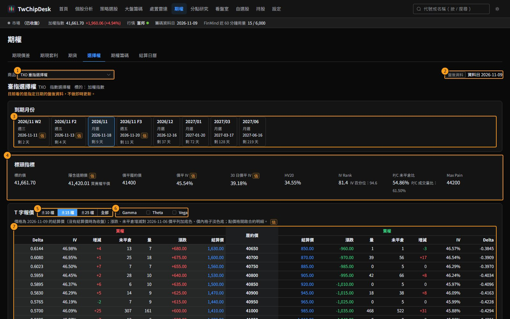
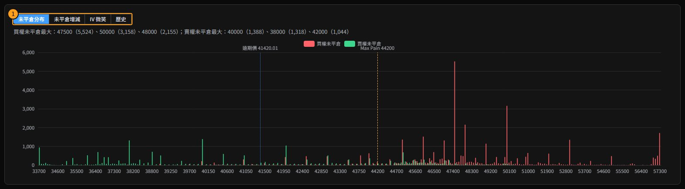
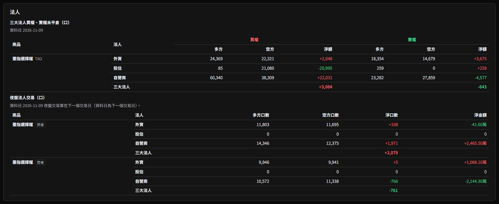
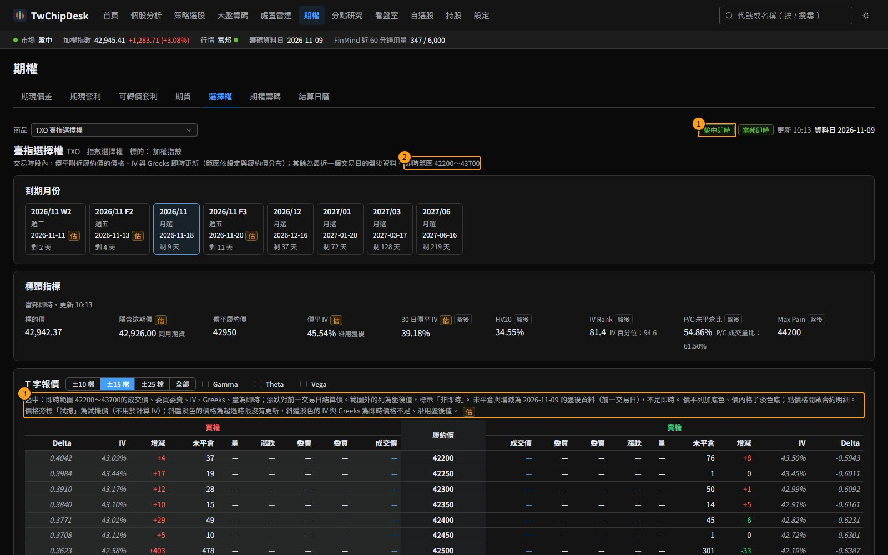

<!-- routes: /derivatives/options/:productId? -->
# 期權｜選擇權

> 位置：頂部選單「期權」→「選擇權」分頁（網址 `/derivatives/options/TXO`；可加 `?expiry=到期月份`、`?date=2026-11-09` 看指定日的盤後資料）
> 資料更新：選擇權日資料每個交易日 15:20 起；IV、Greeks、P/C、Max Pain 等每日衍生資料 19:00 計算；交易時段（含夜盤）價平附近的報價、IV 與 Greeks 即時更新（約每 2 秒重算）

## 這個功能可以做什麼
看一個選擇權商品（預設臺指選擇權 TXO）的到期月份、標頭指標（標的價、隱含遠期價、價平 IV、HV20、IV Rank、P/C 比、Max Pain）、T 字報價（各履約價的價格、未平倉、IV 與 Greeks）、未平倉分布與 IV 微笑等圖表，以及法人部位。盤後資料以結算價計算。

## 畫面說明（盤後）

| 編號 | 名稱 | 說明 |
|---|---|---|
| 1 | 「商品」 | 搜尋選擇權（代號、名稱或標的股票代號）；下方顯示商品名稱、分類與標的 |
| 2 | 資料日 | 右上角標示資料日；盤中改為即時來源（見下方「盤中」） |
| 3 | 「到期月份」 | 每個到期月份一個按鈕：「月選」「週三」「週五」、到期日與「剩 N 天」；推算的到期日標「估」。點選切換 |
| 4 | 「標頭指標」 | 「標的價」「隱含遠期價」（旁邊註明來源：「買賣權平價」「同月期貨」或「現貨推算」）「價平履約價」「價平 IV」「30 日價平 IV」「HV20」「IV Rank」（另列「IV 百分位」）「P/C 未平倉比」（另列 P/C 成交量比）「Max Pain」；還沒有計算時顯示「每個交易日晚上計算後才有」 |
| 5 | 顯示範圍 | 價平上下「±10 檔」「±15 檔」「±25 檔」或「全部」 |
| 6 | 另外顯示 | 勾選「Gamma」「Theta」「Vega」加入欄位 |
| 7 | 「T 字報價」 | 中間為「履約價」，左邊「買權」、右邊「賣權」；每邊有價格（盤後為「結算價」，盤中為「成交價」與「委買」「委賣」）、「漲跌」「量」「未平倉」「增減」「IV」「Delta」。價平列加底色、價內格子淡色底；點價格開啟合約明細 |

股票、ETF 選擇權成交稀少，結算價可能由交易所推算，IV 與 Greeks 標「近似值」。

### 圖表

| 編號 | 名稱 | 說明 |
|---|---|---|
| 1 | 圖表分頁 | 「未平倉分布」：各履約價買權、賣權未平倉長條，加上遠期價、Max Pain 參考線，上方列出未平倉最大的履約價。「未平倉增減」：與前一交易日比較。「IV 微笑」：今日與前一交易日，每個履約價取價外的一邊。「歷史」：30 日價平 IV、HV20、P/C 未平倉比（近月與全部月份）、Max Pain 與標的收盤 |

### 合約明細
點 T 字報價的價格，右側打開該合約的明細：「結算價」「收盤」「漲跌」「成交量（口）」「未平倉（口）」「未平倉增減」「IV」「Greeks」「理論價（盤後）」與「市價 − 理論價」、「價內外」，以及「日走勢（盤後，一般時段）」圖（結算價、收盤與未平倉）。盤中另有「盤中即時」區：成交價、成交時間、今日成交量、五檔與開啟明細後收到的成交。

### 法人

「三大法人買權、賣權未平倉（口）」：外資、投信、自營商與三大法人合計在買權、賣權的多方、空方與淨額；「夜盤法人交易（口）」：夜盤的多方口數、空方口數、淨口數與淨金額（夜盤交易算在下一個交易日）。

## 盤中

> 這張圖要在交易時段才有意義（目前的圖可能是夜盤時拍的）。

| 編號 | 名稱 | 說明 |
|---|---|---|
| 1 | 「盤中即時」 | 即時狀態；旁邊是來源（「富邦即時」「玉山即時」，或「FinMind 延遲」約 30 秒一次）與更新時間。異常時顯示「暫停更新」「即時連線中斷」或「盤中（延遲）」 |
| 2 | 「即時範圍」 | 只有價平附近這段履約價即時更新（範圍依設定與履約價分布） |
| 3 | 盤中說明 | 範圍內的成交價、委買委賣、IV、Greeks、量為即時，漲跌對前一交易日結算價；範圍外的列為盤後值並標「非即時」；未平倉與增減是前一交易日的盤後資料 |

- 價格旁標「試撮」為試撮價（不用於計算 IV）；斜體淡色的價格為超過時限沒有更新，斜體淡色的 IV 與 Greeks 為即時價格不足、沿用盤後值。
- 標頭的標的價、遠期價、價平與價平 IV 改用即時值（算不出來時標「沿用盤後」），其他指標標「盤後」。
- 看指定日期（網址帶 `date`）、非交易時段、頁面不在前景、即時額度已滿等情況，會顯示盤後資料並說明原因。

## 操作步驟
1. 打開「選擇權」，預設為臺指選擇權；要看其他商品在「商品」搜尋（例如輸入 2330 找台積電選擇權）。
2. 點到期月份切換；用顯示範圍與 Gamma／Theta／Vega 勾選調整表格。
3. 下方切換圖表分頁看未平倉分布與 IV 微笑。
4. 點任一價格看合約明細。

## 欄位與名詞
- **隱含遠期價**：以結算價的買賣權平價，取 |買權 − 賣權| 最小的履約價計算；有效履約價少於 3 個時改用同月期貨結算價，仍沒有時用現貨推算。
- **IV**：以結算價與隱含遠期價由 Black-76 模型反推（年利率依設定，預設 1.7%）。
- **Greeks**：Gamma 為每 1 點、Theta 為每日曆日、Vega 為每 1 個百分點波動率。
- **理論價**：以這個到期月份的價平 IV 代入 Black-76 計算。
- **30 日價平 IV**：前後兩個到期月份的價平 IV 依總變異線性內插到 30 天。
- **HV20**：標的近 20 日對數報酬的標準差 × √252。
- **IV Rank** =（今日 30 日價平 IV − 近 252 日最低）÷（最高 − 最低）× 100；**IV 百分位**為近 252 日低於今日的比例；不足 60 筆時不計算。
- **P/C** = 賣權 ÷ 買權 × 100（這個到期月份，一般時段）。
- **Max Pain**：到期時所有未平倉合約的履約價值合計最小的履約價。

## 資料來源與更新時間
盤後為期交所選擇權日資料（經 FinMind），指數選擇權保留約 250 個交易日、股票選擇權約 60 個交易日；盤中為富邦或玉山即時行情。

## 注意事項與限制
- 股票、ETF 選擇權的 IV 為近似值；冷門履約價的結算價可能由交易所推算。
- FinMind 備援時的盤中資料只涵蓋臺指選擇權與週選。

## 相關功能
- [期權籌碼](chips.md)：全部選擇權商品的法人。
- [結算日曆](calendar.md)：每個到期日。
