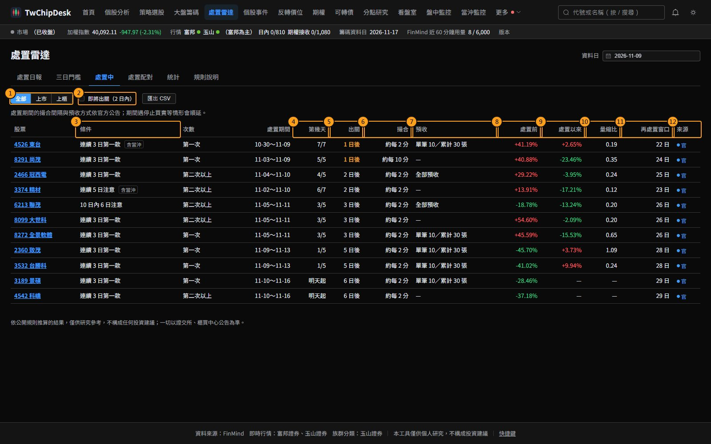

<!-- routes: /disposition/active -->
# 處置雷達｜處置中

> 位置：頂部選單「處置雷達」→「處置中」分頁（網址 `/disposition/active`，可加 `?date=2026-11-09`）
> 資料更新：官方處置名單取得後（預設 18:30、19:30、21:00 抓取）；22:10 定版時再更新一次

## 這個功能可以做什麼
列出資料日正在處置期間內的股票，以及已公告、明天起才開始處置的股票：第幾次處置、處置到哪一天、還有幾天出關、撮合與預收方式、處置前後的漲跌與成交量變化，以及再處置窗口還剩幾天。

## 畫面說明

| 編號 | 名稱 | 說明 |
|---|---|---|
| 1 | 市場 | 「全部」「上市」「上櫃」 |
| 2 | 「即將出關（2 日內）」 | 只列 2 個交易日內出關的股票 |
| 3 | 「條件」 | 處置條件的白話，例如「連續 3 日第一款」「10 日內 6 日注意」；含當沖標準時另標「含當沖」（處置天數延長為 7 日）。滑鼠移上顯示官方原文 |
| 4 | 「第幾天」 | 處置第幾天／共幾天，例如「4/5」；明天才開始的顯示「明天起」 |
| 5 | 「出關」 | 距出關的交易日數，例如「2 日後」；出關當天顯示「今日出關」；1 日內以橘色強調 |
| 6 | 「撮合」 | 處置期間的撮合間隔，例如「約每 2 分」（依官方公告） |
| 7 | 「預收」 | 第一次處置為「單筆 10／累計 30 張」；第二次以上為「全部預收」；公告沒有寫明時為「—」 |
| 8 | 「處置前」 | 公告日的 6 日累積漲跌幅（被處置前漲跌了多少） |
| 9 | 「處置以來」 | 今天收盤相對公告日收盤的漲跌幅；明天起才處置的為「—」 |
| 10 | 「量縮比」 | 處置期間日均量 ÷ 處置前 5 日均量；小於 1 表示處置後成交量變少 |
| 11 | 「再處置窗口」 | 從公告日起 30 個營業日的窗口還剩幾個交易日；這段期間內再被處置就是「第二次以上」（全部預收） |
| 12 | 「來源」 | 「官」為官方公告 |

處置股如果有發行中的可轉債，列下方會顯示「連帶處置的可轉債：…」。處置期間遇臨時休市順延時標「臨時休市順延」，滑鼠移到期間上顯示官方公告期間。

「只看 2 日內出關」旁的「匯出 CSV」把目前的列（依市場與「只看 2 日內出關」篩選）存成 CSV 檔（檔名「處置中_資料日.csv」）；「出關」欄輸出距出關的日數（0 為今日出關），連帶處置的可轉債另列一欄。數值不加千分位、不加 % 符號（百分比欄的欄名註明「（%）」），沒有資料的格子空白，估計值的欄名加「（估）」；沒有資料列時按鈕無法按。

## 操作步驟
1. 打開「處置中」分頁，預設列出資料日所有處置中與明天起處置的股票。
2. 想知道近期誰出關，勾「即將出關（2 日內）」。
3. 點股票名稱開啟 K線籌碼圖；想看這檔過去每一次處置的逐日數字，到「[統計](stats.md)」分頁輸入代號。

## 資料來源與更新時間
處置名單來自證交所、櫃買中心公告（官方來源沒有啟用時，經 FinMind 取得的處置資料在 22:10 定版時轉入）；漲跌與成交量來自 FinMind 日 K。

## 注意事項與限制
- 頁面上方註明：處置期間的撮合間隔與預收方式依官方公告；期間遇停止買賣等情形會順延。
- 「出關」「第幾天」依交易日曆推算；遇停止買賣、全日暫停交易等無法預知的情形，以官方公告為準。

## 相關功能
- [處置日報](daily.md)：「明日出關」表。
- [統計](stats.md)：新制以來處置前、處置期間、出關後的逐日統計。
- [處置配對](pairs.md)：處置股的同族群配對。
