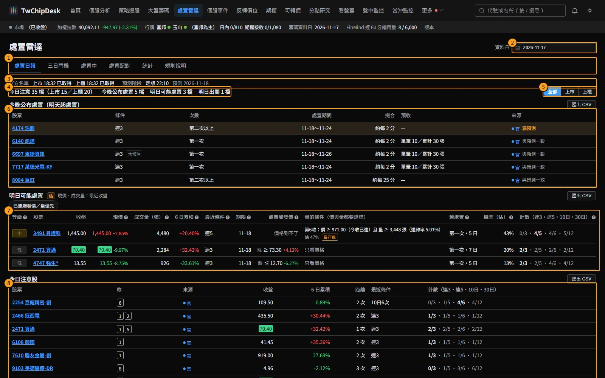
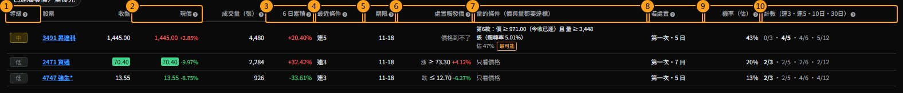
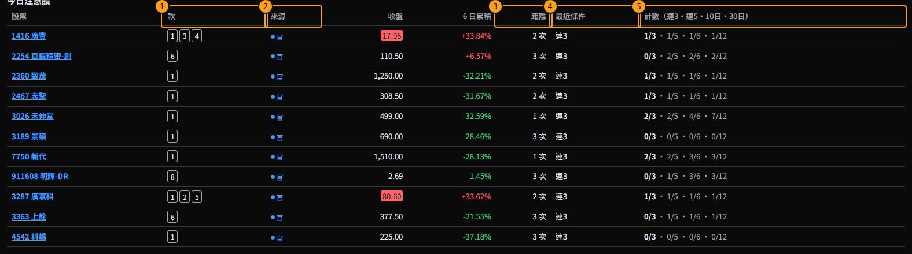
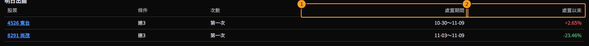

<!-- routes: /disposition/daily -->
# 處置雷達｜處置日報

> 位置：頂部選單「處置雷達」→「處置日報」分頁（網址 `/disposition/daily`，可加 `?date=2026-11-09` 指定資料日）
> 資料更新：交易日 14:40 盤後初版；官方名單取得後（預設 18:30、19:30、21:00 抓取）更新；22:10 定版。明日可能處置的「現價」「成交量」盤中即時更新

## 這個功能可以做什麼
盤後的主畫面，一頁回答四件事：今晚誰會被公布處置、明天誰可能被處置（要漲跌到多少、量要多大）、今天有哪些注意股、明天誰出關。名詞（款、處置條件、等級、處置觸發價）見[處置雷達總覽](README.md#先認識幾個名詞)。

## 畫面說明

| 編號 | 名稱 | 說明 |
|---|---|---|
| 1 | 分頁 | 「處置日報」「三日門檻」「處置中」「處置配對」「統計」「規則說明」 |
| 2 | 「資料日」 | 要看哪一天的日報；清除為「最新」（最近一個有預測的交易日） |
| 3 | 資料狀態 | 「官方名單」：上市、上櫃名單各自的取得時間（例如「上市 18:32 已取得」），未取得顯示「未取得」，官方來源沒有啟用顯示「外掛已關閉」。「預測階段」：「盤後初版 14:40」「官方名單後」或「定版 22:10」，後面的「預測 2026-11-10」是這份預測針對的交易日 |
| 4 | 摘要 | 「今日注意 N 檔（上市／上櫃）」「今晚公布處置 N 檔」「明日可能處置 N 檔」「明日出關 N 檔」 |
| 5 | 市場篩選 | 「全部」「上市」「上櫃」 |
| 6 | 「今晚公布處置（明天起處置）」 | 今晚公布處置的股票：條件、「次數」（「第一次」或「第二次以上」）、處置期間、「撮合」（例如「約每 2 分」）、「預收」（例如「單筆 10／累計 30 張」，第二次以上為「全部預收」）、「來源」 |
| 7 | 「明日可能處置」 | 距離處置只差 1 次注意、且明天收盤可能達到觸發價的股票，細節見下一張圖 |
| 8 | 「今日注意股」 | 今天被公布注意的股票，細節見下方 |

頁面最下方還有「明日出關」表（見下方）。

### 今晚公布處置的「來源」
- 「官」為官方公告，「算」為官方名單還沒取得、本系統依規則重算，「估」為本系統預測。
- 官方名單到了以後，會和 14:40 的預測比對並標出：「與預測一致」「漏預測」（官方有、預測沒有）「多預測」（預測有、官方沒有）；官方還沒公布時為「待官方公布」。
- 處置股如果有發行中的可轉債，列下方會顯示「連帶處置的可轉債：…」。
- 處置期間遇臨時休市順延時，期間後面標「臨時休市順延」，滑鼠移上顯示官方公告期間。

### 明日可能處置

| 編號 | 欄位 | 說明 |
|---|---|---|
| 1 | 「等級」 | 「今晚處置」「必關」「高」「中」「低」「可能」「安全」；滑鼠移上顯示等級的意思（見[總覽](README.md#本系統的推算用語)） |
| 2 | 「現價」「成交量（張）」 | 只有在看最新一天時才顯示。盤中為即時報價與目前累計成交量，成交量下方另有「預估 N」（預估全日量，估）；收盤後為最近一個交易日的收盤與成交量。現價已達觸發價、預估量已達觸發量時分別標「現價已達觸發價」「預估量已達觸發量」；現價當天曾碰到漲跌停時，現價下方另一行加「漲停」「曾漲停」「跌停」「曾跌停」或「曾漲跌停」小標記 |
| 3 | 「6 日累積」 | 最近 6 個營業日的累積漲跌幅（第一款看的數字）；該股全日暫停交易的日子不算營業日，不計入這 6 天 |
| 4 | 「最近條件」 | 最快會達到的處置條件，例如「連3」「10日6次」 |
| 5 | 「期限」 | 最近條件要在哪一天以前達成，過了這天窗口會滑出、計數會變少 |
| 6 | 「處置觸發價」 | 明天收盤價「漲 ≥ 價格」或「跌 ≤ 價格」就會被公布處置，後面是相對今天收盤的漲跌幅。任何收盤價都成立時顯示「漲跌停內都成立」；只看價格的款在漲跌停內到不了時顯示「價格到不了」。滑鼠移上顯示來自哪一款與假設 |
| 7 | 「量的條件（價與量都要達標）」 | 第三、四、六款要價與量同時達標，每一行是一條路徑，例如「第4款：價 ≤ 340.00 且 量 ≥ 18,491 張（週轉率 10.00%）」，後面的「估 N%」是這條路徑單獨成立的機率；最可能的一條標「最可能」。明天只靠第一、二款（只看價格）就能完成處置時顯示「只看價格」 |
| 8 | 「若處置」 | 如果明天被公布處置，會是第幾次、處置幾日，例如「第一次・5 日」 |
| 9 | 「機率（估）」 | 明天晚上被公布處置的機率（估）。在每天最後一個預測階段（22:10 定版）才計算，之前顯示尚未估計 |
| 10 | 「計數（連3·連5·10日·30日）」 | 四個處置條件的進度「次數／門檻」，例如「2/3 · 2/5 · 4/6 · 7/12」；最近條件加粗，滑鼠移上顯示條件全名與期限（「需在 11/12 前」） |

- 「等級」「6 日累積」「期限」「若處置」「機率（估）」等欄名旁有小問號圖示，滑鼠移上去顯示這一欄的說明，手機點一下顯示；點圖示不會排序。
- 欄名可點擊排序（每點一次切換遞增、遞減、恢復預設）；看最新一天時另有「已達觸發價／量優先」按鈕，把盤中現價已達觸發價或預估量已達觸發量的股票排到前面。
- 盤中現價與成交量是推播更新，列的位置不會自己移動；順序有變時會提示重新排序。
- 存託憑證（TDR）標「TDR」，機率欄顯示「第八款無法預測」。
- 該股當天全日暫停交易（不算它的營業日）時沒有當天的推算，改沿用前一營業日的列，代號旁標「暫停交易，沿用 M/D 的次數」（跨年時帶年份）：收盤、6 日累積與次數都是那一天的，連續次數不因暫停中斷，期限順延到該股下一個營業日（暫停交易已公告恢復日時以恢復日為準）。定版後那一列沒有機率時，以前一營業日三日門檻第 1 天的條件機率補回（觸發路徑補不回來）。前一營業日距今超過 5 個交易日的長期暫停、以及前一營業日已公布處置的股票不列入；暫停日 17:35 以前當天還沒有日 K 時，以暫停交易事件判定。

### 今日注意股

| 編號 | 欄位 | 說明 |
|---|---|---|
| 1 | 「款」 | 今天被公布的款號；白框為計入處置次數的款（第一至八款），灰框為不計入的款（第九款以後） |
| 2 | 「來源」 | 「官」官方公告；「算」本系統依規則重算（官方名單未取得時） |
| 3 | 「距離」 | 還要幾次注意才會處置，例如「2 次」；「今晚處置」表示今晚就會公布 |
| 4 | 「最近條件」 | 距離最小的處置條件 |
| 5 | 「計數」 | 同上表的四個條件進度 |

「收盤」欄的價格加紅底表示漲停、綠底表示跌停。

### 明日出關

| 編號 | 欄位 | 說明 |
|---|---|---|
| 1 | 「處置期間」 | 起訖日；遇臨時休市順延時標註 |
| 2 | 「處置以來」 | 從處置開始到目前的漲跌幅 |

四張表的標題右邊各有「匯出 CSV」，匯出該表目前的列（依「市場」篩選與目前的排序），檔名為「處置日報_表名_日期.csv」。「明日可能處置」顯示現價與成交量時，匯出的是按下當下的快照，檔名後面加上時間（例如 `_1032`），並多「現價漲跌（%）」與盤中的「預估全日量（張）（估）」；處置觸發價分成漲、跌兩欄，機率以百分比輸出。數值不加千分位、不加 % 符號（百分比欄的欄名註明「（%）」），沒有資料的格子空白，估計值的欄名加「（估）」；沒有資料列時按鈕無法按。

## 操作步驟
1. 打開「處置雷達」，預設就是最新一天的「處置日報」。
2. 先看頁首的資料狀態：官方名單取得前，今晚處置是本系統的預測；「預測階段」到「定版 22:10」才有機率。
3. 想看某一天，在右上角「資料日」選日期。
4. 點股票名稱開啟該股的 K線籌碼圖；個股頁首的處置徽章可再打開處置面板看每一款的觸發價。

## 欄位與名詞
- **處置觸發價**：假設明天大盤與同類股平均不漲不跌，以收盤價判斷；只計第一、二款（只看價格就能確定）。
- **觸發量**：明天全日成交量（含零股、鉅額）；全體平均以最近 20 日的中位數估計。
- **機率（估）**：依過去狀態相近的股票隔天的價量分配推算，以最近 250 個交易日的實際結果校準；未必會被處置。

## 資料來源與更新時間
- 14:40 盤後初版：以收盤快照重算注意、判定今晚處置、算觸發價（機率尚未估計）。
- 官方名單取得後（預設 18:30、19:30、21:00 抓取）：以官方名單覆蓋重算結果，今晚處置改標「官」並與預測比對。
- 22:10 定版：資券、借券、當沖、分點到齊後補算其他款，算出明日處置機率。

## 注意事項與限制
- 推算依公開規則，實際以證交所、櫃買中心公告為準；第十四款（監視會報決議）無法預測。
- 處置觸發價假設大盤、同類股不漲不跌；第六款的同類淨值比門檻會隨同類股每天的漲跌變動，畫面以區間（「約 349.50～356.50」）表示。
- 盤中的「預估」成交量是估計值，觸發量比較的是明天全日的成交量。

## 常見問題
- **為什麼「機率（估）」是空的？** 機率在 22:10 定版時才計算；14:40 初版與官方名單後的階段只有觸發價。
- **今晚處置的列標「多預測」是什麼意思？** 14:40 的預測認為會處置，但官方名單沒有這檔。

## 相關功能
- [三日門檻](outlook.md)：未來 3 個交易日每天的門檻。
- [處置中](active.md)：處置期間內的股票。
- [規則說明](rules.md)：各款的實際數字。
