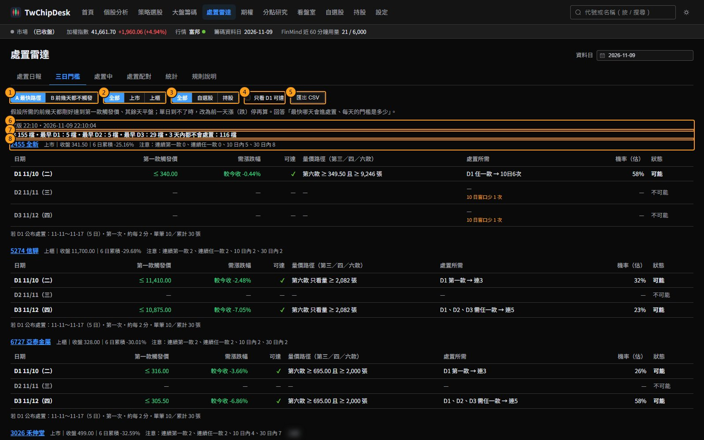
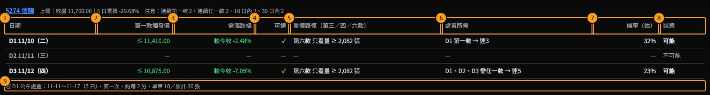

<!-- routes: /disposition/outlook -->
# 處置雷達｜三日門檻

> 位置：頂部選單「處置雷達」→「三日門檻」分頁（網址 `/disposition/outlook`，可加 `?date=2026-11-09`）
> 資料更新：交易日 14:40 初版、官方名單取得後更新、22:10 定版

## 這個功能可以做什麼
「處置日報」只看明天；「三日門檻」往後看 3 個交易日（D1、D2、D3），回答「這些注意股在未來每一天，要漲跌到什麼價格、成交量要多大，才會進處置」，以及「最快哪一天會進處置」。範圍是最近 30 個交易日內有注意的股票（明天在處置期間內的不列入）。

第一款看的是 6 個營業日的累積漲跌，未來 3 天的基準收盤價今天都已經知道，所以每天的第一款觸發價可以事先算出；會變的只有「前幾天有沒有被注意」和「價格能不能在漲跌停限制內走到」。

## 畫面說明

| 編號 | 名稱 | 說明 |
|---|---|---|
| 1 | 情境 | 「A 最快路徑」：假設所需的前幾天都剛好達到第一款觸發價、其餘天平盤，單日到不了時改為前一天漲（跌）停再算，回答「最快哪天會進處置、每天的門檻是多少」。「B 前幾天都不觸發」：假設前幾天都收平盤、沒有注意，回答「如果這幾天沒事，這一天單獨還有沒有可能進處置」。下方一行文字會說明目前情境的假設 |
| 2 | 市場 | 「全部」「上市」「上櫃」 |
| 3 | 範圍 | 「全部」「自選股」「持股」 |
| 4 | 「只看 D1 可達」 | 只列出明天（D1）觸發價在漲跌停範圍內的股票 |
| 5 | 「匯出 CSV」 | 下載目前情境的全部股票（每檔每天一列，含觸發價、觸發量、所需條件、若處置期間與機率） |
| 6 | 預測階段 | 這份門檻是哪個階段算的與計算時間，例如「定版 22:10・2026-11-09 22:10:04」 |
| 7 | 摘要 | 「共 N 檔」「最早 D1：N 檔」「最早 D2」「最早 D3」「3 天內都不會處置：N 檔」 |
| 8 | 個股標頭 | 股票、市場、收盤、6 日累積，以及注意次數（連續第一款、連續任一款、10 日內、30 日內）；屬於自選股或持股時另有標籤 |

清單依最早可能處置的一天與機率排序，一次顯示 30 檔，下方「顯示更多（還有 N 檔）」可再展開。

### 每檔的門檻表

| 編號 | 欄位 | 說明 |
|---|---|---|
| 1 | 「日期」 | D1、D2、D3 與日期、星期 |
| 2 | 「第一款觸發價」 | 當天收盤「≥ 價格」（上漲）或「≤ 價格」（下跌）就成立第一款；大盤、同類股假設平盤 |
| 3 | 「需漲跌幅」 | 「較今收 N%」：相對今天收盤的累計漲跌幅；D2、D3 另列「當天 N%」（前幾天依情境的路徑走完後，當天單日要漲跌多少） |
| 4 | 「可達」 | 「✔」觸發價在每日漲跌停限制內走得到；「✘」走不到。需要前一天先漲（跌）停才到得了時註明「需前一天先漲（跌）停」 |
| 5 | 「量價路徑（第三／四／六款）」 | 例如「第六款 ≥ 349.50 且 ≥ 9,246 張」「第六款 只看量 ≥ 2,082 張」（價格條件已達、只差量）；滑鼠移上顯示週轉率與 20 日均量倍數 |
| 6 | 「處置所需」 | 最少需要哪幾天被注意、完成哪個條件，例如「D1 第一款 → 連3」「D1、D2、D3 需任一款 → 連5」；舊的注意滑出 10 日或 30 日窗口時另註「10 日窗口少 1 次」 |
| 7 | 「機率（估）」 | 條件機率：假設所需的前幾天照路徑都已觸發，當天公布處置的機率。D1 即明日處置機率 |
| 8 | 「狀態」 | 「可能」「已確定」（依規則當天任何收盤價都成立）「不可達」（觸發價超出漲跌停）「不可能」（怎樣都完成不了，或會在更早的一天先處置）「處置中」（更早的一天已確定處置）；滑鼠移上有說明 |
| 9 | 若處置 | 最早可能處置的那一天若公布處置：處置期間（天數）、第幾次、撮合間隔與預收方式 |

## 操作步驟
1. 選情境：想知道「最快哪天」看「A 最快路徑」；想知道「前幾天沒事時某一天單獨會不會」看「B 前幾天都不觸發」。
2. 用「範圍」只看自選股或持股，或勾「只看 D1 可達」縮小清單。
3. 滑鼠移到觸發價、量價路徑、機率上看算法與路徑（例如「路徑：D1 340.00（-0.44%）」）。
4. 需要整份資料時按「匯出 CSV」。

## 欄位與名詞
- **6 日累積的算法**：官方的 6 日累積是每日漲跌幅（截到小數第二位）的加總，與中間怎麼走有關，所以 D2、D3 的觸發價依情境的路徑計算。
- **第三款的 60 日均量**：往後滑動時，未知的天以 20 日均量代替。
- **條件機率**：D2 起以當天的路徑價、觸發價與觸發量，用與明日機率相同的模型與校準估計；不是「三天內累計」的機率。

## 資料來源與更新時間
與處置日報相同：14:40 初版、官方名單後更新、22:10 定版。沒有資料時顯示「這一天沒有三日門檻（最近 30 個交易日內有注意的股票才計算，盤後 14:40 起產生）」。

## 注意事項與限制
- 大盤與同類股假設未來各天平盤；實際漲跌會讓觸發價移動。
- 機率是條件機率（估），不能把 D1、D2、D3 的機率相加。
- 天數預設 3 天，可在設定頁「處置雷達」區調整（最多 5 天）。

## 相關功能
- [處置日報](daily.md)：明天的觸發價與機率。
- 個股頁首的處置徽章：點開後的處置面板也有這張表（只含該檔），見[個股分析](../stock/README.md)。
