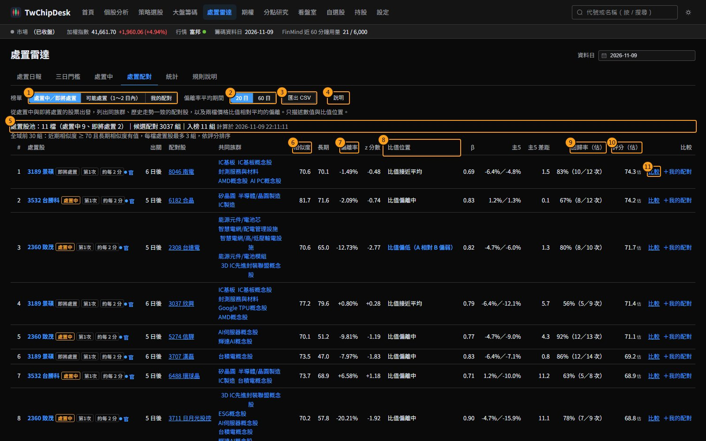
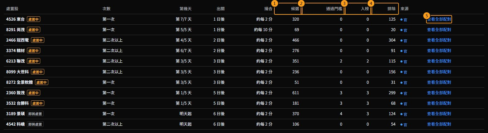
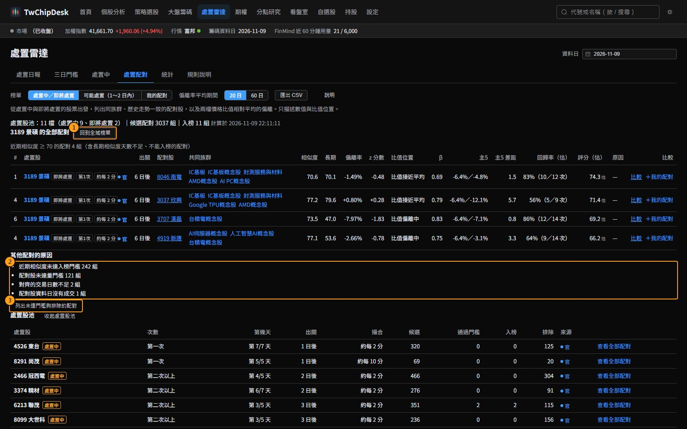
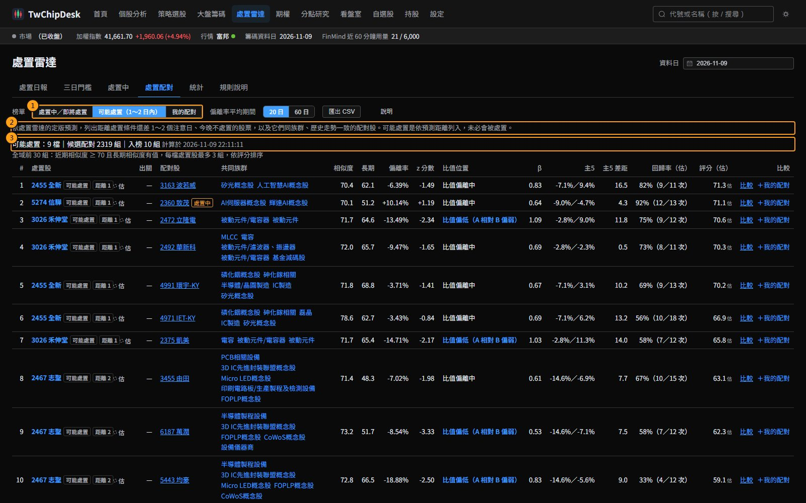
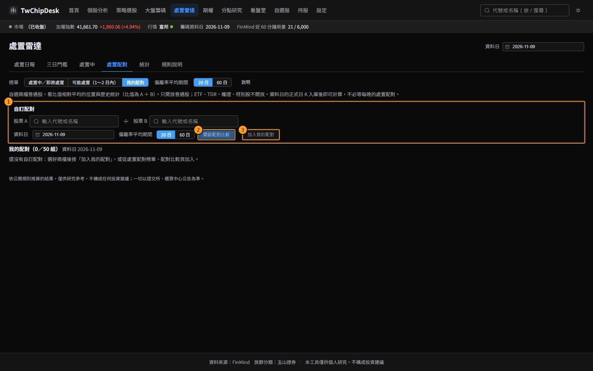
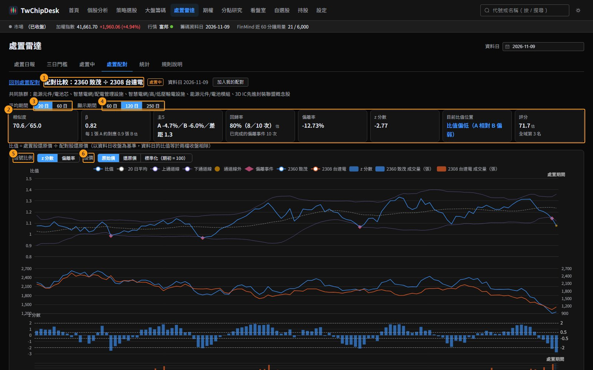
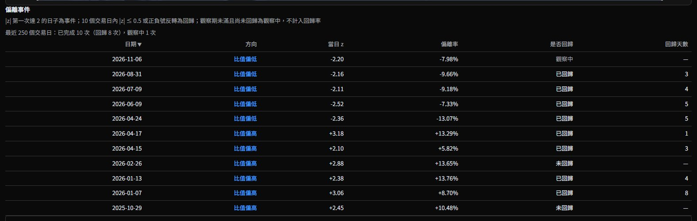

<!-- routes: /disposition/pairs, /disposition/pairs/:stockId/:peerId -->
# 處置雷達｜處置配對

> 位置：頂部選單「處置雷達」→「處置配對」分頁（網址 `/disposition/pairs`；配對比較頁為 `/disposition/pairs/2360/2308`）
> 資料更新：每個交易日 22:10 定版後計算（約 22:20 完成，畫面顯示「計算於 …」）；「我的配對」在資料日的正式日 K 入庫後即可計算

## 這個功能可以做什麼
從處置中、即將處置（或可能處置）的股票出發，找出同族群、過去走勢一致的配對股，並列出兩檔價格比值（處置股 ÷ 配對股）相對平均的偏離與歷史統計。也可以自選任意兩檔普通股做比較（「我的配對」）。

本頁只描述兩檔比值的歷史位置與統計數字，僅供研究參考；回歸率、評分與張數換算是估計值。

## 畫面說明

| 編號 | 名稱 | 說明 |
|---|---|---|
| 1 | 「榜單」 | 「處置中／即將處置」（預設）、「可能處置（1～2 日內）」、「我的配對」；網址的 `segment` 會跟著改變 |
| 2 | 「偏離率平均期間」 | 偏離率與 z 分數用最近「20 日」或「60 日」的平均比值計算 |
| 3 | 「匯出 CSV」 | 下載目前榜單 |
| 4 | 「說明」 | 展開各指標的定義與限制（再按「收起說明」關閉） |
| 5 | 摘要 | 「處置股池：N 檔（處置中、即將處置）｜候選配對 N 組｜入榜 N 組」與計算時間；下一行為入榜規則，例如「全域前 30 組：近期相似度 ≥ 70 且長期相似度有值，每檔處置股最多 3 組，依評分排序」 |
| 6 | 「相似度」「長期」 | 兩檔除權息調整後日報酬的相關係數 × 100（−100～100）。「相似度」為最近 60 個交易日，「長期」為最近 240 個交易日；≥ 90 高度一致、70～90 一致、< 70 一致性不足。上市不滿一年沒有長期值，不能入榜 |
| 7 | 「偏離率」「z 分數」 | 偏離率：比值相對最近 N 個交易日平均比值的百分比；z 分數：比值取對數後相對平均的標準差倍數，以這組配對自己的波動標準化 |
| 8 | 「比值位置」 | 「比值偏高（A 相對 B 偏強）」（z ≥ 2）、「比值偏低（A 相對 B 偏弱）」（z ≤ −2）、「比值接近平均」（|z| ≤ 0.5）、其他為「比值偏離中」 |
| 9 | 「回歸率（估）」 | 過去 250 個交易日中，|z| 第一次達 2 的事件，10 個交易日內回到 |z| ≤ 0.5 或正負號反轉的比例，括號為「回歸次數／事件次數」；事件太少時顯示「回歸樣本不足」 |
| 10 | 「評分（估）」 | 近期一致 × 0.4 ＋ 長期一致 × 0.3 ＋ 回歸率 × 0.3（滑鼠移上看算式），用來排序這一對的歷史一致程度，與目前是否偏離無關 |
| 11 | 「比較」 | 開啟這一組的配對比較頁；旁邊「＋我的配對」把這一組加入我的配對 |

其他欄位：
- **處置股**：股票名稱後的標籤為狀態（「處置中」「即將處置」）、第幾次、撮合間隔與來源；點名稱切換到「這檔處置股的全部配對」。
- **出關**：處置股幾個交易日後出關。
- **共同族群**：兩檔同時所屬的產業、概念、產業鏈或族群。
- **β**：處置股對配對股日報酬的迴歸斜率；滑鼠移上顯示「每 1 張處置股約對應 N 張配對股（估）」。
- **主5**、**主5 差距**：兩檔的 5 日籌碼集中度與差距（百分點）。只有分點資料涵蓋的股票才有值（自選股、處置股池與查詢過分點的股票），沒有值顯示「—」。
- **量低**：配對股 20 日均量低於量門檻（依收盤價分級，見設定頁「選股」的量門檻）；自動配對會排除這類配對，自訂配對照常計算只提示。
- 配對股本身也在處置中時，配對股旁標「處置中」。

### 處置股池

榜單下方的「處置股池」列出每檔處置股的狀態、次數、第幾天、出關與撮合，以及配對的數量（可用「收起處置股池」收合）：

| 編號 | 欄位 | 說明 |
|---|---|---|
| 1 | 「候選」 | 同族群的候選配對數 |
| 2 | 「通過門檻」 | 近期相似度達門檻（預設 70）的配對數 |
| 3 | 「入榜」 | 進入全域榜單的配對數 |
| 4 | 「排除」 | 因非普通股、量低、資料不足等原因排除的配對數 |
| 5 | 「查看全部配對」 | 切換到這檔處置股的全部配對 |

### 一檔處置股的全部配對

點處置股名稱或「查看全部配對」後（網址加 `stock=代號`），列出這檔近期相似度 ≥ 70 的所有配對（含長期相似度天數不足、不能入榜的）。

| 編號 | 名稱 | 說明 |
|---|---|---|
| 1 | 「回到全域榜單」 | 回到全部處置股的榜單 |
| 2 | 「其他配對的原因」 | 沒有列出的配對依原因統計數量，例如「近期相似度未達入榜門檻 242 組」「配對股未達量門檻 121 組」 |
| 3 | 「列出未達門檻與排除的配對」 | 展開逐列查看這些配對與原因 |

### 可能處置榜單

| 編號 | 名稱 | 說明 |
|---|---|---|
| 1 | 「可能處置（1～2 日內）」 | 依處置雷達的定版預測，列出距離處置條件還差 1～2 個注意日、今晚不處置的股票與它們的配對；範圍（最多幾日內）可在設定頁「處置配對」區調整 |
| 2 | 說明 | 可能處置是依預測距離列入，未必會被處置 |
| 3 | 摘要 | 「可能處置：N 檔｜候選配對 N 組｜入榜 N 組」 |

處置股旁的「距離 1」「距離 2」為還要幾個注意日才會處置（估）。處置股池在這個榜單改為「可能處置股池」，另列「預測等級」與「處置機率（估）」：距離 1 為「明日」機率（處置雷達的明日預測）；距離 2 以上為「條件」機率（三日門檻最早可能處置那一天的條件機率）。

### 我的配對（自訂配對）

| 編號 | 名稱 | 說明 |
|---|---|---|
| 1 | 「自訂配對」 | 「股票 A」「股票 B」輸入代號或名稱，比值為 A ÷ B；只開放普通股（ETF、TDR、權證、特別股不開放）。可選「資料日」與「偏離率平均期間」 |
| 2 | 「開啟配對比較」 | 直接開啟這兩檔的配對比較頁（不需要加入清單） |
| 3 | 「加入我的配對」 | 把這一組存入「我的配對」清單，每晚與處置配對一起計算 |

下方「我的配對（N／50 組）」列出已加入的配對：可「上移」「下移」調整順序、輸入一行備註（最多 100 字）後「儲存備註」、「刪除」。還沒有每晚計算結果的組合會即時計算並標「即時」。清單上限預設 50 組（設定頁「處置配對」區）。

## 配對比較頁

從榜單的「比較」或「開啟配對比較」進入（網址 `/disposition/pairs/處置股代號/配對股代號`，可加 `n=20`、`range=120` 指定平均期間與顯示期間）。

| 編號 | 名稱 | 說明 |
|---|---|---|
| 1 | 標題 | 「配對比較：A ÷ B」，旁邊是處置狀態（例如「處置中」「可能處置・距離 1」；處置股不在處置股池時標「自訂」）與資料日；「回到處置配對」回到榜單，「加入我的配對」加入清單 |
| 2 | 指標卡 | 「相似度」（近期／長期）、「β」（每 1 張 A 約對應 N 張 B，估）、「主5」（A／B／差距）、「回歸率」（已完成的偏離事件次數）、「偏離率」、「z 分數」、「目前比值位置」、「評分」（全域第幾名） |
| 3 | 「平均期間」 | 20 日或 60 日 |
| 4 | 「顯示期間」 | 圖表顯示最近 60、120 或 250 日 |
| 5 | 「信號比例」 | 第三張圖顯示「z 分數」或「偏離率」 |
| 6 | 「股價」 | 第二張圖切換「原始價」「還原價」「標準化（期初 = 100）」 |

圖表由上而下（可聯動縮放）：

1. **比值**：比值線、N 日平均、上下通道線（比值取對數後平均 ± 2 個標準差，每一天只用該日以前的資料）；比值落在通道線外的日子以點標出，偏離事件以菱形標出；底色帶為處置期間。
2. **股價**：處置股（左軸）與配對股（右軸）。
3. **信號比例**：z 分數或偏離率的長條，虛線為 ±2 與 ±0.5。
4. **成交量**：兩檔的成交量（張）。

畫面上「比值 = 處置股還原價 ÷ 配對股還原價（以資料日收盤為基準，資料日的比值等於兩檔收盤相除）」。這一組不在當天的處置配對清單時，頁首註明「以下為即時計算的數值」。

### 偏離事件

列出最近 250 個交易日內 |z| 第一次達 2 的日子：「日期」「方向」（比值偏高／比值偏低）、「當日 z」「偏離率」「是否回歸」（「已回歸」「未回歸」「觀察中」）與「回歸天數」。10 個交易日內 |z| ≤ 0.5 或正負號反轉為回歸；觀察期未滿且尚未回歸為「觀察中」，不計入回歸率。

## 操作步驟
1. 打開「處置配對」，看全域榜單（依評分排序）。
2. 想看某檔處置股的所有配對，點它的名稱。
3. 對有興趣的一組按「比較」，在比較頁切換平均期間、顯示期間與股價模式。
4. 想長期追蹤某一組，按「＋我的配對」，之後在「我的配對」榜單查看。

## 資料來源與更新時間
日 K、分點來自 FinMind；處置紀錄來自官方公告；族群依產業鏈與族群分類資料。每晚 22:10 處置雷達定版後計算全部處置配對。

## 注意事項與限制
- 歷史統計大多來自處置股未處置的期間；處置期間採分盤集合競價（約每 2 分鐘撮合）、需預收款券，價格行為與平常不同，歷史回歸率不代表處置期間的表現。
- 相似度、門檻、每檔最多幾組、權重等參數可在設定頁「處置配對」區調整；關閉「處置配對」後這個分頁不顯示。

## 相關功能
- 個股分析的「配對」分頁：以任一檔股票為中心的配對排行，見[個股分析](../stock/README.md)。
- [處置中](active.md)、[三日門檻](outlook.md)。
