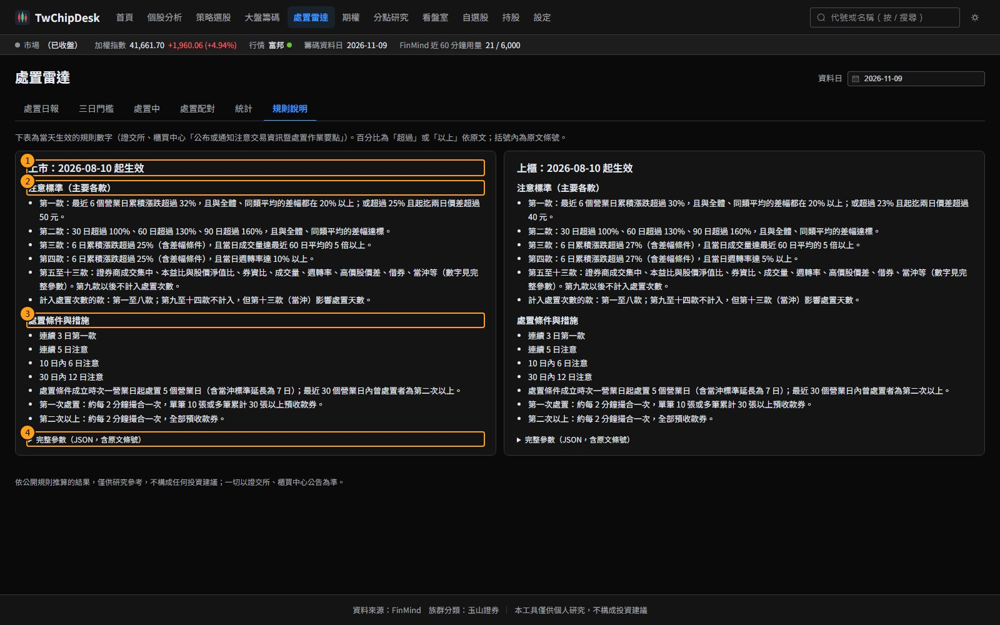

<!-- routes: /disposition/rules -->
# 處置雷達｜規則說明

> 位置：頂部選單「處置雷達」→「規則說明」分頁（網址 `/disposition/rules`，可加 `?date=2026-11-09`）
> 資料更新：規則版本隨交易所修正要點時更新；畫面顯示資料日當天生效的版本

## 這個功能可以做什麼
列出資料日當天生效的注意標準與處置條件的實際數字（證交所、櫃買中心「公布或通知注意交易資訊暨處置作業要點」），上市與上櫃各一張卡片。處置雷達的所有推算都用這些數字。百分比是「超過」或「以上」依原文；括號內為原文條號。

## 畫面說明

| 編號 | 名稱 | 說明 |
|---|---|---|
| 1 | 規則版本 | 「上市：2026-08-10 起生效」；右邊為上櫃的卡片 |
| 2 | 「注意標準（主要各款）」 | 第一至四款的白話與數字；第五至十三款摘要；哪些款計入處置次數 |
| 3 | 「處置條件與措施」 | 四個處置條件、處置天數（含當沖延長）、第一次與第二次以上的撮合間隔與預收方式 |
| 4 | 「完整參數（JSON，含原文條號）」 | 展開後顯示這個版本的全部參數（含各款門檻、除外情形與原文條號） |

## 2026-08-10 起的主要數字（以畫面為準）
| 項目 | 上市 | 上櫃 |
|---|---|---|
| 第一款 | 6 日累積漲跌超過 32%，且與全體、同類平均的差幅都在 20% 以上；或超過 25% 且起迄兩日價差超過 50 元 | 超過 30%（差幅 20% 以上）；或超過 23% 且價差超過 40 元 |
| 第二款 | 30 日超過 100%、60 日超過 130%、90 日超過 160%，且差幅達標 | 同左 |
| 第三款 | 6 日累積超過 25%（含差幅條件），且當日成交量達最近 60 日平均的 5 倍以上 | 6 日累積超過 27% |
| 第四款 | 6 日累積超過 25%（含差幅條件），且當日週轉率達 10% 以上 | 6 日累積超過 27%，週轉率 5% 以上 |
| 處置條件 | 連續 3 日第一款、連續 5 日注意、10 日內 6 日注意、30 日內 12 日注意 | 同左 |
| 處置天數 | 次一營業日起 5 個營業日（含當沖標準延長為 7 日） | 同左 |
| 第一次處置 | 約 2 分鐘撮合一次，單筆 10 張或多筆累計 30 張以上預收款券 | 同左 |
| 第二次以上 | 約 2 分鐘撮合一次，全部預收款券（最近 30 個營業日內曾處置） | 同左 |

計入處置次數的是第一至八款；第九至十四款不計入，但第十三款（當沖）影響處置天數。

## 操作步驟
1. 打開「規則說明」分頁看目前的規則。
2. 想知道某個過去日子適用哪一版，在右上角「資料日」選那一天，畫面改為當天生效的版本（新制自 2026-08-10 起；舊制的處置期間為 10 個營業日、含當沖 12 個營業日）。

## 注意事項與限制
- 畫面只列主要各款的白話，完整數字見「完整參數」。
- 一切以證交所、櫃買中心公告的原文為準。

## 相關功能
- [處置雷達總覽](README.md)：各款與處置條件的白話說明。
- [處置日報](daily.md)、[三日門檻](outlook.md)：用這些數字推算的結果。
