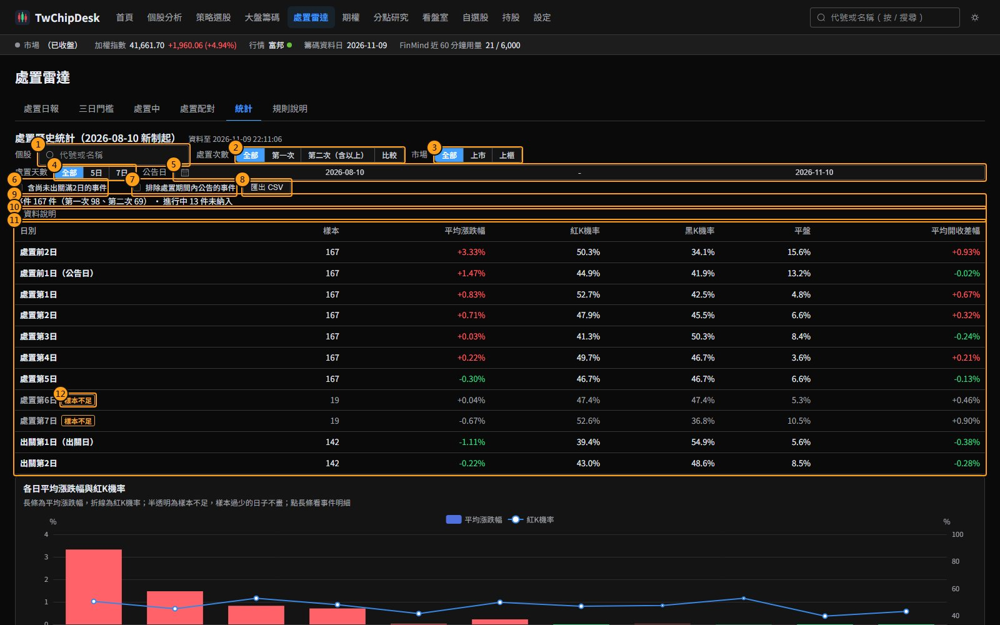
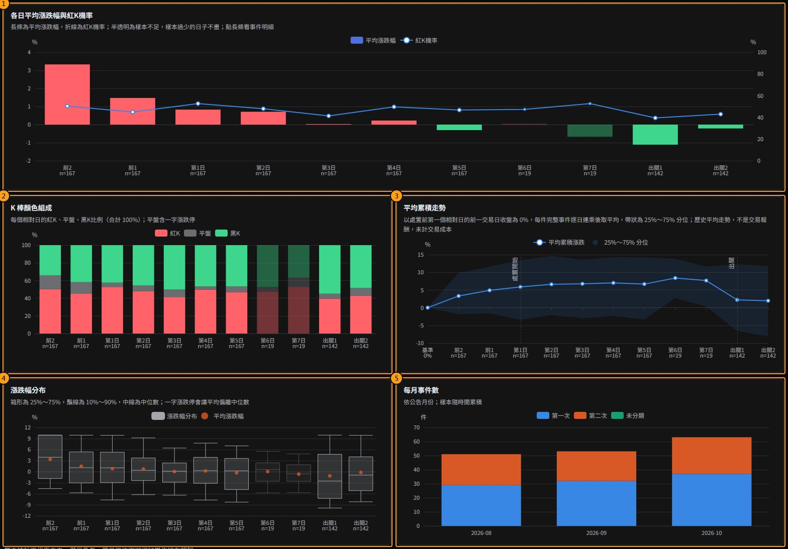
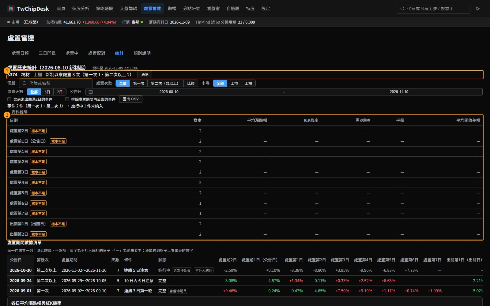
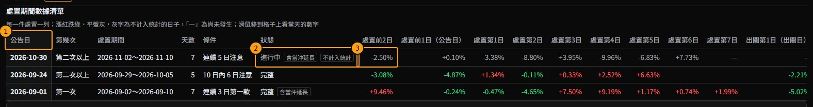

<!-- routes: /disposition/stats -->
# 處置雷達｜統計

> 位置：頂部選單「處置雷達」→「統計」分頁（網址 `/disposition/stats`；個股模式為 `/disposition/stats?stock=3374`）
> 資料更新：每個交易日 22:10 定版後重算（標題旁「資料至 …」為計算時間）

## 這個功能可以做什麼
統計 2026-08-10 新制以來每一件處置，在「處置前 2 日 → 處置期間 → 出關後 2 日」每一天的平均漲跌幅、紅K黑K機率與平均開收差幅，回答「處置股在處置前、處置中、出關後，平均而言每天怎麼走」。也可以輸入一檔股票，只看它自己的處置紀錄與每一次處置的逐日數字。

歷史統計不代表未來，僅供參考；單日平均不可相加當作持有報酬。

## 畫面說明

| 編號 | 名稱 | 說明 |
|---|---|---|
| 1 | 「個股」 | 輸入代號或名稱，切換為個股模式（見下方） |
| 2 | 「處置次數」 | 「全部」「第一次」「第二次（含以上）」「比較」（第一次與第二次並列） |
| 3 | 「市場」 | 「全部」「上市」「上櫃」 |
| 4 | 「處置天數」 | 「全部」「5日」「7日」（7 日為含當沖標準的處置） |
| 5 | 「公告日」 | 只統計公告日在這個區間的事件（起日、迄日） |
| 6 | 「含尚未出關滿2日的事件」 | 預設只統計已經出關滿 2 日的完整事件；勾選後，進行中事件已發生的日子也計入 |
| 7 | 「排除處置期間內公告的事件」 | 排除前一次處置還沒結束就再被公告的事件 |
| 8 | 「匯出 CSV」 | 下載目前條件的統計（個股模式時為該股的事件與逐日數字） |
| 9 | 摘要 | 「事件 N 件（第一次 a、第二次 b）」與進行中事件是否納入 |
| 10 | 「資料說明」 | 展開後列出排除的事件數與原因（非上市櫃普通股、不是以注意次數為條件、沒有處置期間、處置天數無法確定）、處置最後一日與官方迄日不同的件數、出關後仍在另一次處置期間的件數、資料來源件數等 |
| 11 | 逐日統計表 | 每一列一個相對日，欄位見下方 |
| 12 | 「樣本不足」 | 樣本少於 30 件時，該列灰字並標「樣本不足」；少於 5 件時不顯示數值 |

篩選條件存在網址，最後一次的選擇會記在瀏覽器。

### 逐日統計表的欄位
| 欄位 | 說明 |
|---|---|
| 「日別」 | 「處置前2日」「處置前1日（公告日）」「處置第1日」…「處置第7日」「出關第1日（出關日）」「出關第2日」。處置第 6、7 日只有 7 日的處置才有，樣本通常少很多 |
| 「樣本」 | 這一列計入的事件數 |
| 「平均漲跌幅」 | （收盤 − 基準價）÷ 基準價 的平均；基準價為前一交易日收盤（除權息等日為開盤參考價）。滑鼠移上顯示中位數與 95% 區間 |
| 「紅K機率」「黑K機率」「平盤」 | 以開盤與收盤比較（不是與昨收比較）：收盤 > 開盤為紅K、< 開盤為黑K、相等為平盤（含一字漲跌停）；三者合計 100% |
| 「平均開收差幅」 | （收盤 − 開盤）÷ 開盤 的平均，未計交易成本 |

點表格的一格可打開側欄「…的事件明細」，列出這一格的每一件事件：股票、公告日、次數、天數、日期、開盤、收盤、基準價、漲跌幅、K 棒、開收差幅、累積與「狀態」（「計入」「尚未發生」「全日無成交」「仍在另一次處置期間」「已下市」）。

### 圖表

| 編號 | 圖表 | 說明 |
|---|---|---|
| 1 | 「各日平均漲跌幅與紅K機率」 | 長條為平均漲跌幅，折線為紅K機率；半透明為樣本不足，樣本過少的日子不畫；點長條看事件明細 |
| 2 | 「K 棒顏色組成」 | 每個相對日的紅K、平盤、黑K比例（合計 100%） |
| 3 | 「平均累積走勢」 | 以處置前第一個相對日的前一交易日收盤為 0%，每件完整事件逐日連乘後取平均，帶狀為 25%～75% 分位；虛線標出「處置開始」與「出關」。這是歷史平均走勢，不是交易報酬，未計交易成本 |
| 4 | 「漲跌幅分布」 | 箱形為 25%～75%，鬚線為 10%～90%，中線為中位數，點為平均；一字漲跌停會讓平均偏離中位數 |
| 5 | 「每月事件數」 | 依公告月份，分第一次、第二次與未分類 |

## 個股模式
在「個股」輸入代號或名稱並選取後（或在個股頁的處置面板點「這檔的處置統計」），網址帶 `?stock=代號`，統計表與圖表只用這檔股票的事件計算（單檔樣本少，多半只有表格有數字），並在統計表下方加上「處置期間數據清單」。

| 編號 | 名稱 | 說明 |
|---|---|---|
| 1 | 個股標題列 | 代號、名稱與「新制以來處置 N 次（第一次 a、第二次以上 b）」；「清除」回到全市場統計 |
| 2 | 該股的逐日統計 | 欄位同上，只用這檔的事件 |

| 編號 | 名稱 | 說明 |
|---|---|---|
| 1 | 「公告日」 | 每一件處置一列，依公告日由新到舊；其他欄為「第幾次」「處置期間」「天數」「條件」 |
| 2 | 「狀態」 | 「完整」「進行中」「已排除：原因」；不計入統計的事件另標「不計入統計」。另有標籤「含當沖延長」「期間與官方不同」「沒有真正出關」「處置期間內公告」 |
| 3 | 相對日漲跌幅 | 每個相對日的漲跌幅，漲紅跌綠、平盤灰；灰字為不計入統計的日子，「—」為尚未發生。滑鼠移上顯示日期、開盤、收盤、開收差幅、K 棒與累積漲跌 |

表格欄位多時可以左右捲動（「公告日」欄固定）。每列最右邊有「逐日數字」（展開這一件的逐日明細表：日別、日期、開盤、收盤、基準價、漲跌幅、開收差幅、K 棒、累積漲跌、狀態；「收合」關閉）與「K 線」（開啟這檔的 K線籌碼圖）。

這檔自 2026-08-10 起沒有處置時，顯示「這檔自 2026-08-10 起沒有處置紀錄」。

## 欄位與名詞
- **相對日**：以該股自己的交易日排序；停止買賣、全日暫停交易的日子資料來源仍有一列全 0 的日 K（沒有收盤價），這裡不計入、自然跳過。處置雷達的注意次數另依暫停交易事件跳過全日暫停的日子。
- **第二次（含以上）**：依官方公告的分級（最近 30 個營業日內曾發布處置）；第三次以後的措施與第二次相同，所以合併。
- **沒有真正出關**：出關後 1、2 日仍在同一檔另一次處置期間內，這幾天不計入出關後的樣本。

## 資料來源與更新時間
處置事件來自官方公告與 FinMind 處置資料，價格來自 FinMind 日 K。每晚 22:10 定版後全部重算；統計尚未建立時顯示「統計尚未建立，將於今晚 22:10 後產生」。

## 注意事項與限制
- 只統計 2026-08-10 新制以後公告的事件（新舊制的處置天數與撮合方式不同，不混算）。
- 處置前、出關後的天數（預設各 2 日）與樣本門檻可在設定頁「處置雷達」區調整；功能關閉時顯示「功能已關閉」。
- 平均漲跌幅是單日平均，不能把各日相加當作持有報酬。

## 相關功能
- [處置中](active.md)：目前處置中的股票。
- [規則說明](rules.md)：新制的處置天數與措施。
