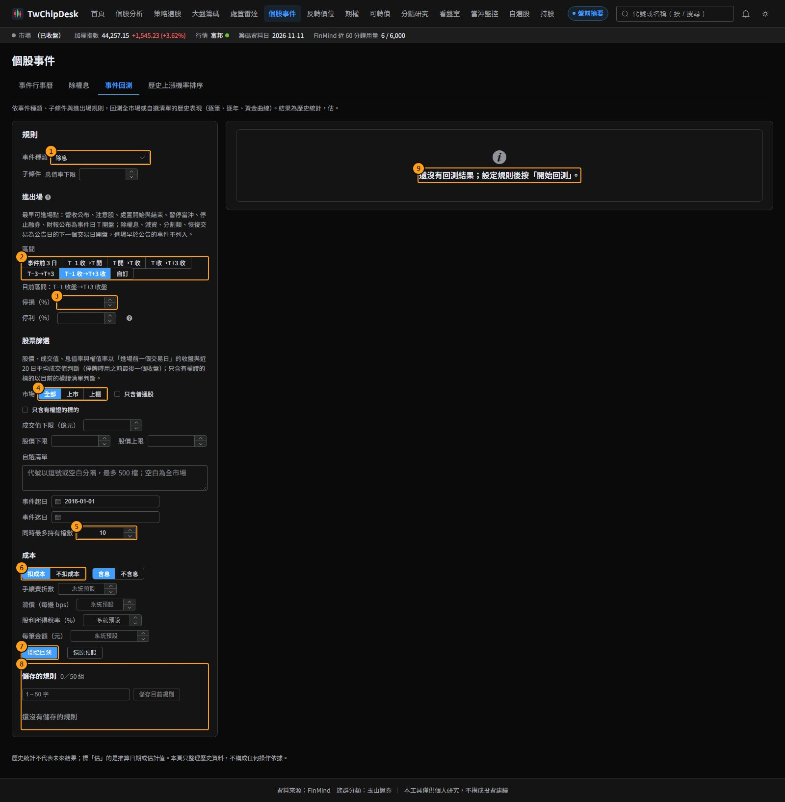

<!-- routes: /events/backtest -->
# 個股事件｜事件回測

> 位置：頂部選單「個股事件」→「事件回測」分頁（網址 `/events/backtest`；`?type=revenueRelease` 可帶入事件種類）
> 資料更新：使用最新的事件樣本（每個交易日 15:40、22:40 更新）；結果為歷史估計

## 這個功能可以做什麼
選一種事件與子條件，設定進場與出場區間、停損停利、股票篩選、期間與成本，回測全市場（或自選清單）過去每一次這種事件的表現：摘要、逐年、每一筆清單、資金曲線與最大回落，並把最近 3 年與更早並列比較。規則可以儲存（最多 50 組），也可以套用到行事曆當作篩選。

## 畫面說明

| 編號 | 名稱 | 說明 |
|---|---|---|
| 1 | 「事件種類」「子條件」 | 子條件依種類不同，見下方。 |
| 2 | 「區間」 | 常用預設或「自訂」進場、出場。 |
| 3 | 「停損（%）」「停利（%）」 | 0.5～50，相對進場價；空白為不設。 |
| 4 | 「股票篩選」 | 「市場」「只含普通股」「只含有權證的標的」「成交值下限（億元）」「股價下限」「股價上限」「自選清單」。 |
| 5 | 期間與持有檔數 | 「事件起日」「事件迄日」（預設 2016-01-01 起）、「同時最多持有檔數」（1～50，預設 10）。 |
| 6 | 「成本」 | 「扣成本」或「不扣成本」、「含息」或「不含息」；「手續費折數」「滑價（每邊 bps）」「股利所得稅率（%）」「每筆金額（元）」空白時用系統預設。 |
| 7 | 「開始回測」 | 規則不合法時下方列出「規則需要修正：」與原因，按鈕無法點。 |
| 8 | 「儲存的規則」 | 輸入名稱後按「儲存目前規則」；清單可「套用」「套用到行事曆」「改名」「刪除」。 |
| 9 | 「回測結果」 | 摘要卡、逐年、最近 3 年與更早、資金曲線、每筆清單。 |

## 子條件
| 事件種類 | 子條件 |
|---|---|
| 「月營收公布」 | 營收年增率下限（%）、營收月增率下限（%）、當月營收創最近幾個月新高（2～120）、年增率由負轉正 |
| 「除息」「權息同日」「ETF 除息」 | 息值率下限（%） |
| 「除權」「權息同日」 | 權值率下限（%） |
| 「處置開始」「處置結束」 | 處置次數：不限、第一次、第二次以上 |
| 「股東會」「庫藏股決議」 | 由系統提供，畫面照清單列出名稱（勾選或輸入數值）；「法說會」沒有子條件 |

## 最早可進場點
回測只用事件公告之後才能知道的資訊，進場點不可早於下列時點：

| 事件種類 | 最早可進場點 | 區間進場早於這個時點時 |
|---|---|---|
| 「月營收公布」「列為注意股」「處置開始」「處置結束」「暫停當沖」「停止融券」「財報公布」「庫藏股決議」 | 事件日 T 開盤（這些事件當天才知道） | 不能回測：表單旁列出後端訊息，請把進場改到 T 開盤或之後 |
| 「除息」「除權」「權息同日」「ETF 除息」「減資恢復買賣」「暫停交易後恢復」「法說會」「股東會」 | 公告日的下一個交易日開盤（沒有公告日時為 T 開盤） | 逐筆判斷：進場早於公告的那幾筆不列入，結果摘要下方註明「進場點早於事件公告而排除 N 筆」 |

事件行事曆、除權息、排序與個股「事件」分頁屬於事件研究，進場早於公告的樣本照常計算，但會註明「部分樣本的進場點早於事件公告，只能當事件研究參考」，行事曆與排序的列另標「早於公告」。

## 計算方式
- 每一筆：在進場日以開盤或收盤進場、出場日以開盤或收盤出場；淨報酬扣除手續費、證交稅、滑價與股利所得稅（持有期間跨過除息日時）。
- 停損與停利：進場後每天以最高、最低價判斷（開盤進場時當天也算）；同一天兩者都觸及算停損；觸及時以停損或停利價出場，跳空越過時以開盤價。觸及那天如果一字漲停或一字跌停，順延到下一個不是一字漲跌停的交易日開盤出場。「不含息」時以不含息的價格比較。
- 缺少每日最高、最低價的筆沒有檢查停損停利，摘要下方註明「有 N 筆缺少每日高低價，未套用停損停利」，每筆清單的出場原因也會註明。
- 股價、成交值、息值率與權值率的篩選以「進場前一個交易日」的收盤（停牌時用之前最後一個收盤）與近 20 日平均成交值判斷，避免用到進場之後的資料；「只含有權證的標的」以目前的權證清單判斷（沒有歷史）。
- 資金曲線：起始 1.0，每一筆投入「當時權益 ÷ 同時最多持有檔數」，當天進當天出的交易也占名額；持有檔數已滿時略過該筆（畫面會列出略過的筆數），現金不計息，每天以收盤評價（停牌日沿用最後一個收盤）。「最大回落」為資金曲線從高點的最大跌幅。

## 結果
- 摘要：「N」「上漲機率」「調整後上漲機率」（估）「平均報酬」「中位數」「t 值」「超額平均」「超額勝率」「資金曲線總報酬」「最大回落」。
- 「逐年」：每年的上漲機率（N）、平均、超額平均。
- 「最近 3 年與更早」：兩段的上漲機率（N）與平均，差異大時標「近年改變」。
- 「資金曲線」。
- 「每筆清單」：代號名稱、事件日（推算的標「估」）、進場日、出場日、出場原因（區間到期、停損、停利）、淨報酬、毛報酬、大盤、超額、是否計入資金曲線；欄名可排序，「匯出 CSV」依畫面順序下載（CSV 另有「推算日期」與「未套用停損停利（缺高低價）」兩欄，後者為「是」表示這筆缺少每日高低價、沒有檢查停損停利）。筆數超過上限（5,000 筆）時註明只列出最新的部分，摘要仍以全部計算。

## 操作步驟
1. 選事件種類與子條件，設定區間與停損停利。
2. 設定股票篩選、期間與成本，按「開始回測」。
3. 看摘要與逐年，比較最近 3 年與更早是否一致。
4. 需要時輸入名稱按「儲存目前規則」；之後可「套用」回表單，或「套用到行事曆」看未來 30 天符合種類與篩選的事件。

## 注意事項與限制
- 儲存的規則最多 50 組，名稱 1～50 字且不可重複。
- 套用到行事曆時會帶事件種類、子條件、區間、市場、成交值、權證與成本，自選清單與只含普通股在行事曆上過濾；股價範圍不會套用（行事曆沒有這個條件，畫面會註明）。也可以在行事曆的「儲存的規則」下拉直接選。
- 設定停損停利、股價或成交值篩選的回測同時只能算一個；別人（或另一個分頁）正在算時顯示「已有一個需要讀取停損停利、股價或成交值資料的回測在計算，請稍後再試。」，稍後按「重試」。
- 事件樣本還沒建置時顯示「事件樣本尚未建置」。
- 回測結果為歷史統計，不代表未來結果，也不構成任何操作依據。

## 相關功能
- [個股事件｜事件行事曆](calendar.md)
- [策略選股｜策略實驗室](../screener/lab.md)
