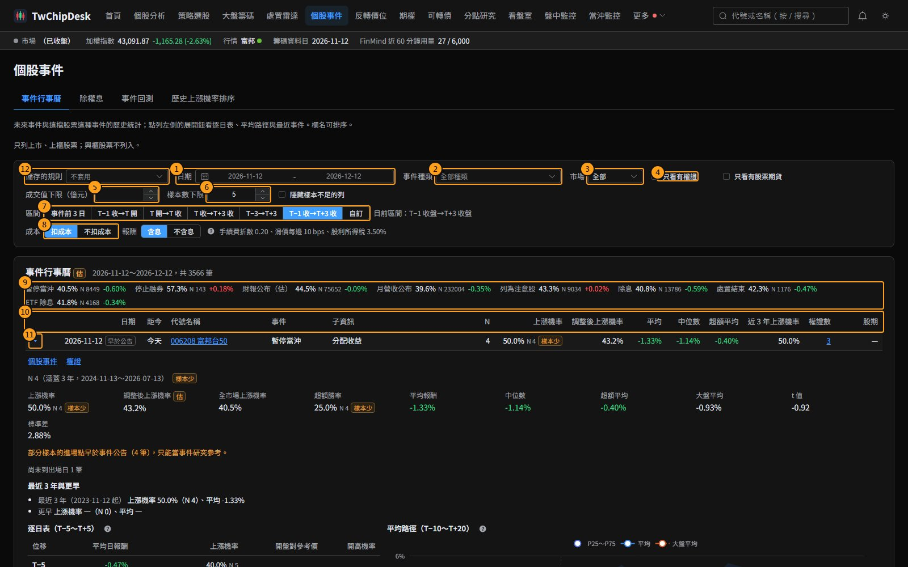

<!-- routes: /events -->
# 個股事件｜事件行事曆

> 位置：頂部選單「個股事件」→「事件行事曆」分頁（網址 `/events`；條件會寫在網址上，例如 `/events?types=exDividend&window=-1:close,0:open&warrants=1`）
> 資料更新：事件樣本每個交易日 15:40 與 22:40 增量更新；所有統計皆為歷史估計

## 這個功能可以做什麼
列出未來一段期間（預設今天起 30 天）的個股事件，每一筆附上「這檔股票、這種事件」在所選區間的歷史統計：N、上漲機率、調整後上漲機率（估）、平均、中位數、超額平均與最近 3 年的上漲機率。可以只看有權證或有股票期貨的股票、設定成交值與樣本數下限，再依任一欄排序。點一列左側的展開鈕，可以看這檔這種事件的逐日表、平均路徑與最近事件。

## 畫面說明

| 編號 | 名稱 | 說明 |
|---|---|---|
| 1 | 「日期」 | 起訖日；沒有選時為今天起 30 天。最多 120 天。 |
| 2 | 「事件種類」 | 多選；不選為全部種類（含只列在行事曆、不做統計的分割、反分割、面額變更，以及「法說會」「股東會」「庫藏股決議」）。篩選區下方註明這三種事件「資料自 YYYY-MM-DD 起累積」。 |
| 3 | 「市場」 | 「全部」「上市」「上櫃」。 |
| 4 | 「只看有權證」「只看有股票期貨」 | 只列目前有上市權證、或有股票期貨的股票。 |
| 5 | 「成交值下限（億元）」 | 近 20 日平均成交值的下限。 |
| 6 | 「樣本數下限」 | 預設 5；N 低於下限的列仍會列出並標「樣本少」，勾「隱藏樣本不足的列」才會隱藏。 |
| 7 | 「區間」 | 常用預設或「自訂」進場、出場的位移與開盤或收盤；自訂後按「套用」。旁邊顯示目前區間。 |
| 8 | 「成本」「報酬」 | 「扣成本」或「不扣成本」、「含息」或「不含息」；扣成本時列出實際採用的手續費折數、滑價與股利所得稅率。 |
| 9 | 全市場統計 | 本次出現的每種事件，全市場同區間、同成本的上漲機率（N）與平均。 |
| 10 | 事件列表 | 欄位見下方；點欄名排序（三態：遞減、遞增、回到日期順序）。 |
| 11 | 展開鈕 | 點列左側的 ▸ 展開、▾ 收合。 |
| 12 | 「儲存的規則」 | 在「日期」左邊；選一組在事件回測儲存的規則，行事曆改用規則的條件，沒有選時顯示「不套用」。見下方「套用儲存的規則」。 |
| 13 | 「公布時間」 | 月營收與財報實際公布的時間與來源，見下方欄位說明；其他事件顯示「—」。 |

## 欄位
- **「日期」**：事件日 T；推算的日期標「估」。在所選區間，進場點早於事件公告的列另標「早於公告」（公告前無法得知，只能當事件研究參考）。
- **「距今」**：今天到事件日的交易日數（今天是事件日顯示「今天」）。
- **「代號名稱」**：點了開啟這檔的[個股「事件」分頁](../stock/events.md)。
- **「事件」「子資訊」**：事件種類與內容，例如除息的現金與股票股利、殖利率（以最新收盤估算，標「估」）；月營收的年月、年增、月增、創幾個月新高；處置的第幾次與期間。三種官方來源事件：
  - 「法說會」：開始時間加地點的前 8 個字，例如「14:00 線上法說會」；受邀參加別家舉辦的說明會時前面加「受邀」。滑鼠移上去（手機點一下）看地點全文、擇要訊息與公告時間；時間是推定的時候標「（估）」。
  - 「股東會」：「常會」或「臨時會」，要改選董監時加「改選董監」；地點在滑過說明。
  - 「庫藏股決議」：預定買回數量與占已發行股份比率，例如「預定 2,500 張（3.72%）」（不足 1 張時顯示股數），以及「區間 21～46 元」的買回價格區間（公告只寫一個價格時為「上限 46 元」或「下限 21 元」）；買回目的與預定買回期間在滑過說明。
- **「公布時間」**：只有月營收與財報有，依來源顯示：
  - 官方有確切時間（例如財報的重大訊息發言時間）：「公布 11/12 14:43」。
  - 官方只知道在某段時間內公布（月營收彙總表在兩次更新之間出現）：同一天時「公布 11/10 16:00 前」，跨天時「公布 11/10」；滑過說明列出區間。
  - 官方只有日期：「公布 11/10」。
  - 沒有官方時間、用 FinMind 入庫日：「公布 11/10」，滑過說明「FinMind 入庫日」。
  - 都沒有、依規則推算：「公布 11/10（估）」。
  - 官方開放資料與 FinMind 的數值不一致、官方有而 FinMind 還沒有，或日期矛盾時，旁邊加小標記「待核對」（滑過說明原因）。統計一律用 FinMind 的數值。
- **「N」「上漲機率」「調整後上漲機率」「平均」「中位數」「超額平均」**：這檔這種事件在所選區間的歷史統計（定義見[個股事件](README.md)的共同用語）。上漲機率旁標 N，N 少於 5 標「樣本少」。
- **「近 3 年上漲機率」**：只用最近 3 年的樣本。
- **「權證數」**：點了開啟這檔的權證分頁。**「股期」**：股票期貨代號。

## 展開列
- 連結：「個股事件」（個股頁「事件」分頁）、「權證」（有權證時）、「以期代現試算」（除權息類且有股票期貨時，開啟[期現套利](../derivatives/arbitrage.md)的除息以期代現）。
- 有樣本的進場點早於事件公告時，註明「部分樣本的進場點早於事件公告（N 筆），只能當事件研究參考。」
- 摘要：N（涵蓋年數與起訖日）、上漲機率、調整後上漲機率（估）、全市場上漲機率、超額勝率、平均報酬、中位數、超額平均、大盤平均、t 值、標準差；剔除與順延的筆數。
- 「最近 3 年與更早」：兩段各自的上漲機率（N）與平均；差異大時標「近年改變」。
- 「逐日表（T−5～T+5）」：每天收盤對前一交易日收盤的平均日報酬與上漲機率（除權息日以參考價計算，不扣成本）；事件日另列「開盤對參考價」與「開高機率」。
- 「平均路徑（T−10～T+20）」：以 T−1 收盤為 0% 的累積報酬平均線，淡色帶狀為 P25～P75，虛線為大盤平均。
- 「最近事件」：最多 10 筆，事件日、進場日、出場日、淨報酬、超額與狀態（已計入、尚未到出場日、結構事件剔除等）。

## 操作步驟
1. 選日期、事件種類與篩選條件。
2. 在「區間」選常用預設，或選「自訂」輸入進場與出場後按「套用」。
3. 點「調整後上漲機率」等欄名排序。
4. 點列左側的展開鈕看逐日表與平均路徑；點代號名稱看這檔的所有事件。

## 套用儲存的規則
兩種方式：
- 在本頁「儲存的規則」下拉選一組在[事件回測](backtest.md)儲存的規則（最多 50 組）。行事曆換成規則的事件種類、子條件、區間、市場、成交值下限、權證與成本；「日期」「只看有股票期貨」「樣本數下限」「隱藏樣本不足的列」維持原本的設定。選「不套用」（清除）回到沒有規則的條件。
- 在事件回測的「儲存的規則」按「套用到行事曆」，效果相同。

套用後上方註明「已套用儲存的規則」。子條件只在「事件種類」只選一種有統計的事件時套用（統計也以子條件計算）。規則的「自選清單」（只列清單內的股票）與「只含普通股」（不列 ETF）在行事曆上直接過濾；「股價範圍」行事曆沒有，不會套用，畫面會列出沒套用的條件。規則之後被刪除時，自選清單與只含普通股也改列為沒套用。

## 注意事項與限制
- 只列上市、上櫃股票；興櫃股票不列入（畫面上方也有註明），「市場」選「全部」也不含興櫃。
- 事件樣本還沒建置時顯示「事件樣本尚未建置」，第一次建置完成後才有統計。
- 未來的除權息指標以最新收盤估算；推算的事件日可能與實際公布日不同。
- 法說會、股東會、庫藏股決議沒有更早的歷史，從官方來源開啟那天起累積，剛開始的統計多半標「樣本少」。來源關閉時這三種事件不會有新資料。
- 歷史統計不代表未來結果。
- 想提前收到自選或持股的除權息、月營收公布提示：到[警示中心](../alerts/README.md)新增「事件提醒（每天）」規則；每天 08:00 以本頁的事件評估一次，推算的事件日標「估」，同一事件每檔只提示一次。

## 相關功能
- [警示中心](../alerts/README.md)：事件提醒
- [個股事件｜除權息](dividends.md)
- [個股事件｜歷史上漲機率排序](rankings.md)
- [大盤籌碼｜當日事件](../market/events.md)
