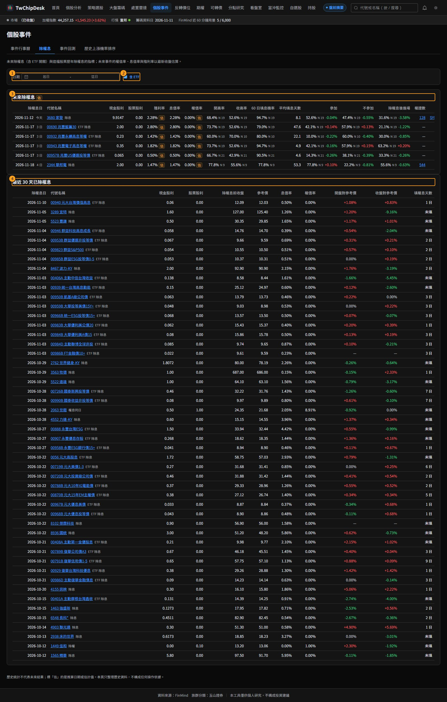

<!-- routes: /events/dividends -->
# 個股事件｜除權息

> 位置：頂部選單「個股事件」→「除權息」分頁（網址 `/events/dividends`；`?etf=0` 不含 ETF）
> 資料更新：除權息公告與結果每個交易日 15:40、22:40；未來事件的比率以最新收盤估算

## 這個功能可以做什麼
列出未來除權息的股票與 ETF，並附上這檔過去每次除權息的歷史指標：除權息當天開盤、收盤高於參考價的比例，60 個交易日內填權息的比例與平均天數，以及「參加」「不參加」「除權息後進場」三種區間的歷史統計。下方另列最近 30 天已除權息的實際結果。

## 畫面說明

| 編號 | 名稱 | 說明 |
|---|---|---|
| 1 | 「日期」 | 起訖日；沒有選時為今天起 30 天（最多 120 天）。 |
| 2 | 「含 ETF」 | 取消勾選時不列 ETF。 |
| 3 | 「未來除權息」 | 欄名可排序，欄位見下方。 |
| 4 | 「最近 30 天已除權息」 | 已發生的除權息與當天的實際結果。 |

## 欄位（未來除權息）
- **「除權息日」**：旁邊為距今的交易日數。**「代號名稱」**：旁邊為種類（除息、除權、權息同日、ETF 除息）。
- **「現金股利」「股票股利」**：元／股。
- **「殖利率」**：現金股利 ÷ 最新收盤，標「估」。
- **「息值率」**：現金股利 ÷ 除權息前收盤；**「權值率」**：（除權息前收盤 − 現金股利 − 參考價）÷ 除權息前收盤，代表股票股利造成的價差比例。未來事件以最新收盤估算，標「估」。
- **「開高率」「收高率」**：這檔歷年同種除權息，當天開盤、收盤高於參考價的比例，旁邊標 N。
- **「60 日填息機率」**：已知結果中，60 個交易日內收盤回到除權息前收盤的比例（旁邊的 N 為計算的筆數）；**「平均填息天數」**：已填者的平均交易日數（上限 250 日）。
- **「參加」「不參加」「除權息後進場」**：三種區間的上漲機率（N）與平均報酬：參加為 T−1 收盤→T 開盤（含息、計股利所得稅）；不參加為 T−3 收盤→T−1 收盤；除權息後進場為 T 開盤→T+3 收盤。成本用系統預設（扣成本、含息）。
- **「權證數」**：點了開啟權證分頁。**「股期」**：有股票期貨時列出代號，點了開啟[期現套利](../derivatives/arbitrage.md)的「除息以期代現」試算。

## 欄位（最近 30 天已除權息）
「除權息前收盤」「參考價」「息值率」「權值率」，當天「開盤對參考價」「收盤對參考價」（「參考價」顯示進位到升降單位、作為開盤競價基準的值，兩個百分比都用它計算；滑過「參考價」會顯示未進位的理論參考價；除權息前一天沒有成交時仍會計算），以及「填權息天數」（還沒填時顯示「未填」）。

## 操作步驟
1. 選日期區間，需要時取消「含 ETF」。
2. 點「開高率」「60 日填息機率」等欄名排序。
3. 點代號名稱看這檔所有事件與歷年除權息明細。

## 注意事項與限制
- 填權息天數以「除權息當天收盤 ≥ 除權息前收盤記為 1」起算，之後依交易日遞增，超過 250 日仍未填記為未填。
- 歷史統計不代表未來結果；N 少時標「樣本少」。

## 相關功能
- [個股事件｜事件行事曆](calendar.md)
- [個股分析｜事件](../stock/events.md)
- [期權｜期現套利](../derivatives/arbitrage.md)
