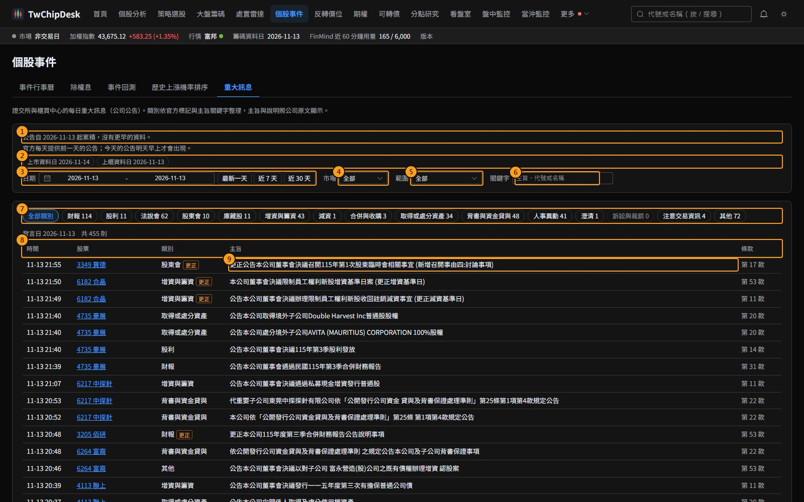

<!-- routes: /events/material -->
# 個股事件｜重大訊息

> 位置：頂部選單「個股事件」→「重大訊息」分頁（網址 `/events/material`；例如 `?from=2026-11-07&to=2026-11-13&cat=dividend,personnel`）
> 資料更新：官方開放資料事件來源開啟時，每天（含假日）08:00、16:00、22:00 抓取（時間可在設定頁修改）；官方每天提供的是**前一天整天**的公告

## 這個功能可以做什麼
集中看證交所與櫃買中心每天公布的重大訊息（上市、上櫃公司的公告）。可以依日期、市場、類別、關鍵字篩選，也可以只看自選股或持股的公告；點一則看說明原文。

公告的主旨與說明照公司原文顯示，本頁只整理分類與日期，不對公告內容下任何評語。

兩個限制要先知道：
- **隔天才有**：官方每天提供的是前一天整天的公告，所以這裡是「隔天早上看昨天的公告」，不是即時。今天的公告明天早上才會出現。
- **沒有歷史**：官方開放資料不提供過去的公告。公告從設定頁開啟「官方開放資料事件來源」那天起累積；主機沒有開機的日子抓不到，之後也補不回來。

## 畫面說明

| 編號 | 名稱 | 說明 |
|---|---|---|
| 1 | 狀態說明 | 「公告自 YYYY-MM-DD 起累積，沒有更早的資料。」「官方每天提供前一天的公告；今天的公告明天早上才會出現。」所選範圍內有沒抓到資料的日子時，多一行「MM-DD 沒有抓到資料（主機沒有開機的日子無法補回）。」 |
| 2 | 各市場資料日 | 上市、上櫃各自最新有公告的日期，例如「上市資料日 2026-11-13」「上櫃資料日 2026-11-12」。兩個市場的官方檔案更新時間不同，資料日可能不一樣。 |
| 3 | 「日期」 | 預設「最新一天」（最新有公告的那一天）。可選單日或起訖，一次最多 31 天；超過時自動縮短開始日期並說明。快捷「最新一天」「近 7 天」「近 30 天」以最新有公告的那一天往前算。 |
| 4 | 「市場」 | 「全部」「上市」「上櫃」。 |
| 5 | 「範圍」 | 「全部」「自選與持股」「自選」「持股」。選「自選」時可再選一個「群組」（預設「全部群組」）。持股與「持股」頁相同，是目前持有股數大於 0 的股票；紙上帳戶不算。 |
| 6 | 「關鍵字」 | 比對主旨、代號開頭與名稱，不分大小寫，最多 40 字；按 Enter 或離開輸入框時套用。 |
| 7 | 類別籤 | 15 個類別，各帶筆數，可複選；筆數 0 的變淡。最前面「全部類別」清除選擇。筆數是套用市場、範圍、關鍵字之後的數字。 |
| 8 | 清單 | 「時間」（MM-DD HH:mm）、「股票」（代號名稱，點了進個股頁；自選、持股各一個小標記）、「類別」、「主旨」（最多兩行，超過截斷）、「條款」（第 N 款）。主旨含「更正」或「補充」時加小標記「更正」。每頁 50 則。 |
| 9 | 詳細 | 點一列從右側打開，見下方「詳細」。 |

### 詳細
- 主旨全文、「發言時間」、「事實發生日」、「條款」、「類別」、「市場」與「說明」原文（純文字，保留原本的換行）。
- 只保存主旨的公告顯示「這則公告只保存主旨。」；說明超過保留天數時顯示「說明已超過保留天數。」。
- 財報、法說會、股東會、庫藏股決議的公告多一個連結「看這檔的事件」，開啟個股頁的[事件](../stock/events.md)分頁。
- 底部固定一行「主旨與說明為公司公告原文。」
- 開啟的那一則記在網址上，瀏覽器的返回鍵會關閉詳細、回到清單，篩選條件不變。

## 類別
類別在查詢時依官方標記與主旨關鍵字整理，判斷順序由上到下，第一個符合就停；官方已標成財報、法說會、股東會、庫藏股、股利的公告直接用官方的類別；其次，第 12 款的公告一律算「法說會」。

| 類別 | 主要依據 |
|---|---|
| 「財報」 | 官方標記財報，或主旨含財務報告、財報、自結、簽證會計師出具 |
| 「股利」 | 官方標記股利，或主旨含股利、配息基準日、除息基準日、除權基準日、盈餘分派或分配 |
| 「法說會」 | 官方標記法說會、第 12 款，或主旨含法人說明會、法說會、業績發表會、法人座談會、投資論壇 |
| 「股東會」 | 官方標記股東會，或主旨含股東常會、股東臨時會、股東會 |
| 「庫藏股」 | 官方標記庫藏股決議，或主旨含庫藏股、買回本公司股份 |
| 「增資與籌資」 | 主旨含現金增資、私募、公司債、發行新股、增資基準日、存託憑證、限制員工權利新股、員工認股權 |
| 「減資」 | 主旨含減資 |
| 「合併與收購」 | 主旨含合併案、吸收合併、簡易合併、公開收購、股份轉換、分割讓與 |
| 「取得或處分資產」 | 主旨含取得或處分；或含取得、處分、出售、購置、轉讓其中之一，且含資產、不動產、股權、有價證券、設備、廠房、土地其中之一（主旨含假處分、裁罰、行政處分時不算） |
| 「背書與資金貸與」 | 主旨含資金貸與或背書 |
| 「人事異動」 | 主旨含董事長、總經理、董事、監察人、發言人、財務主管等職稱，且含異動、辭任、新任、改選等字樣（董事會、審計委員會等會議名稱本身不算職稱） |
| 「澄清」 | 主旨含澄清、媒體報導、報載 |
| 「訴訟與裁罰」 | 主旨含訴訟、仲裁、假扣押、假處分、判決、裁罰、罰鍰、行政處分 |
| 「注意交易資訊」 | 主旨含注意交易資訊或股價異常 |
| 「其他」 | 以上都不符合 |

分類依關鍵字判斷，可能有少數誤判；判斷時請以主旨原文為準。

## 操作步驟
1. 開啟分頁，預設顯示最新一天的全部公告。
2. 用「日期」「市場」「範圍」「關鍵字」縮小範圍，或點類別籤只看某幾類。
3. 點一列看說明原文；按返回鍵或關閉鈕回到清單。
4. 條件都在網址上，可以把網址存成書籤。

## 欄位與名詞
- **發言時間**：公司發布這則重大訊息的時間（台北時間，到秒）。
- **事實發生日**：公告所述事情發生的日期，由公司填寫，可能是空白。
- **條款**：公告依據的重大訊息條款「第 N 款」。上市與上櫃的款號不是同一套，畫面只顯示款號。
- 名詞的完整說明見[名詞解釋](../reference/glossary.md#公告)。

## 資料來源與更新時間
| 資料 | 來源 | 更新 |
|---|---|---|
| 每日重大訊息（主旨、發言時間、條款、事實發生日、說明） | 臺灣證券交易所、證券櫃檯買賣中心開放資料（上市、上櫃每日重大訊息） | 官方開放資料事件來源開啟時，每天 08:00、16:00、22:00；內容是前一天整天的公告 |
| 股票名稱 | 系統的股票清單 | 每天 06:00 |
| 自選、持股標記 | 自選股與持股的交易紀錄 | 每次查詢 |

## 注意事項與限制
- 外掛「官方開放資料事件來源」關閉時不會累積新的公告；已累積的公告照常顯示。關閉而且還沒有任何公告時，頁面顯示「官方開放資料事件來源尚未開啟，還沒有公告資料。」與「前往設定」。設定見[設定](../settings.md#官方開放資料事件來源)。
- 開啟之前的公告、主機沒開機那幾天的公告都無法補回；所選範圍內有缺的日子會列在狀態說明。
- 說明原文保留天數依設定頁「公告內文保留天數」（預設 730 天），超過後只留主旨。
- 公告原文可能很長；詳細裡可以上下捲動。
- 同一檔同一天可能有主旨相同的兩則（發言時間或序號不同），照實列出。
- 本頁不顯示官方的條款說明文字，也不判讀公告內容。

## 相關功能
- [個股分析｜公告](../stock/material.md)：單一股票的公告
- [個股分析｜事件](../stock/events.md)
- [個股事件｜事件行事曆](calendar.md)
- [系統（資料狀態）](../system.md)：官方開放資料各來源的抓取狀態
