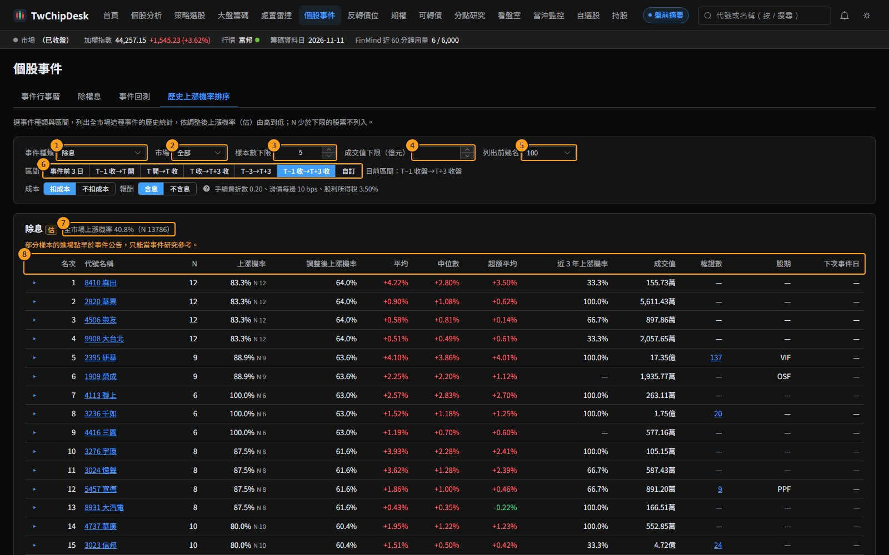

<!-- routes: /events/rankings -->
# 個股事件｜歷史上漲機率排序

> 位置：頂部選單「個股事件」→「歷史上漲機率排序」分頁（網址 `/events/rankings`；例如 `?type=revenueRelease&samples=10`）
> 資料更新：事件樣本每個交易日 15:40、22:40 更新；結果為歷史估計

## 這個功能可以做什麼
選一種事件與區間，列出全市場每檔股票這種事件的歷史統計，依「調整後上漲機率」（估）由高到低排序。調整後上漲機率會把樣本少的股票往全市場的上漲機率拉近，避免只有兩三筆就排在最前面；N 少於「樣本數下限」的股票不列入。

## 畫面說明

| 編號 | 名稱 | 說明 |
|---|---|---|
| 1 | 「事件種類」 | 有統計的種類（不含分割、反分割、面額變更）。 |
| 2 | 「市場」 | 「全部」「上市」「上櫃」。 |
| 3 | 「樣本數下限」 | 5～100，預設 5。 |
| 4 | 「成交值下限（億元）」 | 近 20 日平均成交值的下限。 |
| 5 | 「列出前幾名」 | 50、100（預設）、200、500。 |
| 6 | 「區間」「成本」「報酬」 | 與行事曆相同。 |
| 7 | 全市場上漲機率 | 標題旁的「全市場上漲機率」與 N（同種事件、同區間、同成本）。 |
| 8 | 排序表 | 「名次」「代號名稱」「N」「上漲機率」「調整後上漲機率」「平均」「中位數」「超額平均」「近 3 年上漲機率」「成交值」「權證數」「股期」「下次事件日」；欄名可排序，左側展開鈕與行事曆相同。 |

## 操作步驟
1. 選事件種類與區間。
2. 調整樣本數下限與成交值下限。
3. 點欄名改用其他欄位排序；點展開鈕看逐日表與平均路徑。

## 注意事項與限制
- 一次比較很多股票時，總會有幾檔因為運氣而看起來特別好（多重比較）；請一併看 N、「近 3 年上漲機率」與展開列的「最近 3 年與更早」。
- 「下次事件日」為已知的下一次同種事件，推算的日期標「估」。
- 已下市的股票不列入。
- 在所選區間有樣本的進場點早於事件公告時，標題下註明「部分樣本的進場點早於事件公告，只能當事件研究參考。」，該列標「早於公告」。最早可進場點見[事件回測](backtest.md#最早可進場點)。
- 歷史統計不代表未來結果。

## 相關功能
- [個股事件｜事件行事曆](calendar.md)
- [個股事件｜事件回測](backtest.md)
