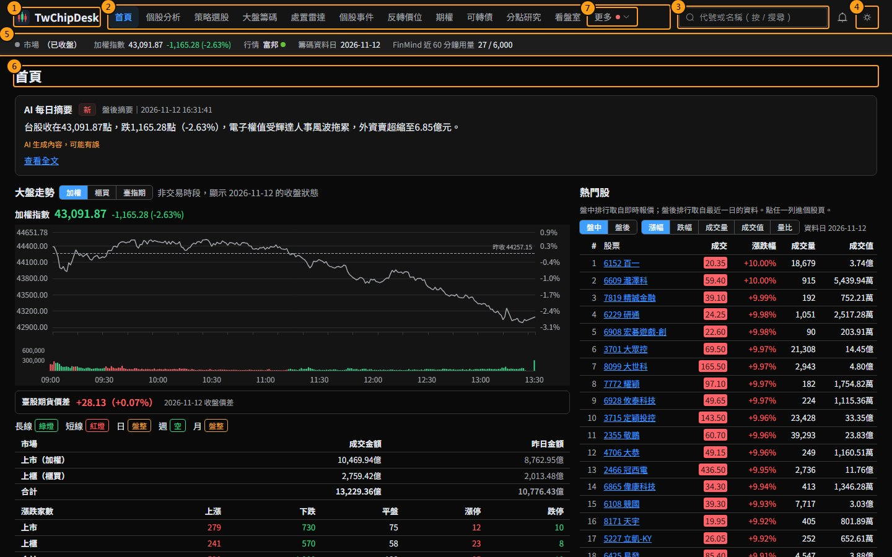
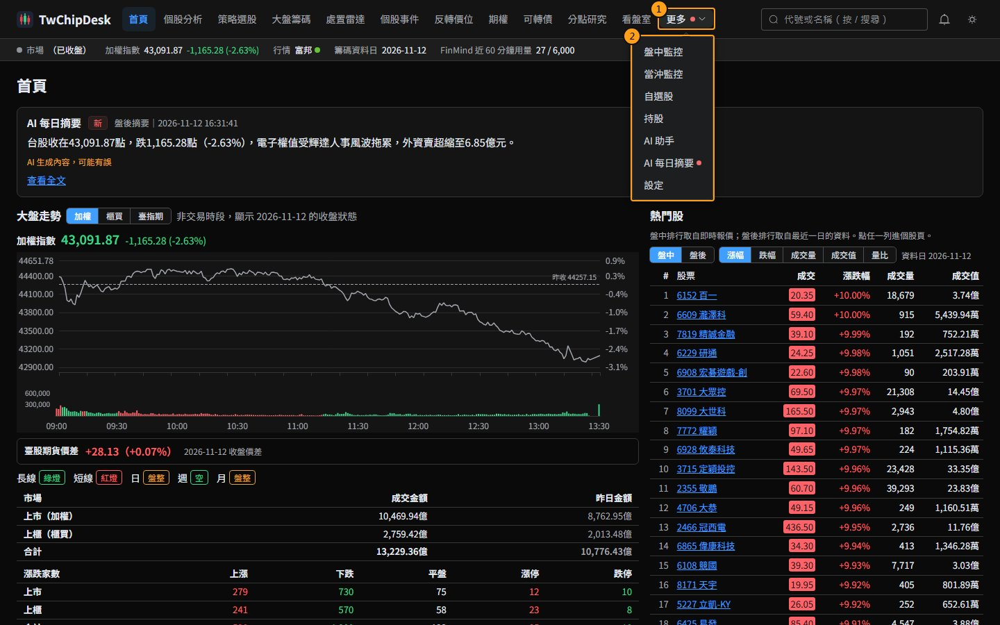
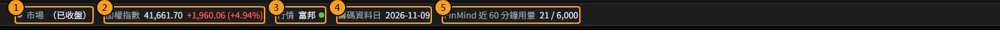

<!-- routes: / -->
# 快速入門：版面、通用操作、標示說明

> 位置：在電腦的瀏覽器開啟 `http://127.0.0.1:5080/`（手機請見 [手機版](mobile.md)）
> 資料更新：畫面上方的市場狀態列隨時更新；各頁面的資料更新時間寫在該頁開頭，總表見 [資料來源與更新時間](reference/data-sources.md)

## 這個功能可以做什麼
TwChipDesk 是在自己電腦上執行的台股籌碼分析工具。這一頁說明所有頁面共用的版面、按鈕與標示，第一次使用請先讀完這一頁，再依需要看各功能的說明。

## 開啟網址
1. 確認電腦上的 TwChipDesk 服務已啟動。
2. 用瀏覽器開啟 `http://127.0.0.1:5080/`，會進到「首頁」。
3. 若畫面顯示「後端連線中斷」或「無法連線到後端服務」，代表服務沒有執行或正在重新啟動，等服務起來後按「重試」或重新整理即可。
4. 第一次使用時，首頁若出現「尚未設定 FinMind token」，請先按「前往設定」，到 [設定](settings.md) 的「FinMind」區塊輸入 token，系統才能取得資料。

## 畫面說明

| 編號 | 名稱 | 說明 |
|---|---|---|
| 1 | 產品名稱 | 點「TwChipDesk」回到首頁。 |
| 2 | 頂部選單 | 「首頁」「個股分析」「策略選股」「大盤籌碼」「處置雷達」「個股事件」「反轉價位」「期權」「可轉債」「分點研究」「看盤室」「盤中監控」「當沖監控」「自選股」「持股」「AI 助手」「AI 每日摘要」「設定」。目前所在的項目會反白。「個股分析」會開啟最後看過的股票（第一次為 2330）。「期權」在期權模組關閉時不顯示，「盤中監控」在盤中監控關閉時不顯示。視窗寬度放不下的項目收進最後的「更多」（編號 7）。手機寬度改用底部分頁列，見[手機版](mobile.md)。 |
| 3 | 搜尋 | 輸入股票或分點的代號、名稱，下拉清單分「股票」「分點」兩組。可用鍵盤：按 `/` 直接跳到搜尋框，上下鍵選擇，Enter 進入，Esc 關閉。已在個股頁時，選另一檔股票會留在同一個分頁、只換股票。 |
| 4 | 主題切換 | 太陽／月亮圖示，切換深色與淺色主題。 |
| 5 | 市場狀態列 | 市場狀態、加權指數、行情來源、籌碼資料日、FinMind 用量與背景工作，詳見下一節。 |
| 6 | 頁面內容 | 各頁的標題與內容。 |
| 7 | 「更多」 | 視窗寬度放不下全部項目時才出現：依實際寬度，排不下的項目依順序收進「更多」選單，視窗越窄收進去的越多。點「更多」展開後選取（見下圖）；目前所在的項目在「更多」裡時，「更多」會反白；「AI 每日摘要」收在裡面且有未讀摘要時，「更多」旁也顯示紅點。 |

| 編號 | 名稱 | 說明 |
|---|---|---|
| 1 | 「更多」 | 點一下展開，再點一次或點別處收合。 |
| 2 | 收進「更多」的項目 | 依頂部選單的順序列出排不下的項目，點一下開啟該頁。圖為 1440 px 寬的畫面。 |

畫面最下方的頁尾標示資料來源（FinMind、族群分類的來源與即時行情的券商）與免責說明。

「資料狀態」頁不在頂部選單裡，從狀態列的「FinMind 近 60 分鐘用量」點進去，見 [系統（資料狀態）](system.md)。

## 市場狀態列

| 編號 | 名稱 | 說明 |
|---|---|---|
| 1 | 市場 | 「開盤前」「盤中」「收盤集合競價」「（已收盤）」「非交易日」「今日未開盤」。前面的圓點用顏色表示狀態。 |
| 2 | 加權指數 | 指數、漲跌點數與漲跌幅；盤中即時更新。個股的「回放」分頁不顯示這一欄，避免和回放中的過去走勢混淆。 |
| 3 | 行情 | 即時行情使用的券商來源（富邦、玉山），只列出已啟用的來源；燈號顏色表示健康狀態（正常、部分異常、無法使用）。兩家同時使用時接著顯示主要來源（例如「（富邦為主）」，平衡模式為「（平衡分配）」）、「日內 x/y」（兩家合計最近一分鐘的日內 HTTP 用量／上限）與「期權接收 x/y」（兩家合計接收中的合約數／合併容量）。滑鼠移上去（手機點一下）可看到各來源的明細、目前使用中的來源、最近一次搬移與玉山方案提醒；有方案提醒時這一欄改為警告色。兩家都沒有啟用時不顯示。 |
| 4 | 籌碼資料日 | 目前資料庫中最新一天的籌碼資料日期。盤後資料尚未到齊時，這個日期會停在前一個交易日。 |
| 5 | FinMind 近 60 分鐘用量 | 最近 60 分鐘已使用的請求數 ／ 方案配額。點這一欄會開啟「資料狀態」頁。還沒設定 token 時改顯示「尚未設定 FinMind token」，點一下到設定頁。 |

其他偶爾出現的欄位：
- **後端連線中斷**：瀏覽器連不到服務；其他欄位顯示「—」，按「重試」重新連線。
- **FinMind 暫停中**：配額用完，系統暫停向 FinMind 請求，會寫出幾點重新確認配額；之後自動恢復。
- **背景工作 N 項進行中**：有排程工作或回補正在執行。

## 左側自選欄
畫面寬度 1024 像素以上時，所有頁面左邊會顯示自選股快速清單，點一檔就開啟該股的「即時」分頁（已在個股頁時留在目前分頁、只換股票）。可收合、可選擇要顯示的群組、可依漲幅排序。詳細說明見 [自選股（含左側自選欄）](watchlist.md)。

## 通用操作

### 日期選擇
- 有日期選擇器的頁面（例如個股的「即時」「回放」、處置雷達、排行等）會把選的日期寫在網址的 `?date=YYYY-MM-DD`。
- 選到非交易日或資料還沒更新的日子時，頁面會顯示「目前沒有資料」「資料尚未更新」，或自動改用最近一個有資料的交易日並標示日期。
- 盤後資料（法人、分點、融資融券等）晚上才會到齊，當天傍晚以前看「今天」常常沒有資料，請參考各頁開頭的「資料更新」時間。

### 網址分享與書籤
- 各頁的分頁、日期、統計天數、篩選條件大多寫在網址裡（例如 `/stock/2330/intraday?date=2026-11-09`、`/market?tab=rankings`）。
- 把網址加入書籤，下次開啟會回到同一個畫面；複製網址貼到同一台電腦或手機版的瀏覽器，也會看到相同的畫面。
- 寫在瀏覽器本機的偏好（主題、漲跌色、表格排序、自選欄顯示的群組等）不在網址裡，換瀏覽器後要重新設定。

### 匯出 CSV
- 有表格的頁面（自選股、籌碼明細、選股結果、處置雷達、分點研究等）右上方有「匯出 CSV」按鈕，下載目前表格的內容，可用試算表軟體開啟。
- 自選股的 CSV 依自選順序匯出，不受畫面上的排序影響。

### 表格排序
- 點表頭的欄名排序，再點一次改變方向，第三次回到預設順序；排序中的欄名旁邊有 ▲▼。
- 盤中即時更新的表格，報價變動時不會自動重排（避免列跳來跳去），順序有變時表格上方顯示「順序已變動・重新排序」，按「重新排序」才重排。
- 手機上表頭常被捲到畫面外，改用表格上方的「排序」列選欄位與方向，按 × 回到預設順序。
- 多數表格的排序記在瀏覽器本機，下次開啟沿用。

### 加入自選
- 個股頁上方有「加入自選」按鈕，已在自選時顯示「已在自選（N）」。按下後列出所有群組，點群組即可加入或移除（星號表示已在此群組），也可直接輸入名稱「建立並加入」新群組。
- 自選股頁可用搜尋或「批次加入」一次加入多檔，見 [自選股](watchlist.md)。

### 「估」與「暫定」標示
- **估**：數字旁的橘色小方塊「估」表示這是估計值，不是官方或資料源直接提供的數字（例如預估量、散戶買賣超（估）、融資維持率、權證約當淨買）。滑鼠移到「估」上（手機點一下）會顯示估算方式。
- **暫定**：收盤後到正式盤後資料入庫前（約 13:40～17:35），當天的日 K 先用收盤快照產生，標示為暫定；17:35 全市場日 K 寫入後自動改為正式數字。其他盤後資料到齊前的計算結果也可能標示暫定。
- 詳細名詞見 [名詞解釋](reference/glossary.md)。

### 資料說明區塊與說明圖示
- 很多頁面在表格或圖表下方有「資料說明」「計算說明」「說明」區塊，寫明資料來源、計算公式與限制；可展開或收起。
- 指標名稱旁的小問號圖示，點開會顯示「公式」與「參數」，並註明這個指標是估算值還是直接來自資料。
- 停用的分頁或按鈕，滑鼠移上去（手機點一下）會顯示停用原因。

### 深色、淺色主題與漲跌色
- 右上角的太陽／月亮圖示切換主題；也可以在 [設定](settings.md) 的「顯示」區塊選「深色」或「淺色」。
- 漲跌色在「顯示」區塊選「紅漲綠跌」（預設）或「綠漲紅跌」；所有價格、走勢圖與漲跌家數都會跟著改。
- 這兩項同時是這個瀏覽器的本機偏好，變更後立即套用。

## 新版自動更新
- 系統更新後，開著的舊頁面不需要手動處理：瀏覽器每 5 分鐘（以及切回這個分頁時）會檢查有沒有新版，有新版時，下一次換頁會自動整頁載入新版，目前畫面不會被打斷。
- 若換頁時程式檔載入失敗，頁面會自動重新載入一次；10 秒內連續失敗時顯示「頁面程式載入失敗，可能是系統剛更新或連線中斷，請按 F5 重新整理」，照指示按 F5 即可。
- 重新載入不會清掉瀏覽器本機的偏好設定。

## 注意事項與限制
- 本系統所有數字都是資料整理與統計結果，不構成任何投資意見。
- 資料大多來自 FinMind，受 FinMind 每 60 分鐘的請求配額限制；配額用完時部分頁面會暫時顯示「FinMind 配額已用盡」，額度釋出後自動恢復。
- 依需求載入的資料（例如較舊日期的逐筆、分點價位明細）第一次開啟會比較慢。

## 常見問題
見 [常見問題](faq.md)。

## 相關功能
- [首頁](home.md)
- [自選股（含左側自選欄）](watchlist.md)
- [設定](settings.md)
- [系統（資料狀態）](system.md)
- [手機版](mobile.md)
- [資料來源與更新時間](reference/data-sources.md)
