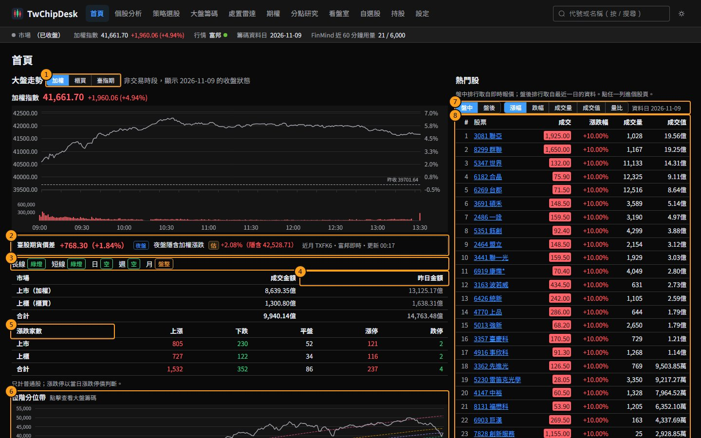
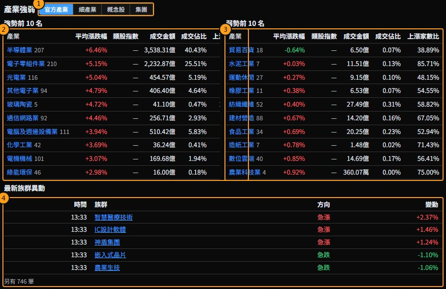

<!-- routes: / -->
# 首頁

> 位置：頂部選單「首頁」，或點左上角「TwChipDesk」（網址 `/`）
> 資料更新：盤中即時（大盤走勢、漲跌家數、成交金額隨行情更新；熱門股每 15 秒、產業強弱定時重新查詢）；收盤後顯示當日完整走勢；非交易時段顯示最近一個交易日的收盤狀態；盤後排行在晚間籌碼資料入庫後更新

## 這個功能可以做什麼
一頁看完大盤現況：加權、櫃買、臺指期的當日走勢，長短線燈號與多空，上市櫃成交金額與漲跌家數，哪些產業最強、最弱，最新的族群異動，以及盤中、盤後的熱門股排行。適合開盤前、盤中與收盤後快速掌握整體市場。

## 畫面說明

| 編號 | 名稱 | 說明 |
|---|---|---|
| 1 | 大盤走勢切換 | 「加權」「櫃買」「臺指期」三選一。盤中為即時走勢與成交量，右側顯示即時狀態與更新時間；非交易時段顯示「非交易時段，顯示 YYYY-MM-DD 的收盤狀態」。走勢圖下方的虛線是昨收。 |
| 2 | 臺股期貨價差 | 臺股期貨近月與加權指數的期現價差（點數與百分比）。夜盤時段另外顯示「夜盤隱含加權漲跌」（標「估」：由夜盤期貨價格換算的加權指數漲跌）。只在期權模組啟用時顯示。 |
| 3 | 燈號與多空 | 「長線」「短線」燈號（紅燈、黃燈、綠燈），以及「日」「週」「月」的多、空、盤整。滑鼠移上去看判斷規則：長線為收盤在長天期均線之上為紅燈；短線為最低價在短天期均線之上為紅燈、最高價在之下為綠燈，其餘黃燈；多空為收盤 > 5 日均線且 5 日均線 > 20 日均線為多。 |
| 4 | 成交金額表 | 「上市（加權）」「上櫃（櫃買）」與「合計」的「成交金額」與「昨日金額」。盤中另有「預估金額」（估）與「昨量比」（＝預估金額 ÷ 昨日金額）。 |
| 5 | 漲跌家數 | 上市、上櫃、合計的上漲、下跌、平盤、漲停、跌停家數（只計普通股；漲跌停以當日漲跌停價判斷）。 |
| 6 | 位階分位帶 | 大盤位階的小圖；點一下開啟「大盤籌碼」。 |
| 7 | 熱門股切換 | 「盤中」：「漲幅」「跌幅」「成交量」「成交值」「量比」，取自即時報價；「盤後」：「外資買超」「投信買超」「主力買超」「當沖比」，取自最近一日的盤後資料。右側顯示資料日。 |
| 8 | 熱門股排行 | 各頁籤前 30 名：股票、成交、漲跌幅、成交量（張）、成交值。點任一列進個股頁。 |

### 產業強弱與族群異動

| 編號 | 名稱 | 說明 |
|---|---|---|
| 1 | 分類切換 | 「官方產業」「細產業」「概念股」「集團」；族群分類來源沒有資料時只有「官方產業」「產業鏈」。 |
| 2 | 強勢前 10 名 | 平均漲跌幅最高的 10 個產業或族群，含平均漲跌幅、成交金額、預估量比等欄位。點一列展開成分股。 |
| 3 | 弱勢前 10 名 | 平均漲跌幅最低的 10 個。 |
| 4 | 最新族群異動 | 盤中偵測到的最新 5 筆族群急漲、急跌事件（時間、族群、漲跌幅變化與領漲股）。 |

## 操作步驟
1. 開盤前打開首頁，看「臺股期貨價差」與燈號，了解前一天收盤與夜盤的狀態。
2. 盤中切換「加權」「櫃買」「臺指期」比較走勢；看「昨量比」判斷今天的量能相對昨天的大小。
3. 在「產業強弱」切換分類，點強勢產業展開成分股，再點股票進個股頁。
4. 在右側「熱門股」切「盤中」或「盤後」排行，點列進個股頁。

## 欄位與名詞
- **平均漲跌幅**：產業內已成交成分股漲跌幅的等權平均。
- **預估量比**：預估成交金額 ÷ 前一交易日成交金額（估）。
- **量比（熱門股）**：預估量 ÷ 前 5 個交易日平均成交量。
- 其他名詞見 [名詞解釋](reference/glossary.md)。

## 資料來源與更新時間
- 指數、個股報價：盤中來自券商即時行情（富邦或玉山），沒有券商行情時用 FinMind 盤中快照（每 10 秒）；收盤後為當日完整走勢。
- 漲跌停價：每個交易日 08:40 盤前準備；前一晚 18:05 先取得次一交易日的漲跌停價。
- 盤後排行（外資、投信、主力、當沖）：依各資料入庫時間，見 [資料來源與更新時間](reference/data-sources.md)。
- 族群分類（細產業、概念股、集團）：每週六 08:00 更新（族群分類外掛啟用時）。

## 注意事項與限制
- 非交易日與開盤前，首頁顯示最近一個交易日的收盤狀態，並標示日期。
- 盤中服務重新啟動時，走勢圖中斷的時段會在恢復後補回。
- 尚未設定 FinMind token 時，頁面上方會提示並提供「前往設定」按鈕。

## 常見問題
- **為什麼盤中熱門股沒有「外資買超」？** 法人資料要等盤後公布，所以放在「盤後」頁籤。
- **臺股期貨價差沒有出現？** 期權模組關閉時不顯示。

## 相關功能
- [大盤籌碼](market/README.md)
- [個股分析](stock/README.md)
- [快速入門](getting-started.md)
