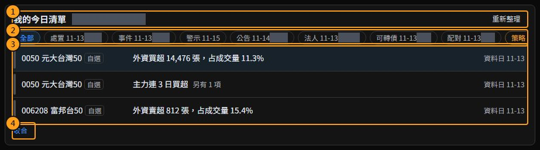
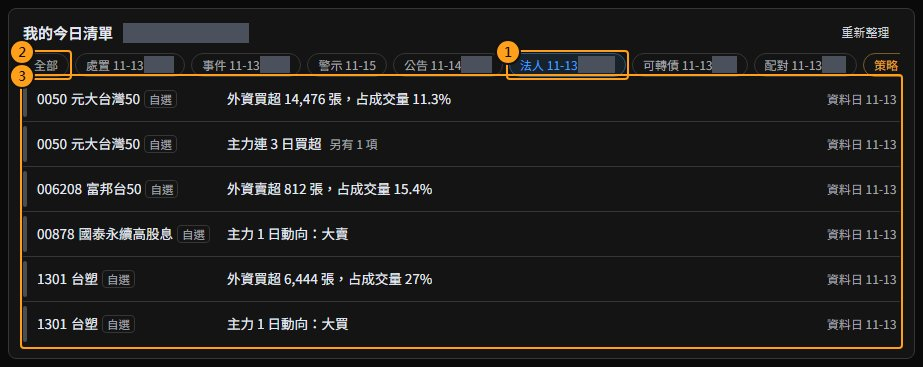

<!-- routes: / -->
# 首頁

> 位置：頂部選單「首頁」，或點左上角「TwChipDesk」（網址 `/`）
> 資料更新：盤中即時（大盤走勢、漲跌家數、成交金額隨行情更新；熱門股每 15 秒、產業強弱定時重新查詢）；收盤後顯示當日完整走勢；非交易時段顯示最近一個交易日的收盤狀態；盤後排行在晚間籌碼資料入庫後更新；「我的今日清單」每次開啟首頁或按「重新整理」時查詢，各區段的資料日見下方

## 這個功能可以做什麼
最上方的「我的今日清單」把自選股與持股今天和未來幾個交易日的事件、處置與注意進度、警示、公告、法人與主力動向，以及可轉債訊號、配對比值位置、策略名單的新進股票、紙上帳戶預計進場的股票集中成一張清單。下方一頁看完大盤現況：加權、櫃買、臺指期的當日走勢，長短線燈號與多空，上市櫃成交金額與漲跌家數，哪些產業最強、最弱，最新的族群異動，以及盤中、盤後的熱門股排行。適合開盤前、盤中與收盤後快速掌握整體市場。

## 畫面說明

| 編號 | 名稱 | 說明 |
|---|---|---|
| 1 | 大盤走勢切換 | 「加權」「櫃買」「臺指期」三選一。盤中為即時走勢與成交量，右側顯示即時狀態與更新時間；非交易時段顯示「非交易時段，顯示 YYYY-MM-DD 的收盤狀態」。走勢圖下方的虛線是昨收。加權、櫃買另有「均價（成交金額加權）」虛線：當天到該分鐘為止以每分鐘成交金額加權的指數平均（算法見[即時大盤](market/live.md)）；臺指期沒有均價線。 |
| 2 | 臺股期貨價差 | 臺股期貨近月與加權指數的期現價差（點數與百分比）。夜盤時段另外顯示「夜盤隱含加權漲跌」（標「估」：由夜盤期貨價格換算的加權指數漲跌）。只在期權模組啟用時顯示。 |
| 3 | 燈號與多空 | 「長線」「短線」燈號（紅燈、黃燈、綠燈），以及「日」「週」「月」的多、空、盤整。滑鼠移上去看判斷規則：長線為收盤在長天期均線之上為紅燈；短線為最低價在短天期均線之上為紅燈、最高價在之下為綠燈，其餘黃燈；多空為收盤 > 5 日均線且 5 日均線 > 20 日均線為多。 |
| 4 | 成交金額表 | 「上市（加權）」「上櫃（櫃買）」與「合計」的「成交金額」與「昨日金額」。盤中另有「預估金額」（估）與「昨量比」（＝預估金額 ÷ 昨日金額）。 |
| 5 | 漲跌家數 | 上市、上櫃、合計的上漲、下跌、平盤、漲停、跌停家數（只計普通股；漲跌停以當日漲跌停價判斷）。 |
| 6 | 位階分位帶 | 大盤位階的小圖；點一下開啟「大盤籌碼」。 |
| 7 | 熱門股切換 | 「盤中」：「漲幅」「跌幅」「成交量」「成交值」「量比」，取自即時報價；「盤後」：「外資買超」「投信買超」「主力買超」「當沖比」，取自最近一日的盤後資料。右側顯示資料日。 |
| 8 | 熱門股排行 | 各頁籤前 30 名：股票、成交、漲跌幅、成交量（張）、成交值。成交價當天曾碰到漲跌停時左邊加「漲停」「曾漲停」「跌停」「曾跌停」或「曾漲跌停」小標記。點任一列進個股頁。 |

### 我的今日清單

位置在頁面最上方（FinMind token 提示之下）。畫面寬度 1280 像素以上時與「AI 每日摘要」卡片並排（今日清單較寬；沒有 AI 摘要時佔滿整列）；較窄時上下排，今日清單在上。「我的股票」是持股（與「持股」頁相同，目前持有股數大於 0 的股票）加上全部自選群組的成員；紙上帳戶不算。設定頁「顯示」區塊關閉「首頁顯示「我的今日清單」」後不顯示這張卡片。（截圖使用示範自選群組拍攝。）

| 編號 | 名稱 | 說明 |
|---|---|---|
| 1 | 標題列 | 「我的今日清單」、右側「自選 N 檔、持股 N 檔」與「重新整理」。 |
| 2 | 資料日小籤 | 最前面是「全部」，接著是各區段的資料日，有列時在後面加列數，例如「處置 11-13 · 37」「事件 11-13 · 13」「可轉債 11-13 · 2」「策略 11-13」。來源還沒建好、資料太舊或這次讀取失敗時顯示「尚未更新」（例如「配對 尚未更新」）；模組或開關關閉的區段不顯示。小籤可以點：點一個區段，清單只列那個區段（最多 50 列）；再點一次或點「全部」回到全部。選中的小籤有底色。畫面窄時可左右滑動。 |
| 3 | 清單 | 每列左側的色條是重要程度（高、中、低三級），接著是股票代號與名稱、「持股」或「自選」小標記、一句事實與數字，必要時加「估」與「另有 N 項」。沒有股票代號的列（未讀警示、某個策略的新進名單、紙上帳戶）在股票欄顯示區段名稱。整列可點，開啟對應的頁面（見下表）。選了區段而那個區段沒有列時顯示「這個區段今天沒有列。」。 |
| 4 | 顯示全部 | 預設顯示 10 列（設定頁可改 5～30；手機固定 5 列）；超過時出現「顯示全部 N 列」，再按「收合」。清單最多 50 列。 |

點了「法人」小籤、只看法人與主力區段的樣子（截圖使用示範自選群組拍攝，列數已遮蔽）。

**各種列的意思**

| 區段 | 列 | 文字範例 | 點了開啟 |
|---|---|---|---|
| 處置與注意 | 今晚公布處置 | 「今晚公布處置，期間 11-17～11-28」；官方名單還沒公布、由預測列出時只寫「今晚公布處置」並標「估」 | [處置日報](disposition/daily.md) |
| 處置與注意 | 明天可能處置 | 「距離處置 1 天，明日處置機率 62%」（估）；該股今天全日暫停交易、沿用前一營業日的次數時，後面加「（暫停交易，沿用 11/12 的次數）」 | 處置日報 |
| 處置與注意 | 明天出關 | 「明天出關」 | 處置日報 |
| 處置與注意 | 處置中 | 「處置中，第 3／10 天」；明天才開始的寫「明天起處置，共 10 天」 | [處置中](disposition/active.md) |
| 處置與注意 | 列為注意股 | 「今天列為注意股（第 1 款）」；官方注意名單還沒取得、由本系統依規則重算時標「估」 | 處置日報 |
| 處置與注意 | 距離處置 2 天內 | 「距離處置 2 天，明日處置機率 5%」（估） | 處置日報 |
| 事件 | 除權息類 | 「11-17 除息，每股 5 元」 | 個股頁「事件」分頁 |
| 事件 | 法說會、股東會 | 「今天 14:00 法說會」「11-20 股東臨時會」 | 個股頁「事件」分頁 |
| 事件 | 月營收、財報公布 | 「11-18 10 月營收公布」；日期是推估時標「估」 | 個股頁「事件」分頁 |
| 事件 | 減資、分割、庫藏股決議、暫停交易後恢復、停止融券、暫停當沖 | 「11-19 減資恢復買賣」；暫停交易只在恢復交易那天列出「暫停交易後恢復」，暫停開始那天不列 | 個股頁「事件」分頁 |
| 警示 | 未讀警示 | 「未讀警示 4 則」（全部日期、不分股票） | [警示中心](alerts/README.md)「觸發紀錄」 |
| 警示 | 今天的觸發 | 警示訊息原文，右側是觸發時間（今天最新 3 筆）；新公告警示在公告區段已有同一檔時不重複列出，可轉債警示在可轉債區段已有同一檔時也不重複列出（未讀數不變；那一檔的公告或可轉債列因列數上限沒有顯示時，警示照列） | 警示中心「觸發紀錄」 |
| 公告 | 上一個交易日起到今天的公告 | 「11-14 公告 2 則：」接一則主旨原文，右側是發言時間（每檔一列；類別排在前面的優先，同類取最新的一則；則數是這段期間的則數） | 個股頁「公告」分頁 |
| 法人與主力 | 單日買賣超占成交量 | 「外資買超 3,200 張，占成交量 14%」，右側「資料日 11-13」 | 個股頁「籌碼明細」 |
| 法人與主力 | 連續買超或賣超 | 「投信連 5 日賣超」（只在剛好 3、5、10、20 天那天列出） | 個股頁「籌碼明細」 |
| 法人與主力 | 主力 1 日動向 | 「主力 1 日動向：大買」或「大賣」 | 個股頁「籌碼明細」 |
| 可轉債 | 標的券償暴增、融券暴增 | 「可轉債標的券償暴增：現券償還 1,200 張（前 20 日平均 150 張）」「可轉債標的融券暴增：融券餘額增加 800 張（前 20 日平均變化 90 張）」，右側是資料日 | [可轉債訊號](cb/signals.md) |
| 可轉債 | 扣成本價差低於門檻 | 「可轉債 12345 扣成本價差 −1.8%」（估；每個標的列價差最低的一檔，門檻見設定頁） | [可轉債套利](cb/arbitrage.md) |
| 配對 | 我的配對比值偏高或偏低 | 「我的配對 2330÷2303 比值偏高（z +2.3，偏離 +8.1%，N=20）」（估）；這一天剛從別的位置變過來時寫「比值轉為偏高」；後一檔成交量偏低時句尾加「，量低」 | [配對比較頁](disposition/pairs.md)（那一組、那個 N） |
| 配對 | 入榜的處置配對 | 「處置配對 6488÷3105 比值偏低（z −2.1，偏離 −6.4%，N=20）」（估）；兩檔之一是自選或持股才列 | 配對比較頁 |
| 策略 | 新進策略名單 | 「新進策略名單：『（策略名稱）』第 3 名」；同一檔同時新進多個策略時寫「新進 2 個策略的名單：『（策略名稱）』等」 | [策略選股](screener/screener.md)（帶入那個策略） |
| 策略 | 某個策略今天新進的股票 | 「『（策略名稱）』新進 4 檔：2330 台積電、2454 聯發科、3008 大立光，另 1 檔（其中 1 檔是自選或持股）」；最多 5 列，其餘策略併成「另有 N 項」 | 策略選股（帶入那個策略） |
| 紙上帳戶 | 下一個交易日預計進場 | 「『（帳戶名稱）』11-17 預計進場 3 檔：2330 台積電、2454 聯發科、3008 大立光」（估；不顯示金額） | [紙上帳戶](screener/portfolio.md)（開啟那個帳戶） |

處置與注意的「今晚」「明天」「明日」是相對處置資料日的說法。新的處置預測在交易日 14:40 才產生，所以每天 14:40 以前與週末，處置的資料日是前一個交易日；這時改寫成日期，例如「11-13 晚間公布處置，期間 11-16～11-27」「今天出關」「處置中，11-13 為第 3／10 天」「今天起處置，共 10 天」「距離處置 1 天，今天處置機率 62%」。

事件列的日期是事件實際發生或公布的日子：法說會、股東會寫開會那天，庫藏股決議寫公告那天，月營收與財報寫公布那天（推估的寫推估的公布日）。已經過去的事件不列，例如昨天下午的法說會今天不會出現。

公告列看「上一個交易日起到今天」：例如週一看得到上週五到週一的公告，連假後第一天從連假前最後一個交易日起算（最多 14 天）。

四個新區段的細節：
- **可轉債**：最新一天的可轉債主力資料中，標的是自選或持股的訊號。券償暴增、融券暴增與[可轉債訊號](cb/signals.md)相同；扣成本價差依設定的費用與收盤價估算，當天不能轉換或沒有成交的可轉債不列。
- **配對**：只列比值「偏高」或「偏低」的配對，「接近平均」與「偏離中」不列；N 用配對設定的預設 N（有 20 用 20）。只讀每晚已算好的結果：剛新增、還沒算過的我的配對要等當晚計算後才會出現；刪除的配對不再出現。
- **策略**：預設只看「我的策略」（設定頁可改成加上內建精選，或全部策略）。「新進」是最新訊號日的名單裡有、前一個交易日的名單裡沒有的股票；策略剛建立或剛改過條件、前一個交易日還沒有用目前條件算過時不判斷，避免整份名單都被當成新進。策略名稱是你自己取的名稱。
- **紙上帳戶**：只列啟用中的帳戶，預計進場日早於今天的不列。內容依最新一天的選股排序與空位估計，實際以隔日重算為準。

**排序與列數**：重要程度高的在前，同樣重要時持股在前，再依區段（處置與注意、事件、警示、公告、法人與主力、可轉債、配對、策略、紙上帳戶）、事件日近到遠、代號排列。重要程度「高」是持股的今晚公布處置、明天可能處置、今天的除權息或減資類事件、暫停交易後恢復；「中」是自選的今晚公布處置與明天可能處置、持股的明天出關、今天列注意股、距離處置 2 天內、今天的法說會、股東會、月營收或財報公布、未讀警示、持股的可轉債券償暴增與融券暴增，以及剛轉為偏高或偏低的我的配對；其餘為「低」。同一檔股票在同一區段最多列 2 列，其餘併成「另有 N 項」。列數超過 50 時，每個有列的區段至少保留排序最前的 3 列，剩下的名額再照整體順序補滿，所以重要程度低的區段也看得到；要看某個區段的全部列，點那個區段的小籤。

**空狀態**：
- 沒有自選股也沒有持股時顯示「還沒有自選股或持股紀錄。加入自選股，或在持股頁新增交易紀錄後，這裡會列出和它們有關的事項。」與「自選股」「持股」兩個連結。
- 有股票但沒有任何列時顯示「今天沒有需要留意的事項。」，資料日小籤照常顯示，可以確認是哪些來源已更新。

### 產業強弱與族群異動

| 編號 | 名稱 | 說明 |
|---|---|---|
| 1 | 分類切換 | 「官方產業」「細產業」「概念股」「集團」；族群分類來源沒有資料時只有「官方產業」「產業鏈」。 |
| 2 | 強勢前 10 名 | 平均漲跌幅最高的 10 個產業或族群，含平均漲跌幅、成交金額、預估量比等欄位。點一列展開成分股。 |
| 3 | 弱勢前 10 名 | 平均漲跌幅最低的 10 個。 |
| 4 | 最新族群異動 | 盤中偵測到的最新 5 筆族群急漲、急跌事件（時間、族群、漲跌幅變化與領漲股）。 |

## 操作步驟
1. 打開首頁先看「我的今日清單」：留意資料日小籤是否有「尚未更新」，再點列進入對應的頁面看細節；想只看某一類（例如可轉債或策略）時點那個區段的小籤。
2. 開盤前看「臺股期貨價差」與燈號，了解前一天收盤與夜盤的狀態。
3. 盤中切換「加權」「櫃買」「臺指期」比較走勢；看「昨量比」判斷今天的量能相對昨天的大小。
4. 在「產業強弱」切換分類，點強勢產業展開成分股，再點股票進個股頁。
5. 在右側「熱門股」切「盤中」或「盤後」排行，點列進個股頁。

## 欄位與名詞
- **平均漲跌幅**：產業內已成交成分股漲跌幅的等權平均。
- **預估量比**：預估成交金額 ÷ 前一交易日成交金額（估）。
- **量比（熱門股）**：預估量 ÷ 前 5 個交易日平均成交量。
- **事件窗（今日清單）**：今天（是交易日時）加後面 3 個交易日（設定頁可改 0～5）；今天休市時從下一個交易日起算，連假依交易日曆跳過。
- **單日買賣超占成交量（今日清單）**：外資或投信當天買賣超張數的絕對值 ÷ 當天成交量 × 100，達到設定的門檻（預設 10%）才列出。
- 其他名詞見 [名詞解釋](reference/glossary.md)。

## 資料來源與更新時間
- 指數、個股報價：盤中來自券商即時行情（富邦或玉山），沒有券商行情時用 FinMind 盤中快照（每 10 秒）；收盤後為當日完整走勢。
- 漲跌停價：每個交易日 08:40 盤前準備；前一晚 18:05 先取得次一交易日的漲跌停價。
- 盤後排行（外資、投信、主力、當沖）：依各資料入庫時間，見 [資料來源與更新時間](reference/data-sources.md)。
- 族群分類（細產業、概念股、集團）：每週六 08:00 更新（族群分類外掛啟用時）。
- 我的今日清單：事件來自[個股事件](events/README.md)的事件資料（交易日 15:40、22:40 更新，官方來源每天三輪）；處置與注意來自[處置雷達](disposition/README.md)的處置日報與處置中；法人與主力來自每日盤後的籌碼特徵（盤後資料入庫後才是當天，之前是前一個交易日）；公告來自官方開放資料的每日重大訊息（官方每天提供前一天的公告）；可轉債來自每個交易日約 22:40 計算的可轉債主力資料；配對來自每個交易日約 22:20 計算的處置配對與我的配對；策略名單在晚間選股特徵寫入後幾分鐘算好；紙上帳戶在每晚重算後更新。每次開啟首頁或按「重新整理」都重新查詢：警示每次都是最新的，其他區段最多每 10 分鐘重新計算一次（自選或持股有變動、或改了設定時立即重算；新增或刪除配對、策略、帳戶最多 10 分鐘後反映）。可轉債、配對、策略、紙上帳戶的資料日早於今天往前第 2 個交易日時視為太舊，那個區段顯示「尚未更新」。系統剛重新啟動時，事件資料要等背景載入完成（啟動後約 1.5 分鐘；盤中重新啟動時延到 13:50）才會出現，之前事件區段顯示「尚未更新」。

## 注意事項與限制
- 非交易日與開盤前，首頁顯示最近一個交易日的收盤狀態，並標示日期。
- 盤中服務重新啟動時，走勢圖中斷的時段會在恢復後補回。
- 尚未設定 FinMind token 時，頁面上方會提示並提供「前往設定」按鈕，直接跳到設定頁的「FinMind」區塊。
- 今日清單的公告是**前一天**的公告：官方每天提供前一天整天的公告，今天的公告要明天才會出現；公告從官方開放資料事件來源開啟那天起累積，沒有更早的資料。
- 今日清單只列事實與數字。處置的預測、距離與機率、推估的事件日期、可轉債扣成本價差、配對比值位置與紙上帳戶預計進場都標「估」，滑過「估」可看估算方式。
- 可轉債、配對、策略、紙上帳戶都是前一晚算好的資料，早上看到的是前一個交易日的結果；每列右側或文字裡有資料日。
- 首頁的「首頁顯示「我的今日清單」」關閉時只影響首頁，[AI 每日摘要](assistant/briefing.md)仍會引用今日清單的事項。
- 法人與主力列的資料日可能是前一個交易日（盤後資料入庫前），列的右側會標出資料日。

## 常見問題
- **為什麼盤中熱門股沒有「外資買超」？** 法人資料要等盤後公布，所以放在「盤後」頁籤。
- **臺股期貨價差沒有出現？** 期權模組關閉時不顯示。
- **剛加入自選股，今日清單沒有出現？** 回到首頁時清單會重新查詢；一直停在首頁時按卡片右上角的「重新整理」。自選或持股有變動時清單會立即重算，不用等快取。
- **資料日小籤顯示「尚未更新」？** 那個來源還沒有資料（例如事件資料第一次建置前，或系統剛重新啟動、事件資料還在背景載入），或這次讀取失敗；其他區段不受影響。
- **今日清單不見了？** 設定頁「顯示」區塊的「首頁顯示「我的今日清單」」被關閉。
- **看不到可轉債、配對、策略或紙上帳戶的列？** 列很多時這些區段排在後面，點那個區段的小籤就能只看它；小籤不見表示設定頁把那個區段關掉了，策略區段在範圍內沒有任何策略時、紙上帳戶區段在沒有啟用中的帳戶時也不顯示。

## 相關功能
- [大盤籌碼](market/README.md)
- [自選股](watchlist.md)、[持股](portfolio.md)
- [處置雷達](disposition/README.md)、[個股事件](events/README.md)、[警示中心](alerts/README.md)
- [可轉債](cb/README.md)、[策略選股](screener/README.md)、[紙上帳戶](screener/portfolio.md)、[AI 每日摘要](assistant/briefing.md)
- [個股分析](stock/README.md)
- [快速入門](getting-started.md)
