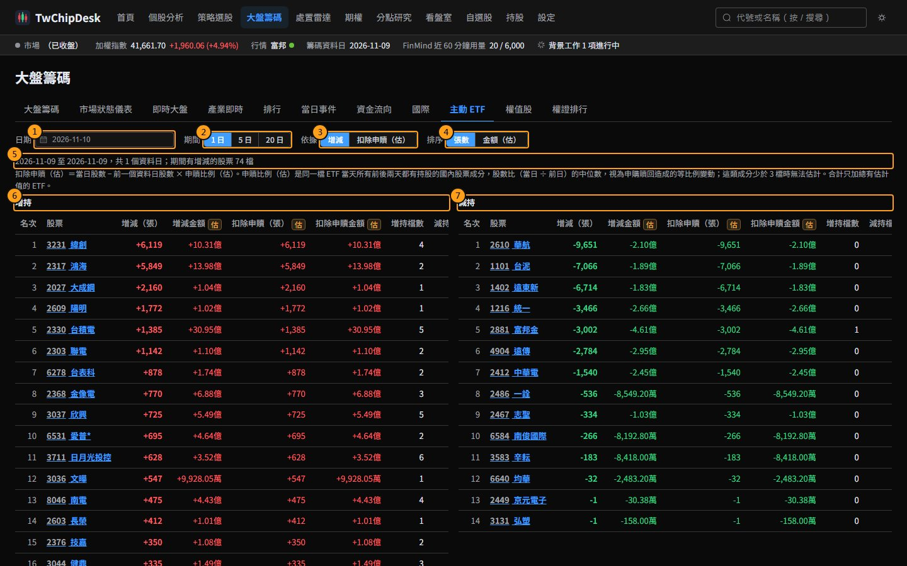
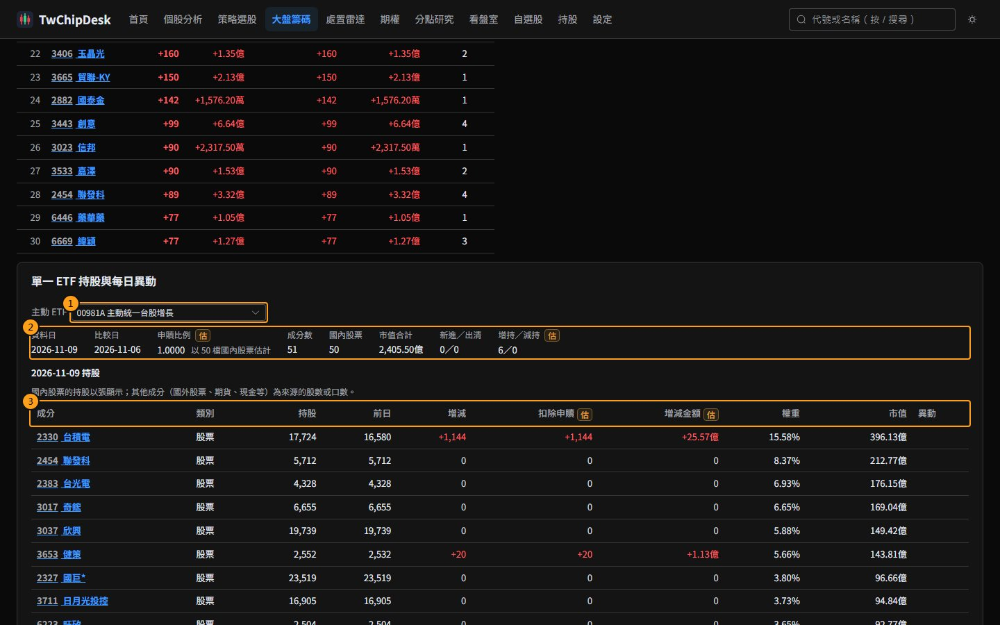
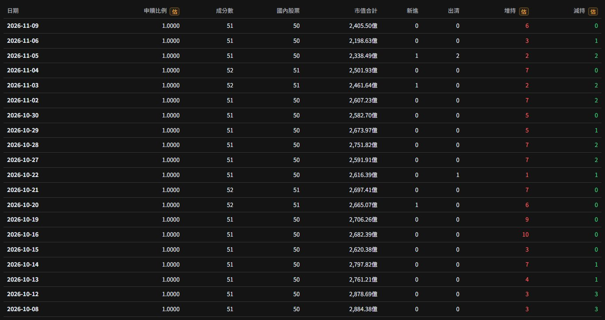

<!-- routes: /market?tab=activeEtf -->
# 大盤籌碼｜主動 ETF

> 位置：頂部選單「大盤籌碼」→「主動 ETF」分頁（網址 `/market?tab=activeEtf`；指定某檔 ETF 時為 `/market?tab=activeEtf&etf=00981A`）
> 資料更新：每個交易日 21:20（主動式 ETF 每日公布的持股），資料從 2025-05-05 起

## 這個功能可以做什麼
主動式 ETF 每天公布持股，這一頁把全部主動 ETF 的持股變化加總到個股：哪些股票被主動 ETF 增持最多、減持最多，有幾檔 ETF 同時增持或減持；並可選一檔主動 ETF 看它的全部成分、當日增減與最近 20 個資料日的異動。

ETF 有投資人申購、贖回時，所有成分會一起等比例增減。「扣除申贖（估）」把這部分估算後扣掉，比較接近經理人主動調整的部位。

## 畫面說明

| 編號 | 名稱 | 說明 |
|---|---|---|
| 1 | 日期 | 預設今天（取最新資料日）；可選過去的日子 |
| 2 | 期間 | 「1 日」「5 日」「20 日」，以資料日計 |
| 3 | 依據 | 「增減」（原始股數變化）或「扣除申贖（估）」 |
| 4 | 排序 | 「張數」或「金額（估）」 |
| 5 | 期間摘要 | 例如「2026-11-09 至 2026-11-09，共 1 個資料日；期間有增減的股票 74 檔」；資料日不足時另註「資料只有 n 個資料日（要求 m 日）」 |
| 6 | 增持表 | 合計增持最多的股票，依所選依據與排序 |
| 7 | 減持表 | 合計減持最多的股票 |

### 增持、減持表的欄位
| 欄位 | 說明 |
|---|---|
| 「名次」 | 依所選依據與排序的名次 |
| 「股票」 | 點擊開啟個股頁的「籌碼明細｜主動 ETF」；期間有分割、減資等事件的股票標「股數事件」 |
| 「增減（張）」「增減金額」（估） | 原始股數變化（張）與金額 |
| 「扣除申贖（張）」「扣除申贖金額」（估） | 扣除申贖後的變化 |
| 「增持檔數」「減持檔數」 | 期間內增持、減持這檔股票的主動 ETF 檔數 |
| 「持有檔數」「合計持股（張）」 | 目前持有這檔股票的主動 ETF 檔數與合計張數 |

欄名可點排序；減持表第一次點增減欄時依減少最多的在前。

### 單一 ETF 持股與每日異動

| 編號 | 名稱 | 說明 |
|---|---|---|
| 1 | 主動 ETF | 選擇一檔主動 ETF（可輸入代號或名稱搜尋）；選擇會寫進網址的 `etf=` |
| 2 | 摘要 | 「資料日」「比較日」「申贖比例」（估，註明以幾檔國內股票估計）、「成分數」「國內股票」「市值合計」「新進／出清」「增持／減持」 |
| 3 | 持股表 | 「某日 持股」：全部成分，國內股票在前、依市值由大到小；欄位為成分、類別、持股、前日、增減、扣除申贖、增減金額、權重、市值、異動（「新進」「出清」「股數事件」）。可點欄名排序 |

持股表下方是「每日異動」：最近 20 個資料日（由新到舊）的申贖比例、成分數、國內股票、市值合計、新進、出清、增持、減持檔數。

國內股票的持股以張顯示並可點到個股頁；其他成分（國外股票、期貨、現金等）沒有股票代號，顯示來源的股數或口數。

## 操作步驟
1. 選期間與依據，看增持、減持表。
2. 想看金額大小時把排序切成「金額（估）」。
3. 點股票到個股頁，看各主動 ETF 對這檔股票的持股變化。
4. 往下在「主動 ETF」選一檔，看它的全部持股與每日異動。

## 欄位與名詞
- **申贖比例（估）**：同一檔 ETF 當天所有前後兩天都有持股的國內股票成分，股數比（當日 ÷ 前日）的中位數；大於 1 代表淨申購、小於 1 代表淨贖回，沒有申贖的日子接近 1。少於 3 檔時無法估計。
- **扣除申贖（估）**：當日股數 − 前一個資料日股數 × 申贖比例（估）。合計只加總有估計值的 ETF。
- **增減金額（估）**：增減股數 × 當日收盤價；沒有收盤價時用該成分的市值 ÷ 股數。期間合計為每日金額相加。
- **增持／減持檔數**：以扣除申贖（估）判斷，為正算增持、為負算減持；申贖比例無法估計時以增減股數判斷。
- **股數事件**：比較期間有分割、反分割、面額變更、配股或減資，增減含這些事件造成的股數變動（未換算）。
- **市值缺漏**：來源沒有提供市值的股票成分，市值顯示「—」，市值合計不含它們，摘要另註「不含 n 檔來源沒有提供市值的股票」。

## 資料來源與更新時間
FinMind 的主動式 ETF 清單與每日持股，每個交易日 21:20 抓取；資料從 2025-05-05 起。

## 注意事項與限制
- 這個功能可在設定頁「籌碼參數」關閉；關閉時只顯示「主動 ETF 持股功能目前關閉，可在設定頁「籌碼參數」開啟。」
- 剛開始回補時可能還沒有資料，畫面顯示「還沒有主動 ETF 持股資料」。
- 只有持股資料，沒有交易明細；同一天先買後賣不會出現在增減中。

## 相關功能
- [個股分析](../stock/README.md)：籌碼明細的「主動 ETF」子分頁
- [權值股](index-weight.md)
