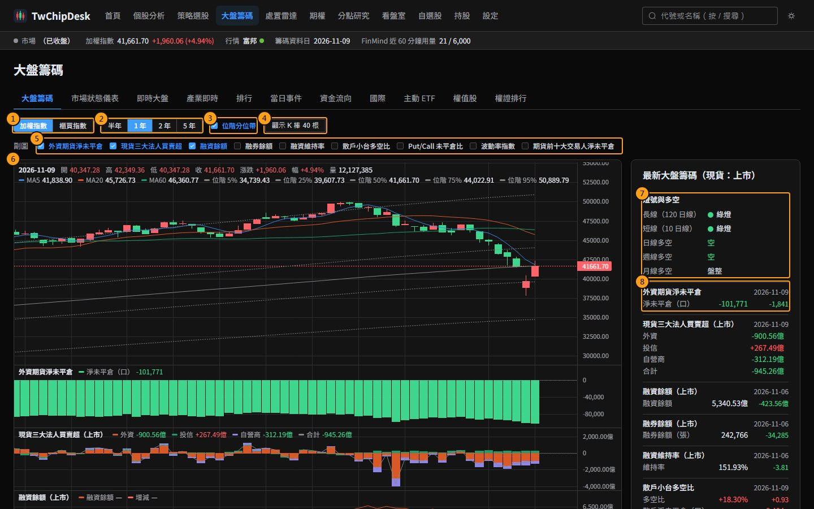

<!-- routes: /market, /market?tab=chips -->
# 大盤籌碼｜大盤籌碼

> 位置：頂部選單「大盤籌碼」→「大盤籌碼」分頁（網址 `/market?tab=chips`，也是 `/market` 的預設分頁）
> 資料更新（交易日）：指數日 K 盤中今天那一根每 15 秒更新（盤中值），收盤後（13:40 收盤快照、17:35 全市場日 K）由正式日資料取代；上市三大法人買賣超 15:05；外資期貨淨未平倉、散戶小台多空比 15:20；期貨前十大交易人 15:30；波動率指數 18:10；上櫃三大法人（個股加總）20:05 後；融資餘額、融券餘額 21:05；融資維持率 22:35

## 這個功能可以做什麼
把加權指數（或櫃買指數）的日 K 和大盤籌碼指標畫在同一張圖：上方是指數 K 線與均線、位階分位帶（盤中會接上今天的 K 棒），下方是可自選的副圖（成交金額、外資期貨淨未平倉、現貨三大法人買賣超、融資餘額等），右側摘要卡列出每項指標的最新值與日變化，以及長短線燈號與日、週、月多空。適合用來比對指數走勢與期現貨籌碼、融資的變化。

## 畫面說明

| 編號 | 名稱 | 說明 |
|---|---|---|
| 1 | 指數 | 「加權指數」或「櫃買指數」。現貨籌碼跟著切換範圍：加權指數看上市、櫃買指數看上櫃；期貨、選擇權、VIX 類的指標兩者相同 |
| 2 | 期間 | 「半年」「1 年」（預設）「2 年」「5 年」 |
| 3 | 位階分位帶 | 勾選後在 K 線上畫出位階 5%、25%、50%、75%、95% 的帶狀線（預設勾選），說明見下方名詞 |
| 4 | 顯示 K 棒 | 圖表一開始與重設視圖時顯示最新幾根 K 棒；與個股 K線籌碼圖共用這個設定 |
| 5 | 副圖 | 勾選要在 K 線下方顯示的指標，可多選；預設為「成交金額（億元）」「外資期貨淨未平倉」「現貨三大法人買賣超」「融資餘額」。「成交金額（億元）」固定排在主圖正下方 |
| 6 | 指數日 K 與副圖 | 上方為指數 K 線、MA5／MA20／MA60 均線與位階分位帶；左上角顯示游標所在日的開高低收、漲跌、量與各線數值。副圖與 K 線同步縮放、捲動；滑鼠停在副圖的某一條線或柱上時，副圖名稱加粗（線與柱的上下順序不變）。盤中最右邊多一根今天的 K 棒（盤中值，見下方注意事項） |
| 7 | 燈號與多空 | 長線（120 日線）、短線（10 日線）燈號，與日線、週線、月線多空 |
| 8 | 指標最新值 | 每項指標一張小卡：資料日、最新值與日變化。標題括號寫出範圍（上市或上櫃）與「估算」等註記 |

圖表下方的「資料說明」（點開）列出每項指標的定義、來源與起始日。

## 操作步驟
1. 選「加權指數」或「櫃買指數」，再選期間。
2. 在「副圖」勾選想看的指標；取消勾選就移除。
3. 在圖上用滑鼠滾輪縮放、拖曳平移；滑過 K 棒可在左上角看當天數值。圖表右下角可重設視圖。
4. 指數、期間、位階分位帶與副圖的選擇記在這台電腦的瀏覽器，下次打開保留。
5. 頁面下方「走勢比較」以目前選的指數為主體（第一張卡），和櫃買指數、ETF、類股指數、族群或國際指數以區間起點 0% 疊圖比較；可選期間、自訂日期或天數、含息切換、左右拖曳。比較清單與個股頁分開記錄。說明見[個股分析｜走勢比較](../stock/compare.md)。

## 欄位與名詞
| 指標 | 說明 |
|---|---|
| 「成交金額（億元）」 | 指數每天的成交金額（億元）：加權指數為上市、櫃買指數為上櫃。柱的顏色依當天 K 棒漲紅跌綠（與個股 K 線的量柱相同）；滑過時左上角另列「成交量（張）」。盤中今天那一根的標題旁標「今天為盤中值」 |
| 「外資期貨淨未平倉」 | 臺股期貨外資的多方減空方未平倉（口）；設定頁「籌碼參數」可加計小台（÷ 4）與微台（÷ 20），預設不加計，加計時標題標「含小台、微台折算」。期貨三大法人資料自 2018-06 起 |
| 「現貨三大法人買賣超」 | 外資、投信、自營商、合計的買賣超金額。上市：證交所公布的上市三大法人金額。上櫃：個股買賣超股數 × 當日成交均價加總的估算（標「估算」）。外資含外資自營商，自營商含自行買賣與避險 |
| 「融資餘額」 | 上市：融資餘額（金額）與增減。上櫃：個股融資餘額加總（張）與張數增減，沒有融資金額 |
| 「融券餘額」 | 融券餘額（張）與增減；上櫃為個股加總 |
| 「融資維持率」 | 上市融資維持率；上櫃沒有這項資料 |
| 「散戶小台多空比」 | 散戶小台淨未平倉（＝ −三大法人小台淨未平倉合計）÷ 小台全市場未平倉量（一般交易時段）。同一個副圖與小卡另有「散戶多空比（含微台）」，見下方名詞 |
| 「Put/Call 未平倉比」 | 臺指選擇權賣權未平倉 ÷ 買權未平倉；選擇權日資料只保留最近約 500 個交易日 |
| 「波動率指數」 | 臺指選擇權波動率指數（每日最後一筆）；來源自 2026-03 起才有資料 |
| 「期貨前十大交易人淨未平倉」 | 臺股期貨所有月份的前十大交易人買方未平倉 − 賣方未平倉 |

- **位階分位帶**：取最近 10 年（設定頁「籌碼參數」的「位階分位帶回看年數」，預設 10）每天「收盤 ÷ 240 日均線 − 1」的分位數，帶狀線＝240 日均線 ×（1＋分位數）。指數在 95% 帶附近代表相對 240 日均線的位置在歷史上偏高，5% 帶附近則偏低。
- **長線燈號**：收盤在 120 日均線之上（含相等）為紅燈，否則為綠燈。長線、短線均線天數可在設定頁「籌碼參數」調整（預設 120 日、10 日）。
- **短線燈號**：最低價在 10 日均線之上為紅燈、最高價在 10 日均線之下為綠燈，其餘為黃燈。
- **散戶多空比（含微台）**：分子 ＝ −三大法人小台淨未平倉合計 ＋（−三大法人微台淨未平倉合計）÷ 5，分母 ＝ 小台全市場未平倉量 ＋ 微台全市場未平倉量 ÷ 5。微台每點 10 元、小台每點 50 元，5 口微台折 1 口小台（與外資期貨淨未平倉「含小台、微台折算」的比例一致）。浮動資訊列另列「散戶淨未平倉（含微台，折小台口）」。微台 2024-07-29 起才有資料，之前沒有值（副圖那一段沒有線、小卡顯示「—」）。市場狀態的成分仍用只算小台的散戶小台多空比。
- **日、週、月多空**：收盤 > 5 均且 5 均 > 20 均為「多」，相反為「空」，其他為「盤整」；週線、月線用週 K、月 K 計算。

## 資料來源與更新時間
| 指標 | 來源 | 更新時間（交易日） |
|---|---|---|
| 指數日 K、成交金額 | 證交所、櫃買中心指數 | 盤中今天那一根每 15 秒更新（與[即時大盤](live.md)的走勢圖同一份資料）；13:40 收盤快照，17:35 全市場日 K |
| 現貨三大法人（上市） | 整體三大法人 | 15:05 |
| 現貨三大法人（上櫃） | 個股三大法人加總（估算） | 20:05 後 |
| 外資期貨淨未平倉、散戶小台多空比、Put/Call 未平倉比 | 期貨、選擇權日資料與三大法人 | 15:20（資料不足時每 10 分鐘重試到 18:30） |
| 期貨前十大交易人淨未平倉 | 期貨大額交易人 | 15:30 |
| 波動率指數 | 臺指選擇權波動率指數 | 18:10 |
| 融資餘額、融券餘額 | 大盤資券（上櫃為個股加總） | 21:05 |
| 融資維持率 | 融資維持率 | 22:35 |

## 注意事項與限制
- 上櫃的歷史只加總系統內現有的股票，並依目前的市場別歸類：已下市、合併或後來轉上市的股票不計，越早的日期涵蓋的股票越少（融資、融券餘額偏低；三大法人買賣超偏差方向不一定）。看長期間的上櫃走勢要留意這個偏差。
- 某項指標在所選期間沒有資料時，副圖標題旁會註明（例如「這段期間沒有資料」「資料自 某日 起」「上櫃沒有資料」）。
- 期貨、選擇權與 VIX 類指標不分上市、上櫃，切換指數時數值相同。
- 盤中今天的 K 棒與成交金額柱是即時大盤走勢的盤中值（加權指數與櫃買指數各自的即時資料，每 15 秒更新，瀏覽器分頁不在前景時暫停）；均線在這一根沒有值，籌碼副圖在這一根留空（籌碼資料收盤後才公布）。收盤後畫面保留盤中那一根，後端寫入當天日 K 後改用正式資料（每 5 分鐘檢查一次）。非交易日與非盤中時段不接，畫面與以前相同。

## 相關功能
- [市場狀態儀表](regime.md)：把趨勢、廣度與籌碼整合成一個分數
- [個股分析｜走勢比較](../stock/compare.md)：走勢比較的完整說明
- [即時大盤](live.md)：盤中的指數走勢與燈號
- [期權](../derivatives/README.md)：期貨、選擇權籌碼的詳細資料
- [設定](../settings.md)：「籌碼參數」的外資期貨淨未平倉是否加計小台、微台、燈號均線天數、位階分位帶回看年數
