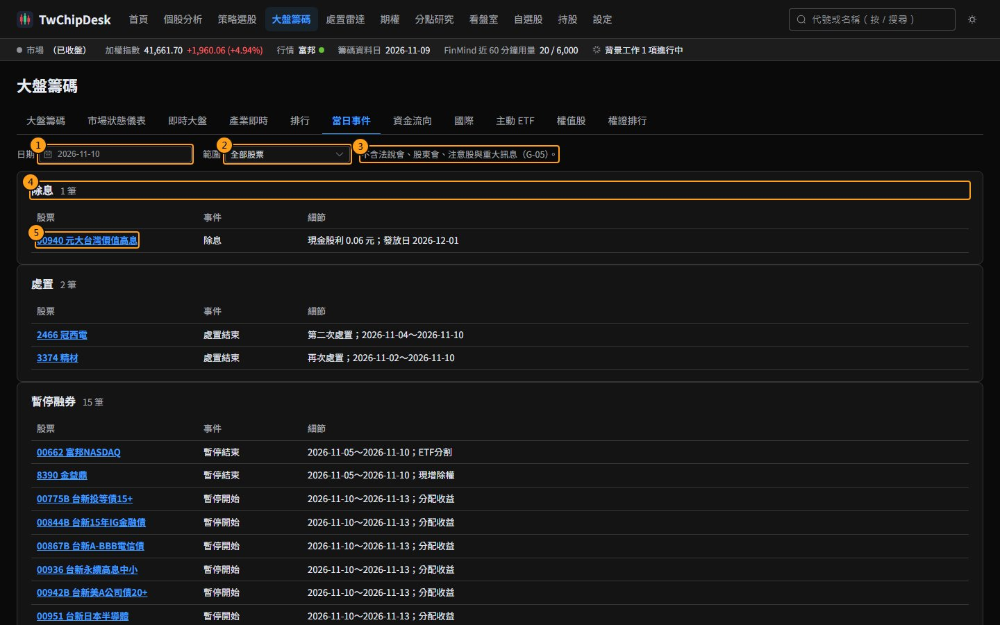

<!-- routes: /market?tab=events -->
# 大盤籌碼｜當日事件

> 位置：頂部選單「大盤籌碼」→「當日事件」分頁（網址 `/market?tab=events`）
> 資料更新：除權息、減資、分割、面額變更、處置、暫停交易、暫停當沖每個交易日 19:00；暫停融券 21:05；營收公告每天 18:30、22:00

## 這個功能可以做什麼
選一個日期，依類別列出那一天的除息、除權、減資恢復買賣、分割與反分割恢復買賣、面額變更恢復買賣、處置開始與結束、暫停交易與恢復交易、暫停融券、暫停先賣後買當沖，以及營收公告。可以只看某個自選股群組，快速確認手上關注的股票當天有沒有會影響股價或交易方式的事件。

## 畫面說明

| 編號 | 名稱 | 說明 |
|---|---|---|
| 1 | 日期 | 預設今天；事件可能預先公告，最遠可選到今天起約一個月後。清除後回到今天 |
| 2 | 範圍 | 「全部股票」（預設）或某個自選股群組 |
| 3 | 不含的事件 | 「不含法說會、股東會、注意股與重大訊息。」 |
| 4 | 事件類別與筆數 | 每一類一個區塊，標題旁為筆數；沒有事件的類別不顯示 |
| 5 | 股票連結 | 點代號名稱開啟該股的 K線籌碼圖 |
| 6 | 「事件的歷史統計與行事曆：個股事件」 | 開啟[個股事件](../events/README.md)：每檔股票每種事件的歷史上漲機率、平均報酬、行事曆與事件回測 |

## 事件類別與細節
| 類別 | 「事件」欄 | 「細節」欄 |
|---|---|---|
| 「除息」 | 除息 | 現金股利（元）、發放日 |
| 「除權」 | 除權 | 股票股利（元） |
| 「減資恢復買賣」 | 減資恢復買賣 | 減資原因、恢復買賣參考價、停止買賣前收盤 |
| 「分割恢復買賣」「反分割恢復買賣」「面額變更恢復買賣」 | 同類別名稱 | 停止買賣前收盤、恢復買賣參考價、開盤競價基準（與參考價不同時） |
| 「處置」 | 「處置開始」或「處置結束」 | 處置原因、處置期間；開始那天另列第幾次與處置條件 |
| 「暫停交易」 | 「暫停交易」或「恢復交易」 | 暫停時列恢復交易日（未定時寫「恢復交易日未定」）；恢復時列暫停期間 |
| 「暫停融券」 | 「暫停開始」或「暫停結束」 | 暫停期間與原因（例如分配收益、現增除權） |
| 「暫停先賣後買當沖」 | 「暫停開始」或「暫停結束」 | 暫停期間與原因 |
| 「營收公告」 | 營收公告 | 某年某月營收與年增率；以資料入庫的日子列入 |

原定日是休市日而順延到這一天的事件，「事件」欄加註「（休市順延）」。

## 操作步驟
1. 選日期（例如想知道下週的除權息，可以直接選下週的日期，只要資料已公布就會列出）。
2. 需要時在「範圍」選自選股群組，只看群組內的股票。
3. 點股票開啟 K線籌碼圖。

## 資料來源與更新時間
| 類別 | 來源 | 更新時間 |
|---|---|---|
| 除權息、減資、分割、面額變更、處置、暫停交易、暫停先賣後買當沖 | FinMind（官方公告資料） | 交易日 19:00 |
| 暫停融券 | FinMind | 交易日 21:05 |
| 營收公告 | 月營收 | 每天 18:30、22:00 |

## 注意事項與限制
- 不含法說會、股東會、注意股與重大訊息。注意股與處置的完整資料見[處置雷達](../disposition/README.md)。
- 營收公告依系統取得資料的日子列入，可能比公司實際公告晚一天。
- 事件資料以來源公布為準；臨時變更（例如臨時休市）可能要到下一次更新才反映。

## 相關功能
- [個股事件](../events/README.md)：事件前後的歷史統計、行事曆與事件回測
- [處置雷達](../disposition/README.md)：注意、處置的推算與統計
- [排行](rankings.md)：量增、值增類會標出區間內有股數變動的股票
- [自選股](../watchlist.md)：建立群組後可在「範圍」選擇
