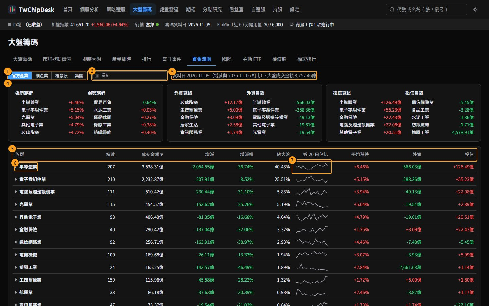
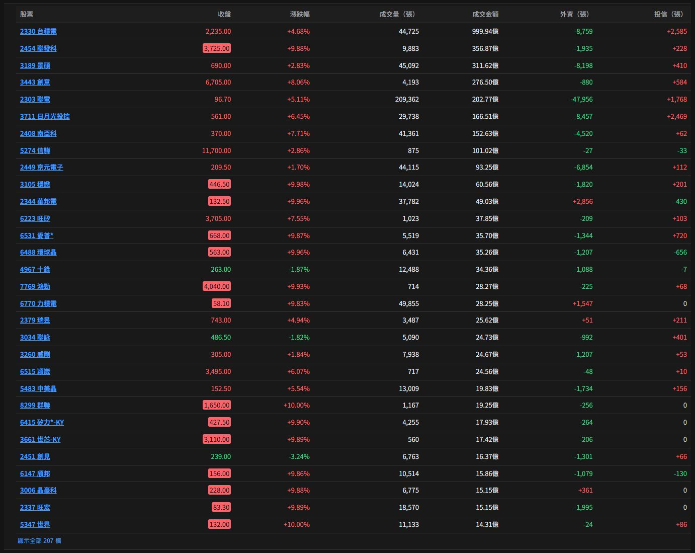

<!-- routes: /market?tab=flow -->
# 大盤籌碼｜資金流向

> 位置：頂部選單「大盤籌碼」→「資金流向」分頁（網址 `/market?tab=flow`）
> 資料更新（交易日）：官方產業、細產業、概念股、集團在 13:40 收盤快照（暫定）與 17:35 全市場日 K 後更新；產業鏈 23:35 後；外資、投信 20:05 後。盤中合併「產業即時」的即時數字，每 15 秒更新

## 這個功能可以做什麼
以族群為單位看資金往哪裡去：每個族群的成交金額、與前一個交易日相比的增減、佔大盤成交金額的比例與近 20 日的佔比走勢、平均漲跌、外資與投信買賣超。上方列出強勢族群、弱勢族群與外資、投信買超與賣超最多的族群（各前 5 名）。族群可以展開看成分股。

## 畫面說明

| 編號 | 名稱 | 說明 |
|---|---|---|
| 1 | 族群分類 | 「官方產業」「細產業」「概念股」「集團」；族群分類外掛沒有啟用時為「官方產業」「產業鏈」並註明「族群分類外掛未啟用，顯示 FinMind 產業鏈」 |
| 2 | 日期 | 預設「最新」；可選過去的日子（不能選未來） |
| 3 | 資料日與大盤成交金額 | 例如「資料日 2026-11-09（增減與 2026-11-06 相比）」與「大盤成交金額」；盤中顯示「盤中 時:分:秒（法人為 月/日）」 |
| 4 | 族群排行卡 | 「強勢族群」「弱勢族群」（依平均漲跌）、「外資買超」「外資賣超」「投信買超」「投信賣超」，各前 5 名 |
| 5 | 族群表 | 每個族群一列，欄位見下表；點欄名可排序 |
| 6 | 展開成分股 | 點族群名稱前的箭頭展開成分股；產業鏈先展開子產業，子產業再展開成分股 |
| 7 | 近 20 日佔比 | 這個族群最近 20 個交易日佔大盤成交金額比例的小走勢圖 |

### 族群表的欄位
| 欄位 | 說明 |
|---|---|
| 「族群」 | 族群名稱 |
| 「檔數」 | 成分股數（只計普通股） |
| 「成交金額」 | 族群成分股的成交金額合計 |
| 「增減」「增減幅」 | 與前一交易日相比的成交金額增減；盤中為預估全日成交金額與前一交易日相比 |
| 「佔大盤」 | 成交金額 ÷ 大盤成交金額 |
| 「近 20 日佔比」 | 最近 20 個交易日的佔大盤比例走勢 |
| 「平均漲跌」 | 成分股漲跌幅的簡單平均 |
| 「外資」「投信」 | 族群成分股的買賣超金額合計（估） |

預設依成交金額由大到小排序；點欄名切換（再點一次反向、第三次恢復預設），排序記在瀏覽器。族群分類外掛的分類中，成員少於 3 檔的族群排在最後，也不列入上方的排行卡。

### 展開的成分股

成分股依成交金額排序，欄位為「股票」「收盤」「漲跌幅」「成交量（張）」「成交金額」「外資（張）」「投信（張）」；收盤當天曾碰到漲跌停時，收盤左邊加「漲停」「曾漲停」「跌停」「曾跌停」或「曾漲跌停」小標記；成分股多時先列前 30 檔，點「顯示全部 n 檔」列出全部。點股票開啟 K線籌碼圖。

工具列最右邊的「匯出 CSV」把族群表目前的列與順序存成 CSV 檔（不含展開的子產業、成分股與「近 20 日佔比」小圖）；金額單位為元，法人買賣超金額為估算。檔名為「資金流向_分類_資料日.csv」；盤中合併即時資料時匯出的是按下當下的快照，檔名後面加上時間（例如 `_1032`），增減與增減幅的欄名加「（估）」。數值不加千分位、不加 % 符號（百分比欄的欄名註明「（%）」），沒有資料的格子空白，估計值的欄名加「（估）」；沒有資料列時按鈕無法按。

## 操作步驟
1. 選族群分類。
2. 看上方排行卡找出強弱與法人買賣超最多的族群。
3. 在族群表點「成交金額」或「增減幅」排序，看資金集中或流出的族群。
4. 點族群展開成分股；要看單一族群的完整資料，從「產業即時」或族群標籤開啟[族群頁](group.md)。
5. 要看過去某一天，選日期。

## 盤中與收盤後
- 日期為「最新」且今天是交易日時，盤中會合併「產業即時」的即時數字，每 15 秒更新並依目前排序重排；滑鼠或鍵盤焦點在表格內時暫停重排。資料日顯示「盤中 時:分:秒」，法人為前一交易日。
- 收盤後到盤後資料寫入之前，保留今天收盤時的數字，資料日顯示「今日收盤（最後更新 時:分:秒…；盤後資料 13:40 後更新）」；產業鏈寫「產業鏈盤後資料 23:35 後更新」。盤後資料寫入後自動改用盤後資料。
- 「增減」欄的說明（滑過欄名）在盤中為「盤中為預估全日成交金額與前一交易日相比」。

## 欄位與名詞
- **法人買賣超金額（估）**：買賣超股數 × 收盤的估算。
- **平均漲跌**：成分股漲跌幅的簡單平均；只計普通股。
- **官方產業**：上市與上櫃名稱不同的產業已合併（例如綠能環保類、綠能環保）。
- **產業鏈**：成交金額、佔比與檔數取自 FinMind 產業鏈資金流向；一檔股票可能屬於多條產業鏈，佔比合計會超過 100%。
- **細產業、概念股、集團**：成交金額由成分股日 K 彙總；一檔股票可以屬於多個族群，佔比加總不是 100%。

## 資料來源與更新時間
| 內容 | 來源 | 更新時間（交易日） |
|---|---|---|
| 官方產業、細產業、概念股、集團的成交金額與漲跌 | 日 K 彙總 | 13:40（暫定）、17:35 |
| 產業鏈 | FinMind 產業鏈資金流向 | 23:35 |
| 外資、投信 | 個股三大法人 | 20:05 後 |
| 盤中 | 產業即時的即時彙總 | 每 15 秒 |

族群成員：細產業、概念股、集團每週六 08:00 更新（族群分類外掛，資料來源玉山證券）；產業鏈每週日 08:00 更新。

## 注意事項與限制
- 產業鏈的盤後資料在 23:35 後才有今天的值，晚上看產業鏈時，今天的數字可能還是收盤時的盤中彙總。

## 相關功能
- [產業即時](sectors.md)：盤中族群強弱、熱力圖與族群異動
- [族群頁](group.md)
- [排行](rankings.md)：個股層級的法人與量值排行
