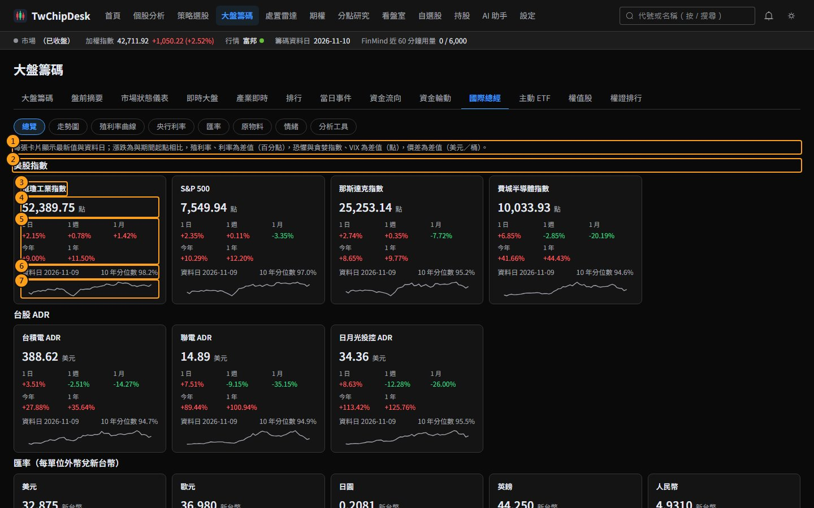
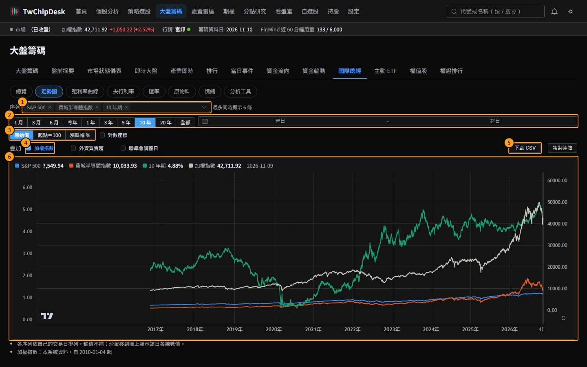
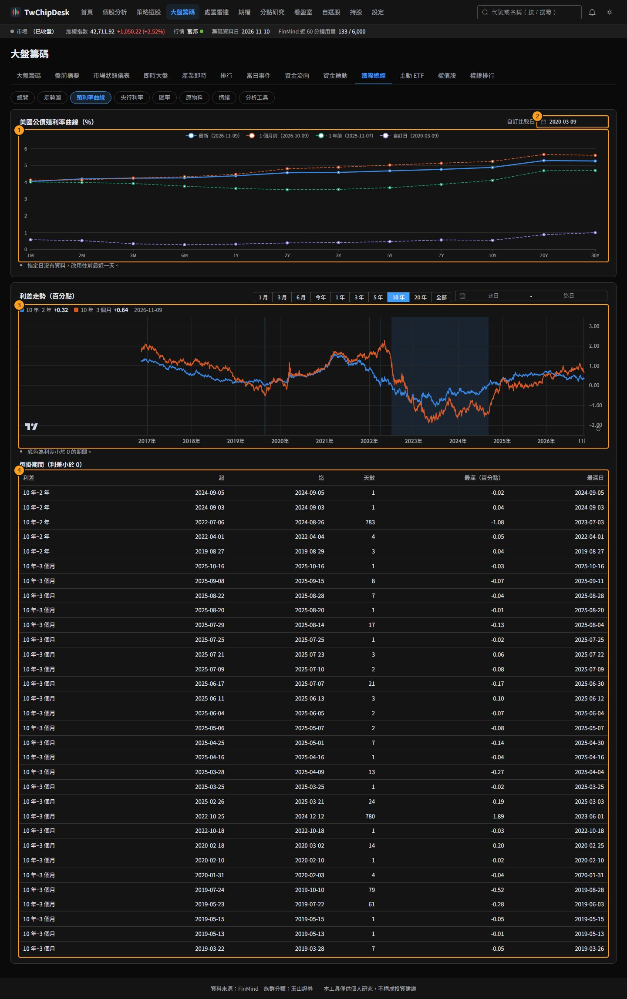
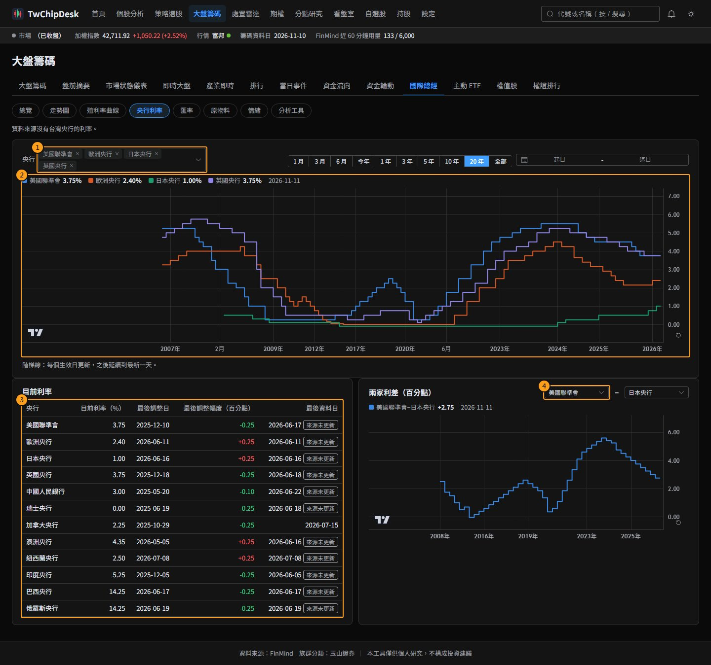
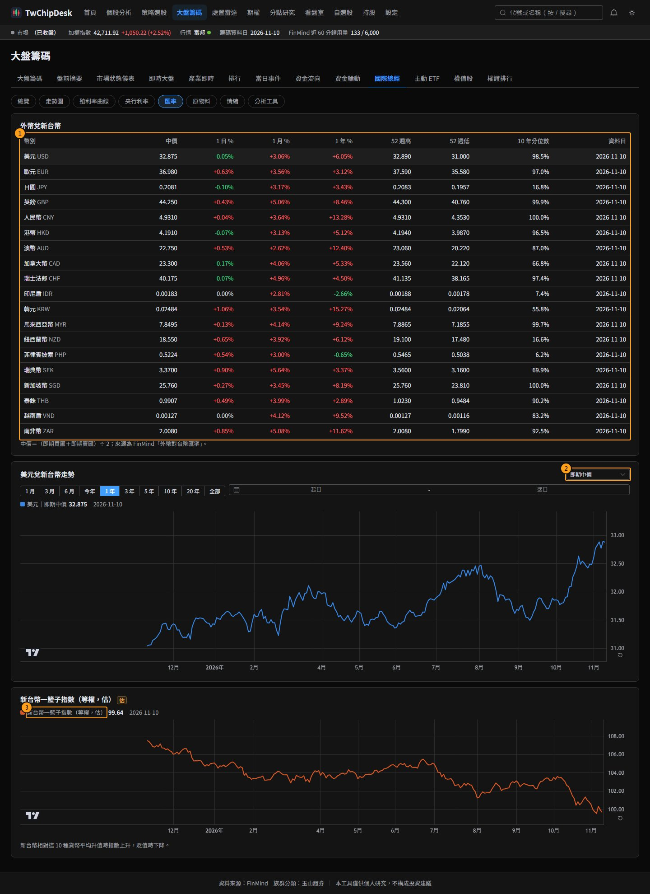
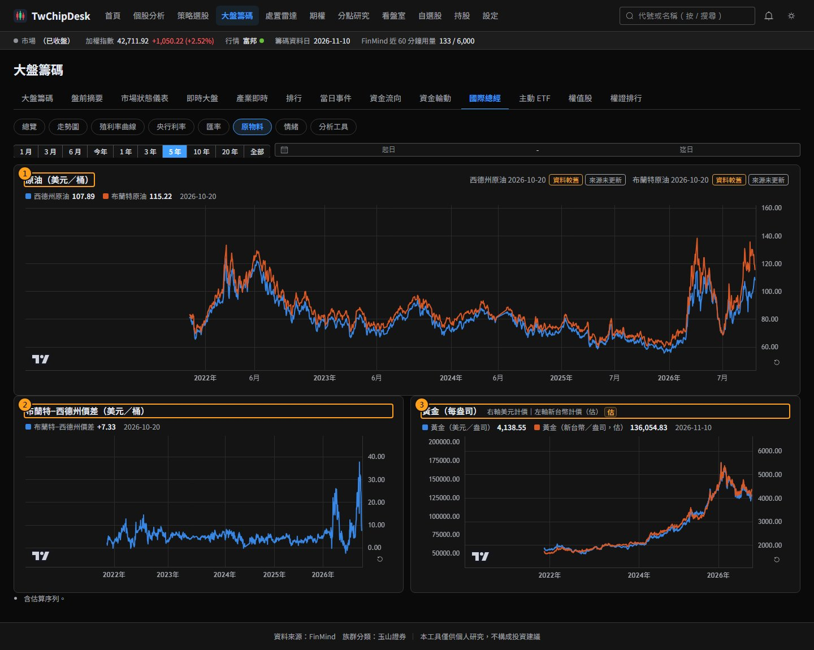
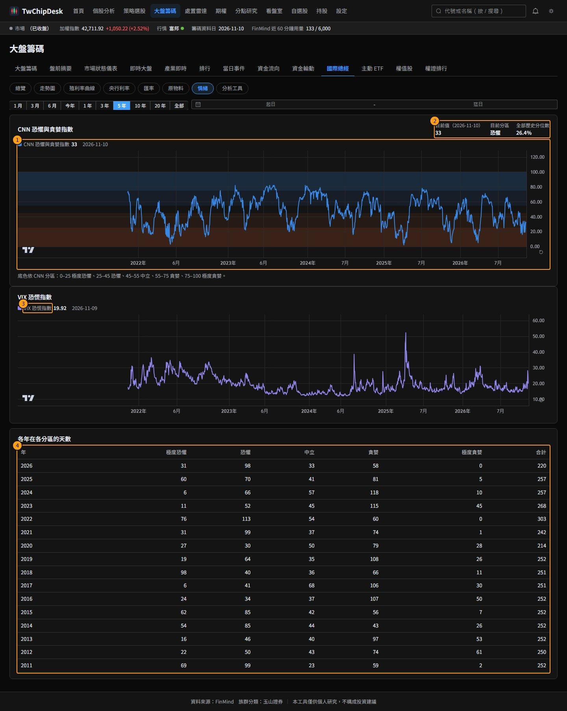
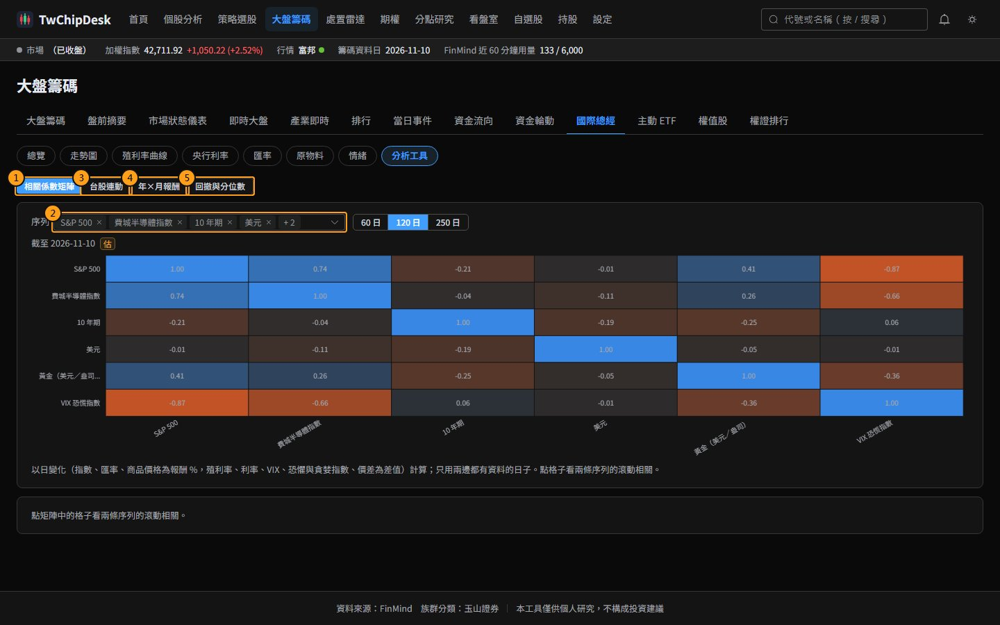

<!-- routes: /market?tab=global, /market?tab=global&view=chart, /market?tab=global&view=curve, /market?tab=global&view=rates, /market?tab=global&view=fx, /market?tab=global&view=commodities, /market?tab=global&view=sentiment, /market?tab=global&view=analysis -->
# 大盤籌碼｜國際總經

> 位置：頂部選單「大盤籌碼」→「國際總經」分頁（網址 `/market?tab=global`；子分頁用 `&view=`）
> 資料更新：每天 07:50（美股還沒拿到時 08:05 再補抓一次）；交易日 08:15 與 08:35 再補抓還沒拿到的代號（來源發布較晚時，可能還沒有前一晚的美股收盤，會晚一個美國交易日）

## 這個功能可以做什麼
把國際總經資料放在同一頁看長期走勢與統計：美股指數與台股 ADR、新台幣匯率（19 種外幣）、各國央行政策利率、原油與黃金、美國公債殖利率（1 個月到 30 年）、CNN 恐懼與貪婪指數與 VIX。資料盡量從各來源最早的一天開始（例如 S&P 500 從 1927 年、聯準會利率從 1982 年、10 年期公債從 1990 年），可以畫走勢、比較殖利率曲線、看相關係數與台股連動的統計。

頁面只列數字與統計，不做判讀；估算的數字與分析工具算出的統計值標「估」。

子分頁（網址的 `view=`）：

| 子分頁 | 網址 | 用途 |
|---|---|---|
| 「總覽」 | `/market?tab=global` | 每個序列一張卡片：最新值、各期間漲跌、10 年分位數、一年小圖 |
| 「走勢圖」 | `&view=chart` | 任選最多 6 條序列畫在同一張圖 |
| 「殖利率曲線」 | `&view=curve` | 美國公債殖利率曲線比較、利差走勢與倒掛期間 |
| 「央行利率」 | `&view=rates` | 12 家央行的利率階梯線、目前利率、兩家利差 |
| 「匯率」 | `&view=fx` | 19 種外幣兌新台幣的表與走勢、新台幣一籃子指數（估） |
| 「原物料」 | `&view=commodities` | 西德州與布蘭特原油、價差、黃金（美元與新台幣計價） |
| 「情緒」 | `&view=sentiment` | 恐懼與貪婪指數（分區底色）、VIX、各年分區天數 |
| 「分析工具」 | `&view=analysis` | 相關係數矩陣、台股連動、年×月報酬、回撤與分位數 |

各子分頁的設定（序列、區間、顯示方式等）都寫在網址裡，重新整理或把網址傳給別人都會看到同一個畫面。

## 總覽

| 編號 | 名稱 | 說明 |
|---|---|---|
| 1 | 說明 | 漲跌的計算方式 |
| 2 | 群組 | 「美股指數」「台股 ADR」「美國公債殖利率（%）」「央行利率（%）」「匯率（每單位外幣兌新台幣）」「原物料」「市場情緒」 |
| 3 | 名稱 | 點名稱會在「走勢圖」開啟這個序列 |
| 4 | 最新值 | 最新一筆的數值與單位；估算序列旁有「估」；恐懼與貪婪指數另標分區（例如「恐懼」） |
| 5 | 各期間漲跌 | 「1 日」「1 週」「1 月」「今年」「1 年」；卡片較窄時分兩列（1 日、1 週、1 月一列，今年、1 年一列） |
| 6 | 資料日與分位數 | 「資料日 …」與「10 年分位數」 |
| 7 | 一年小圖 | 最近一年每週最後一筆的走勢 |

- 漲跌：指數、價格、匯率為百分比；殖利率、央行利率為差值（百分點）；恐懼與貪婪指數與 VIX 為差值（點）；布蘭特−西德州價差為差值（美元／桶）。「1 日」對前一個資料日；「1 週」「1 月」「1 年」對 7、30、365 天前當天或之前最近的資料日；「今年」對去年最後一個資料日。
- 「10 年分位數」：最新值在近 10 年日資料中的位置（小於或等於最新值的比例）；資料少於 250 筆時不顯示。
- 央行利率的卡片：數值為目前利率，日期為最後一次調整日（利率真的改變的日子），另列「最後調整 …（± 百分點）」；來源最後一列早於今天超過 120 天時標「來源未更新」。
- 標籤「資料較舊」：最新資料日距今超過 10 天（央行利率不標）。標籤「來源未更新」：來源本身延遲或停更（原油現貨價、央行利率）。
- 手機上卡片排成一欄。

## 走勢圖

| 編號 | 名稱 | 說明 |
|---|---|---|
| 1 | 序列 | 依群組選序列，最多 6 條（「最多同時顯示 6 條」） |
| 2 | 區間 | 「1 月」「3 月」「6 月」「今年」「1 年」「3 年」「5 年」「10 年」「20 年」「全部」，或右邊選起日與迄日 |
| 3 | 顯示方式 | 「原始值」「起點＝100」「漲跌幅 %」；「對數座標」（漲跌幅時不能用；有小於或等於 0 的值的刻度維持一般刻度，下方會註明是哪幾條） |
| 4 | 疊加 | 「加權指數」「外資買賣超」（本系統資料）、「聯準會調整日」標記 |
| 5 | 下載與分享 | 「下載 CSV」「複製連結」 |
| 6 | 圖 | 滑鼠移到圖上，上方列出那一天各線的數值；右下角按鈕重設縮放。滑鼠停在某一條線上時，上方圖例的名稱加粗；圖上都是線時那一條也畫到最上層（疊加「外資買賣超」柱時上下順序不變，柱不會蓋住線） |

- 「平滑曲線」：圖上每條線都是月資料或季資料（相鄰兩點大多相隔 25 天以上）時，圖例最右邊多一個「平滑曲線」勾選框，預設不勾。勾選後各期之間改用平滑的曲線連接，圖例下方同時顯示一行小字「曲線段只是各期數值之間的視覺連接，不是實際資料」，階梯線（央行利率）與柱狀不受影響；日、週資料不提供這個選項。**曲線段只是兩期之間的視覺連接，不是實際資料**，數值以各期的點（圖例的數字）為準。

- 單位不同的序列自動分左右軸：第一種單位在右軸、第二種在左軸，第三種以後用不顯示刻度的獨立刻度（看形狀，數值看上方圖例）。「漲跌幅 %」模式下殖利率、利率顯示為相對起點的差值，單位「百分點」，不和 % 放同一軸。
- 「起點＝100」把每條價格類序列在區間第一個有值的那天設成 100；「漲跌幅 %」是相對那一天的漲跌。殖利率、利率、恐懼與貪婪指數、VIX、價差這類數值不換算成 100：「起點＝100」照原始值畫，「漲跌幅 %」畫成相對起點的差值。
- 選了匯率時多一個「匯率價格」：「即期中價」（預設）、「即期買匯」「即期賣匯」「現金買匯」「現金賣匯」「即期買賣價差」。
- 各序列依自己的交易日排列（美股、匯率、台股的休市日不同），缺值不補。區間很長時圖上改用週資料（點數超過 5,000）或月資料（超過 20 年），畫面下方會註明；統計仍用日資料算。
- 「加權指數」「外資買賣超」是本系統的資料，下方註明「本系統資料，自 … 起」；外資買賣超（上市，億元）畫成柱狀，一律顯示每天的原始值，不隨顯示方式換算。
- 「聯準會調整日」在第一條線上標出區間內聯準會每次調整與調整後利率。
- 「下載 CSV」下載目前序列與顯示方式的日資料（不降頻），第一欄是日期、之後每欄一個序列代號，空白為缺值。

## 殖利率曲線

| 編號 | 名稱 | 說明 |
|---|---|---|
| 1 | 曲線比較 | 「最新」「1 個月前」「1 年前」三條曲線，x 軸為 1 個月到 30 年的期限 |
| 2 | 自訂比較日 | 多畫一條指定日期的曲線 |
| 3 | 利差走勢 | 「10 年−2 年」「10 年−3 個月」（百分點），底色為 10 年−2 年小於 0 的期間 |
| 4 | 倒掛期間 | 利差小於 0 的連續期間：起、迄、天數、最深（百分點）、最深日 |

- 「1 個月前」「1 年前」以最新資料日往前 30、365 天計；那天沒有資料時用往前最近一天（最多 10 天），圖例會寫出實際的日期。
- 倒掛期間在日資料上計算；還沒結束的一段「迄」顯示「至今」。天數為日曆天（含頭尾）。

## 央行利率

| 編號 | 名稱 | 說明 |
|---|---|---|
| 1 | 央行 | 多選要畫的央行（預設美國聯準會、歐洲央行、日本央行、英國央行） |
| 2 | 階梯線 | 每個生效日更新，之後延續到最新一天 |
| 3 | 目前利率 | 12 家央行的「目前利率（%）」「最後調整日」「最後調整幅度（百分點）」「最後資料日」 |
| 4 | 兩家利差 | 任選兩家（不能選同一家），畫出前者減後者的利差（百分點）；利差查不到時只有這一塊顯示錯誤 |

- 12 家：美國聯準會、歐洲央行、日本央行、英國央行、中國人民銀行、瑞士央行、加拿大央行、澳洲央行、紐西蘭央行、印度央行、巴西央行、俄羅斯央行。
- 「最後調整日」「最後調整幅度」只算利率真的改變的日子（來源也有利率沒變的會議列，不算調整）。「最後資料日」是來源最後一列（含利率沒變的會議）的日期；早於今天超過 120 天時標「來源未更新」（目前來源的央行利率停在 2026 年 6 月中）。
- 資料來源沒有台灣央行的利率，畫面也有註明。

## 匯率

| 編號 | 名稱 | 說明 |
|---|---|---|
| 1 | 外幣兌新台幣 | 19 種外幣：「中價」「1 日 %」「1 月 %」「1 年 %」「52 週高」「52 週低」「10 年分位數」「資料日」；點一列在下方畫該幣別 |
| 2 | 走勢 | 選幣別的走勢；右上角切換價格種類 |
| 3 | 新台幣一籃子指數（等權，估） | 新台幣相對 10 種貨幣的等權指數 |

- 19 種外幣：美元、歐元、日圓、英鎊、人民幣、港幣、澳幣、加拿大幣、瑞士法郎、印尼盾、韓元、馬來西亞幣、紐西蘭幣、菲律賓披索、瑞典幣、新加坡幣、泰銖、越南盾、南非幣。數值為 1 單位外幣兌新台幣。
- 中價＝（即期買匯＋即期賣匯）÷ 2；某天沒有即期價時用現金買匯與現金賣匯的中價。
- 新台幣一籃子指數（估）：美元、歐元、日圓、人民幣、港幣、韓元、英鎊、澳幣、新加坡幣、瑞士法郎 10 種即期中價，等權鏈式計算，第一天＝100。新台幣相對這 10 種貨幣平均升值時指數上升。這是本系統的估算，不是官方指數。
- 「盤前摘要」的匯率仍用即期賣匯，和這裡的中價不同。

## 原物料

| 編號 | 名稱 | 說明 |
|---|---|---|
| 1 | 原油 | 西德州原油與布蘭特原油現貨價（美元／桶）；來源延遲時旁邊標「來源未更新」 |
| 2 | 價差 | 布蘭特−西德州（美元／桶），兩邊同一天都有價格才有 |
| 3 | 黃金 | 右軸美元計價、左軸新台幣計價（估），每盎司 |

- 新台幣計價黃金（估）＝美元金價 × 同一天（沒有時往前 7 天內最近一天）美元兌新台幣即期中價。
- 黃金來源是盤中多筆資料，本系統以 UTC 日為界（台北時間每天早上 8 點換日）彙整成每天一筆開高低收（當天最後一筆為收盤）。
- 原油現貨價的來源本身通常延遲約一週；目前來源資料停在 2026-10-20。

## 情緒

| 編號 | 名稱 | 說明 |
|---|---|---|
| 1 | 恐懼與貪婪指數 | 0～100；底色依 CNN 分區 |
| 2 | 目前值 | 「目前值」「目前分區」「全部歷史分位數」 |
| 3 | VIX 恐慌指數 | 走勢 |
| 4 | 各年在各分區的天數 | 每年在「極度恐懼」「恐懼」「中立」「貪婪」「極度貪婪」的天數與合計 |

- 分區：小於 25 極度恐懼、25 到小於 45 恐懼、45 到 55 中立、大於 55 到 75 貪婪、大於 75 極度貪婪。
- 恐懼與貪婪指數從 2011-01-03 開始有資料。

## 分析工具

| 編號 | 名稱 | 說明 |
|---|---|---|
| 1 | 工具 | 「相關係數矩陣」「台股連動」「年×月報酬」「回撤與分位數」 |
| 2 | 相關係數矩陣 | 任選 2～12 條序列、「60 日」「120 日」「250 日」視窗；點格子看兩條序列的滾動相關 |
| 3 | 台股連動 | 選一條序列與門檻「±1%」「±2%」「±3%」 |
| 4 | 年×月報酬 | 每年每月的報酬熱力圖與「各月份歷年統計」 |
| 5 | 回撤與分位數 | 「自歷史高點回落（%）」走勢與「各序列的 10 年分位數」表 |

- 相關係數依日變化計算：指數、價格、匯率用日報酬 %，殖利率、利率、VIX、恐懼與貪婪指數、價差用日差值；每一對只用兩邊同一天都有資料的日子，取最後 60／120／250 個；少於 20 個不計算。矩陣出現空白格的原因之一是該序列在視窗內每天的變化都相同（例如利率沒有調整），無法計算相關係數。日變化與前一個資料日相隔超過 10 個日曆日時不算（例如 20 年期公債 1987～1993、30 年期 2002～2006 沒有資料）。滾動相關是每天往前取同樣個數的配對重算；「截至」為矩陣實際用到的最後一個共同資料日。
- 台股連動：所選序列第 t 日的變化，對加權指數 t 之後第一個台股交易日的報酬。顯示散佈圖與迴歸線、「相關係數」「迴歸斜率」「件數」，以及條件統計：所選序列單日 ≥ ＋門檻、≤ －門檻與全部日子時，隔日加權指數報酬的「隔日平均（%）」「隔日中位數（%）」「隔日上漲比例（%）」與件數。殖利率、利率、VIX、恐懼與貪婪指數、價差等差值類序列的 x 軸與門檻是差值（百分點、點或美元／桶），不是百分比。加權指數只有本系統有資料的日子（畫面註明起日）。這些是過去資料的統計，不代表之後會一樣。
- 年×月報酬：每月最後一個資料日對上個月最後一個資料日（殖利率、利率、VIX、恐懼與貪婪指數、價差為差值），最右欄為全年；當月還沒結束也以最新資料日計。年份由新到舊，超過 25 年時右側可捲動。
- 回撤：每天相對至今最高值回落的百分比，標出「最大回撤」（高點、低點與回到高點的日子）與「目前回撤」；只適用指數、價格、匯率類序列（VIX、殖利率、利率、價差等不能選）。
- 這些統計值（相關係數、斜率、條件統計、年×月報酬、回撤、分位數）是本系統以日資料計算的，畫面標「估」。
- 網址裡的代號或日期不合法時（例如目錄沒有的代號、2026-02-30），改用預設值。

## 資料來源與更新時間
| 資料 | 來源（FinMind 資料集） | 最早 |
|---|---|---|
| 美股指數（道瓊、S&P 500、那斯達克、費城半導體）、VIX、台股 ADR | 美股股價（USStockPrice） | S&P 500 為 1927-12-30 |
| 19 種外幣兌新台幣（現金與即期的買匯、賣匯） | 外幣對台幣匯率（TaiwanExchangeRate） | 美元 2006-01-02 |
| 12 家央行政策利率（只有調整日） | 央行利率（InterestRate） | 聯準會 1982-09-27 |
| 美國公債殖利率 12 種期限（1 個月～30 年） | 公債殖利率（GovernmentBondsYield） | 10 年期 1990-01-02 |
| 西德州、布蘭特原油現貨價 | 原油價格（CrudeOilPrices） | 1986-01-02 |
| 黃金 | 黃金價格（GoldPrice），彙整成日資料 | 1970-01-01 |
| CNN 恐懼與貪婪指數 | CnnFearGreedIndex | 2011-01-03 |
| 加權指數、外資買賣超（上市） | 本系統的大盤資料 | 依本系統的回補範圍 |

- 每天 07:50 更新全部代號（從各代號自己的最新資料日往前 7 天抓）；美股指數或 ADR 還沒有前一個美國交易日的資料時，08:05 只補抓那些代號；交易日 08:15、08:35 只補抓還沒拿到最新資料的代號。
- 歷史資料由一次性的回補工作從 1911-01-01 抓起，有多少存多少；各序列實際的第一天見上表。
- 新台幣計價黃金、新台幣一籃子指數是本系統計算的估算值。
- 頁面列出目錄裡的全部序列，但每天抓取的代號依設定頁「清單」區塊「國際」類的清單；從清單移除的代號之後不再更新（舊資料仍會顯示，日期停在移除前，標「資料較舊」）。

## 注意事項與限制
- 全部是日資料（央行利率只有調整日），不是即時報價。
- 各序列的資料日各自顯示；週末、美國假日、台灣假日不會有新資料。
- 來源約在早上 07:30～07:40 才發布前一晚的美股收盤，07:50 還沒有時會在 08:05、08:15、08:35 補抓；都還沒有時看到的是再前一個美國交易日。開盤前的整理見[盤前摘要](preopen.md)。
- 原油現貨價來源停在 2026-10-20，標「來源未更新」。
- 公債殖利率只有美國；資料來源沒有台灣央行的利率。
- 匯率來源為 FinMind「外幣對台幣匯率」。
- 手機上圖一次顯示一張，表格可以左右滑動。
- 「平滑曲線」畫出的兩期之間的曲線不是實際資料，只是讓月、季資料的走勢比較容易看；曲線不會超出相鄰兩點的範圍。

## 相關功能
- [盤前摘要](preopen.md)
- [即時大盤](live.md)
- [設定](../settings.md)
