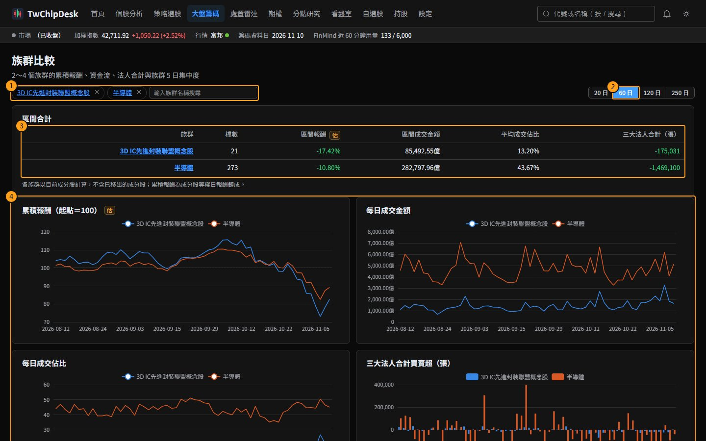

<!-- routes: /market/groups/compare -->
# 大盤籌碼｜族群比較

> 位置：族群頁點「加入比較」後點「開啟族群比較」（網址 `/market/groups/compare?keys=<族群代號>,<族群代號>&days=60`，例如 `/market/groups/compare?keys=concept:<族群代號>,chain:半導體`）
> 資料更新：盤後日 K、主力與法人入庫後；伺服器端快取 5 分鐘（收盤快照與盤後日 K 入庫後立即重新計算；全市場成交值另有依日期的快取，日 K 寫入後更新）

## 這個功能可以做什麼
把 2～4 個族群放在一起比較同一段期間（20／60／120／250 個交易日）的累積報酬、每日成交金額與成交佔比、三大法人合計買賣超與族群 5 日集中度（合計）。比較的族群與期間都寫在網址裡，複製網址就能分享或存成書籤。

## 畫面說明

| 編號 | 名稱 | 說明 |
|---|---|---|
| 1 | 比較的族群 | 目前比較的族群；點名稱開啟族群頁，點 × 移除；未滿 4 個時可在「輸入族群名稱搜尋」輸入名稱加入 |
| 2 | 期間 | 「20 日」「60 日」「120 日」「250 日」（交易日） |
| 3 | 區間合計 | 每個族群的「檔數」「區間報酬」「區間成交金額」「平均成交佔比」「三大法人合計（張）」 |
| 4 | 圖表 | 「累積報酬（起點＝100）」「每日成交金額」「每日成交佔比」「三大法人合計買賣超（張）」「族群 5 日集中度（合計，%）」；寬螢幕兩欄並排，手機一次顯示一張，用上方的按鈕切換 |

## 操作步驟
1. 在族群頁點「加入比較」，對其他族群重複（最多 4 個）。
2. 點「開啟族群比較」；也可以在這一頁直接搜尋加入或移除族群。
3. 切換期間，看累積報酬、資金與法人的數字。
4. 複製網址分享，或加入書籤。

## 欄位與名詞
- **累積報酬（起點＝100）（估）**：成分股等權日報酬一天一天鏈成的合成指數，期間第一天的前一個交易日＝100（與族群頁的族群指數收盤相同算法）。
- **區間報酬（估）**：整段期間的累積報酬（%），與累積報酬線最後一天的位置一致。
- **每日成交金額、成交佔比**：成分股成交金額合計，與佔當日全部普通股成交金額的比例。
- **三大法人合計**：外資、投信、自營商買賣超的合計（張）。
- **族群 5 日集中度（合計）**：近 5 個交易日成分股的主力買賣超合計 ÷ 同期有主力資料的成分股成交量合計 × 100%（把整個族群當成一檔計算，不是各檔集中度的平均）；5 日內任一天沒有主力資料時該日為空白。

## 資料來源與更新時間
- 日 K、主力（分點）與三大法人為盤後入庫的資料；這一頁只用日資料，不含當天盤中。
- 各族群以目前成分股計算，不含已移出的成分股。

## 注意事項與限制
- 少於 2 個族群時不查詢，顯示「至少需要 2 個族群；從族群頁點「加入比較」，或在上方搜尋加入。」。
- 網址超過 4 個族群時只取前 4 個；族群代號格式不對時略過；找不到的族群另外列出。
- 這裡只呈現數字，不做任何判斷。

## 相關功能
- [族群頁](group.md)
- [資金輪動](rotation.md)
- [產業即時](sectors.md)
