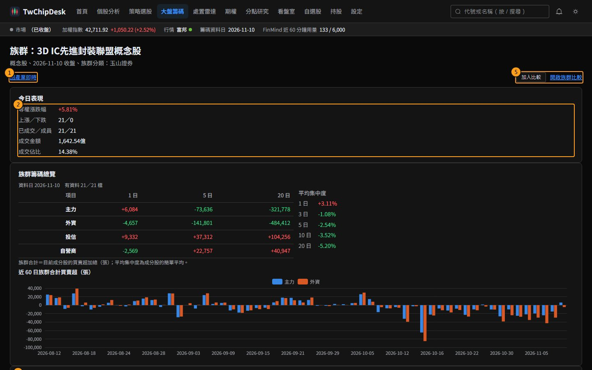
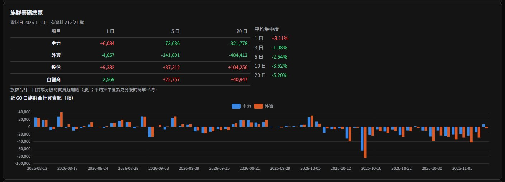
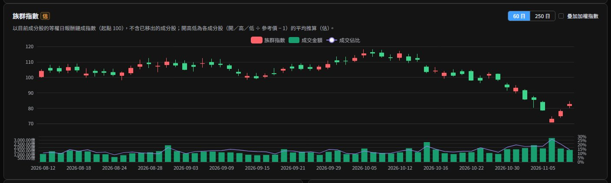
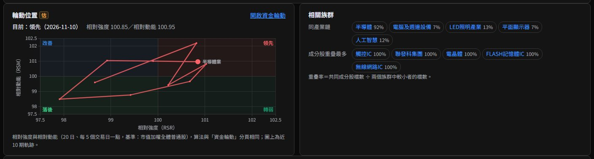
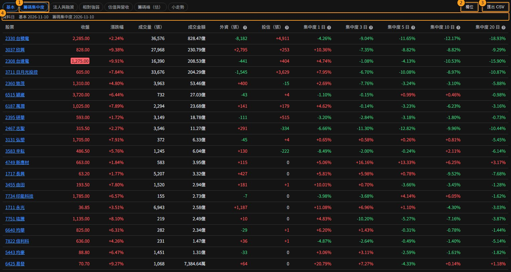
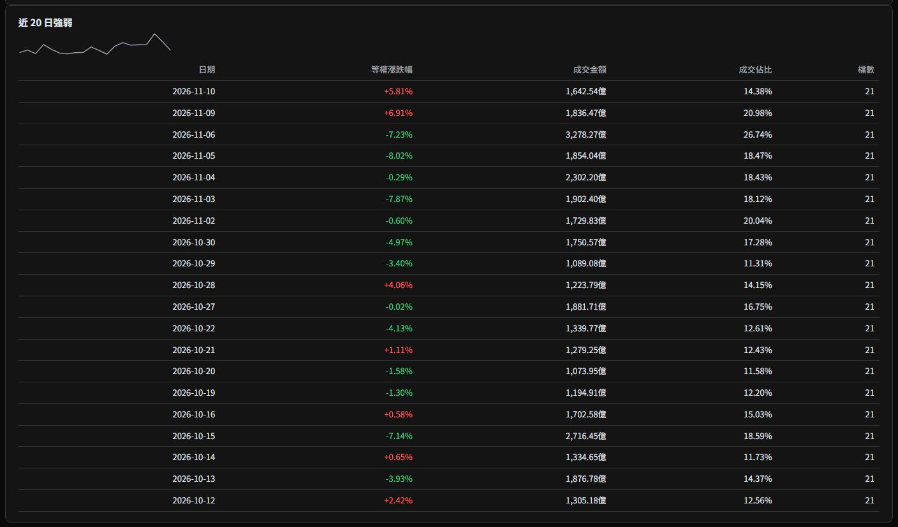

<!-- routes: /market/groups/:key -->
# 大盤籌碼｜族群頁

> 位置：從「產業即時」族群排行展開區、族群異動、熱力圖、「資金輪動」，或個股頁的族群標籤點「族群頁」進入（網址 `/market/groups/<族群代號>`，例如 `/market/groups/concept:<族群代號>`）
> 資料更新：交易日盤中每 15 秒重新查詢今日表現與成分股的基本欄位，族群異動以推播即時加入；收盤後顯示當天收盤狀態。籌碼集中度、法人、相對強弱、估值、籌碼峰等夜間計算的資料，盤中與夜間計算完成前是前一個交易日（表格上方標出各組的資料日）。成員每週更新（細產業、概念股、集團每週六 08:00，產業鏈每週日 08:00）

## 這個功能可以做什麼
一個族群（官方產業、細產業、概念股、集團或產業鏈）的完整資料：今日的等權漲跌幅、漲跌家數、成交金額與佔比；族群合計的主力與法人買賣超、成分股平均籌碼集中度；當日的等權漲跌幅走勢；以目前成分股計算的族群指數日 K；族群在資金輪動象限的位置；相關族群；今日的族群異動紀錄；可自選欄位、可排序、可匯出的成分股表；以及近 20 個交易日的強弱。可以把族群「加入比較」，在[族群比較](group-compare.md)頁並排比較 2～4 個族群。

## 畫面說明

標題為「族群：族群名稱」，下方小字寫出分類、資料日（盤中或收盤），細產業、概念股、集團另註明「族群分類：玉山證券」。

| 編號 | 名稱 | 說明 |
|---|---|---|
| 1 | 回產業即時 | 回到「產業即時」分頁 |
| 2 | 今日表現 | 「等權漲跌幅」「上漲／下跌」「已成交／成員」「成交金額」「成交佔比」；盤中另有「預估成交金額」（估） |
| 3 | 族群走勢 | 「族群走勢（等權漲跌幅）」：當日每分鐘的等權漲跌幅 |
| 4 | 今日異動 | 這個族群今天的急漲、急跌紀錄，可用分類與方向篩選；點一列看變動最大的成員 |
| 5 | 加入比較 | 「加入比較」把這個族群加進比較清單（存在這台電腦的瀏覽器，最多 4 個，滿了會移除最早加入的）；「開啟族群比較」開啟族群比較頁，帶入比較清單與目前的族群；「清除比較清單」清空清單 |

### 族群籌碼總覽

- 上方小字為資料日與「有資料 n／m 檔」（當天有夜間資料的成分股數／成分股數）。
- 表格：「主力」「外資」「投信」「自營商」在「1 日」「5 日」「20 日」的買賣超合計（張），為目前成分股各自數字的加總。
- 「平均集中度」：成分股籌碼集中度 1、3、5、10、20 日的簡單平均（只算有數值的成分股，滑過數字可看是幾檔的平均）。
- 「近 60 日族群合計買賣超（張）」：每天主力與外資買賣超合計的柱狀圖。

### 族群指數

以目前成分股的等權日報酬一天一天鏈成的指數（第一天的前一個交易日＝100），畫成日 K；開、高、低是推算值，標「估」。

- 「60 日」「250 日」切換期間；勾「疊加加權指數」時，以虛線畫出換算到同一起點的加權指數（不含息）。
- 下方副圖：每天成分股成交金額合計（柱）與佔全部普通股成交金額的比例（線）。
- 只用日 K，當天盤中不在圖上（上方「族群走勢」是當天的分鐘走勢）。期間與疊加的選擇記在這台電腦的瀏覽器。

### 走勢比較
以這個族群為主體（第一張卡，含息），和加權指數等其他項目以區間起點 0% 疊圖比較；可選期間、自訂日期或天數、左右拖曳，卡片數字跟著可見區間重算。族群頁的比較清單與個股頁、大盤頁分開記錄。說明見[個股分析｜走勢比較](../stock/compare.md)。

### 輪動位置

這個族群在資金輪動象限（相對強度、相對動能）的目前位置與近 10 期軌跡（族群指數為市值加權，標「估」），上方寫出目前所在的象限與日期。算法與參數和「資金輪動」分頁相同（20 日、每 5 個交易日一點、市值加權、基準為全體普通股）。點圖或「開啟資金輪動」，開啟「資金輪動」分頁（同一分類、軌跡 10 點）。族群不在資金輪動的計算結果中（成分股或資料天數不足）時顯示說明文字。

### 相關族群
三組可點的標籤，點一下切換到那個族群的族群頁：

- 「同產業鏈」：成分股所屬的產業鏈（最多 5 個），滑過標籤可看共同檔數與這些成分股在產業鏈中的子產業。
- 「成分股重疊最多」：其他族群中重疊率最高的前 5 個（至少有 2 檔共同成分股）；只列族群分類外掛的族群（細產業、概念股、集團），族群分類外掛關閉時不顯示。
- 「同官方產業」：成分股所屬的官方產業（最多 5 個）。

標籤旁的百分比為重疊率＝共同成分股檔數 ÷ 兩個族群中較小者的檔數。

### 成分股

| 編號 | 名稱 | 說明 |
|---|---|---|
| 1 | 欄位群組 | 「基本」（含外資、投信當日買賣超，盤中為前一交易日）「籌碼集中度」「法人與融資」「相對強弱」「估值與營收」「籌碼峰（估）」「小走勢」，點一下顯示或隱藏整組；預設顯示「基本」與「籌碼集中度」；「基本」的現價當天曾碰到漲跌停時左邊加「漲停」「曾漲停」「跌停」「曾跌停」或「曾漲跌停」小標記 |
| 2 | 欄位 | 開啟「選擇欄位」：逐欄勾選、上移、下移調整順序，「恢復預設欄位」回到預設；設定記在這台電腦的瀏覽器 |
| 3 | 匯出 CSV | 匯出目前顯示的欄位、目前的排序（數值不加千分位；估算欄的欄名加「（估）」；「近 20 日收盤」小圖不匯出；「月營收年增率」後面另加「營收年月」一欄） |
| 4 | 資料日 | 每個顯示中的欄位群組各自的資料日；借券或量比的資料日不同時另外括號寫出 |

- 點欄名排序（第一次由大到小、再點反向、第三次回到預設的成交金額順序；排名欄第一次由小到大）；空值一律排最後。排序記在這台電腦的瀏覽器；排序中的欄被隱藏時回到預設順序。
- 盤中每 15 秒更新時列不移動；順序和最新數字不同時，表格上方出現「順序已變動・重新排序」，點一下重新排序。手機寬度時表格上方另有排序選單。
- 點股票開啟 K線籌碼圖。成分股超過 200 檔時改用只繪製看得到的列的表格。
- 表格可以左右捲動，股票欄固定在左側。

### 近 20 日強弱

近 20 個交易日的日期、等權漲跌幅、成交金額、成交佔比、檔數；上方另有成交佔比的小走勢圖。

## 操作步驟
1. 在「產業即時」點族群名稱展開，點族群頁連結；或在個股頁點族群標籤再點「開啟族群頁」。
2. 看今日表現、族群籌碼總覽與族群指數，了解族群整體的數字。
3. 往下看成分股：點欄位群組加入要看的欄位，點欄名排序，需要時「匯出 CSV」。
4. 點相關族群的標籤切換到其他族群；點「加入比較」後到族群比較頁並排比較。
5. 網址可以存成書籤，下次直接打開同一個族群。

## 欄位與名詞
- **等權漲跌幅**：當日已成交成員漲跌幅的簡單平均。
- **成交佔比**：族群成交金額佔大盤（普通股）的比例；一檔股票可以屬於多個族群，各族群的佔比加總不是 100%。
- **預估成交金額（估）**：已成交成員的預估成交金額合計（各股＝累計成交金額＋剩餘預估量 × 當日均價），只在盤中顯示。
- **族群異動**：預設為 5 分鐘內等權漲跌幅變動 ≥ 1.0 個百分點、同方向家數 ≥ 60%、至少 3 檔有成交時記錄；同一族群同一方向 15 分鐘內只記一次。
- **集中度 n 日**：n 日主力買賣超 ÷ n 日成交量 × 100%，主力為區間買超前 15 名減賣超前 15 名分點（與策略選股的籌碼集中度相同）；分點資料不足 n 日時為「—」。
- **外資連買、投信連買（日）**：到資料日為止連續買超的天數；前一日不是買超時為 0。
- **外資、投信 5／20 日（張）**：近 5、20 個交易日買賣超合計。**融資 1／5 日增減（張）**：融資餘額的增減。**借券賣量 當日／5 日（張）**：資料日當天、含當天近 5 個交易日的合計。
- **5／20／60 日報酬**：近 n 個交易日的還原報酬（除權息已還原）。**n 日相對族群**：本檔報酬減去族群成分股同期報酬的簡單平均（百分點）。**n 日族群排名**：族群內依報酬由高到低的名次／有報酬的檔數（同值同名次）。
- **本益比、殖利率、股價淨值比**：虧損或不適用時本益比為「—」。**月營收年增率**：最新已公布月營收的年增率，括號內為營收年月。
- **籌碼峰（估）**：依每日換手推算的成本分布模型，不是實際持股。「獲利比例」為成本不高於收盤的占比；「90% 集中度」＝（95 分位 − 5 分位）÷（95 分位 ＋ 5 分位）× 100，數字越小成本越集中；「收盤相對平均成本」＝（收盤 − 模型平均成本）÷ 平均成本 × 100%。
- **近 20 日收盤**：近 20 個交易日收盤的小走勢圖；**5 日量比**：資料日成交量 ÷ 前 5 個交易日平均成交量。
- **族群指數（估）**：開、高、低＝前一日指數 ×（1 ＋ 成分股（開／高／低 ÷ 參考價 − 1）的平均）；收＝前一日指數 ×（1 ＋ 成分股日報酬的平均）；當天沒有成分股成交時沿用前一日。

## 資料來源與更新時間
- 盤中：成員即時報價彙總，每 15 秒更新；分鐘走勢由盤中快照累積，服務未運行的時段沒有資料（顯示「沒有分鐘走勢（服務未運行的時段沒有資料）」）。
- 族群籌碼總覽、成分股的集中度、法人與融資、相對強弱、估值、籌碼峰、量比：夜間計算的資料（主力、法人、日 K 入庫後計算）；近 60 日走勢圖的主力資料在收盤後入庫就會出現，所以最後一天可能比上方的資料日晚。
- 族群指數、近 20 日強弱：盤後日 K 彙總。
- 族群指數、族群籌碼總覽、族群比較的歷史序列都以「目前成分股」計算，不含已移出的成分股。
- 成員：官方產業依股票主檔；細產業、概念股、集團來自族群分類外掛（資料來源玉山證券，每週六 08:00）；產業鏈來自 FinMind（每週日 08:00）。
- 各區塊伺服器端快取 5 分鐘；收盤快照（13:40）與盤後日 K 入庫後立即重新計算。全市場成交值（成交佔比的分母）另有依日期的快取，日 K 寫入後更新。設定頁「清除快取」也會讓族群頁立即重算。

## 注意事項與限制
- 族群代號不存在，或族群分類外掛沒有啟用時，顯示「找不到這個族群，或族群分類外掛未啟用」。
- 欄位選擇、排序、族群指數的期間與比較清單記在這台電腦的瀏覽器，換一台電腦或清除瀏覽器資料後回到預設值。
- 這裡只呈現發生了什麼，不做任何判斷。

## 相關功能
- [族群比較](group-compare.md)
- [個股分析｜走勢比較](../stock/compare.md)
- [產業即時](sectors.md)
- [資金流向](flow.md)
- [資金輪動](rotation.md)
- [個股分析](../stock/README.md)：個股頁的族群標籤
