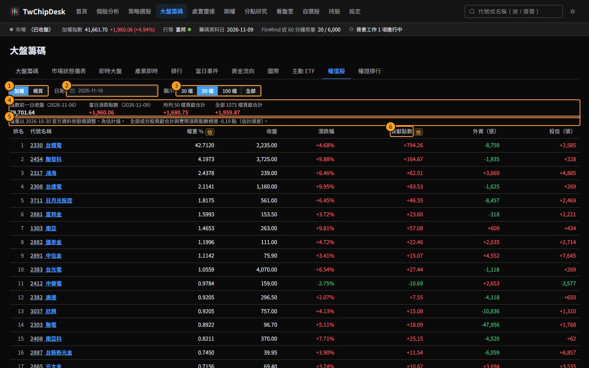

<!-- routes: /market?tab=indexWeight -->
# 大盤籌碼｜權值股

> 位置：頂部選單「大盤籌碼」→「權值股」分頁（網址 `/market?tab=indexWeight`）
> 資料更新：指數權重每個交易日 21:00（上市官方權重每月底一次、上櫃每天）；收盤價與漲跌 17:35 全市場日 K 後；外資、投信 20:05 後

## 這個功能可以做什麼
列出加權指數（或櫃買指數）成分股的權重（估）、收盤、漲跌幅，以及每檔股票對當天指數漲跌貢獻了幾點，另列外資、投信買賣超。適合用來看今天指數的漲跌主要是哪幾檔權值股拉動。

## 畫面說明

| 編號 | 名稱 | 說明 |
|---|---|---|
| 1 | 指數 | 「加權」或「櫃買」 |
| 2 | 日期 | 預設今天（取最近有日 K 的日子）；可選過去的日子 |
| 3 | 顯示筆數 | 「30 檔」「50 檔」（預設）「100 檔」「全部」 |
| 4 | 摘要 | 「指數前一日收盤（日期）」「當日漲跌點數（日期）」「所列 n 檔貢獻合計」「全部 n 檔貢獻合計」 |
| 5 | 權重說明與誤差 | 「權重以 某日 官方資料依股價調整，為估計值。」與「全部成分股貢獻合計與實際漲跌點數相差 n 點（估計誤差）。」 |
| 6 | 貢獻點數 | 這檔股票對當天指數漲跌的貢獻（估） |

### 欄位
| 欄位 | 說明 |
|---|---|
| 「排名」 | 依權重由大到小 |
| 「代號名稱」 | 點擊開啟個股頁的籌碼明細 |
| 「權重 %」（估） | 前一交易日的估計權重 |
| 「收盤」「漲跌幅」 | 當天收盤與漲跌幅（漲跌幅用前一日收盤計算，除息日會含除息造成的跌幅，與指數的算法一致） |
| 「貢獻點數」（估） | 指數前一日收盤 × 權重 ÷ 100 × 漲跌幅 |
| 「外資（張）」「投信（張）」 | 當天的買賣超（外資含外資自營商） |

欄名可點排序（再點一次反向、第三次恢復預設）。

## 操作步驟
1. 選「加權」或「櫃買」與日期。
2. 看摘要：所列幾檔的貢獻合計佔當日漲跌點數多少。
3. 點「貢獻點數」欄名排序，找出拉動或拖累指數最多的股票。

## 欄位與名詞
- **估計權重**：官方公布的指數權重只在特定日子有（上市每月最後一個交易日、上櫃每天），其他日子以最近一次官方權重依各股之後的股價變化調整，所以是估計值。
- **貢獻點數**：指數(前一日) × 權重 ÷ 100 × 漲跌幅，兩位小數；所列合計以不捨入的值相加後再取兩位。
- **估計誤差**：全部成分股的貢獻合計與實際指數漲跌點數的差距，用來判斷估計權重的準確程度。

## 資料來源與更新時間
| 內容 | 來源 | 更新時間（交易日） |
|---|---|---|
| 指數權重 | FinMind 指數權重 | 21:00；上市官方權重每月最後一個交易日、上櫃每天 |
| 收盤、漲跌、指數 | 日 K、指數 | 17:35 |
| 外資、投信 | 個股三大法人 | 20:05 後 |

資料從 2025 年起。

## 注意事項與限制
- 這一天沒有權值股資料時顯示「這一天沒有權值股資料」。
- 估計權重在月中距離官方權重日越遠，誤差可能越大；以摘要的估計誤差為參考。
- 「即時大盤」的「上市權重前 50」「上櫃權重前 50」清單也是依這裡的估計權重排序，不是官方台灣 50 成分股。

## 相關功能
- [即時大盤](live.md)：權重前 50 成分股的盤中漲跌
- [大盤籌碼](chips.md)
