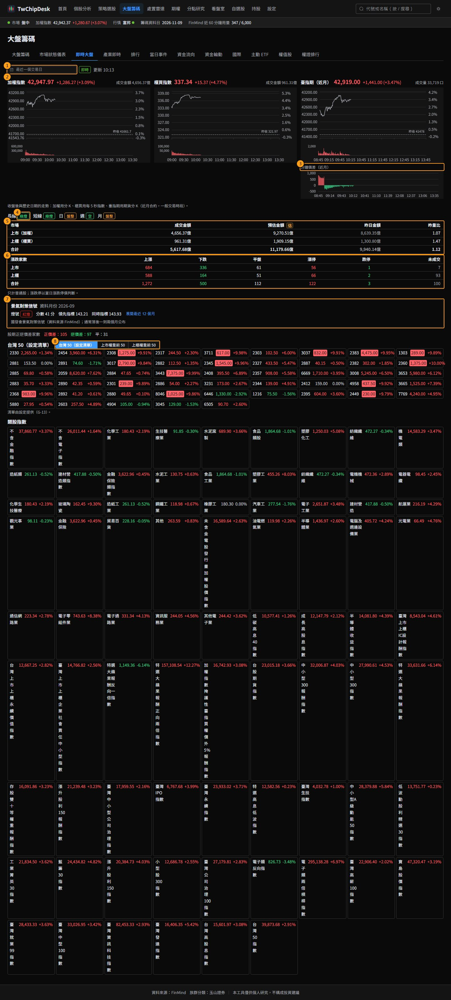

<!-- routes: /market?tab=live -->
# 大盤籌碼｜即時大盤

> 位置：頂部選單「大盤籌碼」→「即時大盤」分頁（網址 `/market?tab=live`）
> 資料更新：交易日盤中即時（推播；走勢圖每 15 秒重新查詢）；收盤後保留當天收盤狀態；景氣對策信號每週六 10:00 更新（月資料）

## 這個功能可以做什麼
盤中一頁看大盤：加權指數、櫃買指數、臺指期（近月）的當日走勢並排，長短線燈號與日、週、月多空，上市、上櫃的成交金額與預估全日成交金額（估），漲跌家數與漲跌停家數，國發會景氣對策信號，以及台灣 50 或權重前 50 名成分股的漲跌一覽與類股指數。收盤後與選擇歷史日期時，可回看那一天的走勢。

## 畫面說明

> 這張圖在非交易時段拍攝，畫面顯示前一個交易日的收盤狀態；盤中會多出即時標記、預估金額、昨量比與類股指數。

| 編號 | 名稱 | 說明 |
|---|---|---|
| 1 | 日期 | 預設「最近一個交易日」（盤中為今天、即時更新）；選擇過去的日期可回看那天的走勢，清除後回到最近一個交易日。右邊顯示連線狀態與「更新 時:分:秒」，非交易時段顯示「非交易時段，顯示 某日 的收盤狀態」 |
| 2 | 三個當日走勢 | 「加權指數」「櫃買指數」「臺指期（近月）」各一張：標題列有最新點數、漲跌、漲跌幅與成交金額（臺指期為成交口數）；圖中虛線為昨收，右軸為漲跌幅，下方為每分鐘量 |
| 3 | 分鐘價差 | 「分鐘價差（近月）」：臺指期近月減加權指數的每分鐘價差（期權功能啟用時才有） |
| 4 | 燈號與多空 | 「長線」「短線」燈號，與「日」「週」「月」多空；滑過可看判斷規則 |
| 5 | 成交金額表 | 上市（加權）、上櫃（櫃買）與合計的「成交金額」「預估金額」（估，盤中才有）、「昨日金額」「昨量比」（盤中才有） |
| 6 | 漲跌家數 | 上市、上櫃、合計的上漲、下跌、平盤、漲停、跌停家數；盤中另有「未成交」 |
| 7 | 景氣對策信號 | 資料月份、燈號、分數、領先指標與同時指標；點「展開最近 12 個月」看每月明細 |
| 8 | 成分股清單 | 「台灣 50（設定清單）」「上市權重前 50」「上櫃權重前 50」切換，下方每格為一檔股票的代號、成交價與漲跌幅 |

盤中另有：
- 「股期正逆價差家數」：個股期貨近月（不含小型與調整後契約）正價差、逆價差、平的家數（期權功能啟用時）。
- 「類股指數」：各類股指數的點數與漲跌幅（只在盤中顯示）。

## 操作步驟
1. 盤中打開即可，數字自動更新，不需要重新整理。
2. 要回看過去某一天：在日期選那一天。歷史日期只顯示三張走勢圖與成分股清單，燈號、成交金額、漲跌家數只在「最近一個交易日」顯示。
3. 切換成分股清單：點「台灣 50（設定清單）」「上市權重前 50」「上櫃權重前 50」，選擇記在瀏覽器。點任一格開啟該股的個股即時頁。
4. 景氣對策信號點「展開最近 12 個月」看每月明細。

## 欄位與名詞
- **燈號**：長線為收盤在 120 日均線之上為紅燈；短線為最低價在 10 日均線之上為紅燈、最高價在 10 日均線之下為綠燈，其餘為黃燈。多空：收盤 > 5 均且 5 均 > 20 均為「多」，相反為「空」，其他為「盤整」。均線天數可在設定頁「籌碼參數」調整。
- **預估金額（估）**：加權指數、櫃買指數各自以目前累計成交金額估算全日成交金額（依各自的日內輪廓與校準；沒有模型時以已過交易時間比例線性換算），收盤後等於全日成交金額。合計為兩個市場預估值相加；某一市場沒有預估值時顯示「—」，不用另一市場代替。
- **昨量比**：預估金額 ÷ 昨日金額（前一交易日成交金額）；合計列為兩市場預估金額合計 ÷ 昨日金額合計。
- **漲跌家數**：只計普通股；漲跌停以當日漲跌停價判斷。
- **台灣 50（設定清單）**：成分股代號由設定頁「清單」區塊提供，沒有設定時顯示「尚未設定成分股清單：請到設定頁「清單」區塊填入台灣 50 成分股代號。」
- **上市（上櫃）權重前 50**：依最新的估計指數權重排序的前 50 名，不是官方台灣 50 成分股（說明見[權值股](index-weight.md)）。
- **景氣對策信號**：國發會的月資料，燈號為「紅燈」「黃紅燈」「綠燈」「黃藍燈」「藍燈」，通常落後一到兩個月公布；不隨畫面選擇的日期改變。

## 資料來源與更新時間
- 盤中：指數、臺指期與個股報價來自盤中行情來源，以推播即時更新；走勢圖每 15 秒重新查詢一次。
- 收盤後與歷史日期的走勢：加權用分 K、櫃買用每 5 秒指數、臺指期用期貨分 K（近月合約，一般交易時段）。
- 景氣對策信號：每週六 10:00 抓取最近 6 個月（FinMind 提供的國發會資料）。
- 指數權重前 50：指數權重每個交易日 21:00 更新。

## 注意事項與限制
- 連線狀態：「即時」表示推播正常；「即時連線中斷，畫面每隔一段時間重新整理」表示推播中斷，畫面改為定時重新查詢。
- 盤中服務停止的時段沒有走勢資料；收盤後會盡量用分 K 補回。
- 預估金額是估計值，開盤初期誤差較大。

## 相關功能
- [大盤籌碼](chips.md)：指數日 K 與大盤籌碼副圖
- [產業即時](sectors.md)：盤中各族群強弱
- [權值股](index-weight.md)：指數權重與貢獻點數
- [首頁](../home.md)：大盤走勢與產業強弱的精簡版
- [設定](../settings.md)：「清單」區塊的台灣 50 成分股代號
